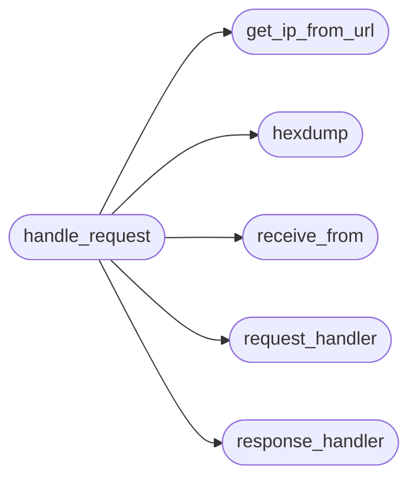

# `contrib.legacy.lazyproxy`

> Source: [contrib/legacy/lazyproxy.py:1](../../contrib/legacy/lazyproxy.py#L1) | language `py` | coverage 0.0% | [API index](../index.md)

## Contents

- **Functions:** [`check_sudo`](#check_sudo), [`signal_handler`](#signal_handler), [`hexdump`](#hexdump), [`receive_from`](#receive_from), [`request_handler`](#request_handler), [`response_handler`](#response_handler), [`get_ip_from_url`](#get_ip_from_url), [`handle_request`](#handle_request), [`start_proxy`](#start_proxy)
- **Constants:** [`BANNER`](#banner)

## Call Graph

Solid arrows stay in this module, dashed arrows leave it.



## Functions

<a id="check_sudo"></a>

### `check_sudo`

`function` | [contrib/legacy/lazyproxy.py:40](../../contrib/legacy/lazyproxy.py#L40)

```python
def check_sudo()
```

---

<a id="signal_handler"></a>

### `signal_handler`

`function` | [contrib/legacy/lazyproxy.py:47](../../contrib/legacy/lazyproxy.py#L47)

```python
def signal_handler(sig, frame)
```

**Parameters**

| Name | Type | Default | Description |
|---|---|---|---|
| `sig` |  |  |  |
| `frame` |  |  |  |

---

<a id="hexdump"></a>

### `hexdump`

`function` | [contrib/legacy/lazyproxy.py:52](../../contrib/legacy/lazyproxy.py#L52)

```python
def hexdump(src, length=16)
```

**Parameters**

| Name | Type | Default | Description |
|---|---|---|---|
| `src` |  |  |  |
| `length` |  | `16` |  |

*Called by:* [`handle_request`](#handle_request), [`main_curses`](contrib.legacy.lazysniff.py.md#main_curses)

---

<a id="receive_from"></a>

### `receive_from`

`function` | [contrib/legacy/lazyproxy.py:63](../../contrib/legacy/lazyproxy.py#L63)

```python
def receive_from(connection)
```

**Parameters**

| Name | Type | Default | Description |
|---|---|---|---|
| `connection` |  |  |  |

*Called by:* [`handle_request`](#handle_request)

---

<a id="request_handler"></a>

### `request_handler`

`function` | [contrib/legacy/lazyproxy.py:77](../../contrib/legacy/lazyproxy.py#L77)

```python
def request_handler(buffer)
```

**Parameters**

| Name | Type | Default | Description |
|---|---|---|---|
| `buffer` |  |  |  |

*Called by:* [`handle_request`](#handle_request)

---

<a id="response_handler"></a>

### `response_handler`

`function` | [contrib/legacy/lazyproxy.py:82](../../contrib/legacy/lazyproxy.py#L82)

```python
def response_handler(buffer)
```

**Parameters**

| Name | Type | Default | Description |
|---|---|---|---|
| `buffer` |  |  |  |

*Called by:* [`handle_request`](#handle_request)

---

<a id="get_ip_from_url"></a>

### `get_ip_from_url`

`function` | [contrib/legacy/lazyproxy.py:87](../../contrib/legacy/lazyproxy.py#L87)

```python
def get_ip_from_url(url)
```

**Parameters**

| Name | Type | Default | Description |
|---|---|---|---|
| `url` |  |  |  |

*Called by:* [`handle_request`](#handle_request)

---

<a id="handle_request"></a>

### `handle_request`

`function` | [contrib/legacy/lazyproxy.py:104](../../contrib/legacy/lazyproxy.py#L104)

```python
def handle_request(client_socket, address)
```

**Parameters**

| Name | Type | Default | Description |
|---|---|---|---|
| `client_socket` |  |  |  |
| `address` |  |  |  |

*Calls:* [`get_ip_from_url`](#get_ip_from_url), [`hexdump`](#hexdump), [`receive_from`](#receive_from), [`request_handler`](#request_handler), [`response_handler`](#response_handler)

---

<a id="start_proxy"></a>

### `start_proxy`

`function` | [contrib/legacy/lazyproxy.py:183](../../contrib/legacy/lazyproxy.py#L183)

```python
def start_proxy()
```

---

## Constants

<a id="banner"></a>

### `BANNER`

`constant` | [contrib/legacy/lazyproxy.py:12](../../contrib/legacy/lazyproxy.py#L12)

```python
BANNER
```

---
