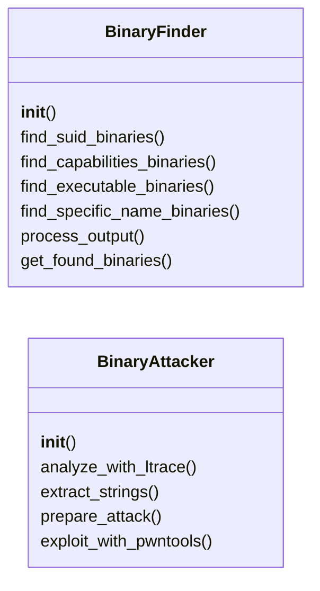
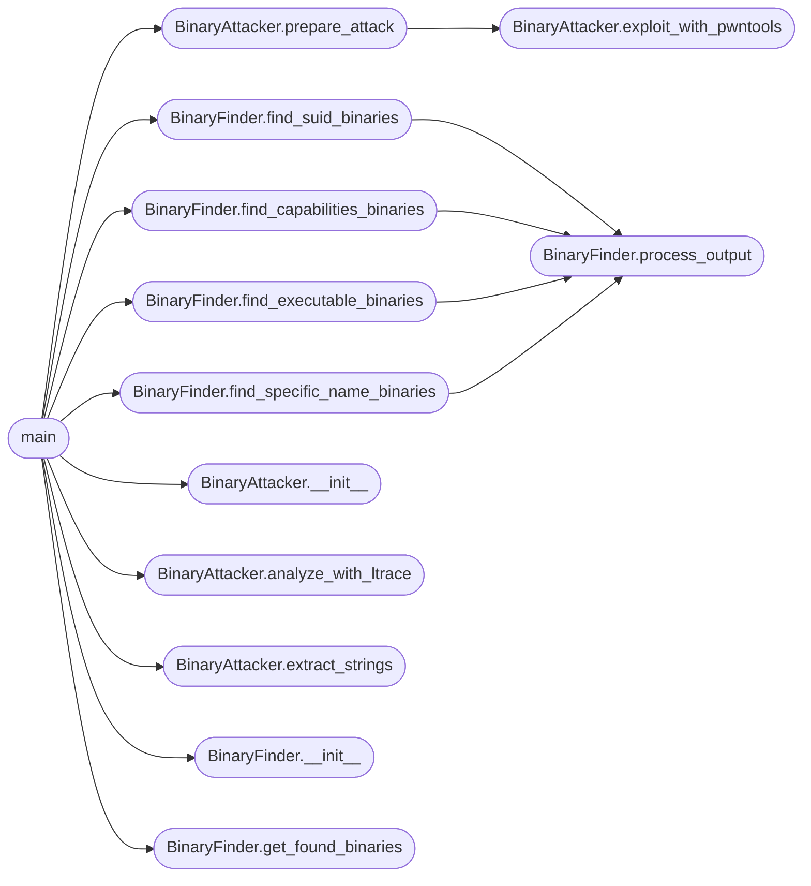

# `contrib.legacy.lazypwn`

> Source: [contrib/legacy/lazypwn.py:1](../../contrib/legacy/lazypwn.py#L1) | language `py` | coverage 0.0% | [API index](../index.md)

## Contents

- **Classes:** [`BinaryFinder`](#binaryfinder), [`BinaryAttacker`](#binaryattacker)
- **Functions:** [`main`](#main)
- **Constants:** [`BANNER`](#banner)

## Type Diagram



## Call Graph

Solid arrows stay in this module, dashed arrows leave it.



## Classes

<a id="binaryfinder"></a>

### `BinaryFinder`

`class` | [contrib/legacy/lazypwn.py:24](../../contrib/legacy/lazypwn.py#L24)

```python
class BinaryFinder
```

**Members**

| Member | Kind | Summary |
|---|---|---|
| [`__init__`](#binaryfinder-__init__) | constructor |  |
| [`find_suid_binaries`](#binaryfinder-find_suid_binaries) | method |  |
| [`find_capabilities_binaries`](#binaryfinder-find_capabilities_binaries) | method |  |
| [`find_executable_binaries`](#binaryfinder-find_executable_binaries) | method |  |
| [`find_specific_name_binaries`](#binaryfinder-find_specific_name_binaries) | method |  |
| [`process_output`](#binaryfinder-process_output) | method |  |
| [`get_found_binaries`](#binaryfinder-get_found_binaries) | method |  |

<a id="binaryfinder-__init__"></a>

#### `BinaryFinder.__init__`

`constructor` | [contrib/legacy/lazypwn.py:25](../../contrib/legacy/lazypwn.py#L25)

```python
def __init__(self)
```

*Called by:* [`main`](#main)

<a id="binaryfinder-find_suid_binaries"></a>

#### `BinaryFinder.find_suid_binaries`

`method` | [contrib/legacy/lazypwn.py:28](../../contrib/legacy/lazypwn.py#L28)

```python
def find_suid_binaries(self)
```

*Calls:* [`BinaryFinder.process_output`](#binaryfinder-process_output)

*Called by:* [`main`](#main)

<a id="binaryfinder-find_capabilities_binaries"></a>

#### `BinaryFinder.find_capabilities_binaries`

`method` | [contrib/legacy/lazypwn.py:36](../../contrib/legacy/lazypwn.py#L36)

```python
def find_capabilities_binaries(self)
```

*Calls:* [`BinaryFinder.process_output`](#binaryfinder-process_output)

*Called by:* [`main`](#main)

<a id="binaryfinder-find_executable_binaries"></a>

#### `BinaryFinder.find_executable_binaries`

`method` | [contrib/legacy/lazypwn.py:44](../../contrib/legacy/lazypwn.py#L44)

```python
def find_executable_binaries(self)
```

*Calls:* [`BinaryFinder.process_output`](#binaryfinder-process_output)

*Called by:* [`main`](#main)

<a id="binaryfinder-find_specific_name_binaries"></a>

#### `BinaryFinder.find_specific_name_binaries`

`method` | [contrib/legacy/lazypwn.py:52](../../contrib/legacy/lazypwn.py#L52)

```python
def find_specific_name_binaries(self, names)
```

**Parameters**

| Name | Type | Default | Description |
|---|---|---|---|
| `names` |  |  |  |

*Calls:* [`BinaryFinder.process_output`](#binaryfinder-process_output)

*Called by:* [`main`](#main)

<a id="binaryfinder-process_output"></a>

#### `BinaryFinder.process_output`

`method` | [contrib/legacy/lazypwn.py:61](../../contrib/legacy/lazypwn.py#L61)

```python
def process_output(self, output)
```

**Parameters**

| Name | Type | Default | Description |
|---|---|---|---|
| `output` |  |  |  |

*Called by:* [`BinaryFinder.find_capabilities_binaries`](#binaryfinder-find_capabilities_binaries), [`BinaryFinder.find_executable_binaries`](#binaryfinder-find_executable_binaries), [`BinaryFinder.find_specific_name_binaries`](#binaryfinder-find_specific_name_binaries), [`BinaryFinder.find_suid_binaries`](#binaryfinder-find_suid_binaries)

<a id="binaryfinder-get_found_binaries"></a>

#### `BinaryFinder.get_found_binaries`

`method` | [contrib/legacy/lazypwn.py:67](../../contrib/legacy/lazypwn.py#L67)

```python
def get_found_binaries(self)
```

*Called by:* [`main`](#main)

---

<a id="binaryattacker"></a>

### `BinaryAttacker`

`class` | [contrib/legacy/lazypwn.py:70](../../contrib/legacy/lazypwn.py#L70)

```python
class BinaryAttacker
```

**Members**

| Member | Kind | Summary |
|---|---|---|
| [`__init__`](#binaryattacker-__init__) | constructor |  |
| [`analyze_with_ltrace`](#binaryattacker-analyze_with_ltrace) | method |  |
| [`extract_strings`](#binaryattacker-extract_strings) | method |  |
| [`prepare_attack`](#binaryattacker-prepare_attack) | method |  |
| [`exploit_with_pwntools`](#binaryattacker-exploit_with_pwntools) | method |  |

<a id="binaryattacker-__init__"></a>

#### `BinaryAttacker.__init__`

`constructor` | [contrib/legacy/lazypwn.py:71](../../contrib/legacy/lazypwn.py#L71)

```python
def __init__(self, binary_path)
```

**Parameters**

| Name | Type | Default | Description |
|---|---|---|---|
| `binary_path` |  |  |  |

*Called by:* [`main`](#main)

<a id="binaryattacker-analyze_with_ltrace"></a>

#### `BinaryAttacker.analyze_with_ltrace`

`method` | [contrib/legacy/lazypwn.py:76](../../contrib/legacy/lazypwn.py#L76)

```python
def analyze_with_ltrace(self)
```

*Called by:* [`main`](#main)

<a id="binaryattacker-extract_strings"></a>

#### `BinaryAttacker.extract_strings`

`method` | [contrib/legacy/lazypwn.py:83](../../contrib/legacy/lazypwn.py#L83)

```python
def extract_strings(self)
```

*Called by:* [`main`](#main)

<a id="binaryattacker-prepare_attack"></a>

#### `BinaryAttacker.prepare_attack`

`method` | [contrib/legacy/lazypwn.py:90](../../contrib/legacy/lazypwn.py#L90)

```python
def prepare_attack(self)
```

*Calls:* [`BinaryAttacker.exploit_with_pwntools`](#binaryattacker-exploit_with_pwntools)

*Called by:* [`main`](#main)

<a id="binaryattacker-exploit_with_pwntools"></a>

#### `BinaryAttacker.exploit_with_pwntools`

`method` | [contrib/legacy/lazypwn.py:170](../../contrib/legacy/lazypwn.py#L170)

```python
def exploit_with_pwntools(self)
```

*Called by:* [`BinaryAttacker.prepare_attack`](#binaryattacker-prepare_attack)

---

## Functions

<a id="main"></a>

### `main`

`function` | [contrib/legacy/lazypwn.py:181](../../contrib/legacy/lazypwn.py#L181)

```python
def main()
```

*Calls:* [`BinaryAttacker.__init__`](#binaryattacker-__init__), [`BinaryAttacker.analyze_with_ltrace`](#binaryattacker-analyze_with_ltrace), [`BinaryAttacker.extract_strings`](#binaryattacker-extract_strings), [`BinaryAttacker.prepare_attack`](#binaryattacker-prepare_attack), [`BinaryFinder.__init__`](#binaryfinder-__init__), [`BinaryFinder.find_capabilities_binaries`](#binaryfinder-find_capabilities_binaries), [`BinaryFinder.find_executable_binaries`](#binaryfinder-find_executable_binaries), [`BinaryFinder.find_specific_name_binaries`](#binaryfinder-find_specific_name_binaries), [`BinaryFinder.find_suid_binaries`](#binaryfinder-find_suid_binaries), [`BinaryFinder.get_found_binaries`](#binaryfinder-get_found_binaries)

---

## Constants

<a id="banner"></a>

### `BANNER`

`constant` | [contrib/legacy/lazypwn.py:5](../../contrib/legacy/lazypwn.py#L5)

```python
BANNER
```

---
