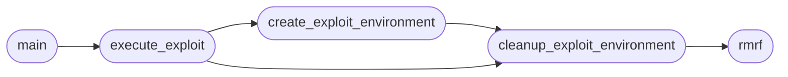

# `contrib.legacy.lazypwnkit`

> Source: [contrib/legacy/lazypwnkit.py:1](../../contrib/legacy/lazypwnkit.py#L1) | language `py` | coverage 66.7% | [API index](../index.md)

## Contents

- **Functions:** [`rmrf`](#rmrf), [`create_exploit_environment`](#create_exploit_environment), [`cleanup_exploit_environment`](#cleanup_exploit_environment), [`execute_exploit`](#execute_exploit), [`main`](#main)

## Call Graph

Solid arrows stay in this module, dashed arrows leave it.



## Functions

<a id="rmrf"></a>

### `rmrf`

`function` | [contrib/legacy/lazypwnkit.py:8](../../contrib/legacy/lazypwnkit.py#L8)

```python
def rmrf(path)
```

Elimina recursivamente un directorio y su contenido.

**Parameters**

| Name | Type | Default | Description |
|---|---|---|---|
| `path` |  |  |  |

*Called by:* [`cleanup_exploit_environment`](#cleanup_exploit_environment)

---

<a id="create_exploit_environment"></a>

### `create_exploit_environment`

`function` | [contrib/legacy/lazypwnkit.py:13](../../contrib/legacy/lazypwnkit.py#L13)

```python
def create_exploit_environment()
```

Crea el entorno necesario para el exploit.

*Calls:* [`cleanup_exploit_environment`](#cleanup_exploit_environment)

*Called by:* [`execute_exploit`](#execute_exploit)

---

<a id="cleanup_exploit_environment"></a>

### `cleanup_exploit_environment`

`function` | [contrib/legacy/lazypwnkit.py:31](../../contrib/legacy/lazypwnkit.py#L31)

```python
def cleanup_exploit_environment()
```

Limpia el entorno creado para el exploit.

*Calls:* [`rmrf`](#rmrf)

*Called by:* [`create_exploit_environment`](#create_exploit_environment), [`execute_exploit`](#execute_exploit)

---

<a id="execute_exploit"></a>

### `execute_exploit`

`function` | [contrib/legacy/lazypwnkit.py:37](../../contrib/legacy/lazypwnkit.py#L37)

```python
def execute_exploit(cmd=None)
```

Ejecuta el exploit.

**Parameters**

| Name | Type | Default | Description |
|---|---|---|---|
| `cmd` |  | `None` |  |

*Calls:* [`cleanup_exploit_environment`](#cleanup_exploit_environment), [`create_exploit_environment`](#create_exploit_environment)

*Called by:* [`main`](#main)

---

<a id="main"></a>

### `main`

`function` | [contrib/legacy/lazypwnkit.py:79](../../contrib/legacy/lazypwnkit.py#L79)

```python
def main()
```

*Calls:* [`execute_exploit`](#execute_exploit)

---
