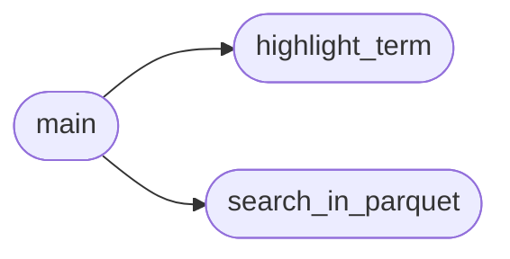

# `contrib.legacy.lazysearch`

> Source: [contrib/legacy/lazysearch.py:1](../../contrib/legacy/lazysearch.py#L1) | language `py` | coverage 25.0% | [API index](../index.md)

main.py

Autor: Gris Iscomeback
Correo electrónico: grisiscomeback[at]gmail[dot]com
Fecha de creación: 09/06/2024
Licencia: GPL v3

Descripción: search in gtofbins db

██╗      █████╗ ███████╗██╗   ██╗ ██████╗ ██╗    ██╗███╗   ██╗
██║     ██╔══██╗╚══███╔╝╚██╗ ██╔╝██╔═══██╗██║    ██║████╗  ██║
██║     ███████║  ███╔╝  ╚████╔╝ ██║   ██║██║ █╗ ██║██╔██╗ ██║
██║     ██╔══██║ ███╔╝    ╚██╔╝  ██║   ██║██║███╗██║██║╚██╗██║
███████╗██║  ██║███████╗   ██║   ╚██████╔╝╚███╔███╔╝██║ ╚████║
╚══════╝╚═╝  ╚═╝╚══════╝   ╚═╝    ╚═════╝  ╚══╝╚══╝ ╚═╝  ╚═══╝

## Contents

- **Functions:** [`highlight_term`](#highlight_term), [`search_in_parquet`](#search_in_parquet), [`main`](#main)

## Call Graph

Solid arrows stay in this module, dashed arrows leave it.



## Functions

<a id="highlight_term"></a>

### `highlight_term`

`function` | [contrib/legacy/lazysearch.py:29](../../contrib/legacy/lazysearch.py#L29)

```python
def highlight_term(text, term)
```

**Parameters**

| Name | Type | Default | Description |
|---|---|---|---|
| `text` |  |  |  |
| `term` |  |  |  |

*Called by:* [`main`](#main)

---

<a id="search_in_parquet"></a>

### `search_in_parquet`

`function` | [contrib/legacy/lazysearch.py:32](../../contrib/legacy/lazysearch.py#L32)

```python
def search_in_parquet(term, parquet_files)
```

**Parameters**

| Name | Type | Default | Description |
|---|---|---|---|
| `term` |  |  |  |
| `parquet_files` |  |  |  |

*Called by:* [`main`](#main)

---

<a id="main"></a>

### `main`

`function` | [contrib/legacy/lazysearch.py:44](../../contrib/legacy/lazysearch.py#L44)

```python
def main()
```

*Calls:* [`highlight_term`](#highlight_term), [`search_in_parquet`](#search_in_parquet)

---
