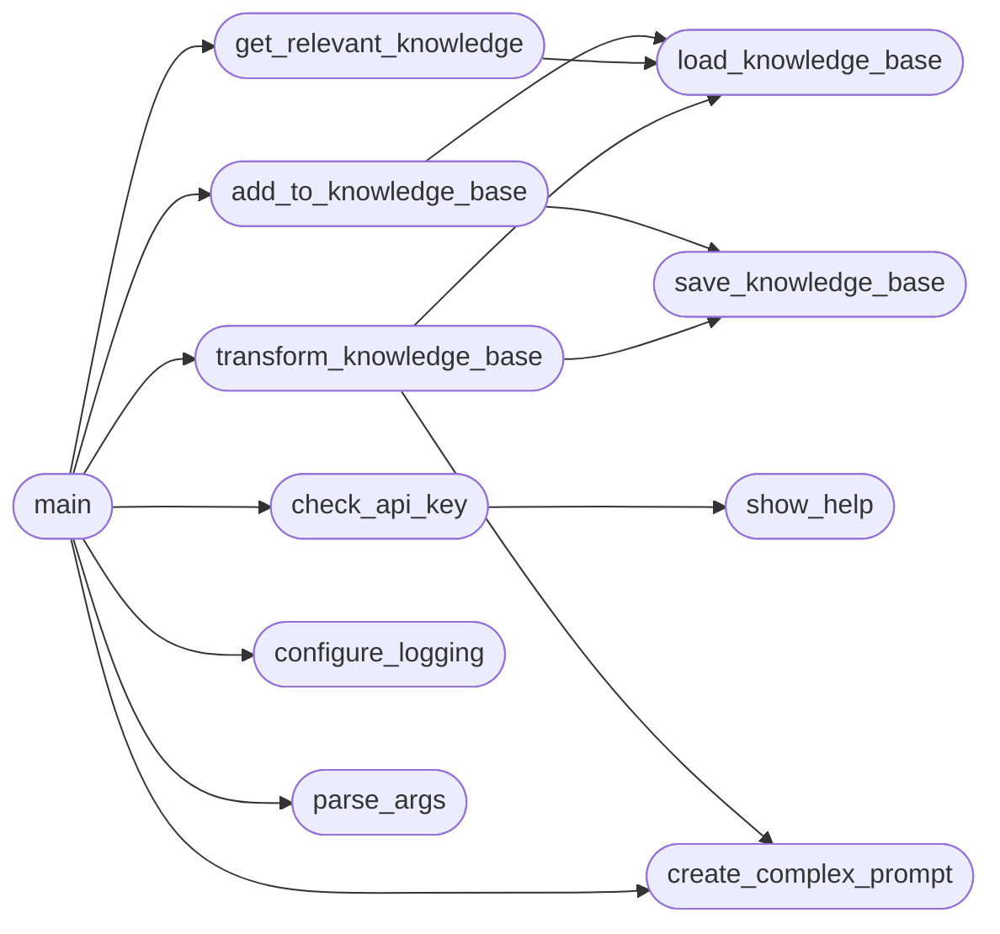

# `contrib.legacy.lazysearch_bot`

> Source: [contrib/legacy/lazysearch_bot.py:1](../../contrib/legacy/lazysearch_bot.py#L1) | language `py` | coverage 7.1% | [API index](../index.md)

main.py

Autor: Gris Iscomeback
Correo electrónico: grisiscomeback[at]gmail[dot]com
Fecha de creación: 09/06/2024
Licencia: GPL v3

Descripción: Asistente de investigacion por consola estilo GPT con Groq

██╗      █████╗ ███████╗██╗   ██╗ ██████╗ ██╗    ██╗███╗   ██╗
██║     ██╔══██╗╚══███╔╝╚██╗ ██╔╝██╔═══██╗██║    ██║████╗  ██║
██║     ███████║  ███╔╝  ╚████╔╝ ██║   ██║██║ █╗ ██║██╔██╗ ██║
██║     ██╔══██║ ███╔╝    ╚██╔╝  ██║   ██║██║███╗██║██║╚██╗██║
███████╗██║  ██║███████╗   ██║   ╚██████╔╝╚███╔███╔╝██║ ╚████║
╚══════╝╚═╝  ╚═╝╚══════╝   ╚═╝    ╚═════╝  ╚══╝╚══╝ ╚═╝  ╚═══╝

## Contents

- **Functions:** [`signal_handler`](#signal_handler), [`show_help`](#show_help), [`check_api_key`](#check_api_key), [`configure_logging`](#configure_logging), [`parse_args`](#parse_args), [`create_complex_prompt`](#create_complex_prompt), [`execute_command`](#execute_command), [`load_knowledge_base`](#load_knowledge_base), [`save_knowledge_base`](#save_knowledge_base), [`add_to_knowledge_base`](#add_to_knowledge_base), [`get_relevant_knowledge`](#get_relevant_knowledge), [`transform_knowledge_base`](#transform_knowledge_base), [`main`](#main)
- **Constants:** [`BANNER`](#banner), [`HELP_MESSAGE`](#help_message), [`KNOWLEDGE_BASE_FILE`](#knowledge_base_file), [`IMPROVED_KNOWLEDGE_BASE_FILE`](#improved_knowledge_base_file)

## Call Graph

Solid arrows stay in this module, dashed arrows leave it.



## Functions

<a id="signal_handler"></a>

### `signal_handler`

`function` | [contrib/legacy/lazysearch_bot.py:59](../../contrib/legacy/lazysearch_bot.py#L59)

```python
def signal_handler(sig: int, frame: any) -> None
```

**Parameters**

| Name | Type | Default | Description |
|---|---|---|---|
| `sig` | `int` |  |  |
| `frame` | `any` |  |  |

---

<a id="show_help"></a>

### `show_help`

`function` | [contrib/legacy/lazysearch_bot.py:65](../../contrib/legacy/lazysearch_bot.py#L65)

```python
def show_help(message: str) -> None
```

**Parameters**

| Name | Type | Default | Description |
|---|---|---|---|
| `message` | `str` |  |  |

*Called by:* [`check_api_key`](#check_api_key)

---

<a id="check_api_key"></a>

### `check_api_key`

`function` | [contrib/legacy/lazysearch_bot.py:69](../../contrib/legacy/lazysearch_bot.py#L69)

```python
def check_api_key() -> str
```

**Returns:** `str`

*Calls:* [`show_help`](#show_help)

*Called by:* [`main`](#main)

---

<a id="configure_logging"></a>

### `configure_logging`

`function` | [contrib/legacy/lazysearch_bot.py:75](../../contrib/legacy/lazysearch_bot.py#L75)

```python
def configure_logging(debug: bool) -> None
```

**Parameters**

| Name | Type | Default | Description |
|---|---|---|---|
| `debug` | `bool` |  |  |

*Called by:* [`main`](#main)

---

<a id="parse_args"></a>

### `parse_args`

`function` | [contrib/legacy/lazysearch_bot.py:79](../../contrib/legacy/lazysearch_bot.py#L79)

```python
def parse_args() -> argparse.Namespace
```

**Returns:** `argparse.Namespace`

*Called by:* [`main`](#main)

---

<a id="create_complex_prompt"></a>

### `create_complex_prompt`

`function` | [contrib/legacy/lazysearch_bot.py:86](../../contrib/legacy/lazysearch_bot.py#L86)

```python
def create_complex_prompt(base_prompt: str, history: str, knowledge_base: str, error_message: str = None) -> str
```

**Parameters**

| Name | Type | Default | Description |
|---|---|---|---|
| `base_prompt` | `str` |  |  |
| `history` | `str` |  |  |
| `knowledge_base` | `str` |  |  |
| `error_message` | `str` | `None` |  |

**Returns:** `str`

*Called by:* [`main`](#main), [`transform_knowledge_base`](#transform_knowledge_base)

---

<a id="execute_command"></a>

### `execute_command`

`function` | [contrib/legacy/lazysearch_bot.py:109](../../contrib/legacy/lazysearch_bot.py#L109)

```python
def execute_command(command: str) -> subprocess.CompletedProcess
```

**Parameters**

| Name | Type | Default | Description |
|---|---|---|---|
| `command` | `str` |  |  |

**Returns:** `subprocess.CompletedProcess`

---

<a id="load_knowledge_base"></a>

### `load_knowledge_base`

`function` | [contrib/legacy/lazysearch_bot.py:112](../../contrib/legacy/lazysearch_bot.py#L112)

```python
def load_knowledge_base(file_path: str) -> dict
```

**Parameters**

| Name | Type | Default | Description |
|---|---|---|---|
| `file_path` | `str` |  |  |

**Returns:** `dict`

*Called by:* [`add_to_knowledge_base`](#add_to_knowledge_base), [`get_relevant_knowledge`](#get_relevant_knowledge), [`transform_knowledge_base`](#transform_knowledge_base)

---

<a id="save_knowledge_base"></a>

### `save_knowledge_base`

`function` | [contrib/legacy/lazysearch_bot.py:118](../../contrib/legacy/lazysearch_bot.py#L118)

```python
def save_knowledge_base(knowledge_base: dict, file_path: str) -> None
```

**Parameters**

| Name | Type | Default | Description |
|---|---|---|---|
| `knowledge_base` | `dict` |  |  |
| `file_path` | `str` |  |  |

*Called by:* [`add_to_knowledge_base`](#add_to_knowledge_base), [`transform_knowledge_base`](#transform_knowledge_base)

---

<a id="add_to_knowledge_base"></a>

### `add_to_knowledge_base`

`function` | [contrib/legacy/lazysearch_bot.py:122](../../contrib/legacy/lazysearch_bot.py#L122)

```python
def add_to_knowledge_base(prompt: str, command: str, file_path: str) -> None
```

**Parameters**

| Name | Type | Default | Description |
|---|---|---|---|
| `prompt` | `str` |  |  |
| `command` | `str` |  |  |
| `file_path` | `str` |  |  |

*Calls:* [`load_knowledge_base`](#load_knowledge_base), [`save_knowledge_base`](#save_knowledge_base)

*Called by:* [`main`](#main)

---

<a id="get_relevant_knowledge"></a>

### `get_relevant_knowledge`

`function` | [contrib/legacy/lazysearch_bot.py:127](../../contrib/legacy/lazysearch_bot.py#L127)

```python
def get_relevant_knowledge(prompt: str) -> str
```

**Parameters**

| Name | Type | Default | Description |
|---|---|---|---|
| `prompt` | `str` |  |  |

**Returns:** `str`

*Calls:* [`load_knowledge_base`](#load_knowledge_base)

*Called by:* [`main`](#main)

---

<a id="transform_knowledge_base"></a>

### `transform_knowledge_base`

`function` | [contrib/legacy/lazysearch_bot.py:135](../../contrib/legacy/lazysearch_bot.py#L135)

```python
def transform_knowledge_base(client) -> None
```

**Parameters**

| Name | Type | Default | Description |
|---|---|---|---|
| `client` |  |  |  |

*Calls:* [`create_complex_prompt`](#create_complex_prompt), [`load_knowledge_base`](#load_knowledge_base), [`save_knowledge_base`](#save_knowledge_base)

*Called by:* [`main`](#main)

---

<a id="main"></a>

### `main`

`function` | [contrib/legacy/lazysearch_bot.py:158](../../contrib/legacy/lazysearch_bot.py#L158)

```python
def main() -> None
```

*Calls:* [`add_to_knowledge_base`](#add_to_knowledge_base), [`check_api_key`](#check_api_key), [`configure_logging`](#configure_logging), [`create_complex_prompt`](#create_complex_prompt), [`get_relevant_knowledge`](#get_relevant_knowledge), [`parse_args`](#parse_args), [`transform_knowledge_base`](#transform_knowledge_base)

---

## Constants

<a id="banner"></a>

### `BANNER`

`constant` | [contrib/legacy/lazysearch_bot.py:31](../../contrib/legacy/lazysearch_bot.py#L31)

```python
BANNER
```

---

<a id="help_message"></a>

### `HELP_MESSAGE`

`constant` | [contrib/legacy/lazysearch_bot.py:41](../../contrib/legacy/lazysearch_bot.py#L41)

```python
HELP_MESSAGE
```

---

<a id="knowledge_base_file"></a>

### `KNOWLEDGE_BASE_FILE`

`constant` | [contrib/legacy/lazysearch_bot.py:56](../../contrib/legacy/lazysearch_bot.py#L56)

```python
KNOWLEDGE_BASE_FILE = 'knowledge_base.json'
```

---

<a id="improved_knowledge_base_file"></a>

### `IMPROVED_KNOWLEDGE_BASE_FILE`

`constant` | [contrib/legacy/lazysearch_bot.py:57](../../contrib/legacy/lazysearch_bot.py#L57)

```python
IMPROVED_KNOWLEDGE_BASE_FILE = 'knowledge_base_improved.json'
```

---
