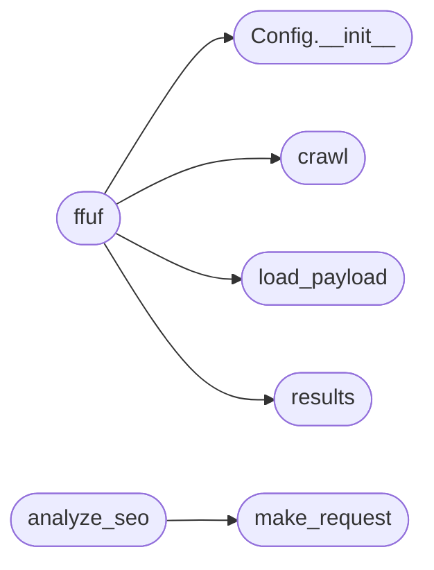

# `contrib.legacy.lazyseo`

> Source: [contrib/legacy/lazyseo.py:1](../../contrib/legacy/lazyseo.py#L1) | language `py` | coverage 0.0% | [API index](../index.md)

## Contents

- **Classes:** [`Config`](#config)
- **Functions:** [`load_payload`](#load_payload), [`make_request`](#make_request), [`results`](#results), [`crawl`](#crawl), [`ffuf`](#ffuf), [`analyze_seo`](#analyze_seo)

## Call Graph

Solid arrows stay in this module, dashed arrows leave it.



## Classes

<a id="config"></a>

### `Config`

`class` | [contrib/legacy/lazyseo.py:14](../../contrib/legacy/lazyseo.py#L14)

```python
class Config
```

**Members**

| Member | Kind | Summary |
|---|---|---|
| [`__init__`](#config-__init__) | constructor |  |

<a id="config-__init__"></a>

#### `Config.__init__`

`constructor` | [contrib/legacy/lazyseo.py:15](../../contrib/legacy/lazyseo.py#L15)

```python
def __init__(self, config_dict)
```

**Parameters**

| Name | Type | Default | Description |
|---|---|---|---|
| `config_dict` |  |  |  |

*Called by:* [`ffuf`](#ffuf)

---

## Functions

<a id="load_payload"></a>

### `load_payload`

`function` | [contrib/legacy/lazyseo.py:23](../../contrib/legacy/lazyseo.py#L23)

```python
def load_payload()
```

*Called by:* [`ffuf`](#ffuf)

---

<a id="make_request"></a>

### `make_request`

`function` | [contrib/legacy/lazyseo.py:28](../../contrib/legacy/lazyseo.py#L28)

```python
def make_request(url, retries=3, timeout=30)
```

**Parameters**

| Name | Type | Default | Description |
|---|---|---|---|
| `url` |  |  |  |
| `retries` |  | `3` |  |
| `timeout` |  | `30` |  |

*Called by:* [`analyze_seo`](#analyze_seo)

---

<a id="results"></a>

### `results`

`function` | [contrib/legacy/lazyseo.py:49](../../contrib/legacy/lazyseo.py#L49)

```python
def results(file)
```

**Parameters**

| Name | Type | Default | Description |
|---|---|---|---|
| `file` |  |  |  |

*Called by:* [`ffuf`](#ffuf)

---

<a id="crawl"></a>

### `crawl`

`function` | [contrib/legacy/lazyseo.py:57](../../contrib/legacy/lazyseo.py#L57)

```python
def crawl(url)
```

**Parameters**

| Name | Type | Default | Description |
|---|---|---|---|
| `url` |  |  |  |

*Called by:* [`ffuf`](#ffuf)

---

<a id="ffuf"></a>

### `ffuf`

`function` | [contrib/legacy/lazyseo.py:66](../../contrib/legacy/lazyseo.py#L66)

```python
def ffuf()
```

*Calls:* [`Config.__init__`](#config-__init__), [`crawl`](#crawl), [`load_payload`](#load_payload), [`results`](#results)

---

<a id="analyze_seo"></a>

### `analyze_seo`

`function` | [contrib/legacy/lazyseo.py:76](../../contrib/legacy/lazyseo.py#L76)

```python
def analyze_seo(url)
```

**Parameters**

| Name | Type | Default | Description |
|---|---|---|---|
| `url` |  |  |  |

*Calls:* [`make_request`](#make_request)

---
