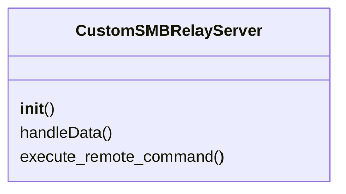
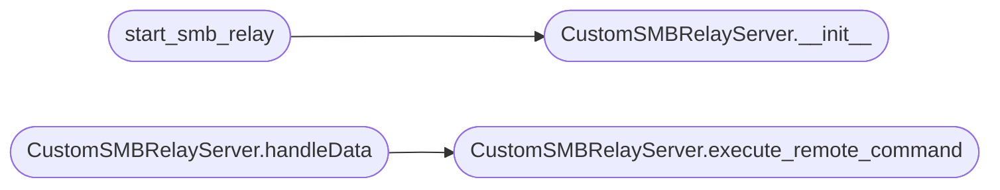

# `contrib.legacy.lazysmbrelay`

> Source: [contrib/legacy/lazysmbrelay.py:1](../../contrib/legacy/lazysmbrelay.py#L1) | language `py` | coverage 0.0% | [API index](../index.md)

## Contents

- **Classes:** [`CustomSMBRelayServer`](#customsmbrelayserver)
- **Functions:** [`check_sudo`](#check_sudo), [`start_smb_server`](#start_smb_server), [`start_smb_relay`](#start_smb_relay)

## Type Diagram



## Call Graph

Solid arrows stay in this module, dashed arrows leave it.



## Classes

<a id="customsmbrelayserver"></a>

### `CustomSMBRelayServer`

`class` | [contrib/legacy/lazysmbrelay.py:41](../../contrib/legacy/lazysmbrelay.py#L41)

```python
class CustomSMBRelayServer(SMBRelayServer)
```

Bases: `SMBRelayServer`

**Members**

| Member | Kind | Summary |
|---|---|---|
| [`__init__`](#customsmbrelayserver-__init__) | constructor |  |
| [`handleData`](#customsmbrelayserver-handledata) | method |  |
| [`execute_remote_command`](#customsmbrelayserver-execute_remote_command) | method |  |

<a id="customsmbrelayserver-__init__"></a>

#### `CustomSMBRelayServer.__init__`

`constructor` | [contrib/legacy/lazysmbrelay.py:42](../../contrib/legacy/lazysmbrelay.py#L42)

```python
def __init__(self, *args, **kwargs)
```

**Parameters**

| Name | Type | Default | Description |
|---|---|---|---|
| `*args` |  |  |  |
| `**kwargs` |  |  |  |

*Called by:* [`start_smb_relay`](#start_smb_relay)

<a id="customsmbrelayserver-handledata"></a>

#### `CustomSMBRelayServer.handleData`

`method` | [contrib/legacy/lazysmbrelay.py:46](../../contrib/legacy/lazysmbrelay.py#L46)

```python
def handleData(self, *args, **kwargs)
```

**Parameters**

| Name | Type | Default | Description |
|---|---|---|---|
| `*args` |  |  |  |
| `**kwargs` |  |  |  |

*Calls:* [`CustomSMBRelayServer.execute_remote_command`](#customsmbrelayserver-execute_remote_command)

<a id="customsmbrelayserver-execute_remote_command"></a>

#### `CustomSMBRelayServer.execute_remote_command`

`method` | [contrib/legacy/lazysmbrelay.py:50](../../contrib/legacy/lazysmbrelay.py#L50)

```python
def execute_remote_command(self)
```

*Called by:* [`CustomSMBRelayServer.handleData`](#customsmbrelayserver-handledata)

---

## Functions

<a id="check_sudo"></a>

### `check_sudo`

`function` | [contrib/legacy/lazysmbrelay.py:15](../../contrib/legacy/lazysmbrelay.py#L15)

```python
def check_sudo()
```

---

<a id="start_smb_server"></a>

### `start_smb_server`

`function` | [contrib/legacy/lazysmbrelay.py:27](../../contrib/legacy/lazysmbrelay.py#L27)

```python
def start_smb_server()
```

---

<a id="start_smb_relay"></a>

### `start_smb_relay`

`function` | [contrib/legacy/lazysmbrelay.py:35](../../contrib/legacy/lazysmbrelay.py#L35)

```python
def start_smb_relay(target, command)
```

**Parameters**

| Name | Type | Default | Description |
|---|---|---|---|
| `target` |  |  |  |
| `command` |  |  |  |

*Calls:* [`CustomSMBRelayServer.__init__`](#customsmbrelayserver-__init__)

---
