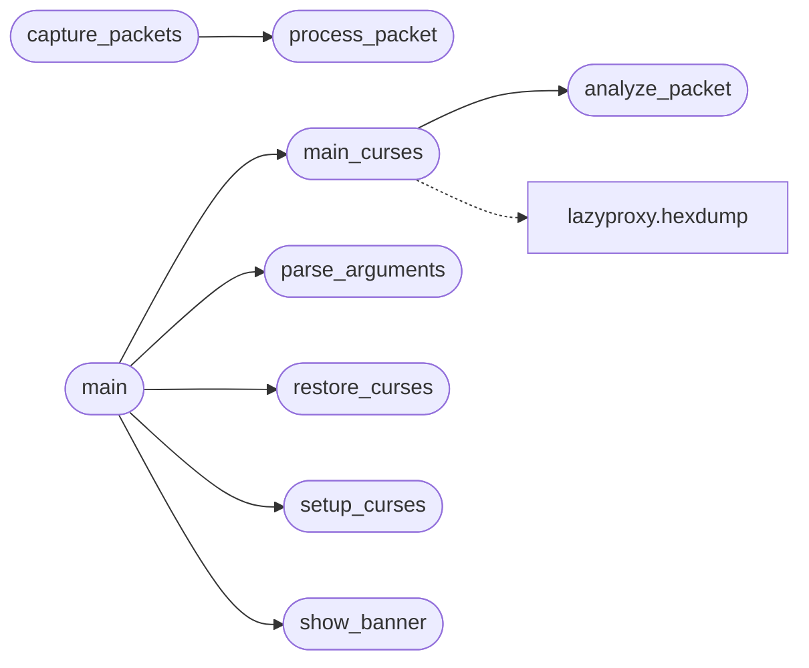

# `contrib.legacy.lazysniff`

> Source: [contrib/legacy/lazysniff.py:1](../../contrib/legacy/lazysniff.py#L1) | language `py` | coverage 8.3% | [API index](../index.md)

main.py

Autor: Gris Iscomeback
Correo electrónico: grisiscomeback[at]gmail[dot]com
Fecha de creación: 09/06/2024
Licencia: AGPL v3

Descripción: LazyOwnSniffer

██╗      █████╗ ███████╗██╗   ██╗ ██████╗ ██╗    ██╗███╗   ██╗
██║     ██╔══██╗╚══███╔╝╚██╗ ██╔╝██╔═══██╗██║    ██║████╗  ██║
██║     ███████║  ███╔╝  ╚████╔╝ ██║   ██║██║ █╗ ██║██╔██╗ ██║
██║     ██╔══██║ ███╔╝    ╚██╔╝  ██║   ██║██║███╗██║██║╚██╗██║
███████╗██║  ██║███████╗   ██║   ╚██████╔╝╚███╔███╔╝██║ ╚████║
╚══════╝╚═╝  ╚═╝╚══════╝   ╚═╝    ╚═════╝  ╚══╝╚══╝ ╚═╝  ╚═══╝

## Contents

- **Functions:** [`check_sudo`](#check_sudo), [`signal_handler`](#signal_handler), [`setup_curses`](#setup_curses), [`restore_curses`](#restore_curses), [`show_banner`](#show_banner), [`process_packet`](#process_packet), [`analyze_packet`](#analyze_packet), [`capture_packets`](#capture_packets), [`main_curses`](#main_curses), [`parse_arguments`](#parse_arguments), [`main`](#main)
- **Constants:** [`BANNER`](#banner)

## Call Graph

Solid arrows stay in this module, dashed arrows leave it.



## Functions

<a id="check_sudo"></a>

### `check_sudo`

`function` | [contrib/legacy/lazysniff.py:41](../../contrib/legacy/lazysniff.py#L41)

```python
def check_sudo()
```

---

<a id="signal_handler"></a>

### `signal_handler`

`function` | [contrib/legacy/lazysniff.py:50](../../contrib/legacy/lazysniff.py#L50)

```python
def signal_handler(sig, frame)
```

**Parameters**

| Name | Type | Default | Description |
|---|---|---|---|
| `sig` |  |  |  |
| `frame` |  |  |  |

---

<a id="setup_curses"></a>

### `setup_curses`

`function` | [contrib/legacy/lazysniff.py:57](../../contrib/legacy/lazysniff.py#L57)

```python
def setup_curses()
```

*Called by:* [`main`](#main)

---

<a id="restore_curses"></a>

### `restore_curses`

`function` | [contrib/legacy/lazysniff.py:66](../../contrib/legacy/lazysniff.py#L66)

```python
def restore_curses(stdscr)
```

**Parameters**

| Name | Type | Default | Description |
|---|---|---|---|
| `stdscr` |  |  |  |

*Called by:* [`main`](#main)

---

<a id="show_banner"></a>

### `show_banner`

`function` | [contrib/legacy/lazysniff.py:73](../../contrib/legacy/lazysniff.py#L73)

```python
def show_banner(stdscr, banner)
```

**Parameters**

| Name | Type | Default | Description |
|---|---|---|---|
| `stdscr` |  |  |  |
| `banner` |  |  |  |

*Called by:* [`main`](#main)

---

<a id="process_packet"></a>

### `process_packet`

`function` | [contrib/legacy/lazysniff.py:80](../../contrib/legacy/lazysniff.py#L80)

```python
def process_packet(packet, packets, win_top, win_bottom)
```

**Parameters**

| Name | Type | Default | Description |
|---|---|---|---|
| `packet` |  |  |  |
| `packets` |  |  |  |
| `win_top` |  |  |  |
| `win_bottom` |  |  |  |

*Called by:* [`capture_packets`](#capture_packets)

---

<a id="analyze_packet"></a>

### `analyze_packet`

`function` | [contrib/legacy/lazysniff.py:90](../../contrib/legacy/lazysniff.py#L90)

```python
def analyze_packet(packet)
```

**Parameters**

| Name | Type | Default | Description |
|---|---|---|---|
| `packet` |  |  |  |

*Called by:* [`main_curses`](#main_curses)

---

<a id="capture_packets"></a>

### `capture_packets`

`function` | [contrib/legacy/lazysniff.py:112](../../contrib/legacy/lazysniff.py#L112)

```python
def capture_packets(interface, count, filter, pcap_file, packets, win_top, win_bottom)
```

**Parameters**

| Name | Type | Default | Description |
|---|---|---|---|
| `interface` |  |  |  |
| `count` |  |  |  |
| `filter` |  |  |  |
| `pcap_file` |  |  |  |
| `packets` |  |  |  |
| `win_top` |  |  |  |
| `win_bottom` |  |  |  |

*Calls:* [`process_packet`](#process_packet)

---

<a id="main_curses"></a>

### `main_curses`

`function` | [contrib/legacy/lazysniff.py:118](../../contrib/legacy/lazysniff.py#L118)

```python
def main_curses(stdscr, packets, interface, count, filter, pcap_file)
```

**Parameters**

| Name | Type | Default | Description |
|---|---|---|---|
| `stdscr` |  |  |  |
| `packets` |  |  |  |
| `interface` |  |  |  |
| `count` |  |  |  |
| `filter` |  |  |  |
| `pcap_file` |  |  |  |

*Calls:* [`hexdump`](contrib.legacy.lazyproxy.py.md#hexdump), [`analyze_packet`](#analyze_packet)

*Called by:* [`main`](#main)

---

<a id="parse_arguments"></a>

### `parse_arguments`

`function` | [contrib/legacy/lazysniff.py:188](../../contrib/legacy/lazysniff.py#L188)

```python
def parse_arguments()
```

*Called by:* [`main`](#main)

---

<a id="main"></a>

### `main`

`function` | [contrib/legacy/lazysniff.py:197](../../contrib/legacy/lazysniff.py#L197)

```python
def main()
```

*Calls:* [`main_curses`](#main_curses), [`parse_arguments`](#parse_arguments), [`restore_curses`](#restore_curses), [`setup_curses`](#setup_curses), [`show_banner`](#show_banner)

---

## Constants

<a id="banner"></a>

### `BANNER`

`constant` | [contrib/legacy/lazysniff.py:30](../../contrib/legacy/lazysniff.py#L30)

```python
BANNER
```

---
