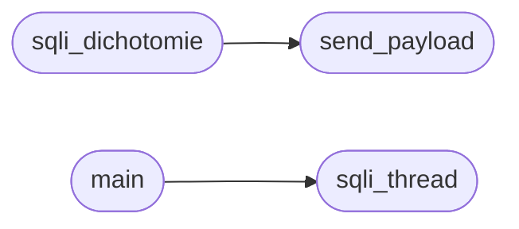

# `contrib.legacy.lazysqli`

> Source: [contrib/legacy/lazysqli.py:1](../../contrib/legacy/lazysqli.py#L1) | language `py` | coverage 20.0% | [API index](../index.md)

AUTHOR: jahman EDITED BY grisun0

## Contents

- **Functions:** [`send_payload`](#send_payload), [`sqli_dichotomie`](#sqli_dichotomie), [`sqli_thread`](#sqli_thread), [`main`](#main)

## Call Graph

Solid arrows stay in this module, dashed arrows leave it.



## Functions

<a id="send_payload"></a>

### `send_payload`

`function` | [contrib/legacy/lazysqli.py:13](../../contrib/legacy/lazysqli.py#L13)

```python
def send_payload(payload, url, s, sql_time)
```

**Parameters**

| Name | Type | Default | Description |
|---|---|---|---|
| `payload` |  |  |  |
| `url` |  |  |  |
| `s` |  |  |  |
| `sql_time` |  |  |  |

*Called by:* [`sqli_dichotomie`](#sqli_dichotomie)

---

<a id="sqli_dichotomie"></a>

### `sqli_dichotomie`

`function` | [contrib/legacy/lazysqli.py:30](../../contrib/legacy/lazysqli.py#L30)

```python
def sqli_dichotomie(payload_brute, offset, url, s, sql_time)
```

**Parameters**

| Name | Type | Default | Description |
|---|---|---|---|
| `payload_brute` |  |  |  |
| `offset` |  |  |  |
| `url` |  |  |  |
| `s` |  |  |  |
| `sql_time` |  |  |  |

*Calls:* [`send_payload`](#send_payload)

---

<a id="sqli_thread"></a>

### `sqli_thread`

`function` | [contrib/legacy/lazysqli.py:51](../../contrib/legacy/lazysqli.py#L51)

```python
def sqli_thread(url, db, table, col, sql_time, threads)
```

**Parameters**

| Name | Type | Default | Description |
|---|---|---|---|
| `url` |  |  |  |
| `db` |  |  |  |
| `table` |  |  |  |
| `col` |  |  |  |
| `sql_time` |  |  |  |
| `threads` |  |  |  |

*Called by:* [`main`](#main)

---

<a id="main"></a>

### `main`

`function` | [contrib/legacy/lazysqli.py:89](../../contrib/legacy/lazysqli.py#L89)

```python
def main(args)
```

**Parameters**

| Name | Type | Default | Description |
|---|---|---|---|
| `args` |  |  |  |

*Calls:* [`sqli_thread`](#sqli_thread)

---
