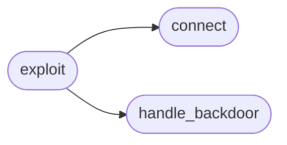

# `contrib.legacy.lazyvsftp`

> Source: [contrib/legacy/lazyvsftp.py:1](../../contrib/legacy/lazyvsftp.py#L1) | language `py` | coverage 0.0% | [API index](../index.md)

## Contents

- **Functions:** [`connect`](#connect), [`exploit`](#exploit), [`handle_backdoor`](#handle_backdoor)

## Call Graph

Solid arrows stay in this module, dashed arrows leave it.



## Functions

<a id="connect"></a>

### `connect`

`function` | [contrib/legacy/lazyvsftp.py:7](../../contrib/legacy/lazyvsftp.py#L7)

```python
def connect(host, port)
```

**Parameters**

| Name | Type | Default | Description |
|---|---|---|---|
| `host` |  |  |  |
| `port` |  |  |  |

*Called by:* [`exploit`](#exploit)

---

<a id="exploit"></a>

### `exploit`

`function` | [contrib/legacy/lazyvsftp.py:16](../../contrib/legacy/lazyvsftp.py#L16)

```python
def exploit(host, port)
```

**Parameters**

| Name | Type | Default | Description |
|---|---|---|---|
| `host` |  |  |  |
| `port` |  |  |  |

*Calls:* [`connect`](#connect), [`handle_backdoor`](#handle_backdoor)

---

<a id="handle_backdoor"></a>

### `handle_backdoor`

`function` | [contrib/legacy/lazyvsftp.py:61](../../contrib/legacy/lazyvsftp.py#L61)

```python
def handle_backdoor(s)
```

**Parameters**

| Name | Type | Default | Description |
|---|---|---|---|
| `s` |  |  |  |

*Called by:* [`exploit`](#exploit)

---
