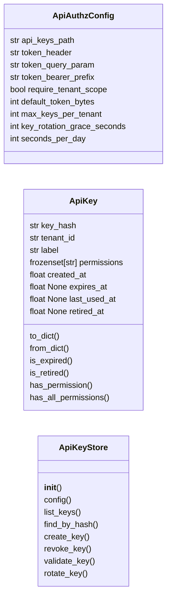
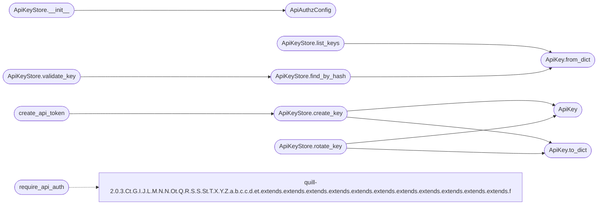

# `core.api_authz`

> Source: [core/api_authz.py:1](../../core/api_authz.py#L1) | language `py` | coverage 65.0% | [API index](../index.md)

Tenant-bound API authorization for the LazyOwn C2 dashboard.

Provides API-key generation, storage, validation, and route-decorator
enforcement that requires both a valid key AND tenant membership.
Keys are hashed at rest with ``hashlib.sha256``; only the plaintext
is returned once at creation time.

This module is self-contained and has zero dependencies beyond the
Python standard library. It integrates with Flask via decorators and
with the ``modules/lazy_rbac.py`` RBAC system for permission checks.

Contracts
---------
* `[`ApiKeyStore`](#apikeystore)`: persistence layer (atomic writes, no plaintext storage).
* `[`require_api_auth`](#require_api_auth)`: Flask-route decorator that reads the API key from
  headers or query params, validates it, resolves the tenant, and enforces
  the required permissions.
* `[`create_api_token`](#create_api_token)`: convenience helper that stores the key and returns
  the one-time plaintext secret.

Usage::

    from core.api_authz import ApiAuthzConfig, ApiKeyStore, require_api_auth

    _store = ApiKeyStore(config=ApiAuthzConfig())

    @app.route("/api/secrets")
    @require_api_auth(store=_store, permissions={"api:read"})
    def secrets():
        return jsonify(...)

    token = create_api_token(store=_store, tenant_id="acme", label="bot-01")
    # → token only displayed ONCE

## Contents

- **Classes:** [`ApiAuthzConfig`](#apiauthzconfig), [`ApiKey`](#apikey), [`ApiKeyStore`](#apikeystore)
- **Functions:** [`require_api_auth`](#require_api_auth), [`create_api_token`](#create_api_token)

## Type Diagram



## Call Graph

Solid arrows stay in this module, dashed arrows leave it.



## Classes

<a id="apiauthzconfig"></a>

### `ApiAuthzConfig`

`class` `dataclass` | [core/api_authz.py:54](../../core/api_authz.py#L54)

Decorators: `@dataclass`

```python
class ApiAuthzConfig
```

Configuration contract for the API authorization module.

Every tunable value is defined here; no magic numbers exist elsewhere.

**Attributes**

| Name | Type | Default | Description |
|---|---|---|---|
| [`api_keys_path`](#apiauthzconfig-api_keys_path) | `str` | `'sessions/api_keys.json'` |  |
| [`token_header`](#apiauthzconfig-token_header) | `str` | `'X-API-Key'` |  |
| [`token_query_param`](#apiauthzconfig-token_query_param) | `str` | `'api_key'` |  |
| [`token_bearer_prefix`](#apiauthzconfig-token_bearer_prefix) | `str` | `'Bearer '` |  |
| [`require_tenant_scope`](#apiauthzconfig-require_tenant_scope) | `bool` | `True` |  |
| [`default_token_bytes`](#apiauthzconfig-default_token_bytes) | `int` | `32` |  |
| [`max_keys_per_tenant`](#apiauthzconfig-max_keys_per_tenant) | `int` | `100` |  |
| [`key_rotation_grace_seconds`](#apiauthzconfig-key_rotation_grace_seconds) | `int` | `300` |  |
| [`seconds_per_day`](#apiauthzconfig-seconds_per_day) | `int` | `86400` |  |

---

<a id="apikey"></a>

### `ApiKey`

`class` `dataclass` | [core/api_authz.py:75](../../core/api_authz.py#L75)

Decorators: `@dataclass`

```python
class ApiKey
```

Immutable record of a hashed API key bound to a tenant.

The plaintext secret is never stored after creation. Validation
uses constant-time comparison of the SHA-256 hash. `[`retired_at`](#apikey-retired_at)`
marks a rotated key: it stays valid for the configured grace
window so live clients keep working during a rotation, then it is
pruned from the store.

**Attributes**

| Name | Type | Default | Description |
|---|---|---|---|
| [`key_hash`](#apikey-key_hash) | `str` |  |  |
| [`tenant_id`](#apikey-tenant_id) | `str` |  |  |
| [`label`](#apikey-label) | `str` |  |  |
| [`permissions`](#apikey-permissions) | `frozenset[str]` | `field(default_factory=frozenset)` |  |
| [`created_at`](#apikey-created_at) | `float` | `field(default_factory=time.time)` |  |
| [`expires_at`](#apikey-expires_at) | `float \| None` | `None` |  |
| [`last_used_at`](#apikey-last_used_at) | `float \| None` | `None` |  |
| [`retired_at`](#apikey-retired_at) | `float \| None` | `None` |  |

**Members**

| Member | Kind | Summary |
|---|---|---|
| [`to_dict`](#apikey-to_dict) | method |  |
| [`from_dict`](#apikey-from_dict) | classmethod |  |
| [`is_expired`](#apikey-is_expired) | method |  |
| [`is_retired`](#apikey-is_retired) | method |  |
| [`has_permission`](#apikey-has_permission) | method |  |
| [`has_all_permissions`](#apikey-has_all_permissions) | method |  |

<a id="apikey-to_dict"></a>

#### `ApiKey.to_dict`

`method` | [core/api_authz.py:94](../../core/api_authz.py#L94)

```python
def to_dict(self) -> dict[str, Any]
```

**Returns:** `dict[str, Any]`

*Called by:* [`ApiKeyStore.create_key`](#apikeystore-create_key), [`ApiKeyStore.rotate_key`](#apikeystore-rotate_key)

<a id="apikey-from_dict"></a>

#### `ApiKey.from_dict`

`classmethod` | [core/api_authz.py:107](../../core/api_authz.py#L107)

Decorators: `@classmethod`

```python
def from_dict(cls, data: dict[str, Any]) -> ApiKey
```

**Parameters**

| Name | Type | Default | Description |
|---|---|---|---|
| `data` | `dict[str, Any]` |  |  |

**Returns:** `ApiKey`

*Called by:* [`ApiKeyStore.find_by_hash`](#apikeystore-find_by_hash), [`ApiKeyStore.list_keys`](#apikeystore-list_keys)

<a id="apikey-is_expired"></a>

#### `ApiKey.is_expired`

`method` | [core/api_authz.py:119](../../core/api_authz.py#L119)

```python
def is_expired(self) -> bool
```

**Returns:** `bool`

<a id="apikey-is_retired"></a>

#### `ApiKey.is_retired`

`method` | [core/api_authz.py:124](../../core/api_authz.py#L124)

```python
def is_retired(self) -> bool
```

**Returns:** `bool`

<a id="apikey-has_permission"></a>

#### `ApiKey.has_permission`

`method` | [core/api_authz.py:127](../../core/api_authz.py#L127)

```python
def has_permission(self, permission: str) -> bool
```

**Parameters**

| Name | Type | Default | Description |
|---|---|---|---|
| `permission` | `str` |  |  |

**Returns:** `bool`

<a id="apikey-has_all_permissions"></a>

#### `ApiKey.has_all_permissions`

`method` | [core/api_authz.py:130](../../core/api_authz.py#L130)

```python
def has_all_permissions(self, permissions: frozenset[str]) -> bool
```

**Parameters**

| Name | Type | Default | Description |
|---|---|---|---|
| `permissions` | `frozenset[str]` |  |  |

**Returns:** `bool`

---

<a id="apikeystore"></a>

### `ApiKeyStore`

`class` | [core/api_authz.py:161](../../core/api_authz.py#L161)

```python
class ApiKeyStore
```

Persistent store for tenant-scoped API keys.

Keys are hashed with SHA-256 before storage. Atomic writes use
``.tmp`` + ``os.replace`` to prevent corruption. Rotated keys are
retired (not deleted) so they stay valid during the configured
grace window, then pruned lazily.

**Members**

| Member | Kind | Summary |
|---|---|---|
| [`__init__`](#apikeystore-__init__) | constructor |  |
| [`config`](#apikeystore-config) | property | The configuration this store was built with. |
| [`list_keys`](#apikeystore-list_keys) | method | List all active keys, optionally filtered by *tenant_id*. |
| [`find_by_hash`](#apikeystore-find_by_hash) | method | Look up a key record by its SHA-256 hash. |
| [`create_key`](#apikeystore-create_key) | method | Create a new API key and return ``(ApiKey, plaintext_secret)``. |
| [`revoke_key`](#apikeystore-revoke_key) | method | Revoke every key with *label* within *tenant_id*. |
| [`validate_key`](#apikeystore-validate_key) | method | Validate a plaintext API key and return the ApiKey record. |
| [`rotate_key`](#apikeystore-rotate_key) | method | Rotate an existing key by label. |

<a id="apikeystore-__init__"></a>

#### `ApiKeyStore.__init__`

`constructor` | [core/api_authz.py:170](../../core/api_authz.py#L170)

```python
def __init__(self, config: ApiAuthzConfig | None = None)
```

**Parameters**

| Name | Type | Default | Description |
|---|---|---|---|
| `config` | `ApiAuthzConfig \| None` | `None` |  |

*Calls:* [`ApiAuthzConfig`](#apiauthzconfig)

*Called by:* [`require_api_auth_with_store`](lazyc2.blueprints.api.py.md#require_api_auth_with_store)

<a id="apikeystore-config"></a>

#### `ApiKeyStore.config`

`property` | [core/api_authz.py:176](../../core/api_authz.py#L176)

Decorators: `@property`

```python
def config(self) -> ApiAuthzConfig
```

The configuration this store was built with.

**Returns:** `ApiAuthzConfig`

<a id="apikeystore-list_keys"></a>

#### `ApiKeyStore.list_keys`

`method` | [core/api_authz.py:217](../../core/api_authz.py#L217)

```python
def list_keys(self, tenant_id: str | None = None) -> list[ApiKey]
```

List all active keys, optionally filtered by *tenant_id*.

Retired keys are excluded: the operator sees the live key set.

**Parameters**

| Name | Type | Default | Description |
|---|---|---|---|
| `tenant_id` | `str \| None` | `None` |  |

**Returns:** `list[ApiKey]`

*Calls:* [`ApiKey.from_dict`](#apikey-from_dict)

<a id="apikeystore-find_by_hash"></a>

#### `ApiKeyStore.find_by_hash`

`method` | [core/api_authz.py:229](../../core/api_authz.py#L229)

```python
def find_by_hash(self, key_hash: str) -> ApiKey | None
```

Look up a key record by its SHA-256 hash.

**Parameters**

| Name | Type | Default | Description |
|---|---|---|---|
| `key_hash` | `str` |  |  |

**Returns:** `ApiKey | None`

*Calls:* [`ApiKey.from_dict`](#apikey-from_dict)

*Called by:* [`ApiKeyStore.validate_key`](#apikeystore-validate_key)

<a id="apikeystore-create_key"></a>

#### `ApiKeyStore.create_key`

`method` | [core/api_authz.py:238](../../core/api_authz.py#L238)

```python
def create_key(self, tenant_id: str, label: str, permissions: frozenset[str] | None = None, expires_in_days: int | None = None) -> tuple[ApiKey, str]
```

Create a new API key and return ``(ApiKey, plaintext_secret)``.

The plaintext secret is returned only once. The caller must
display it to the operator immediately.

**Parameters**

| Name | Type | Default | Description |
|---|---|---|---|
| `tenant_id` | `str` |  |  |
| `label` | `str` |  |  |
| `permissions` | `frozenset[str] \| None` | `None` |  |
| `expires_in_days` | `int \| None` | `None` |  |

**Returns:** `tuple[ApiKey, str]`

**Raises**

- `ValueError`: (raised in the body, not documented)

*Calls:* [`ApiKey`](#apikey), [`ApiKey.to_dict`](#apikey-to_dict)

*Called by:* [`create_api_token`](#create_api_token)

<a id="apikeystore-revoke_key"></a>

#### `ApiKeyStore.revoke_key`

`method` | [core/api_authz.py:273](../../core/api_authz.py#L273)

```python
def revoke_key(self, label: str, tenant_id: str) -> bool
```

Revoke every key with *label* within *tenant_id*.

Both active and retired records are removed. Returns ``True``
when at least one record was found.

**Parameters**

| Name | Type | Default | Description |
|---|---|---|---|
| `label` | `str` |  |  |
| `tenant_id` | `str` |  |  |

**Returns:** `bool`

<a id="apikeystore-validate_key"></a>

#### `ApiKeyStore.validate_key`

`method` | [core/api_authz.py:287](../../core/api_authz.py#L287)

```python
def validate_key(self, plaintext: str) -> ApiKey | None
```

Validate a plaintext API key and return the ApiKey record.

Returns ``None`` if the key is invalid, expired, retired past its
grace window, or not found. On successful validation the
`[`last_used_at`](#apikey-last_used_at)` timestamp is updated in the store.

**Parameters**

| Name | Type | Default | Description |
|---|---|---|---|
| `plaintext` | `str` |  |  |

**Returns:** `ApiKey | None`

*Calls:* [`ApiKeyStore.find_by_hash`](#apikeystore-find_by_hash)

<a id="apikeystore-rotate_key"></a>

#### `ApiKeyStore.rotate_key`

`method` | [core/api_authz.py:309](../../core/api_authz.py#L309)

```python
def rotate_key(self, label: str, tenant_id: str) -> str | None
```

Rotate an existing key by label.

Returns the new plaintext.

The old key keeps working for `[`key_rotation_grace_seconds`](#apiauthzconfig-key_rotation_grace_seconds)` so
clients can switch without an outage. Permissions and expiration
are copied from the rotated key, never from another record.

**Parameters**

| Name | Type | Default | Description |
|---|---|---|---|
| `label` | `str` |  |  |
| `tenant_id` | `str` |  |  |

**Returns:** `str | None`

*Calls:* [`ApiKey`](#apikey), [`ApiKey.to_dict`](#apikey-to_dict)

---

## Functions

<a id="require_api_auth"></a>

### `require_api_auth`

`function` | [core/api_authz.py:365](../../core/api_authz.py#L365)

```python
def require_api_auth(store: ApiKeyStore, permissions: frozenset[str] | None = None, require_tenant: bool | None = None)
```

Flask-route decorator that enforces API-key + tenant authorization.

The API key is extracted from (in priority order):
1. ``Authorization: Bearer <key>`` header
2. ``X-API-Key`` header
3. ``api_key`` query parameter

If *permissions* is provided the key must hold every listed permission.
If *require_tenant* is ``True`` the key must be scoped to a valid
tenant; when omitted it defaults to
[`ApiAuthzConfig.require_tenant_scope`](#apiauthzconfig-require_tenant_scope) so the security posture
lives in one place.

On failure the decorated route returns a JSON body with ``401`` or
``403`` — never an HTML error page and never `[`abort`](modules.lazy_loop.py.md#runtimetracker-abort)`, so the
contract holds even in apps with ``TRAP_HTTP_EXCEPTIONS`` enabled.

**Parameters**

| Name | Type | Default | Description |
|---|---|---|---|
| `store` | `ApiKeyStore` |  |  |
| `permissions` | `frozenset[str] \| None` | `None` |  |
| `require_tenant` | `bool \| None` | `None` |  |

*Calls:* [`Ct.G.I.J.L.M.N.N.Ot.Q.R.S.S.St.T.X.Y.Z.a.b.c.c.d.et.extends.extends.extends.extends.extends.extends.extends.extends.extends.extends.extends.f`](static.js.quill-2.0.3.js.md#ct-g-i-j-l-m-n-n-ot-q-r-s-s-st-t-x-y-z-a-b-c-c-d-et-extends-extends-extends-extends-extends-extends-extends-extends-extends-extends-extends-f)

*Called by:* [`require_api_auth_with_store`](lazyc2.blueprints.api.py.md#require_api_auth_with_store)

---

<a id="create_api_token"></a>

### `create_api_token`

`function` | [core/api_authz.py:440](../../core/api_authz.py#L440)

```python
def create_api_token(store: ApiKeyStore, tenant_id: str, label: str, permissions: frozenset[str] | None = None, expires_in_days: int | None = None) -> str
```

Create an API key and return the one-time plaintext token.

**Parameters**

| Name | Type | Default | Description |
|---|---|---|---|
| `store` | `ApiKeyStore` |  | The ApiKeyStore instance to persist the key. |
| `tenant_id` | `str` |  | Tenant to which the key is bound. |
| `label` | `str` |  | Human-readable label for the key. |
| `permissions` | `frozenset[str] \| None` | `None` | Optional set of permission strings. |
| `expires_in_days` | `int \| None` | `None` | If set, the key expires after this many days. |

**Returns:** `str` - The plaintext API token. Display once and store securely.

*Calls:* [`ApiKeyStore.create_key`](#apikeystore-create_key)

---
