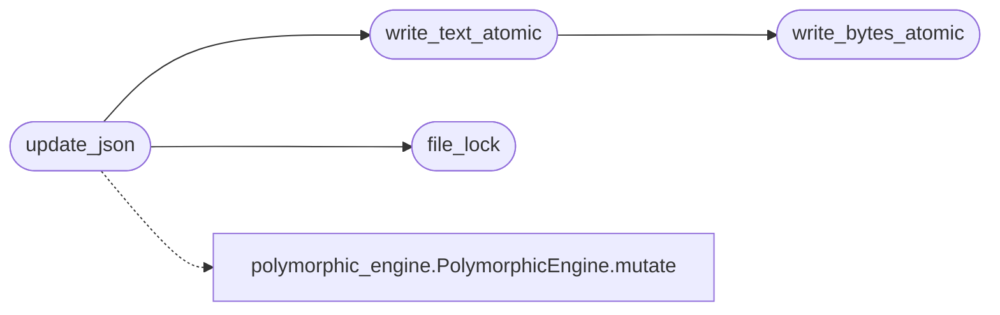

# `core.atomic_store`

> Source: [core/atomic_store.py:1](../../core/atomic_store.py#L1) | language `py` | coverage 100.0% | [API index](../index.md)

Shared atomic file primitives for the loop's small JSON and blob stores.

Several stores (attribution tallies, guard rules, evidence and wire snapshots)
persist tiny files from many workers at once. A fixed temporary name races two
writers onto the same path, and a lock that only covers the final replace still
loses updates across a load-mutate-save cycle. This module centralises the two
disciplines that fix both: every temporary file carries a process-and-thread
unique name so concurrent writers never collide, and a cross-process advisory
lock can wrap a whole read-modify-write so no update is silently dropped.

The lock is a POSIX ``flock`` on a sidecar file, which an operator's CLI and the
C2 process honour even though they are separate processes, unlike a thread lock.
Every helper raises on real I/O failure rather than swallowing it, so a caller
can report a failed persist instead of claiming a success that never reached
disk. Nothing here imports the loop runtime, keeping the module cycle-free.

## Contents

- **Functions:** [`write_bytes_atomic`](#write_bytes_atomic), [`write_text_atomic`](#write_text_atomic), [`file_lock`](#file_lock), [`update_json`](#update_json)

## Call Graph

Solid arrows stay in this module, dashed arrows leave it.



## Functions

<a id="write_bytes_atomic"></a>

### `write_bytes_atomic`

`function` | [core/atomic_store.py:49](../../core/atomic_store.py#L49)

```python
def write_bytes_atomic(path: Path, data: bytes) -> None
```

Write bytes to ``path`` atomically via a unique temp file and replace.

**Parameters**

| Name | Type | Default | Description |
|---|---|---|---|
| `path` | `Path` |  | Destination path. |
| `data` | `bytes` |  | Payload to write. |

**Raises**

- `OSError`: When the write or replace fails.

*Called by:* [`write_text_atomic`](#write_text_atomic), [`WireStore.capture`](modules.wire_capture.py.md#wirestore-capture)

---

<a id="write_text_atomic"></a>

### `write_text_atomic`

`function` | [core/atomic_store.py:71](../../core/atomic_store.py#L71)

```python
def write_text_atomic(path: Path, text: str) -> None
```

Write text to ``path`` atomically, UTF-8 encoded.

**Parameters**

| Name | Type | Default | Description |
|---|---|---|---|
| `path` | `Path` |  | Destination path. |
| `text` | `str` |  | Payload to write. |

**Raises**

- `OSError`: When the write or replace fails.

*Calls:* [`write_bytes_atomic`](#write_bytes_atomic)

*Called by:* [`update_json`](#update_json), [`EvidenceStore.preserve`](modules.evidence_store.py.md#evidencestore-preserve)

---

<a id="file_lock"></a>

### `file_lock`

`function` `generator` | [core/atomic_store.py:85](../../core/atomic_store.py#L85)

Decorators: `@contextmanager`

```python
def file_lock(path: Path)
```

Hold a cross-process advisory lock for the duration of the block.

The lock is an ``flock`` on ``<path>.lock``; it serialises writers in
different processes, not only different threads. On a platform without
``fcntl`` the lock degrades to a no-op so the caller still runs, trading
cross-process exclusion for availability.

**Parameters**

| Name | Type | Default | Description |
|---|---|---|---|
| `path` | `Path` |  | The file whose sidecar lock is taken. |

*Called by:* [`update_json`](#update_json)

---

<a id="update_json"></a>

### `update_json`

`function` | [core/atomic_store.py:127](../../core/atomic_store.py#L127)

```python
def update_json(path: Path, mutate: Callable[[dict], Any], default: dict | None = None) -> dict
```

Apply a mutation to a JSON document under a cross-process lock.

The whole load-mutate-save cycle runs inside [`file_lock`](#file_lock), so two
writers never read the same base and lose each other's update. The mutation
receives the current document (or ``default``) and mutates it in place; the
result is written atomically.

**Parameters**

| Name | Type | Default | Description |
|---|---|---|---|
| `path` | `Path` |  | The JSON document path. |
| `mutate` | `Callable[[dict], Any]` |  | A callable applied to the loaded document in place. |
| `default` | `dict \| None` | `None` | The document to start from when the file is absent or corrupt. |

**Returns:** `dict` - The document as persisted.

**Raises**

- `OSError`: When the write fails.

*Calls:* [`file_lock`](#file_lock), [`write_text_atomic`](#write_text_atomic), [`PolymorphicEngine.mutate`](modules.polymorphic_engine.py.md#polymorphicengine-mutate)

*Called by:* [`AttributionLedger.record`](modules.outcome_attribution.py.md#attributionledger-record)

---
