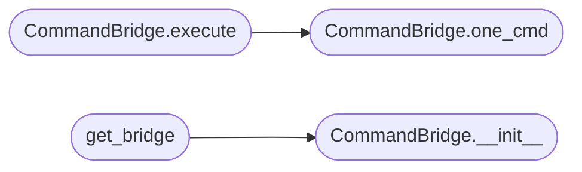

# `core.command_bridge`

> Source: [core/command_bridge.py:1](../../core/command_bridge.py#L1) | language `py` | coverage 88.9% | [API index](../index.md)

Lightweight command execution bridge between C2 bots and the LazyOwn CLI shell.

Lazy-loads the heavy shell infrastructure only when a command is actually
executed, reducing import-time overhead for C2 workers.

## Contents

- **Classes:** [`CommandBridge`](#commandbridge)
- **Functions:** [`get_bridge`](#get_bridge)

## Call Graph

Solid arrows stay in this module, dashed arrows leave it.



## Classes

<a id="commandbridge"></a>

### `CommandBridge`

`class` | [core/command_bridge.py:15](../../core/command_bridge.py#L15)

```python
class CommandBridge
```

Facade that lazy-loads LazyOwnShell for C2 bot command execution.

**Members**

| Member | Kind | Summary |
|---|---|---|
| [`__init__`](#commandbridge-__init__) | constructor |  |
| [`ready`](#commandbridge-ready) | property | Whether the bridge has been successfully initialized. |
| [`error`](#commandbridge-error) | property | Error message if initialization failed, or None. |
| [`onecmd`](#commandbridge-onecmd) | method | Execute a LazyOwn internal command via the shell. |
| [`one_cmd`](#commandbridge-one_cmd) | method | Execute a command using the shell's one_cmd method. |
| [`execute`](#commandbridge-execute) | method | Alias for one_cmd. |

<a id="commandbridge-__init__"></a>

#### `CommandBridge.__init__`

`constructor` | [core/command_bridge.py:18](../../core/command_bridge.py#L18)

```python
def __init__(self) -> None
```

*Called by:* [`get_bridge`](#get_bridge)

<a id="commandbridge-ready"></a>

#### `CommandBridge.ready`

`property` | [core/command_bridge.py:25](../../core/command_bridge.py#L25)

Decorators: `@property`

```python
def ready(self) -> bool
```

Whether the bridge has been successfully initialized.

**Returns:** `bool`

<a id="commandbridge-error"></a>

#### `CommandBridge.error`

`property` | [core/command_bridge.py:30](../../core/command_bridge.py#L30)

Decorators: `@property`

```python
def error(self) -> str | None
```

Error message if initialization failed, or None.

**Returns:** `str | None`

<a id="commandbridge-onecmd"></a>

#### `CommandBridge.onecmd`

`method` | [core/command_bridge.py:65](../../core/command_bridge.py#L65)

```python
def onecmd(self, command: str) -> str
```

Execute a LazyOwn internal command via the shell.

Captures all stdout output during execution and returns it as a string.
All output (banners, status, errors) is included.

**Parameters**

| Name | Type | Default | Description |
|---|---|---|---|
| `command` | `str` |  | The LazyOwn command string to execute. |

**Returns:** `str` - The captured stdout output, or an error message on failure.

<a id="commandbridge-one_cmd"></a>

#### `CommandBridge.one_cmd`

`method` | [core/command_bridge.py:89](../../core/command_bridge.py#L89)

```python
def one_cmd(self, command: str) -> str
```

Execute a command using the shell's one_cmd method.

Uses the shell's built-in output capture (which may include AI
enhancement depending on shell configuration).

**Parameters**

| Name | Type | Default | Description |
|---|---|---|---|
| `command` | `str` |  | The LazyOwn command string to execute. |

**Returns:** `str` - The command output as a string, or an error message on failure.

*Called by:* [`CommandBridge.execute`](#commandbridge-execute)

<a id="commandbridge-execute"></a>

#### `CommandBridge.execute`

`method` | [core/command_bridge.py:110](../../core/command_bridge.py#L110)

```python
def execute(self, command: str) -> str
```

Alias for one_cmd.

Execute any LazyOwn command.

**Parameters**

| Name | Type | Default | Description |
|---|---|---|---|
| `command` | `str` |  | The LazyOwn command string to execute. |

**Returns:** `str` - The command output as a string.

*Calls:* [`CommandBridge.one_cmd`](#commandbridge-one_cmd)

---

## Functions

<a id="get_bridge"></a>

### `get_bridge`

`function` | [core/command_bridge.py:126](../../core/command_bridge.py#L126)

```python
def get_bridge() -> CommandBridge
```

Get or create the singleton CommandBridge instance.

**Returns:** `CommandBridge` - The shared CommandBridge, created on first call.

*Calls:* [`CommandBridge.__init__`](#commandbridge-__init__)

---
