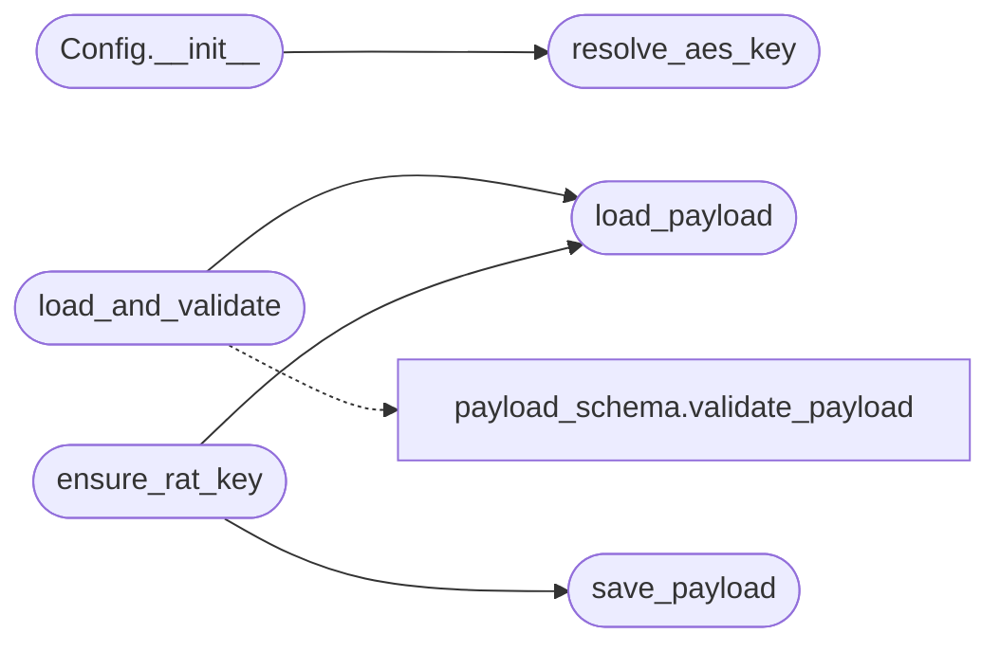

# `core.config`

> Source: [core/config.py:1](../../core/config.py#L1) | language `py` | coverage 90.0% | [API index](../index.md)

Configuration loader and Config wrapper.

``payload.json`` is the single source of runtime configuration for the entire
LazyOwn framework. This module exposes:

- `[`PAYLOAD_PATH`](#payload_path)` constant pointing at ``payload.json`` in the current working
  directory.
- `[`load_payload`](#load_payload)` / `[`save_payload`](#save_payload)` for reading and writing it atomically.
- `[`Config`](#config)` — a thin attribute-style wrapper around the payload dictionary.
- `[`resolve_aes_key`](#resolve_aes_key)` — the AES key resolver used by `[`Config`](#config)` so the
  key is reachable from the shell, the C2, the MCP, and the lazyaddons
  templating.

Atomic writes go through ``*.tmp`` and ``os.replace`` so a crashed write never
leaves the operator with a corrupt payload file.

## Contents

- **Classes:** [`Config`](#config)
- **Functions:** [`resolve_aes_key`](#resolve_aes_key), [`load_payload`](#load_payload), [`load_and_validate`](#load_and_validate), [`save_payload`](#save_payload), [`ensure_rat_key`](#ensure_rat_key)
- **Constants:** [`PAYLOAD_FILENAME`](#payload_filename), [`PAYLOAD_PATH`](#payload_path), [`LAZYOWN_ENV_PREFIX`](#lazyown_env_prefix)

## Call Graph

Solid arrows stay in this module, dashed arrows leave it.



## Classes

<a id="config"></a>

### `Config`

`class` | [core/config.py:211](../../core/config.py#L211)

```python
class Config
```

Attribute-style wrapper around a configuration dictionary.

Behavior is intentionally preserved from the legacy ``utils.Config``:
every key in the underlying dictionary becomes both an instance attribute
and is accessible via ``config[key]``. Missing keys via ``__getitem__``
return ``None`` rather than raising.

The instance also exposes ``aes_key`` (resolved bytes) and `[`as_params`](#config-as_params)`
(a snapshot of the underlying dictionary) so the LazyOwn shell can
substitute ``{{aes_key}}`` and other tokens in lazyaddons.

**Members**

| Member | Kind | Summary |
|---|---|---|
| [`__init__`](#config-__init__) | constructor |  |
| [`as_params`](#config-as_params) | method | Return a shallow copy of the underlying parameter dictionary. |
| [`overridden_keys`](#config-overridden_keys) | method | Return sorted list of keys that were overridden via ``LAZYOWN_*`` env vars. |

<a id="config-__init__"></a>

#### `Config.__init__`

`constructor` | [core/config.py:224](../../core/config.py#L224)

```python
def __init__(self, config_dict: dict[str, Any], sessions_dir: str | os.PathLike[str] | None = None) -> None
```

**Parameters**

| Name | Type | Default | Description |
|---|---|---|---|
| `config_dict` | `dict[str, Any]` |  |  |
| `sessions_dir` | `str \| os.PathLike[str] \| None` | `None` |  |

*Calls:* [`resolve_aes_key`](#resolve_aes_key)

*Called by:* [`load_adversary`](utils.py.md#load_adversary)

<a id="config-as_params"></a>

#### `Config.as_params`

`method` | [core/config.py:239](../../core/config.py#L239)

```python
def as_params(self) -> dict[str, Any]
```

Return a shallow copy of the underlying parameter dictionary.

**Returns:** `dict[str, Any]` - A dict suitable for ``self.params`` on the cmd2 shell. The
``aes_key`` value is the hex string, matching the format
consumed by lazyaddon template substitution.

<a id="config-overridden_keys"></a>

#### `Config.overridden_keys`

`method` | [core/config.py:249](../../core/config.py#L249)

```python
def overridden_keys(self) -> list[str]
```

Return sorted list of keys that were overridden via ``LAZYOWN_*`` env vars.

**Returns:** `list[str]`

---

## Functions

<a id="resolve_aes_key"></a>

### `resolve_aes_key`

`function` | [core/config.py:266](../../core/config.py#L266)

```python
def resolve_aes_key(config_dict: dict[str, Any], *, sessions_dir: str | os.PathLike[str]) -> bytes
```

Return a 32-byte AES key derived from config, disk, or randomness.

**Parameters**

| Name | Type | Default | Description |
|---|---|---|---|
| `config_dict` | `dict[str, Any]` |  | The payload dictionary. Looks for an ``aes_key`` entry holding a 64-character hex string. |
| `sessions_dir` | `str \| os.PathLike[str]` |  | Directory holding ``key.aes``. Created if missing. |

**Returns:** `bytes` - Exactly 32 bytes suitable for AES-256.

**Raises**

- `ValueError`: when ``aes_key`` is present but not a 64-char hex.

*Called by:* [`Config.__init__`](#config-__init__), [`BeaconConfigBuilder.build`](modules.beacon_config_builder.py.md#beaconconfigbuilder-build)

---

<a id="load_payload"></a>

### `load_payload`

`function` | [core/config.py:332](../../core/config.py#L332)

```python
def load_payload(path: str | os.PathLike[str] = PAYLOAD_FILENAME) -> dict[str, Any]
```

Load and return the JSON payload at ``path``.

If the payload does not exist but ``payload.example.json`` does, the
example file is copied to ``path`` automatically so a fresh clone never
leaves the operator without a starting configuration.

Environment variable overrides
(``LAZYOWN_<KEY>``) are applied on top of the file contents.

**Parameters**

| Name | Type | Default | Description |
|---|---|---|---|
| `path` | `str \| os.PathLike[str]` | `PAYLOAD_FILENAME` |  |

**Returns:** `dict[str, Any]`

**Raises**

- `FileNotFoundError`: if neither the payload nor the example exists.
- `json.JSONDecodeError`: if the payload is not valid JSON.

*Called by:* [`load_aliases`](cli.aliases.py.md#load_aliases), [`BofMarketplaceCommandSet.do_bof_run`](cli.commands.bof_registry.py.md#bofmarketplacecommandset-do_bof_run), [`MiscMigratedCommandSet.do_config_banner`](cli.commands.misc_migrated.py.md#miscmigratedcommandset-do_config_banner), [`PurpleTeamCommandSet.do_purple_config`](cli.commands.purple_team.py.md#purpleteamcommandset-do_purple_config), [`SecurityCommandSet.do_opsec`](cli.commands.security.py.md#securitycommandset-do_opsec), [`SecurityCommandSet.do_rotate_aes`](cli.commands.security.py.md#securitycommandset-do_rotate_aes), [`SecurityCommandSet.do_seal_credentials`](cli.commands.security.py.md#securitycommandset-do_seal_credentials), [`SecurityCommandSet.do_unseal_credentials`](cli.commands.security.py.md#securitycommandset-do_unseal_credentials), [`ensure_rat_key`](#ensure_rat_key), [`load_and_validate`](#load_and_validate), [`ensure_session_secrets`](core.session_secrets.py.md#ensure_session_secrets), [`rotate_session_secrets`](core.session_secrets.py.md#rotate_session_secrets) and 18 more

---

<a id="load_and_validate"></a>

### `load_and_validate`

`function` | [core/config.py:350](../../core/config.py#L350)

```python
def load_and_validate(path: str | os.PathLike[str] = PAYLOAD_FILENAME) -> dict[str, Any]
```

Load ``payload.json``, validate against the schema, and return a result dict.

Validation never raises: problems are collected in the ``warnings`` and
``errors`` lists of the result dict. The payload is returned in the
``payload`` key as loaded.

**Parameters**

| Name | Type | Default | Description |
|---|---|---|---|
| `path` | `str \| os.PathLike[str]` | `PAYLOAD_FILENAME` | Filesystem location of the payload (defaults to ``payload.json`` in the current working directory). |

**Returns:** `dict[str, Any]` - A dict with keys:
- ``payload`` (``dict``): the loaded configuration dictionary.
- `[`valid`](modules.playbook_admin.py.md#playbookentry-valid)` (``bool``): ``True`` when no errors were found.
- ``warnings`` (``list[str]``): advisory issues (schema warnings,
  unresolved placeholders, default-looking values).
- ``errors`` (``list[str]``): blocking issues from schema
  validation.
- ``issues`` (``list[ValidationIssue]``): structured schema issues
  for programmatic consumers (preserves backward compat).

*Calls:* [`load_payload`](#load_payload), [`validate_payload`](core.payload_schema.py.md#validate_payload)

---

<a id="save_payload"></a>

### `save_payload`

`function` | [core/config.py:401](../../core/config.py#L401)

```python
def save_payload(payload: dict[str, Any], path: str | os.PathLike[str] = PAYLOAD_FILENAME) -> None
```

Atomically merge ``payload`` into the JSON file at ``path``.

Concurrent writers mutate ``payload.json`` at the same time (the C2
rotates session secrets while the shell assigns parameters), so the
write is merged over the on-disk snapshot instead of replacing it:
keys absent from ``payload`` keep their current on-disk value.
Deleting a key is done by writing it with ``None``, never by omitting
it from the saved dict.

Uses a sibling ``*.tmp`` file plus ``os.replace`` so a crash mid-write
cannot leave the operator with a half-written payload.

Configuration changes are audited to ``sessions/config_changes.jsonl``.

**Parameters**

| Name | Type | Default | Description |
|---|---|---|---|
| `payload` | `dict[str, Any]` |  |  |
| `path` | `str \| os.PathLike[str]` | `PAYLOAD_FILENAME` |  |

*Called by:* [`McpBridgeCommandSet.do_auto_populate`](cli.commands.mcp_bridge.py.md#mcpbridgecommandset-do_auto_populate), [`PurpleTeamCommandSet.do_purple_config`](cli.commands.purple_team.py.md#purpleteamcommandset-do_purple_config), [`SecurityCommandSet.do_rotate_aes`](cli.commands.security.py.md#securitycommandset-do_rotate_aes), [`SecurityCommandSet.do_seal_credentials`](cli.commands.security.py.md#securitycommandset-do_seal_credentials), [`SecurityCommandSet.do_unseal_credentials`](cli.commands.security.py.md#securitycommandset-do_unseal_credentials), [`OrchestratorAssetsMixin.save_config`](cli.orchestrator_assets_tabs.py.md#orchestratorassetsmixin-save_config), [`OrchestratorAssetsMixin.save_guardrails`](cli.orchestrator_assets_tabs.py.md#orchestratorassetsmixin-save_guardrails), [`ensure_rat_key`](#ensure_rat_key), [`rotate_session_secrets`](core.session_secrets.py.md#rotate_session_secrets), [`set_default`](lazyc2.blueprints.api.py.md#set_default), [`LazyOwnShell.preloop`](lazyown.py.md#lazyownshell-preloop), [`set_full_cli`](modules.lazy_cli_bridge.py.md#set_full_cli) and 2 more

---

<a id="ensure_rat_key"></a>

### `ensure_rat_key`

`function` | [core/config.py:468](../../core/config.py#L468)

```python
def ensure_rat_key(config_obj: Any = None) -> str
```

Bootstrap the beacon HMAC signing key from ``payload.json``.

When the stored ``rat_key`` is empty, a placeholder, or the published
schema default, a fresh random 32-byte key is generated, persisted via
[`save_payload`](#save_payload), and (when given) mirrored onto the live config
object so the C2 enforcement and the implant builder read the same
secret in the same deployment.

**Parameters**

| Name | Type | Default | Description |
|---|---|---|---|
| `config_obj` | `Any` | `None` | Optional live config wrapper (`[`core.config.Config`](#config)`) whose ``rat_key`` attribute is refreshed in memory. |

**Returns:** `str` - The rat_key currently in effect as 64 lowercase hex characters.

**Raises**

- `RuntimeError`: if ``payload.json`` cannot be resolved to a dict and no key can be ensured.

*Calls:* [`load_payload`](#load_payload), [`save_payload`](#save_payload)

---

## Constants

<a id="payload_filename"></a>

### `PAYLOAD_FILENAME`

`constant` | [core/config.py:33](../../core/config.py#L33)

```python
PAYLOAD_FILENAME = 'payload.json'
```

---

<a id="payload_path"></a>

### `PAYLOAD_PATH`

`constant` | [core/config.py:34](../../core/config.py#L34)

```python
PAYLOAD_PATH = Path(PAYLOAD_FILENAME)
```

---

<a id="lazyown_env_prefix"></a>

### `LAZYOWN_ENV_PREFIX`

`constant` | [core/config.py:45](../../core/config.py#L45)

```python
LAZYOWN_ENV_PREFIX = 'LAZYOWN_'
```

---
