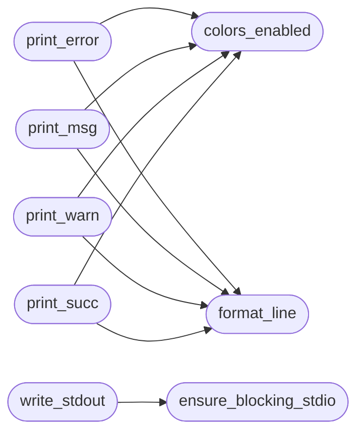

# `core.console`

> Source: [core/console.py:1](../../core/console.py#L1) | language `py` | coverage 100.0% | [API index](../index.md)

ANSI color constants and console output helpers.

This module is the single source of truth for terminal styling and the
`[`print_msg`](#print_msg)` / `[`print_warn`](#print_warn)` / `[`print_error`](#print_error)` / `[`print_succ`](#print_succ)` helpers used
throughout the framework. ``utils.py`` re-exports these names for backwards
compatibility with the historical import path ``from utils import print_msg``.

## Contents

- **Functions:** [`colors_enabled`](#colors_enabled), [`format_line`](#format_line), [`print_error`](#print_error), [`print_msg`](#print_msg), [`print_warn`](#print_warn), [`print_succ`](#print_succ), [`ensure_blocking_stdio`](#ensure_blocking_stdio), [`write_stdout`](#write_stdout)
- **Constants:** [`RESET`](#reset), [`BOLD`](#bold), [`UNDERLINE`](#underline), [`INVERT`](#invert), [`BLINK`](#blink), [`BLACK`](#black), [`RED`](#red), [`GREEN`](#green), [`YELLOW`](#yellow), [`BLUE`](#blue), [`MAGENTA`](#magenta), [`CYAN`](#cyan), [`WHITE`](#white), [`BG_BLACK`](#bg_black), [`BG_RED`](#bg_red), [`BG_GREEN`](#bg_green), [`BG_YELLOW`](#bg_yellow), [`BG_BLUE`](#bg_blue), [`BG_MAGENTA`](#bg_magenta), [`BG_CYAN`](#bg_cyan), [`BG_WHITE`](#bg_white), [`BRIGHT_BLACK`](#bright_black), [`BRIGHT_RED`](#bright_red), [`BRIGHT_GREEN`](#bright_green), [`BRIGHT_YELLOW`](#bright_yellow), [`BRIGHT_BLUE`](#bright_blue), [`BRIGHT_MAGENTA`](#bright_magenta), [`BRIGHT_CYAN`](#bright_cyan), [`BRIGHT_WHITE`](#bright_white), [`BG_BRIGHT_BLACK`](#bg_bright_black), [`BG_BRIGHT_RED`](#bg_bright_red), [`BG_BRIGHT_GREEN`](#bg_bright_green), [`BG_BRIGHT_YELLOW`](#bg_bright_yellow), [`BG_BRIGHT_BLUE`](#bg_bright_blue), [`BG_BRIGHT_MAGENTA`](#bg_bright_magenta), [`BG_BRIGHT_CYAN`](#bg_bright_cyan), [`BG_BRIGHT_WHITE`](#bg_bright_white), [`COLOR_256`](#color_256), [`BG_COLOR_256`](#bg_color_256), [`TRUE_COLOR`](#true_color), [`BG_TRUE_COLOR`](#bg_true_color), [`SURROGATE_CHARS`](#surrogate_chars), [`TRANSLATION_TABLE`](#translation_table), [`DOCS_BASE_URL`](#docs_base_url)

## Call Graph

Solid arrows stay in this module, dashed arrows leave it.



## Functions

<a id="colors_enabled"></a>

### `colors_enabled`

`function` | [core/console.py:98](../../core/console.py#L98)

```python
def colors_enabled() -> bool
```

Return False when NO_COLOR or ANSI_COLORS_DISABLED is set.

**Returns:** `bool` - True when ANSI escapes may be emitted, False otherwise.

*Called by:* [`print_error`](#print_error), [`print_msg`](#print_msg), [`print_succ`](#print_succ), [`print_warn`](#print_warn)

---

<a id="format_line"></a>

### `format_line`

`function` | [core/console.py:121](../../core/console.py#L121)

```python
def format_line(prefix: str, message: object, glyph: str = '') -> str
```

Build a single log line with standard prefix and sanitized message.

**Parameters**

| Name | Type | Default | Description |
|---|---|---|---|
| `prefix` | `str` |  | Short prefix such as ERROR_PREFIX. |
| `message` | `object` |  | Payload to sanitize and append. |
| `glyph` | `str` | `''` | Optional trailing glyph. |

**Returns:** `str` - Formatted single line string.

*Called by:* [`print_error`](#print_error), [`print_msg`](#print_msg), [`print_succ`](#print_succ), [`print_warn`](#print_warn)

---

<a id="print_error"></a>

### `print_error`

`function` | [core/console.py:137](../../core/console.py#L137)

```python
def print_error(error: object) -> None
```

Print a red error message to stdout (never raises on broken pipes).

**Parameters**

| Name | Type | Default | Description |
|---|---|---|---|
| `error` | `object` |  |  |

*Calls:* [`colors_enabled`](#colors_enabled), [`format_line`](#format_line)

*Called by:* [`list_png_files`](banner.py.md#list_png_files), [`main`](banner.py.md#main), [`AiCommandSet.do_ai_playbook`](cli.commands.ai.py.md#aicommandset-do_ai_playbook), [`AiCommandSet.do_ask`](cli.commands.ai.py.md#aicommandset-do_ask), [`AiCommandSet.do_groq`](cli.commands.ai.py.md#aicommandset-do_groq), [`AiCommandSet.do_poolcheck`](cli.commands.ai.py.md#aicommandset-do_poolcheck), [`AntiForensicsCommandSet.do_shred`](cli.commands.anti_forensics.py.md#antiforensicscommandset-do_shred), [`AntiForensicsCommandSet.do_wipe_free`](cli.commands.anti_forensics.py.md#antiforensicscommandset-do_wipe_free), [`AntiForensicsCommandSet.do_wipe_logs`](cli.commands.anti_forensics.py.md#antiforensicscommandset-do_wipe_logs), [`AntiForensicsCommandSet.do_wipe_timeline`](cli.commands.anti_forensics.py.md#antiforensicscommandset-do_wipe_timeline), [`AppLockerBypassCommandSet.do_applocker_csc`](cli.commands.applocker_bypass.py.md#applockerbypasscommandset-do_applocker_csc), [`AppLockerBypassCommandSet.do_applocker_installutil`](cli.commands.applocker_bypass.py.md#applockerbypasscommandset-do_applocker_installutil) and 523 more

---

<a id="print_msg"></a>

### `print_msg`

`function` | [core/console.py:143](../../core/console.py#L143)

```python
def print_msg(msg: object) -> None
```

Print a green informational message to stdout (never raises).

**Parameters**

| Name | Type | Default | Description |
|---|---|---|---|
| `msg` | `object` |  |  |

*Calls:* [`colors_enabled`](#colors_enabled), [`format_line`](#format_line)

*Called by:* [`AiCommandSet.do_ai_playbook`](cli.commands.ai.py.md#aicommandset-do_ai_playbook), [`AiCommandSet.do_ask`](cli.commands.ai.py.md#aicommandset-do_ask), [`AiCommandSet.do_groq`](cli.commands.ai.py.md#aicommandset-do_groq), [`AiCommandSet.do_llm_budget`](cli.commands.ai.py.md#aicommandset-do_llm_budget), [`AiCommandSet.do_poolcheck`](cli.commands.ai.py.md#aicommandset-do_poolcheck), [`AntiForensicsCommandSet.do_clean_ad`](cli.commands.anti_forensics.py.md#antiforensicscommandset-do_clean_ad), [`AntiForensicsCommandSet.do_cover_tracks`](cli.commands.anti_forensics.py.md#antiforensicscommandset-do_cover_tracks), [`AntiForensicsCommandSet.do_shred`](cli.commands.anti_forensics.py.md#antiforensicscommandset-do_shred), [`AntiForensicsCommandSet.do_wipe_free`](cli.commands.anti_forensics.py.md#antiforensicscommandset-do_wipe_free), [`AntiForensicsCommandSet.do_wipe_logs`](cli.commands.anti_forensics.py.md#antiforensicscommandset-do_wipe_logs), [`AntiForensicsCommandSet.do_wipe_timeline`](cli.commands.anti_forensics.py.md#antiforensicscommandset-do_wipe_timeline), [`AppLockerBypassCommandSet.do_applocker_csc`](cli.commands.applocker_bypass.py.md#applockerbypasscommandset-do_applocker_csc) and 665 more

---

<a id="print_warn"></a>

### `print_warn`

`function` | [core/console.py:149](../../core/console.py#L149)

```python
def print_warn(warn: object) -> None
```

Print a magenta/yellow warning message to stdout (never raises).

**Parameters**

| Name | Type | Default | Description |
|---|---|---|---|
| `warn` | `object` |  |  |

*Calls:* [`colors_enabled`](#colors_enabled), [`format_line`](#format_line)

*Called by:* [`AiCommandSet.do_ai_playbook`](cli.commands.ai.py.md#aicommandset-do_ai_playbook), [`AiCommandSet.do_llm_budget`](cli.commands.ai.py.md#aicommandset-do_llm_budget), [`AntiForensicsCommandSet.do_clean_ad`](cli.commands.anti_forensics.py.md#antiforensicscommandset-do_clean_ad), [`AntiForensicsCommandSet.do_cover_tracks`](cli.commands.anti_forensics.py.md#antiforensicscommandset-do_cover_tracks), [`AntiForensicsCommandSet.do_shred`](cli.commands.anti_forensics.py.md#antiforensicscommandset-do_shred), [`AntiForensicsCommandSet.do_wipe_free`](cli.commands.anti_forensics.py.md#antiforensicscommandset-do_wipe_free), [`AntiForensicsCommandSet.do_wipe_logs`](cli.commands.anti_forensics.py.md#antiforensicscommandset-do_wipe_logs), [`AntiForensicsCommandSet.do_wipe_timeline`](cli.commands.anti_forensics.py.md#antiforensicscommandset-do_wipe_timeline), [`C2SessionCommandSet.do_c2_exec`](cli.commands.c2_session.py.md#c2sessioncommandset-do_c2_exec), [`C2SessionCommandSet.do_c2_loot`](cli.commands.c2_session.py.md#c2sessioncommandset-do_c2_loot), [`C2SessionCommandSet.do_c2_reboot`](cli.commands.c2_session.py.md#c2sessioncommandset-do_c2_reboot), [`CalderaCommandSet.do_op_timeline`](cli.commands.caldera.py.md#calderacommandset-do_op_timeline) and 241 more

---

<a id="print_succ"></a>

### `print_succ`

`function` | [core/console.py:155](../../core/console.py#L155)

```python
def print_succ(msg: object) -> None
```

Print a bright green success message to stdout (never raises).

**Parameters**

| Name | Type | Default | Description |
|---|---|---|---|
| `msg` | `object` |  |  |

*Calls:* [`colors_enabled`](#colors_enabled), [`format_line`](#format_line)

*Called by:* [`AppLockerBypassCommandSet.do_applocker_csc`](cli.commands.applocker_bypass.py.md#applockerbypasscommandset-do_applocker_csc), [`AppLockerBypassCommandSet.do_applocker_installutil`](cli.commands.applocker_bypass.py.md#applockerbypasscommandset-do_applocker_installutil), [`AppLockerBypassCommandSet.do_applocker_msbuild`](cli.commands.applocker_bypass.py.md#applockerbypasscommandset-do_applocker_msbuild), [`AppLockerBypassCommandSet.do_applocker_mshta`](cli.commands.applocker_bypass.py.md#applockerbypasscommandset-do_applocker_mshta), [`AppLockerBypassCommandSet.do_applocker_regsvcs`](cli.commands.applocker_bypass.py.md#applockerbypasscommandset-do_applocker_regsvcs), [`AppLockerBypassCommandSet.do_applocker_rundll32`](cli.commands.applocker_bypass.py.md#applockerbypasscommandset-do_applocker_rundll32), [`CICDCommandSet.do_cicd_scan`](cli.commands.cicd.py.md#cicdcommandset-do_cicd_scan), [`CICDCommandSet.do_mfa_bypass`](cli.commands.cicd.py.md#cicdcommandset-do_mfa_bypass), [`CliAuthCommandSet.do_login`](cli.commands.cli_auth.py.md#cliauthcommandset-do_login), [`CliAuthCommandSet.do_logout`](cli.commands.cli_auth.py.md#cliauthcommandset-do_logout), [`CliAuthCommandSet.do_register`](cli.commands.cli_auth.py.md#cliauthcommandset-do_register), [`CloudCommandSet.do_cloud_buckets`](cli.commands.cloud.py.md#cloudcommandset-do_cloud_buckets) and 26 more

---

<a id="ensure_blocking_stdio"></a>

### `ensure_blocking_stdio`

`function` | [core/console.py:161](../../core/console.py#L161)

```python
def ensure_blocking_stdio() -> None
```

Restore blocking mode on stdio fds inherited as non-blocking.

Operator shells are sometimes spawned with ``O_NONBLOCK`` set on
stdout/stderr (supervisors, pipes, embedded terminals). Any later
`[`write`](tools.generate_metasploitable_gym.py.md#write)` then fails with ``BlockingIOError`` and kills the session.
This restores blocking mode best-effort and never raises.

*Called by:* [`write_stdout`](#write_stdout), [`main`](lazyown.py.md#main)

---

<a id="write_stdout"></a>

### `write_stdout`

`function` | [core/console.py:180](../../core/console.py#L180)

```python
def write_stdout(text: str) -> bool
```

Write ``text`` to stdout, tolerating non-blocking or broken pipes.

On ``BlockingIOError`` the stdio mode is restored to blocking once
and the write retried; as a last resort the text goes to stderr and
then is dropped. Never raises; returns True when stdout took it.

**Parameters**

| Name | Type | Default | Description |
|---|---|---|---|
| `text` | `str` |  |  |

**Returns:** `bool`

*Calls:* [`ensure_blocking_stdio`](#ensure_blocking_stdio)

---

## Constants

<a id="reset"></a>

### `RESET`

`constant` | [core/console.py:14](../../core/console.py#L14)

```python
RESET = '\x1b[0m'
```

---

<a id="bold"></a>

### `BOLD`

`constant` | [core/console.py:15](../../core/console.py#L15)

```python
BOLD = '\x1b[1m'
```

---

<a id="underline"></a>

### `UNDERLINE`

`constant` | [core/console.py:16](../../core/console.py#L16)

```python
UNDERLINE = '\x1b[4m'
```

---

<a id="invert"></a>

### `INVERT`

`constant` | [core/console.py:17](../../core/console.py#L17)

```python
INVERT = '\x1b[7m'
```

---

<a id="blink"></a>

### `BLINK`

`constant` | [core/console.py:18](../../core/console.py#L18)

```python
BLINK = '\x1b[5m'
```

---

<a id="black"></a>

### `BLACK`

`constant` | [core/console.py:20](../../core/console.py#L20)

```python
BLACK = '\x1b[30m'
```

---

<a id="red"></a>

### `RED`

`constant` | [core/console.py:21](../../core/console.py#L21)

```python
RED = '\x1b[31m'
```

---

<a id="green"></a>

### `GREEN`

`constant` | [core/console.py:22](../../core/console.py#L22)

```python
GREEN = '\x1b[32m'
```

---

<a id="yellow"></a>

### `YELLOW`

`constant` | [core/console.py:23](../../core/console.py#L23)

```python
YELLOW = '\x1b[33m'
```

---

<a id="blue"></a>

### `BLUE`

`constant` | [core/console.py:24](../../core/console.py#L24)

```python
BLUE = '\x1b[34m'
```

---

<a id="magenta"></a>

### `MAGENTA`

`constant` | [core/console.py:25](../../core/console.py#L25)

```python
MAGENTA = '\x1b[35m'
```

---

<a id="cyan"></a>

### `CYAN`

`constant` | [core/console.py:26](../../core/console.py#L26)

```python
CYAN = '\x1b[36m'
```

---

<a id="white"></a>

### `WHITE`

`constant` | [core/console.py:27](../../core/console.py#L27)

```python
WHITE = '\x1b[37m'
```

---

<a id="bg_black"></a>

### `BG_BLACK`

`constant` | [core/console.py:29](../../core/console.py#L29)

```python
BG_BLACK = '\x1b[40m'
```

---

<a id="bg_red"></a>

### `BG_RED`

`constant` | [core/console.py:30](../../core/console.py#L30)

```python
BG_RED = '\x1b[41m'
```

---

<a id="bg_green"></a>

### `BG_GREEN`

`constant` | [core/console.py:31](../../core/console.py#L31)

```python
BG_GREEN = '\x1b[42m'
```

---

<a id="bg_yellow"></a>

### `BG_YELLOW`

`constant` | [core/console.py:32](../../core/console.py#L32)

```python
BG_YELLOW = '\x1b[43m'
```

---

<a id="bg_blue"></a>

### `BG_BLUE`

`constant` | [core/console.py:33](../../core/console.py#L33)

```python
BG_BLUE = '\x1b[44m'
```

---

<a id="bg_magenta"></a>

### `BG_MAGENTA`

`constant` | [core/console.py:34](../../core/console.py#L34)

```python
BG_MAGENTA = '\x1b[45m'
```

---

<a id="bg_cyan"></a>

### `BG_CYAN`

`constant` | [core/console.py:35](../../core/console.py#L35)

```python
BG_CYAN = '\x1b[46m'
```

---

<a id="bg_white"></a>

### `BG_WHITE`

`constant` | [core/console.py:36](../../core/console.py#L36)

```python
BG_WHITE = '\x1b[47m'
```

---

<a id="bright_black"></a>

### `BRIGHT_BLACK`

`constant` | [core/console.py:38](../../core/console.py#L38)

```python
BRIGHT_BLACK = '\x1b[90m'
```

---

<a id="bright_red"></a>

### `BRIGHT_RED`

`constant` | [core/console.py:39](../../core/console.py#L39)

```python
BRIGHT_RED = '\x1b[91m'
```

---

<a id="bright_green"></a>

### `BRIGHT_GREEN`

`constant` | [core/console.py:40](../../core/console.py#L40)

```python
BRIGHT_GREEN = '\x1b[92m'
```

---

<a id="bright_yellow"></a>

### `BRIGHT_YELLOW`

`constant` | [core/console.py:41](../../core/console.py#L41)

```python
BRIGHT_YELLOW = '\x1b[93m'
```

---

<a id="bright_blue"></a>

### `BRIGHT_BLUE`

`constant` | [core/console.py:42](../../core/console.py#L42)

```python
BRIGHT_BLUE = '\x1b[94m'
```

---

<a id="bright_magenta"></a>

### `BRIGHT_MAGENTA`

`constant` | [core/console.py:43](../../core/console.py#L43)

```python
BRIGHT_MAGENTA = '\x1b[95m'
```

---

<a id="bright_cyan"></a>

### `BRIGHT_CYAN`

`constant` | [core/console.py:44](../../core/console.py#L44)

```python
BRIGHT_CYAN = '\x1b[96m'
```

---

<a id="bright_white"></a>

### `BRIGHT_WHITE`

`constant` | [core/console.py:45](../../core/console.py#L45)

```python
BRIGHT_WHITE = '\x1b[97m'
```

---

<a id="bg_bright_black"></a>

### `BG_BRIGHT_BLACK`

`constant` | [core/console.py:47](../../core/console.py#L47)

```python
BG_BRIGHT_BLACK = '\x1b[100m'
```

---

<a id="bg_bright_red"></a>

### `BG_BRIGHT_RED`

`constant` | [core/console.py:48](../../core/console.py#L48)

```python
BG_BRIGHT_RED = '\x1b[101m'
```

---

<a id="bg_bright_green"></a>

### `BG_BRIGHT_GREEN`

`constant` | [core/console.py:49](../../core/console.py#L49)

```python
BG_BRIGHT_GREEN = '\x1b[102m'
```

---

<a id="bg_bright_yellow"></a>

### `BG_BRIGHT_YELLOW`

`constant` | [core/console.py:50](../../core/console.py#L50)

```python
BG_BRIGHT_YELLOW = '\x1b[103m'
```

---

<a id="bg_bright_blue"></a>

### `BG_BRIGHT_BLUE`

`constant` | [core/console.py:51](../../core/console.py#L51)

```python
BG_BRIGHT_BLUE = '\x1b[104m'
```

---

<a id="bg_bright_magenta"></a>

### `BG_BRIGHT_MAGENTA`

`constant` | [core/console.py:52](../../core/console.py#L52)

```python
BG_BRIGHT_MAGENTA = '\x1b[105m'
```

---

<a id="bg_bright_cyan"></a>

### `BG_BRIGHT_CYAN`

`constant` | [core/console.py:53](../../core/console.py#L53)

```python
BG_BRIGHT_CYAN = '\x1b[106m'
```

---

<a id="bg_bright_white"></a>

### `BG_BRIGHT_WHITE`

`constant` | [core/console.py:54](../../core/console.py#L54)

```python
BG_BRIGHT_WHITE = '\x1b[107m'
```

---

<a id="color_256"></a>

### `COLOR_256`

`constant` | [core/console.py:56](../../core/console.py#L56)

```python
COLOR_256 = '\x1b[38;5;{}m'
```

---

<a id="bg_color_256"></a>

### `BG_COLOR_256`

`constant` | [core/console.py:57](../../core/console.py#L57)

```python
BG_COLOR_256 = '\x1b[48;5;{}m'
```

---

<a id="true_color"></a>

### `TRUE_COLOR`

`constant` | [core/console.py:58](../../core/console.py#L58)

```python
TRUE_COLOR = '\x1b[38;2;{};{};{}m'
```

---

<a id="bg_true_color"></a>

### `BG_TRUE_COLOR`

`constant` | [core/console.py:59](../../core/console.py#L59)

```python
BG_TRUE_COLOR = '\x1b[48;2;{};{};{}m'
```

---

<a id="surrogate_chars"></a>

### `SURROGATE_CHARS`

`constant` | [core/console.py:61](../../core/console.py#L61)

```python
SURROGATE_CHARS = dict.fromkeys(range(55296, 57344))
```

---

<a id="translation_table"></a>

### `TRANSLATION_TABLE`

`constant` | [core/console.py:62](../../core/console.py#L62)

```python
TRANSLATION_TABLE = str.maketrans(SURROGATE_CHARS)
```

---

<a id="docs_base_url"></a>

### `DOCS_BASE_URL`

`constant` | [core/console.py:69](../../core/console.py#L69)

```python
DOCS_BASE_URL = 'https://grisuno.github.io/LazyOwn/'
```

---
