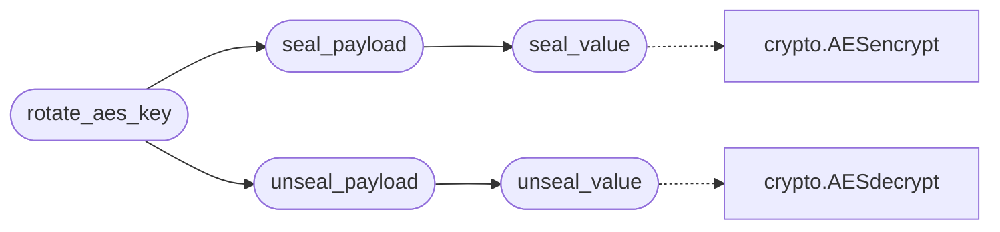

# `core.credential_vault`

> Source: [core/credential_vault.py:1](../../core/credential_vault.py#L1) | language `py` | coverage 100.0% | [API index](../index.md)

Credential vault — AES-256-GCM encryption for sensitive config values.

Wraps `[`core.crypto.AESencrypt`](core.crypto.py.md#aesencrypt)`/`[`AESdecrypt`](core.crypto.py.md#aesdecrypt)` to protect secrets stored
in ``payload.json`` (`[`c2_pass`](modules.beacon_config_builder.py.md#beaconconfig-c2_pass)`, ``email_password``, ``api_key``, etc.)
and provides transparent load/save with encryption.

Design (SOLID):
- Single Responsibility: CredentialVault only handles encryption of secrets.
- Open/Closed: new sensitive keys added via SENSITIVE_KEYS without code change.
- Liskov: any AES-compatible encryptor can replace the default.
- Interface Segregation: seal(), unseal(), and seal_payload() are the surface.
- Dependency Inversion: depends on bytes-based encrypt/decrypt callables.

Usage:
    from core.credential_vault import seal_payload, unseal_payload

    payload = load_payload()
    secure = seal_payload(payload)
    save_payload(secure)

    loaded = load_payload()
    plain = unseal_payload(loaded)

## Contents

- **Functions:** [`check_dangerous_defaults`](#check_dangerous_defaults), [`seal_value`](#seal_value), [`unseal_value`](#unseal_value), [`seal_payload`](#seal_payload), [`unseal_payload`](#unseal_payload), [`rotate_aes_key`](#rotate_aes_key), [`generate_secure_defaults`](#generate_secure_defaults)
- **Constants:** [`SENSITIVE_KEYS`](#sensitive_keys), [`DANGEROUS_DEFAULTS`](#dangerous_defaults)

## Call Graph

Solid arrows stay in this module, dashed arrows leave it.



## Functions

<a id="check_dangerous_defaults"></a>

### `check_dangerous_defaults`

`function` | [core/credential_vault.py:63](../../core/credential_vault.py#L63)

```python
def check_dangerous_defaults(payload: dict[str, Any]) -> list[str]
```

Scan payload for unchanged default credential values.

Returns a list of human-readable warning messages. An empty list means
all sensitive keys have been changed from their factory defaults.

**Parameters**

| Name | Type | Default | Description |
|---|---|---|---|
| `payload` | `dict[str, Any]` |  |  |

**Returns:** `list[str]`

*Called by:* [`LazyOwnShell.preloop`](lazyown.py.md#lazyownshell-preloop)

---

<a id="seal_value"></a>

### `seal_value`

`function` | [core/credential_vault.py:93](../../core/credential_vault.py#L93)

```python
def seal_value(plaintext: str, key: bytes | None = None) -> str
```

Encrypt a single credential value.

**Parameters**

| Name | Type | Default | Description |
|---|---|---|---|
| `plaintext` | `str` |  | Sensitive value to encrypt. |
| `key` | `bytes \| None` | `None` | AES key (auto-resolved if None). |

**Returns:** `str` - Base64-encoded sealed value with vault marker prefix.

*Calls:* [`AESencrypt`](core.crypto.py.md#aesencrypt)

*Called by:* [`seal_payload`](#seal_payload)

---

<a id="unseal_value"></a>

### `unseal_value`

`function` | [core/credential_vault.py:112](../../core/credential_vault.py#L112)

```python
def unseal_value(sealed: str, key: bytes | None = None) -> str
```

Decrypt a sealed credential value.

Returns the value unchanged if it is not a sealed vault value (plaintext
backward compat). Returns empty string for empty input.

**Parameters**

| Name | Type | Default | Description |
|---|---|---|---|
| `sealed` | `str` |  | Possibly encrypted credential string. |
| `key` | `bytes \| None` | `None` | AES key (auto-resolved if None). |

**Returns:** `str` - Decrypted plaintext string.

*Calls:* [`AESdecrypt`](core.crypto.py.md#aesdecrypt)

*Called by:* [`unseal_payload`](#unseal_payload)

---

<a id="seal_payload"></a>

### `seal_payload`

`function` | [core/credential_vault.py:141](../../core/credential_vault.py#L141)

```python
def seal_payload(payload: dict[str, Any], key: bytes | None = None) -> dict[str, Any]
```

Return a copy of ``payload`` with all sensitive values encrypted.

Non-sensitive keys and the key ``aes_key`` itself are left untouched.
The returned dict is safe to write to ``payload.json``.

**Parameters**

| Name | Type | Default | Description |
|---|---|---|---|
| `payload` | `dict[str, Any]` |  | Configuration dict to seal. |
| `key` | `bytes \| None` | `None` | AES key (auto-resolved if None). |

**Returns:** `dict[str, Any]` - Shallow copy with sensitive fields encrypted.

*Calls:* [`seal_value`](#seal_value)

*Called by:* [`SecurityCommandSet.do_seal_credentials`](cli.commands.security.py.md#securitycommandset-do_seal_credentials), [`rotate_aes_key`](#rotate_aes_key), [`LazyOwnShell.preloop`](lazyown.py.md#lazyownshell-preloop)

---

<a id="unseal_payload"></a>

### `unseal_payload`

`function` | [core/credential_vault.py:164](../../core/credential_vault.py#L164)

```python
def unseal_payload(payload: dict[str, Any], key: bytes | None = None) -> dict[str, Any]
```

Return a copy of ``payload`` with all sealed values decrypted.

Values that are not sealed are passed through unchanged.

**Parameters**

| Name | Type | Default | Description |
|---|---|---|---|
| `payload` | `dict[str, Any]` |  | Configuration dict possibly containing sealed values. |
| `key` | `bytes \| None` | `None` | AES key (auto-resolved if None). |

**Returns:** `dict[str, Any]` - Shallow copy with sensitive fields decrypted in-place.

*Calls:* [`unseal_value`](#unseal_value)

*Called by:* [`SecurityCommandSet.do_unseal_credentials`](cli.commands.security.py.md#securitycommandset-do_unseal_credentials), [`rotate_aes_key`](#rotate_aes_key)

---

<a id="rotate_aes_key"></a>

### `rotate_aes_key`

`function` | [core/credential_vault.py:186](../../core/credential_vault.py#L186)

```python
def rotate_aes_key(payload: dict[str, Any], current_key: bytes | None = None) -> tuple[dict[str, Any], bytes]
```

Generate a new AES key, re-encrypt all sealed values under it.

First decrypts with ``current_key``, then encrypts with a fresh key.
The fresh key is written to ``sessions/key.aes`` with mode 0o600.

**Parameters**

| Name | Type | Default | Description |
|---|---|---|---|
| `payload` | `dict[str, Any]` |  | Configuration dict (can be sealed or plain). |
| `current_key` | `bytes \| None` | `None` | Current AES key (auto-resolved if None). |

**Returns:** `tuple[dict[str, Any], bytes]` - ``(new_payload, new_key_bytes)`` tuple. ``new_payload``
is sealed with the fresh key and ready to save.

*Calls:* [`seal_payload`](#seal_payload), [`unseal_payload`](#unseal_payload)

*Called by:* [`SecurityCommandSet.do_rotate_aes`](cli.commands.security.py.md#securitycommandset-do_rotate_aes)

---

<a id="generate_secure_defaults"></a>

### `generate_secure_defaults`

`function` | [core/credential_vault.py:215](../../core/credential_vault.py#L215)

```python
def generate_secure_defaults() -> dict[str, str]
```

Generate cryptographically random default values for sensitive keys.

Returns a dict mapping each sensitive key to a 32-char hex random value.
Use this to bootstrap a new ``payload.json`` with secure defaults.

**Returns:** `dict[str, str]`

---

## Constants

<a id="sensitive_keys"></a>

### `SENSITIVE_KEYS`

`constant` | [core/credential_vault.py:37](../../core/credential_vault.py#L37)

```python
SENSITIVE_KEYS: tuple[str, ...]
```

---

<a id="dangerous_defaults"></a>

### `DANGEROUS_DEFAULTS`

`constant` | [core/credential_vault.py:52](../../core/credential_vault.py#L52)

```python
DANGEROUS_DEFAULTS: dict[str, str]
```

---
