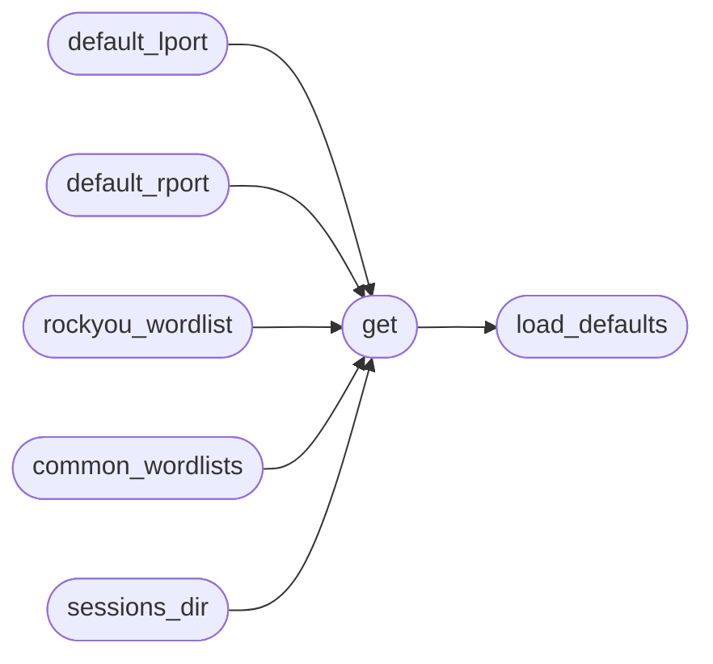

# `core.defaults`

> Source: [core/defaults.py:1](../../core/defaults.py#L1) | language `py` | coverage 100.0% | [API index](../index.md)

Build-time default constants loaded from ``config/defaults.toml``.

Single source of truth for fallback ports, wordlists and well-known
paths. Commands read live engagement values from ``payload.json``
first and call these helpers only when the key is unset, so the TOML
file is never rewritten at runtime and per-engagement ``assign``
values always win.

## Contents

- **Functions:** [`load_defaults`](#load_defaults), [`clear_cache`](#clear_cache), [`get`](#get), [`default_lport`](#default_lport), [`default_rport`](#default_rport), [`rockyou_wordlist`](#rockyou_wordlist), [`common_wordlists`](#common_wordlists), [`sessions_dir`](#sessions_dir)

## Call Graph

Solid arrows stay in this module, dashed arrows leave it.



## Functions

<a id="load_defaults"></a>

### `load_defaults`

`function` | [core/defaults.py:21](../../core/defaults.py#L21)

```python
def load_defaults(path: str | Path | None = None) -> dict[str, Any]
```

Load and cache the defaults document.

**Parameters**

| Name | Type | Default | Description |
|---|---|---|---|
| `path` | `str \| Path \| None` | `None` | TOML file to load. Defaults to ``config/defaults.toml``. |

**Returns:** `dict[str, Any]` - Parsed TOML mapping with `[`ports`](modules.enrich.py.md#enrichresult-ports)`, ``wordlists`` and
``paths`` sections.

**Raises**

- `FileNotFoundError`: When the TOML file does not exist.
- `ValueError`: (raised in the body, not documented)

*Called by:* [`get`](#get), [`get_defaults`](lazyc2.blueprints.api.py.md#get_defaults)

---

<a id="clear_cache"></a>

### `clear_cache`

`function` | [core/defaults.py:44](../../core/defaults.py#L44)

```python
def clear_cache() -> None
```

Drop cached documents (tests only).

---

<a id="get"></a>

### `get`

`function` | [core/defaults.py:49](../../core/defaults.py#L49)

```python
def get(section: str, key: str, default: Any = None) -> Any
```

Return ``defaults[section][key]`` or ``default`` when absent.

**Parameters**

| Name | Type | Default | Description |
|---|---|---|---|
| `section` | `str` |  | TOML section (`[`ports`](modules.enrich.py.md#enrichresult-ports)`, ``wordlists``, ``paths``). |
| `key` | `str` |  | Key inside the section. |
| `default` | `Any` | `None` | Fallback when section or key is missing. |

**Returns:** `Any` - The configured value or ``default``.

*Calls:* [`load_defaults`](#load_defaults)

*Called by:* [`common_wordlists`](#common_wordlists), [`default_lport`](#default_lport), [`default_rport`](#default_rport), [`rockyou_wordlist`](#rockyou_wordlist), [`sessions_dir`](#sessions_dir)

---

<a id="default_lport"></a>

### `default_lport`

`function` | [core/defaults.py:63](../../core/defaults.py#L63)

```python
def default_lport() -> int
```

Return the fallback listener port as an int.

**Returns:** `int` - ``ports.default_lport`` (1337 unless the TOML changes it).

*Calls:* [`get`](#get)

---

<a id="default_rport"></a>

### `default_rport`

`function` | [core/defaults.py:72](../../core/defaults.py#L72)

```python
def default_rport() -> int
```

Return the fallback remote port as an int.

**Returns:** `int` - ``ports.default_rport`` (443 unless the TOML changes it).

*Calls:* [`get`](#get)

---

<a id="rockyou_wordlist"></a>

### `rockyou_wordlist`

`function` | [core/defaults.py:81](../../core/defaults.py#L81)

```python
def rockyou_wordlist() -> str
```

Return the default wordlist path.

**Returns:** `str` - ``wordlists.rockyou`` unless the TOML changes it.

*Calls:* [`get`](#get)

*Called by:* [`CredMigratedCommandSet.do_john2zip`](cli.commands.cred_migrated.py.md#credmigratedcommandset-do_john2zip)

---

<a id="common_wordlists"></a>

### `common_wordlists`

`function` | [core/defaults.py:90](../../core/defaults.py#L90)

```python
def common_wordlists() -> list[str]
```

Return the ordered wordlist fallback candidates.

**Returns:** `list[str]` - ``wordlists.fallbacks`` as a list of paths.

*Calls:* [`get`](#get)

---

<a id="sessions_dir"></a>

### `sessions_dir`

`function` | [core/defaults.py:100](../../core/defaults.py#L100)

```python
def sessions_dir() -> str
```

Return the sessions directory path.

**Returns:** `str` - ``paths.sessions_dir`` (``sessions`` unless changed).

*Calls:* [`get`](#get)

---
