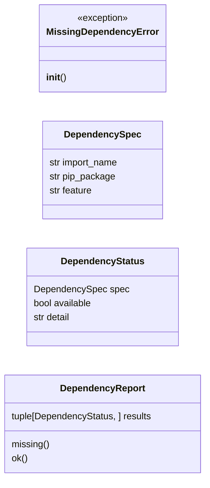
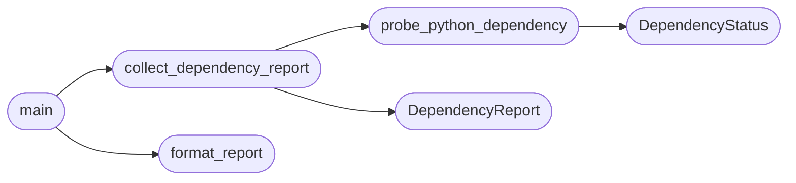

# `core.dependencies`

> Source: [core/dependencies.py:1](../../core/dependencies.py#L1) | language `py` | coverage 100.0% | [API index](../index.md)

Graceful optional-import handling for heavy third-party dependencies.

Historically ``utils.py`` imported every third-party library at module top
level. A single missing package (for example ``pycryptodome`` or
``python-libnmap``) raised `ImportError` before any code ran, which
crashed the whole framework -- CLI, C2 and MCP server alike -- with an opaque
traceback and no guidance on how to recover.

This module makes optional dependencies fail late and loudly instead of early
and silently:

- [`optional_import`](#optional_import) and [`optional_attr`](#optional_attr) return the real module or
  attribute when the package is installed (identical runtime behaviour), and a
  `_DeferredImport` proxy when it is missing. The proxy raises
  [`MissingDependencyError`](#missingdependencyerror) only when the feature is actually used, with
  the exact ``pip install`` command needed to fix it.
- [`OPTIONAL_PYTHON_DEPENDENCIES`](#optional_python_dependencies) is the single source of truth for the
  install hint of every dependency bound lazily by ``utils.py``.

Scope: this module owns *runtime resilience* for lazily-imported Python
packages only. The operator-facing preflight report (Python version, virtual
environment, external binaries, certificates, SecLists) lives in
[`cli.doctor`](cli.doctor.py.md), which is rendered with ``rich`` and reachable through the
``doctor`` CLI command. This module deliberately depends only on the Python
standard library so that ``python3 -m core.dependencies`` keeps working as a
last-resort diagnostic even when ``rich`` or ``cmd2`` themselves fail to
import.

## Contents

- **Classes:** [`DependencySpec`](#dependencyspec), [`DependencyStatus`](#dependencystatus), [`DependencyReport`](#dependencyreport)
- **Exceptions:** [`MissingDependencyError`](#missingdependencyerror)
- **Functions:** [`optional_import`](#optional_import), [`optional_attr`](#optional_attr), [`probe_python_dependency`](#probe_python_dependency), [`collect_dependency_report`](#collect_dependency_report), [`format_report`](#format_report), [`main`](#main)
- **Constants:** [`OPTIONAL_PYTHON_DEPENDENCIES`](#optional_python_dependencies)

## Type Diagram



## Call Graph

Solid arrows stay in this module, dashed arrows leave it.



## Classes

<a id="dependencyspec"></a>

### `DependencySpec`

`class` `dataclass` | [core/dependencies.py:66](../../core/dependencies.py#L66)

Decorators: `@dataclass(frozen=True)`

```python
class DependencySpec
```

Declarative metadata for a single optional Python dependency.

**Attributes**

| Name | Type | Default | Description |
|---|---|---|---|
| [`import_name`](#dependencyspec-import_name) | `str` |  | The dotted import path consumed by the framework. |
| [`pip_package`](#dependencyspec-pip_package) | `str` |  | The PyPI distribution that provides `[`import_name`](#dependencyspec-import_name)`. |
| [`feature`](#dependencyspec-feature) | `str` |  | Human-readable capability that the dependency unlocks. |

---

<a id="dependencystatus"></a>

### `DependencyStatus`

`class` `dataclass` | [core/dependencies.py:253](../../core/dependencies.py#L253)

Decorators: `@dataclass(frozen=True)`

```python
class DependencyStatus
```

Result of probing a single Python dependency.

**Attributes**

| Name | Type | Default | Description |
|---|---|---|---|
| [`spec`](#dependencystatus-spec) | `DependencySpec` |  | The dependency that was probed. |
| [`available`](#dependencystatus-available) | `bool` |  | ``True`` when the dependency imported successfully. |
| [`detail`](#dependencystatus-detail) | `str` |  | Installed version when available, otherwise the import error. |

---

<a id="dependencyreport"></a>

### `DependencyReport`

`class` `dataclass` | [core/dependencies.py:268](../../core/dependencies.py#L268)

Decorators: `@dataclass(frozen=True)`

```python
class DependencyReport
```

Aggregated readiness snapshot of the lazily-imported Python packages.

**Attributes**

| Name | Type | Default | Description |
|---|---|---|---|
| [`results`](#dependencyreport-results) | `tuple[DependencyStatus, ...]` |  | Status for every declared optional Python dependency. |

**Members**

| Member | Kind | Summary |
|---|---|---|
| [`missing`](#dependencyreport-missing) | property | Return the optional Python dependencies that are not installed. |
| [`ok`](#dependencyreport-ok) | property | Return ``True`` when every declared dependency is present. |

<a id="dependencyreport-missing"></a>

#### `DependencyReport.missing`

`property` | [core/dependencies.py:278](../../core/dependencies.py#L278)

Decorators: `@property`

```python
def missing(self) -> tuple[DependencyStatus, ...]
```

Return the optional Python dependencies that are not installed.

**Returns:** `tuple[DependencyStatus, ...]`

<a id="dependencyreport-ok"></a>

#### `DependencyReport.ok`

`property` | [core/dependencies.py:283](../../core/dependencies.py#L283)

Decorators: `@property`

```python
def ok(self) -> bool
```

Return ``True`` when every declared dependency is present.

**Returns:** `bool`

---

## Exceptions

<a id="missingdependencyerror"></a>

### `MissingDependencyError`

`exception` | [core/dependencies.py:37](../../core/dependencies.py#L37)

```python
class MissingDependencyError(ImportError)
```

Bases: `ImportError`

Raised when an optional dependency is used but is not installed.

The error message includes the import name, the owning feature and the
exact ``pip install`` command that resolves it, so the operator never has
to map a bare ``ModuleNotFoundError`` back to a package name by hand.

**Members**

| Member | Kind | Summary |
|---|---|---|
| [`__init__`](#missingdependencyerror-__init__) | constructor | Build a remediation-oriented error message. |

<a id="missingdependencyerror-__init__"></a>

#### `MissingDependencyError.__init__`

`constructor` | [core/dependencies.py:45](../../core/dependencies.py#L45)

```python
def __init__(self, import_name: str, pip_package: str, feature: str) -> None
```

Build a remediation-oriented error message.

**Parameters**

| Name | Type | Default | Description |
|---|---|---|---|
| `import_name` | `str` |  | The dotted import path that failed (for example ``Crypto.Cipher``). |
| `pip_package` | `str` |  | The PyPI distribution that provides `[`import_name`](#dependencyspec-import_name)`. |
| `feature` | `str` |  | Human-readable description of the capability that needs the dependency. |

---

## Functions

<a id="optional_import"></a>

### `optional_import`

`function` | [core/dependencies.py:183](../../core/dependencies.py#L183)

```python
def optional_import(import_name: str, *, pip_package: str | None = None, feature: str | None = None) -> Any
```

Import an optional module, returning a deferred proxy when absent.

**Parameters**

| Name | Type | Default | Description |
|---|---|---|---|
| `import_name` | `str` |  | The dotted module path to import. |
| `pip_package` | `str \| None` | `None` | Override for the PyPI distribution name. Ignored when `[`import_name`](#dependencyspec-import_name)` is already declared in the registry. |
| `feature` | `str \| None` | `None` | Override for the capability description. Ignored when `[`import_name`](#dependencyspec-import_name)` is already declared in the registry. |

**Returns:** `Any` - The imported module when available, otherwise a `_DeferredImport`
proxy that raises [`MissingDependencyError`](#missingdependencyerror) on first use.

---

<a id="optional_attr"></a>

### `optional_attr`

`function` | [core/dependencies.py:209](../../core/dependencies.py#L209)

```python
def optional_attr(import_name: str, attr: str, *, pip_package: str | None = None, feature: str | None = None) -> Any
```

Import an attribute from an optional module, deferring failure.

The ``attr`` may be a plain attribute (class, function, constant) or a
submodule (for example `[`AES`](utils.py.md#aes)` in ``Crypto.Cipher``). When attribute
access fails, the function transparently retries by importing
``f"{import_name}.{attr}"`` as a submodule, mirroring the semantics of
``from {import_name} import {attr}``.

**Parameters**

| Name | Type | Default | Description |
|---|---|---|---|
| `import_name` | `str` |  | The dotted module path to import. |
| `attr` | `str` |  | The attribute or submodule to retrieve from the imported module. |
| `pip_package` | `str \| None` | `None` | Override for the PyPI distribution name. Ignored when `[`import_name`](#dependencyspec-import_name)` is already declared in the registry. |
| `feature` | `str \| None` | `None` | Override for the capability description. Ignored when `[`import_name`](#dependencyspec-import_name)` is already declared in the registry. |

**Returns:** `Any` - The requested attribute or submodule when available, otherwise a
`_DeferredImport` proxy that raises
[`MissingDependencyError`](#missingdependencyerror) on first use.

---

<a id="probe_python_dependency"></a>

### `probe_python_dependency`

`function` | [core/dependencies.py:288](../../core/dependencies.py#L288)

```python
def probe_python_dependency(spec: DependencySpec) -> DependencyStatus
```

Probe a single Python dependency by importing it.

**Parameters**

| Name | Type | Default | Description |
|---|---|---|---|
| `spec` | `DependencySpec` |  | The dependency to probe. |

**Returns:** `DependencyStatus` - A [`DependencyStatus`](#dependencystatus) describing availability and version.

*Calls:* [`DependencyStatus`](#dependencystatus)

*Called by:* [`collect_dependency_report`](#collect_dependency_report)

---

<a id="collect_dependency_report"></a>

### `collect_dependency_report`

`function` | [core/dependencies.py:312](../../core/dependencies.py#L312)

```python
def collect_dependency_report() -> DependencyReport
```

Probe every declared optional Python dependency.

**Returns:** `DependencyReport` - A [`DependencyReport`](#dependencyreport) aggregating the status of all dependencies
in [`OPTIONAL_PYTHON_DEPENDENCIES`](#optional_python_dependencies).

*Calls:* [`DependencyReport`](#dependencyreport), [`probe_python_dependency`](#probe_python_dependency)

*Called by:* [`main`](#main)

---

<a id="format_report"></a>

### `format_report`

`function` | [core/dependencies.py:323](../../core/dependencies.py#L323)

```python
def format_report(report: DependencyReport, *, use_color: bool = True) -> str
```

Render a [`DependencyReport`](#dependencyreport) as an aligned, human-readable block.

**Parameters**

| Name | Type | Default | Description |
|---|---|---|---|
| `report` | `DependencyReport` |  | The report to render. |
| `use_color` | `bool` | `True` | When ``True`` wrap status markers in ANSI colour codes. |

**Returns:** `str` - A multi-line string suitable for printing to a terminal.

*Called by:* [`main`](#main)

---

<a id="main"></a>

### `main`

`function` | [core/dependencies.py:368](../../core/dependencies.py#L368)

```python
def main() -> int
```

Print the optional-dependency report and return a process exit code.

**Returns:** `int` - ``0`` when every declared dependency is present, ``1`` otherwise. The
non-zero code lets shell scripts gate on a clean environment.

*Calls:* [`collect_dependency_report`](#collect_dependency_report), [`format_report`](#format_report)

---

## Constants

<a id="optional_python_dependencies"></a>

### `OPTIONAL_PYTHON_DEPENDENCIES`

`constant` | [core/dependencies.py:80](../../core/dependencies.py#L80)

```python
OPTIONAL_PYTHON_DEPENDENCIES: dict[str, DependencySpec]
```

---
