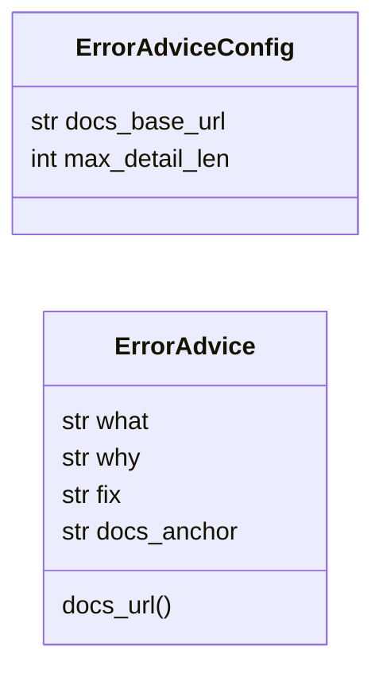

# `core.error_advice`

> Source: [core/error_advice.py:1](../../core/error_advice.py#L1) | language `py` | coverage 100.0% | [API index](../index.md)

Actionable error advice with fix command and documentation link.

Every framework error renders four lines: what failed, why it failed,
the exact command that fixes it, and the documentation anchor. This
replaces bare red messages that forced operators to guess the remedy.

## Contents

- **Classes:** [`ErrorAdviceConfig`](#erroradviceconfig), [`ErrorAdvice`](#erroradvice)
- **Functions:** [`get_advice`](#get_advice), [`render_advice`](#render_advice)
- **Constants:** [`DEFAULT_CONFIG`](#default_config)

## Type Diagram



## Call Graph

Solid arrows stay in this module, dashed arrows leave it.


## Classes

<a id="erroradviceconfig"></a>

### `ErrorAdviceConfig`

`class` `dataclass` | [core/error_advice.py:16](../../core/error_advice.py#L16)

Decorators: `@dataclass(frozen=True)`

```python
class ErrorAdviceConfig
```

Centralized knobs for error advice rendering.

**Attributes**

| Name | Type | Default | Description |
|---|---|---|---|
| [`docs_base_url`](#erroradviceconfig-docs_base_url) | `str` | `DOCS_BASE_URL` |  |
| [`max_detail_len`](#erroradviceconfig-max_detail_len) | `int` | `220` |  |

---

<a id="erroradvice"></a>

### `ErrorAdvice`

`class` `dataclass` | [core/error_advice.py:27](../../core/error_advice.py#L27)

Decorators: `@dataclass(frozen=True)`

```python
class ErrorAdvice
```

Structured remedy for one failure mode.

**Attributes**

| Name | Type | Default | Description |
|---|---|---|---|
| [`what`](#erroradvice-what) | `str` |  |  |
| [`why`](#erroradvice-why) | `str` |  |  |
| [`fix`](#erroradvice-fix) | `str` |  |  |
| [`docs_anchor`](#erroradvice-docs_anchor) | `str` |  |  |

**Members**

| Member | Kind | Summary |
|---|---|---|
| [`docs_url`](#erroradvice-docs_url) | method | Return absolute documentation URL for this advice. |

<a id="erroradvice-docs_url"></a>

#### `ErrorAdvice.docs_url`

`method` | [core/error_advice.py:35](../../core/error_advice.py#L35)

```python
def docs_url(self, config: ErrorAdviceConfig = DEFAULT_CONFIG) -> str
```

Return absolute documentation URL for this advice.

**Parameters**

| Name | Type | Default | Description |
|---|---|---|---|
| `config` | `ErrorAdviceConfig` | `DEFAULT_CONFIG` |  |

**Returns:** `str`

---

## Functions

<a id="get_advice"></a>

### `get_advice`

`function` | [core/error_advice.py:74](../../core/error_advice.py#L74)

```python
def get_advice(key: str) -> ErrorAdvice | None
```

Return advice for key or None when unknown.

**Parameters**

| Name | Type | Default | Description |
|---|---|---|---|
| `key` | `str` |  | Lookup key such as tool_not_found:nmap. |

**Returns:** `ErrorAdvice | None` - Matching ErrorAdvice or None.

*Called by:* [`render_advice`](#render_advice)

---

<a id="render_advice"></a>

### `render_advice`

`function` | [core/error_advice.py:86](../../core/error_advice.py#L86)

```python
def render_advice(key: str, config: ErrorAdviceConfig = DEFAULT_CONFIG) -> str
```

Render advice as four plain lines with explicit level tags.

**Parameters**

| Name | Type | Default | Description |
|---|---|---|---|
| `key` | `str` |  | Lookup key. |
| `config` | `ErrorAdviceConfig` | `DEFAULT_CONFIG` | Rendering configuration. |

**Returns:** `str` - Multiline string, empty when the key is unknown.

*Calls:* [`get_advice`](#get_advice)

---

## Constants

<a id="default_config"></a>

### `DEFAULT_CONFIG`

`constant` | [core/error_advice.py:23](../../core/error_advice.py#L23)

```python
DEFAULT_CONFIG = ErrorAdviceConfig()
```

---
