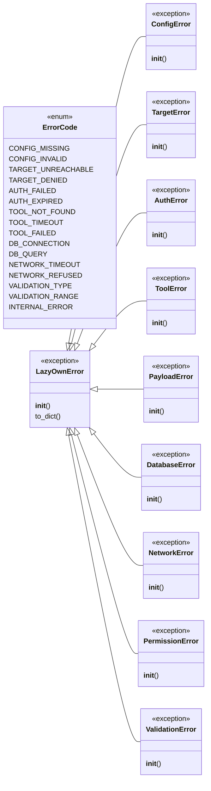
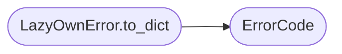

# `core.errors`

> Source: [core/errors.py:1](../../core/errors.py#L1) | language `py` | coverage 56.5% | [API index](../index.md)

Error taxonomy for the LazyOwn framework.

Provides a hierarchy of exception classes with error codes, enabling
structured error reporting and programmatic error handling.

## Contents

- **Enums:** [`ErrorCode`](#errorcode)
- **Exceptions:** [`LazyOwnError`](#lazyownerror), [`ConfigError`](#configerror), [`TargetError`](#targeterror), [`AuthError`](#autherror), [`ToolError`](#toolerror), [`PayloadError`](#payloaderror), [`DatabaseError`](#databaseerror), [`NetworkError`](#networkerror), [`PermissionError`](#permissionerror), [`ValidationError`](#validationerror)

## Type Diagram



## Call Graph

Solid arrows stay in this module, dashed arrows leave it.



## Enums

<a id="errorcode"></a>

### `ErrorCode`

`enum` | [core/errors.py:10](../../core/errors.py#L10)

```python
class ErrorCode(IntEnum)
```

Bases: `IntEnum`

Structured error codes for the LazyOwn framework.

**Attributes**

| Name | Type | Default | Description |
|---|---|---|---|
| [`CONFIG_MISSING`](#errorcode-config_missing) |  | `1001` |  |
| [`CONFIG_INVALID`](#errorcode-config_invalid) |  | `1002` |  |
| [`TARGET_UNREACHABLE`](#errorcode-target_unreachable) |  | `2001` |  |
| [`TARGET_DENIED`](#errorcode-target_denied) |  | `2002` |  |
| [`AUTH_FAILED`](#errorcode-auth_failed) |  | `3001` |  |
| [`AUTH_EXPIRED`](#errorcode-auth_expired) |  | `3002` |  |
| [`TOOL_NOT_FOUND`](#errorcode-tool_not_found) |  | `4001` |  |
| [`TOOL_TIMEOUT`](#errorcode-tool_timeout) |  | `4002` |  |
| [`TOOL_FAILED`](#errorcode-tool_failed) |  | `4003` |  |
| [`DB_CONNECTION`](#errorcode-db_connection) |  | `5001` |  |
| [`DB_QUERY`](#errorcode-db_query) |  | `5002` |  |
| [`NETWORK_TIMEOUT`](#errorcode-network_timeout) |  | `6001` |  |
| [`NETWORK_REFUSED`](#errorcode-network_refused) |  | `6002` |  |
| [`VALIDATION_TYPE`](#errorcode-validation_type) |  | `7001` |  |
| [`VALIDATION_RANGE`](#errorcode-validation_range) |  | `7002` |  |
| [`INTERNAL_ERROR`](#errorcode-internal_error) |  | `9001` |  |

---

## Exceptions

<a id="lazyownerror"></a>

### `LazyOwnError`

`exception` | [core/errors.py:58](../../core/errors.py#L58)

```python
class LazyOwnError(Exception)
```

Bases: `Exception`

Subclasses: [`AuthError`](#autherror), [`ConfigError`](#configerror), [`DatabaseError`](#databaseerror), [`NetworkError`](#networkerror), [`PayloadError`](#payloaderror), [`PermissionError`](#permissionerror), [`TargetError`](#targeterror), [`ToolError`](#toolerror), [`ValidationError`](#validationerror)

Base exception for all LazyOwn framework errors.

**Members**

| Member | Kind | Summary |
|---|---|---|
| [`__init__`](#lazyownerror-__init__) | constructor |  |
| [`to_dict`](#lazyownerror-to_dict) | method | Return a serialisable dict with code, type, and message. |

<a id="lazyownerror-__init__"></a>

#### `LazyOwnError.__init__`

`constructor` | [core/errors.py:61](../../core/errors.py#L61)

```python
def __init__(self, message: str, error_code: int | None = None) -> None
```

**Parameters**

| Name | Type | Default | Description |
|---|---|---|---|
| `message` | `str` |  |  |
| `error_code` | `int \| None` | `None` |  |

<a id="lazyownerror-to_dict"></a>

#### `LazyOwnError.to_dict`

`method` | [core/errors.py:66](../../core/errors.py#L66)

```python
def to_dict(self) -> dict
```

Return a serialisable dict with code, type, and message.

**Returns:** `dict`

*Calls:* [`ErrorCode`](#errorcode)

---

<a id="configerror"></a>

### `ConfigError`

`exception` | [core/errors.py:78](../../core/errors.py#L78)

```python
class ConfigError(LazyOwnError)
```

Bases: [`LazyOwnError`](#lazyownerror)

Configuration-related errors (missing/invalid payload.json, etc.).

**Members**

| Member | Kind | Summary |
|---|---|---|
| [`__init__`](#configerror-__init__) | constructor |  |

<a id="configerror-__init__"></a>

#### `ConfigError.__init__`

`constructor` | [core/errors.py:81](../../core/errors.py#L81)

```python
def __init__(self, message: str, error_code: int | None = None) -> None
```

**Parameters**

| Name | Type | Default | Description |
|---|---|---|---|
| `message` | `str` |  |  |
| `error_code` | `int \| None` | `None` |  |

---

<a id="targeterror"></a>

### `TargetError`

`exception` | [core/errors.py:85](../../core/errors.py#L85)

```python
class TargetError(LazyOwnError)
```

Bases: [`LazyOwnError`](#lazyownerror)

Target connectivity or access errors.

**Members**

| Member | Kind | Summary |
|---|---|---|
| [`__init__`](#targeterror-__init__) | constructor |  |

<a id="targeterror-__init__"></a>

#### `TargetError.__init__`

`constructor` | [core/errors.py:88](../../core/errors.py#L88)

```python
def __init__(self, message: str, error_code: int | None = None) -> None
```

**Parameters**

| Name | Type | Default | Description |
|---|---|---|---|
| `message` | `str` |  |  |
| `error_code` | `int \| None` | `None` |  |

---

<a id="autherror"></a>

### `AuthError`

`exception` | [core/errors.py:92](../../core/errors.py#L92)

```python
class AuthError(LazyOwnError)
```

Bases: [`LazyOwnError`](#lazyownerror)

Authentication or authorisation failures.

**Members**

| Member | Kind | Summary |
|---|---|---|
| [`__init__`](#autherror-__init__) | constructor |  |

<a id="autherror-__init__"></a>

#### `AuthError.__init__`

`constructor` | [core/errors.py:95](../../core/errors.py#L95)

```python
def __init__(self, message: str, error_code: int | None = None) -> None
```

**Parameters**

| Name | Type | Default | Description |
|---|---|---|---|
| `message` | `str` |  |  |
| `error_code` | `int \| None` | `None` |  |

---

<a id="toolerror"></a>

### `ToolError`

`exception` | [core/errors.py:99](../../core/errors.py#L99)

```python
class ToolError(LazyOwnError)
```

Bases: [`LazyOwnError`](#lazyownerror)

External tool execution errors.

**Members**

| Member | Kind | Summary |
|---|---|---|
| [`__init__`](#toolerror-__init__) | constructor |  |

<a id="toolerror-__init__"></a>

#### `ToolError.__init__`

`constructor` | [core/errors.py:102](../../core/errors.py#L102)

```python
def __init__(self, message: str, error_code: int | None = None) -> None
```

**Parameters**

| Name | Type | Default | Description |
|---|---|---|---|
| `message` | `str` |  |  |
| `error_code` | `int \| None` | `None` |  |

---

<a id="payloaderror"></a>

### `PayloadError`

`exception` | [core/errors.py:106](../../core/errors.py#L106)

```python
class PayloadError(LazyOwnError)
```

Bases: [`LazyOwnError`](#lazyownerror)

Payload generation or deployment errors.

**Members**

| Member | Kind | Summary |
|---|---|---|
| [`__init__`](#payloaderror-__init__) | constructor |  |

<a id="payloaderror-__init__"></a>

#### `PayloadError.__init__`

`constructor` | [core/errors.py:109](../../core/errors.py#L109)

```python
def __init__(self, message: str, error_code: int | None = None) -> None
```

**Parameters**

| Name | Type | Default | Description |
|---|---|---|---|
| `message` | `str` |  |  |
| `error_code` | `int \| None` | `None` |  |

---

<a id="databaseerror"></a>

### `DatabaseError`

`exception` | [core/errors.py:113](../../core/errors.py#L113)

```python
class DatabaseError(LazyOwnError)
```

Bases: [`LazyOwnError`](#lazyownerror)

Database operation errors.

**Members**

| Member | Kind | Summary |
|---|---|---|
| [`__init__`](#databaseerror-__init__) | constructor |  |

<a id="databaseerror-__init__"></a>

#### `DatabaseError.__init__`

`constructor` | [core/errors.py:116](../../core/errors.py#L116)

```python
def __init__(self, message: str, error_code: int | None = None) -> None
```

**Parameters**

| Name | Type | Default | Description |
|---|---|---|---|
| `message` | `str` |  |  |
| `error_code` | `int \| None` | `None` |  |

---

<a id="networkerror"></a>

### `NetworkError`

`exception` | [core/errors.py:120](../../core/errors.py#L120)

```python
class NetworkError(LazyOwnError)
```

Bases: [`LazyOwnError`](#lazyownerror)

Network-level errors.

**Members**

| Member | Kind | Summary |
|---|---|---|
| [`__init__`](#networkerror-__init__) | constructor |  |

<a id="networkerror-__init__"></a>

#### `NetworkError.__init__`

`constructor` | [core/errors.py:123](../../core/errors.py#L123)

```python
def __init__(self, message: str, error_code: int | None = None) -> None
```

**Parameters**

| Name | Type | Default | Description |
|---|---|---|---|
| `message` | `str` |  |  |
| `error_code` | `int \| None` | `None` |  |

---

<a id="permissionerror"></a>

### `PermissionError`

`exception` | [core/errors.py:127](../../core/errors.py#L127)

```python
class PermissionError(LazyOwnError)
```

Bases: [`LazyOwnError`](#lazyownerror)

Subclasses: [`SecurityViolation`](core.hardening.py.md#securityviolation), [`CommandInjectionError`](core.safe_exec.py.md#commandinjectionerror), [`UrlValidationError`](core.safe_exec.py.md#urlvalidationerror), [`ShellNotAllowedError`](core.safe_subprocess.py.md#shellnotallowederror)

Insufficient-permission errors (wraps OS-level PermissionError).

**Members**

| Member | Kind | Summary |
|---|---|---|
| [`__init__`](#permissionerror-__init__) | constructor |  |

<a id="permissionerror-__init__"></a>

#### `PermissionError.__init__`

`constructor` | [core/errors.py:130](../../core/errors.py#L130)

```python
def __init__(self, message: str, error_code: int | None = None) -> None
```

**Parameters**

| Name | Type | Default | Description |
|---|---|---|---|
| `message` | `str` |  |  |
| `error_code` | `int \| None` | `None` |  |

*Called by:* [`safe_run_shell`](core.safe_exec.py.md#safe_run_shell), [`TrafficRecorder.get_body`](modules.traffic_recorder.py.md#trafficrecorder-get_body), [`resolve`](modules.workspace.py.md#resolve)

---

<a id="validationerror"></a>

### `ValidationError`

`exception` | [core/errors.py:134](../../core/errors.py#L134)

```python
class ValidationError(LazyOwnError)
```

Bases: [`LazyOwnError`](#lazyownerror)

Input validation / sanitisation errors.

**Members**

| Member | Kind | Summary |
|---|---|---|
| [`__init__`](#validationerror-__init__) | constructor |  |

<a id="validationerror-__init__"></a>

#### `ValidationError.__init__`

`constructor` | [core/errors.py:137](../../core/errors.py#L137)

```python
def __init__(self, message: str, error_code: int | None = None) -> None
```

**Parameters**

| Name | Type | Default | Description |
|---|---|---|---|
| `message` | `str` |  |  |
| `error_code` | `int \| None` | `None` |  |

---
