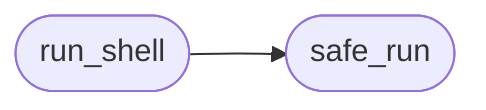

# `core.executor`

> Source: [core/executor.py:1](../../core/executor.py#L1) | language `py` | coverage 100.0% | [API index](../index.md)

Centralised subprocess wrapper for the LazyOwn framework.

Provides safe, logged command execution as a replacement for bare
`os.system` and unguarded `subprocess.run` calls.

Contracts
---------
1. [`safe_run`](#safe_run) executes a command via the system shell, logs the
   invocation, enforces a timeout, and returns a
   `subprocess.CompletedProcess`.
2. [`run_shell`](#run_shell) is a convenience wrapper that returns stdout as a
   string (or raises on failure).
3. Every command is logged at INFO level with the PID and exit code.

Usage
-----
    from core.executor import safe_run, run_shell

    result = safe_run(["nmap", "-sS", target], timeout=60)
    if result.returncode != 0:
        print(result.stderr)

    output = run_shell("ls -la /tmp", timeout=10)

Config keys owned: none.

## Contents

- **Functions:** [`safe_run`](#safe_run), [`safe_run`](#safe_run), [`safe_run`](#safe_run), [`run_shell`](#run_shell)

## Call Graph

Solid arrows stay in this module, dashed arrows leave it.



## Functions

<a id="safe_run"></a>

### `safe_run`

`function` | [core/executor.py:101](../../core/executor.py#L101)

```python
def safe_run(command: str | list[str], *, timeout: int = 300) -> subprocess.CompletedProcess[str]
```

Execute a command with logging and timeout.

List input uses ``shell=False``. String input keeps ``shell=True``
for legacy pipelines and requires caller sanitisation.

Security:
    List form never touches shell. String form intentionally uses
    shell; callers must sanitise user-controlled input.
    Null-byte injection is rejected.

**Parameters**

| Name | Type | Default | Description |
|---|---|---|---|
| `command` | `str \| list[str]` |  | A shell command string or list of argv tokens. |
| `timeout` | `int` | `300` | Maximum execution time in seconds (1-3600, default 300). |

**Returns:** `subprocess.CompletedProcess[str]` - A `subprocess.CompletedProcess` with ``stdout`` and
``stderr`` captured as strings.

**Raises**

- `TypeError`: If *command* is neither ``str`` nor ``list``.
- `ValueError`: If *command* is empty, contains null bytes, or timeout is out of range.
- `subprocess.TimeoutExpired`: If the command exceeds *timeout*.

*Called by:* [`run_shell`](#run_shell)

---

<a id="safe_run"></a>

### `safe_run`

`function` | [core/executor.py:101](../../core/executor.py#L101)

```python
def safe_run(command: str | list[str], *, timeout: int = 300) -> subprocess.CompletedProcess[str]
```

Execute a command with logging and timeout.

List input uses ``shell=False``. String input keeps ``shell=True``
for legacy pipelines and requires caller sanitisation.

Security:
    List form never touches shell. String form intentionally uses
    shell; callers must sanitise user-controlled input.
    Null-byte injection is rejected.

**Parameters**

| Name | Type | Default | Description |
|---|---|---|---|
| `command` | `str \| list[str]` |  | A shell command string or list of argv tokens. |
| `timeout` | `int` | `300` | Maximum execution time in seconds (1-3600, default 300). |

**Returns:** `subprocess.CompletedProcess[str]` - A `subprocess.CompletedProcess` with ``stdout`` and
``stderr`` captured as strings.

**Raises**

- `TypeError`: If *command* is neither ``str`` nor ``list``.
- `ValueError`: If *command* is empty, contains null bytes, or timeout is out of range.
- `subprocess.TimeoutExpired`: If the command exceeds *timeout*.

*Called by:* [`run_shell`](#run_shell)

---

<a id="safe_run"></a>

### `safe_run`

`function` | [core/executor.py:101](../../core/executor.py#L101)

```python
def safe_run(command: str | list[str], *, timeout: int = 300) -> subprocess.CompletedProcess[str]
```

Execute a command with logging and timeout.

List input uses ``shell=False``. String input keeps ``shell=True``
for legacy pipelines and requires caller sanitisation.

Security:
    List form never touches shell. String form intentionally uses
    shell; callers must sanitise user-controlled input.
    Null-byte injection is rejected.

**Parameters**

| Name | Type | Default | Description |
|---|---|---|---|
| `command` | `str \| list[str]` |  | A shell command string or list of argv tokens. |
| `timeout` | `int` | `300` | Maximum execution time in seconds (1-3600, default 300). |

**Returns:** `subprocess.CompletedProcess[str]` - A `subprocess.CompletedProcess` with ``stdout`` and
``stderr`` captured as strings.

**Raises**

- `TypeError`: If *command* is neither ``str`` nor ``list``.
- `ValueError`: If *command* is empty, contains null bytes, or timeout is out of range.
- `subprocess.TimeoutExpired`: If the command exceeds *timeout*.

*Called by:* [`run_shell`](#run_shell)

---

<a id="run_shell"></a>

### `run_shell`

`function` | [core/executor.py:149](../../core/executor.py#L149)

```python
def run_shell(cmd: str, *, timeout: int = 300) -> str
```

Execute a shell command and return its stdout.

A convenient wrapper over [`safe_run`](#safe_run) that raises on non-zero
exit codes.

Security:
    See [`safe_run`](#safe_run) security note.

**Parameters**

| Name | Type | Default | Description |
|---|---|---|---|
| `cmd` | `str` |  | The shell command string to execute. |
| `timeout` | `int` | `300` | Maximum execution time in seconds (1-3600, default 300). |

**Returns:** `str` - Captured stdout with leading/trailing whitespace stripped.

**Raises**

- `subprocess.CalledProcessError`: If the command exits with a non-zero return code.
- `See`: func:[`safe_run`](#safe_run) for other possible exceptions.

*Calls:* [`safe_run`](#safe_run)

---
