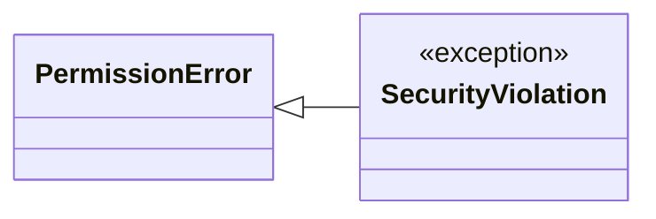
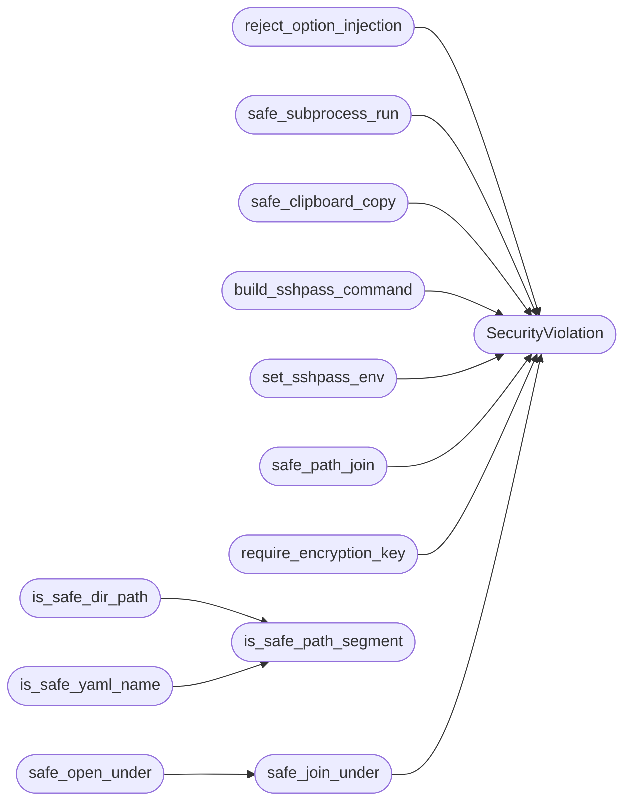

# `core.hardening`

> Source: [core/hardening.py:1](../../core/hardening.py#L1) | language `py` | coverage 100.0% | [API index](../index.md)

Centralized security hardening utilities for the LazyOwn framework.

Contract: provides safe alternatives to dangerous patterns found across
the codebase. Every function is a single-responsibility security control
that replaces ad-hoc, vulnerable patterns with a tested, auditable path.

Invariants:

1. `[`safe_subprocess_run`](#safe_subprocess_run)` never invokes a shell unless explicitly allowed
   and audited.
2. `[`safe_clipboard_copy`](#safe_clipboard_copy)` uses subprocess list-form, never os.system.
3. ``validate_sshpass_env`` sets SSHPASS env var and uses sshpass -e,
   never sshpass -p.
4. ``escape_html`` sanitizes all user-controlled data before HTML insertion.
5. `[`safe_path_join`](#safe_path_join)` prevents path traversal via os.path.realpath prefix
   check.
6. `[`require_encryption_key`](#require_encryption_key)` refuses to operate with a static fallback key.
7. `[`defused_xml_parse`](#defused_xml_parse)` wraps defusedxml for safe XML parsing.

## Contents

- **Exceptions:** [`SecurityViolation`](#securityviolation)
- **Functions:** [`reject_option_injection`](#reject_option_injection), [`escape_powershell_single_quoted`](#escape_powershell_single_quoted), [`safe_subprocess_run`](#safe_subprocess_run), [`safe_clipboard_copy`](#safe_clipboard_copy), [`build_sshpass_command`](#build_sshpass_command), [`set_sshpass_env`](#set_sshpass_env), [`escape_html_content`](#escape_html_content), [`safe_path_join`](#safe_path_join), [`validate_network_cidr`](#validate_network_cidr), [`validate_port_spec`](#validate_port_spec), [`validate_host`](#validate_host), [`require_encryption_key`](#require_encryption_key), [`defused_xml_parse`](#defused_xml_parse), [`sanitize_filename`](#sanitize_filename), [`tls_secure_context`](#tls_secure_context), [`tls_lab_unverified_allowed`](#tls_lab_unverified_allowed), [`tls_lab_fallback_context`](#tls_lab_fallback_context), [`validate_upstream_path`](#validate_upstream_path), [`is_safe_path_segment`](#is_safe_path_segment), [`is_safe_dir_path`](#is_safe_dir_path), [`is_safe_yaml_name`](#is_safe_yaml_name), [`safe_join_under`](#safe_join_under), [`safe_open_under`](#safe_open_under), [`store_secret_owner_only`](#store_secret_owner_only), [`contains_emoji`](#contains_emoji), [`iter_emoji_spans`](#iter_emoji_spans), [`seal_secret`](#seal_secret), [`unseal_secret`](#unseal_secret), [`redact_text`](#redact_text)
- **Constants:** [`MAX_SSH_COMMAND_LENGTH`](#max_ssh_command_length), [`MAX_CLIPBOARD_CONTENT_LENGTH`](#max_clipboard_content_length), [`SHELL_OPERATOR_CHARS`](#shell_operator_chars), [`PROGRAM_NAME_PATTERN`](#program_name_pattern), [`TLS_MINIMUM_VERSION`](#tls_minimum_version), [`UPSTREAM_PATH_MAX_LENGTH`](#upstream_path_max_length), [`DIR_PATH_MAX_LENGTH`](#dir_path_max_length), [`PATH_SEGMENT_MAX_LENGTH`](#path_segment_max_length), [`YAML_NAME_MAX_LENGTH`](#yaml_name_max_length), [`SECRET_FILE_MODE`](#secret_file_mode), [`SECRET_DIR_MODE`](#secret_dir_mode), [`SEALED_SECRET_PREFIX`](#sealed_secret_prefix)

## Type Diagram



## Call Graph

Solid arrows stay in this module, dashed arrows leave it.



## Exceptions

<a id="securityviolation"></a>

### `SecurityViolation`

`exception` | [core/hardening.py:125](../../core/hardening.py#L125)

```python
class SecurityViolation(PermissionError)
```

Bases: [`PermissionError`](core.errors.py.md#permissionerror)

Raised when a security invariant is violated.

---

## Functions

<a id="reject_option_injection"></a>

### `reject_option_injection`

`function` | [core/hardening.py:85](../../core/hardening.py#L85)

```python
def reject_option_injection(argv: Sequence[str], *, allow_options: bool = True) -> None
```

Reject argument-injection payloads in argv.

**Parameters**

| Name | Type | Default | Description |
|---|---|---|---|
| `argv` | `Sequence[str]` |  | Program and arguments as a sequence. |
| `allow_options` | `bool` | `True` | When False, reject any argument starting with dash. |

**Raises**

- [`SecurityViolation`](#securityviolation): If an injection pattern is detected.

*Calls:* [`SecurityViolation`](#securityviolation)

---

<a id="escape_powershell_single_quoted"></a>

### `escape_powershell_single_quoted`

`function` | [core/hardening.py:104](../../core/hardening.py#L104)

```python
def escape_powershell_single_quoted(value: str) -> str
```

Escape a value for embedding in a PowerShell single-quoted string.

**Parameters**

| Name | Type | Default | Description |
|---|---|---|---|
| `value` | `str` |  | Raw value that may contain quotes or metacharacters. |

**Returns:** `str` - Value safe to embed between single quotes in PowerShell.

*Called by:* [`PersistMigratedCommandSet.do_grisun0w`](cli.commands.persist_migrated.py.md#persistmigratedcommandset-do_grisun0w)

---

<a id="safe_subprocess_run"></a>

### `safe_subprocess_run`

`function` | [core/hardening.py:150](../../core/hardening.py#L150)

```python
def safe_subprocess_run(argv: Sequence[str], *, timeout: float | None = None, capture_output: bool = True, reason: str = '') -> subprocess.CompletedProcess[str]
```

Execute a command via subprocess without shell interpretation.

**Parameters**

| Name | Type | Default | Description |
|---|---|---|---|
| `argv` | `Sequence[str]` |  | Program and arguments as a sequence. Must not be empty. |
| `timeout` | `float \| None` | `None` | Optional wall-clock timeout in seconds. |
| `capture_output` | `bool` | `True` | Whether to capture stdout and stderr. |
| `reason` | `str` | `''` | Free-text justification for audit logging. |

**Returns:** `subprocess.CompletedProcess[str]` - CompletedProcess result.

**Raises**

- [`SecurityViolation`](#securityviolation): If argv is empty or contains shell metacharacters.
- `ValueError`: If argv is empty.

*Calls:* [`SecurityViolation`](#securityviolation)

*Called by:* [`CloudCommandSet.do_cloud_iam`](cli.commands.cloud.py.md#cloudcommandset-do_cloud_iam), [`WebSocketBeacon.run`](modules.websocket_beacon.py.md#websocketbeacon-run)

---

<a id="safe_clipboard_copy"></a>

### `safe_clipboard_copy`

`function` | [core/hardening.py:195](../../core/hardening.py#L195)

```python
def safe_clipboard_copy(content: str) -> bool
```

Copy content to system clipboard without shell interpretation.

Uses subprocess list-form with xclip or xsel. Never uses os.system.

**Parameters**

| Name | Type | Default | Description |
|---|---|---|---|
| `content` | `str` |  | Text to copy to clipboard. |

**Returns:** `bool` - True if copy succeeded, False otherwise.

**Raises**

- [`SecurityViolation`](#securityviolation): If content exceeds MAX_CLIPBOARD_CONTENT_LENGTH.

*Calls:* [`SecurityViolation`](#securityviolation)

*Called by:* [`NetworkHelpersCommandSet.do_rhost`](cli.commands.nethelpers.py.md#networkhelperscommandset-do_rhost), [`PersistMigratedCommandSet.do_grisun0`](cli.commands.persist_migrated.py.md#persistmigratedcommandset-do_grisun0), [`PersistMigratedCommandSet.do_rdp`](cli.commands.persist_migrated.py.md#persistmigratedcommandset-do_rdp)

---

<a id="build_sshpass_command"></a>

### `build_sshpass_command`

`function` | [core/hardening.py:234](../../core/hardening.py#L234)

```python
def build_sshpass_command(password: str, ssh_args: list[str], *, max_password_length: int = 256) -> list[str]
```

Build an sshpass command using SSHPASS env var (sshpass -e).

Never uses sshpass -p which exposes passwords in process listings.

**Parameters**

| Name | Type | Default | Description |
|---|---|---|---|
| `password` | `str` |  | The SSH password to use. |
| `ssh_args` | `list[str]` |  | Arguments to pass to ssh/scp after sshpass. |
| `max_password_length` | `int` | `256` | Maximum allowed password length. |

**Returns:** `list[str]` - List of command arguments suitable for subprocess.run.

**Raises**

- [`SecurityViolation`](#securityviolation): If password exceeds max_password_length or contains characters that could break the env var.

*Calls:* [`SecurityViolation`](#securityviolation)

---

<a id="set_sshpass_env"></a>

### `set_sshpass_env`

`function` | [core/hardening.py:263](../../core/hardening.py#L263)

```python
def set_sshpass_env(password: str) -> dict[str, str]
```

Create an environment dict with SSHPASS set for sshpass -e.

**Parameters**

| Name | Type | Default | Description |
|---|---|---|---|
| `password` | `str` |  | The SSH password. |

**Returns:** `dict[str, str]` - Copy of os.environ with SSHPASS set.

**Raises**

- [`SecurityViolation`](#securityviolation): If password contains null bytes.

*Calls:* [`SecurityViolation`](#securityviolation)

*Called by:* [`AntiForensicsCommandSet.do_clean_ad`](cli.commands.anti_forensics.py.md#antiforensicscommandset-do_clean_ad), [`CommandAndControlMigratedCommandSet.do_atomic_agent`](cli.commands.command_and_control_migrated.py.md#commandandcontrolmigratedcommandset-do_atomic_agent), [`ExfiltrationCommandSet.do_rsync`](cli.commands.exfiltration.py.md#exfiltrationcommandset-do_rsync), [`LateralMigratedCommandSet.do_lateral_mov_lin`](cli.commands.lateral_migrated.py.md#lateralmigratedcommandset-do_lateral_mov_lin), [`PersistMigratedCommandSet.do_ftp`](cli.commands.persist_migrated.py.md#persistmigratedcommandset-do_ftp)

---

<a id="escape_html_content"></a>

### `escape_html_content`

`function` | [core/hardening.py:282](../../core/hardening.py#L282)

```python
def escape_html_content(value: str) -> str
```

Escape HTML special characters to prevent XSS.

**Parameters**

| Name | Type | Default | Description |
|---|---|---|---|
| `value` | `str` |  | Raw string that may contain HTML. |

**Returns:** `str` - HTML-escaped string safe for insertion into HTML context.

---

<a id="safe_path_join"></a>

### `safe_path_join`

`function` | [core/hardening.py:294](../../core/hardening.py#L294)

```python
def safe_path_join(base_dir: str, user_path: str) -> str
```

Join base_dir and user_path safely, preventing path traversal.

Uses os.path.realpath to resolve symlinks and .. components, then
verifies the result starts with the allowed base directory.

**Parameters**

| Name | Type | Default | Description |
|---|---|---|---|
| `base_dir` | `str` |  | The allowed root directory. |
| `user_path` | `str` |  | User-controlled path component. |

**Returns:** `str` - Resolved absolute path within base_dir.

**Raises**

- [`SecurityViolation`](#securityviolation): If the resolved path escapes base_dir.
- `ValueError`: If user_path is empty or contains only separators.

*Calls:* [`SecurityViolation`](#securityviolation)

*Called by:* [`check_calls`](scripts.devtools.core_smoke.py.md#check_calls)

---

<a id="validate_network_cidr"></a>

### `validate_network_cidr`

`function` | [core/hardening.py:320](../../core/hardening.py#L320)

```python
def validate_network_cidr(cidr: str) -> bool
```

Validate a network CIDR notation string.

**Parameters**

| Name | Type | Default | Description |
|---|---|---|---|
| `cidr` | `str` |  | Network address in CIDR notation (e.g. "192.168.1.0/24"). |

**Returns:** `bool` - True if valid CIDR, False otherwise.

---

<a id="validate_port_spec"></a>

### `validate_port_spec`

`function` | [core/hardening.py:332](../../core/hardening.py#L332)

```python
def validate_port_spec(ports: str) -> bool
```

Validate a port specification string.

Supports comma-separated ports and ranges (e.g. "22,80,443-445").

**Parameters**

| Name | Type | Default | Description |
|---|---|---|---|
| `ports` | `str` |  | Port specification string. |

**Returns:** `bool` - True if valid, False otherwise.

*Called by:* [`check_calls`](scripts.devtools.core_smoke.py.md#check_calls)

---

<a id="validate_host"></a>

### `validate_host`

`function` | [core/hardening.py:348](../../core/hardening.py#L348)

```python
def validate_host(host: str) -> bool
```

Validate a hostname or IP address.

Single policy shared with the CLI gates: plain IPs, CIDR blocks
and hostnames pass, shell metacharacters fail. CIDR-only strings
are additionally accepted by the network pattern below.

**Parameters**

| Name | Type | Default | Description |
|---|---|---|---|
| `host` | `str` |  | Hostname or IP to validate. |

**Returns:** `bool` - True if valid, False otherwise.

*Called by:* [`AntiForensicsCommandSet.do_shred`](cli.commands.anti_forensics.py.md#antiforensicscommandset-do_shred), [`AntiForensicsCommandSet.do_wipe_free`](cli.commands.anti_forensics.py.md#antiforensicscommandset-do_wipe_free), [`AntiForensicsCommandSet.do_wipe_logs`](cli.commands.anti_forensics.py.md#antiforensicscommandset-do_wipe_logs), [`AntiForensicsCommandSet.do_wipe_timeline`](cli.commands.anti_forensics.py.md#antiforensicscommandset-do_wipe_timeline), [`load_targets_file`](modules.lazy_runner.py.md#load_targets_file)

---

<a id="require_encryption_key"></a>

### `require_encryption_key`

`function` | [core/hardening.py:368](../../core/hardening.py#L368)

```python
def require_encryption_key(env_key: str = 'LAZYOWN_SECRET_KEY', secret_file: Path | None = None) -> str
```

Require a proper encryption key; never fall back to a static default.

**Parameters**

| Name | Type | Default | Description |
|---|---|---|---|
| `env_key` | `str` | `'LAZYOWN_SECRET_KEY'` | Environment variable name for the secret key. |
| `secret_file` | `Path \| None` | `None` | Optional path to a file containing the key. |

**Returns:** `str` - The encryption key string.

**Raises**

- [`SecurityViolation`](#securityviolation): If no key is configured.

*Calls:* [`SecurityViolation`](#securityviolation)

---

<a id="defused_xml_parse"></a>

### `defused_xml_parse`

`function` | [core/hardening.py:396](../../core/hardening.py#L396)

```python
def defused_xml_parse(source: str | Path) -> Any
```

Parse XML safely using defusedxml.

**Parameters**

| Name | Type | Default | Description |
|---|---|---|---|
| `source` | `str \| Path` |  | File path or string containing XML data. |

**Returns:** `Any` - Parsed XML ElementTree root element.

**Raises**

- `ImportError`: If defusedxml is not installed.
- `ValueError`: If XML parsing fails.

---

<a id="sanitize_filename"></a>

### `sanitize_filename`

`function` | [core/hardening.py:418](../../core/hardening.py#L418)

```python
def sanitize_filename(filename: str, max_length: int = 255) -> str
```

Sanitize a filename by removing dangerous characters.

**Parameters**

| Name | Type | Default | Description |
|---|---|---|---|
| `filename` | `str` |  | Raw filename from user input. |
| `max_length` | `int` | `255` | Maximum filename length. |

**Returns:** `str` - Sanitized filename with only safe characters.

---

<a id="tls_secure_context"></a>

### `tls_secure_context`

`function` | [core/hardening.py:438](../../core/hardening.py#L438)

```python
def tls_secure_context(extra_ca: str = '') -> ssl.SSLContext
```

Build a verifying client TLS context with a TLS 1.2 floor.

**Parameters**

| Name | Type | Default | Description |
|---|---|---|---|
| `extra_ca` | `str` | `''` | Optional extra CA bundle path loaded for verification. |

**Returns:** `ssl.SSLContext` - Verifying SSLContext with hostname checking enabled.

---

<a id="tls_lab_unverified_allowed"></a>

### `tls_lab_unverified_allowed`

`function` | [core/hardening.py:463](../../core/hardening.py#L463)

```python
def tls_lab_unverified_allowed(host: str) -> bool
```

Return True only when unverified lab TLS is explicitly opted in.

Both conditions must hold: the host is a loopback/private literal (or
localhost) and the operator set ``LAZY_PROXY_ALLOW_SELF_SIGNED_LAB=1``.
Request data can never enable it alone.

**Parameters**

| Name | Type | Default | Description |
|---|---|---|---|
| `host` | `str` |  | Target hostname or IP literal. |

**Returns:** `bool` - True when the operator opt-in covers this lab host.

---

<a id="tls_lab_fallback_context"></a>

### `tls_lab_fallback_context`

`function` | [core/hardening.py:490](../../core/hardening.py#L490)

```python
def tls_lab_fallback_context() -> ssl.SSLContext
```

Build the gated unverified context for lab self-signed hosts.

This is the single audited location allowed to disable verification.
Callers must check [`tls_lab_unverified_allowed`](#tls_lab_unverified_allowed) first; the TLS
1.2 floor still applies so only verification (not protocol version)
is relaxed.

**Returns:** `ssl.SSLContext` - Unverified SSLContext with TLS 1.2 floor.

---

<a id="validate_upstream_path"></a>

### `validate_upstream_path`

`function` | [core/hardening.py:512](../../core/hardening.py#L512)

```python
def validate_upstream_path(path: str) -> bool
```

Validate an origin-form upstream path without regular expressions.

Only ``/absolute-path[?query]`` is accepted: absolute URLs, control
characters, NUL/CR/LF and overlong values are rejected in linear time.

**Parameters**

| Name | Type | Default | Description |
|---|---|---|---|
| `path` | `str` |  | Upstream path or target string. |

**Returns:** `bool` - True when the path is safe to send upstream.

---

<a id="is_safe_path_segment"></a>

### `is_safe_path_segment`

`function` | [core/hardening.py:541](../../core/hardening.py#L541)

```python
def is_safe_path_segment(segment: str) -> bool
```

Validate one path segment with a linear charset scan (no regex).

**Parameters**

| Name | Type | Default | Description |
|---|---|---|---|
| `segment` | `str` |  | Single directory or filename stem segment. |

**Returns:** `bool` - True when the segment uses only safe characters.

*Called by:* [`is_safe_dir_path`](#is_safe_dir_path), [`is_safe_yaml_name`](#is_safe_yaml_name)

---

<a id="is_safe_dir_path"></a>

### `is_safe_dir_path`

`function` | [core/hardening.py:562](../../core/hardening.py#L562)

```python
def is_safe_dir_path(raw: str) -> bool
```

Validate a relative directory path with linear scans (no regex).

**Parameters**

| Name | Type | Default | Description |
|---|---|---|---|
| `raw` | `str` |  | Untrusted relative directory path. |

**Returns:** `bool` - True when every segment is safe and no traversal is present.

*Calls:* [`is_safe_path_segment`](#is_safe_path_segment)

---

<a id="is_safe_yaml_name"></a>

### `is_safe_yaml_name`

`function` | [core/hardening.py:588](../../core/hardening.py#L588)

```python
def is_safe_yaml_name(name: str) -> bool
```

Validate a YAML filename with linear scans (no regex).

**Parameters**

| Name | Type | Default | Description |
|---|---|---|---|
| `name` | `str` |  | Untrusted filename. |

**Returns:** `bool` - True when the name is a safe ``*.yaml`` file.

*Calls:* [`is_safe_path_segment`](#is_safe_path_segment)

---

<a id="safe_join_under"></a>

### `safe_join_under`

`function` | [core/hardening.py:607](../../core/hardening.py#L607)

```python
def safe_join_under(base_dir: str, user_path: str) -> str
```

Join and resolve ``user_path`` under ``base_dir`` (symlink-safe).

Uses realpath on both sides plus a commonpath prefix check so
``..`` segments and symlink escapes are rejected.

**Parameters**

| Name | Type | Default | Description |
|---|---|---|---|
| `base_dir` | `str` |  | Allowed root directory. |
| `user_path` | `str` |  | Untrusted relative path. |

**Returns:** `str` - Resolved absolute path within ``base_dir``.

**Raises**

- [`SecurityViolation`](#securityviolation): If the resolved path escapes ``base_dir``.
- `ValueError`: If ``user_path`` is empty.

*Calls:* [`SecurityViolation`](#securityviolation)

*Called by:* [`safe_open_under`](#safe_open_under)

---

<a id="safe_open_under"></a>

### `safe_open_under`

`function` | [core/hardening.py:636](../../core/hardening.py#L636)

```python
def safe_open_under(base_dir: str, user_path: str, mode: str = 'r', **kwargs: Any) -> Any
```

Open a file under ``base_dir`` after traversal validation.

**Parameters**

| Name | Type | Default | Description |
|---|---|---|---|
| `base_dir` | `str` |  | Allowed root directory. |
| `user_path` | `str` |  | Untrusted relative path. |
| `mode` | `str` | `'r'` | Open mode (binary-safe modes rejected for writes of text secrets). |
| `**kwargs` | `Any` |  |  |

**Returns:** `Any` - Open file handle. Caller must close it.

*Calls:* [`safe_join_under`](#safe_join_under)

---

<a id="store_secret_owner_only"></a>

### `store_secret_owner_only`

`function` | [core/hardening.py:663](../../core/hardening.py#L663)

```python
def store_secret_owner_only(path: str | Path, text: str) -> str
```

Atomically store a secret owner-only (0600, dir 0700).

**Parameters**

| Name | Type | Default | Description |
|---|---|---|---|
| `path` | `str \| Path` |  | Destination file path. |
| `text` | `str` |  | Secret text to persist. |

**Returns:** `str` - Resolved absolute path as string.

---

<a id="contains_emoji"></a>

### `contains_emoji`

`function` | [core/hardening.py:706](../../core/hardening.py#L706)

```python
def contains_emoji(text: str) -> bool
```

Return True when ``text`` carries any emoji codepoint.

**Parameters**

| Name | Type | Default | Description |
|---|---|---|---|
| `text` | `str` |  | Text to inspect. |

**Returns:** `bool` - True on first emoji hit; linear scan, no regex.

---

<a id="iter_emoji_spans"></a>

### `iter_emoji_spans`

`function` | [core/hardening.py:721](../../core/hardening.py#L721)

```python
def iter_emoji_spans(text: str) -> list[tuple[int, str]]
```

Return ``(offset, char)`` for every emoji char in ``text``.

**Parameters**

| Name | Type | Default | Description |
|---|---|---|---|
| `text` | `str` |  | Text to inspect. |

**Returns:** `list[tuple[int, str]]` - List of offset/character pairs in encounter order.

---

<a id="seal_secret"></a>

### `seal_secret`

`function` | [core/hardening.py:754](../../core/hardening.py#L754)

```python
def seal_secret(plaintext: str, *, sessions_dir: str | Path = 'sessions') -> str
```

Seal a secret with Fernet (AES-128-CBC + HMAC) for storage.

The key comes from the shared ``key.aes`` resolver so sealed values
round-trip across restarts without new configuration. Failures fall
back to plaintext so loot/operator flows never break; callers keep
owner-only file modes regardless.

**Parameters**

| Name | Type | Default | Description |
|---|---|---|---|
| `plaintext` | `str` |  | Secret to protect. |
| `sessions_dir` | `str \| Path` | `'sessions'` | Key directory override (tests). |

**Returns:** `str` - ``enc:v2:`` sealed value, or plaintext when sealing is unavailable.

---

<a id="unseal_secret"></a>

### `unseal_secret`

`function` | [core/hardening.py:785](../../core/hardening.py#L785)

```python
def unseal_secret(stored: str, *, sessions_dir: str | Path = 'sessions') -> str
```

Reveal a secret stored by [`seal_secret`](#seal_secret) (legacy-compatible).

Legacy ``enc:v1:`` vault values and plaintext fall back to the
credential vault / passthrough so existing stores keep working.

**Parameters**

| Name | Type | Default | Description |
|---|---|---|---|
| `stored` | `str` |  | Sealed or plaintext value. |
| `sessions_dir` | `str \| Path` | `'sessions'` | Key directory override (tests). |

**Returns:** `str` - Plaintext secret, or empty string when undecryptable.

---

<a id="redact_text"></a>

### `redact_text`

`function` | [core/hardening.py:826](../../core/hardening.py#L826)

```python
def redact_text(text: str) -> str
```

Mask credential-like patterns before persistence or display.

**Parameters**

| Name | Type | Default | Description |
|---|---|---|---|
| `text` | `str` |  | Raw text that may embed secrets. |

**Returns:** `str` - Text with secrets replaced by ``***`` markers.

---

## Constants

<a id="max_ssh_command_length"></a>

### `MAX_SSH_COMMAND_LENGTH`

`constant` | [core/hardening.py:37](../../core/hardening.py#L37)

```python
MAX_SSH_COMMAND_LENGTH = 4096
```

---

<a id="max_clipboard_content_length"></a>

### `MAX_CLIPBOARD_CONTENT_LENGTH`

`constant` | [core/hardening.py:38](../../core/hardening.py#L38)

```python
MAX_CLIPBOARD_CONTENT_LENGTH = 65536
```

---

<a id="shell_operator_chars"></a>

### `SHELL_OPERATOR_CHARS`

`constant` | [core/hardening.py:39](../../core/hardening.py#L39)

```python
SHELL_OPERATOR_CHARS = frozenset([';', '|', '&', '$', '`', '\n', '\r'])
```

---

<a id="program_name_pattern"></a>

### `PROGRAM_NAME_PATTERN`

`constant` | [core/hardening.py:40](../../core/hardening.py#L40)

```python
PROGRAM_NAME_PATTERN = re.compile('^[a-zA-Z0-9._/\\-][a-zA-Z0-9._/\\- ]*$')
```

---

<a id="tls_minimum_version"></a>

### `TLS_MINIMUM_VERSION`

`constant` | [core/hardening.py:42](../../core/hardening.py#L42)

```python
TLS_MINIMUM_VERSION = ssl.TLSVersion.TLSv1_2
```

---

<a id="upstream_path_max_length"></a>

### `UPSTREAM_PATH_MAX_LENGTH`

`constant` | [core/hardening.py:43](../../core/hardening.py#L43)

```python
UPSTREAM_PATH_MAX_LENGTH = 8192
```

---

<a id="dir_path_max_length"></a>

### `DIR_PATH_MAX_LENGTH`

`constant` | [core/hardening.py:44](../../core/hardening.py#L44)

```python
DIR_PATH_MAX_LENGTH = 256
```

---

<a id="path_segment_max_length"></a>

### `PATH_SEGMENT_MAX_LENGTH`

`constant` | [core/hardening.py:45](../../core/hardening.py#L45)

```python
PATH_SEGMENT_MAX_LENGTH = 64
```

---

<a id="yaml_name_max_length"></a>

### `YAML_NAME_MAX_LENGTH`

`constant` | [core/hardening.py:46](../../core/hardening.py#L46)

```python
YAML_NAME_MAX_LENGTH = 128
```

---

<a id="secret_file_mode"></a>

### `SECRET_FILE_MODE`

`constant` | [core/hardening.py:48](../../core/hardening.py#L48)

```python
SECRET_FILE_MODE = 384
```

---

<a id="secret_dir_mode"></a>

### `SECRET_DIR_MODE`

`constant` | [core/hardening.py:49](../../core/hardening.py#L49)

```python
SECRET_DIR_MODE = 448
```

---

<a id="sealed_secret_prefix"></a>

### `SEALED_SECRET_PREFIX`

`constant` | [core/hardening.py:737](../../core/hardening.py#L737)

```python
SEALED_SECRET_PREFIX = 'enc:v2:'
```

---
