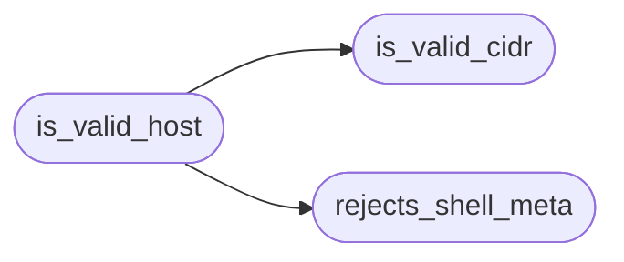

# `core.host_policy`

> Source: [core/host_policy.py:1](../../core/host_policy.py#L1) | language `py` | coverage 100.0% | [API index](../index.md)

Single source of truth for host and network shape validation.

Both the CLI UX gates (``core.validators.check_*``) and the security
predicates (``core.hardening.validate_*``) used to embed their own
host-matching logic, which drifted apart. Every predicate here is
pure (no I/O, no console output) so presentation and security layers
share one fail-closed policy: plain IPs, CIDR blocks and hostnames
pass, anything with shell metacharacters fails.

## Contents

- **Functions:** [`rejects_shell_meta`](#rejects_shell_meta), [`is_valid_cidr`](#is_valid_cidr), [`is_valid_host`](#is_valid_host)

## Call Graph

Solid arrows stay in this module, dashed arrows leave it.



## Functions

<a id="rejects_shell_meta"></a>

### `rejects_shell_meta`

`function` | [core/host_policy.py:20](../../core/host_policy.py#L20)

```python
def rejects_shell_meta(value: str) -> bool
```

Return True when value contains characters usable for shell injection.

**Parameters**

| Name | Type | Default | Description |
|---|---|---|---|
| `value` | `str` |  | Raw host string to inspect. |

**Returns:** `bool` - True when any shell metacharacter is present.

*Called by:* [`is_valid_host`](#is_valid_host)

---

<a id="is_valid_cidr"></a>

### `is_valid_cidr`

`function` | [core/host_policy.py:32](../../core/host_policy.py#L32)

```python
def is_valid_cidr(value: str) -> bool
```

Check value is a valid CIDR block.

**Parameters**

| Name | Type | Default | Description |
|---|---|---|---|
| `value` | `str` |  | Candidate CIDR string. |

**Returns:** `bool` - True when ``ipaddress`` accepts it as a network.

*Called by:* [`is_valid_host`](#is_valid_host)

---

<a id="is_valid_host"></a>

### `is_valid_host`

`function` | [core/host_policy.py:48](../../core/host_policy.py#L48)

```python
def is_valid_host(value: object) -> bool
```

Check value is a plain IP, CIDR, or hostname without shell metacharacters.

**Parameters**

| Name | Type | Default | Description |
|---|---|---|---|
| `value` | `object` |  | Candidate host value of any type. |

**Returns:** `bool` - True for IPs, CIDR blocks and hostnames up to 253 chars.

*Calls:* [`is_valid_cidr`](#is_valid_cidr), [`rejects_shell_meta`](#rejects_shell_meta)

---
