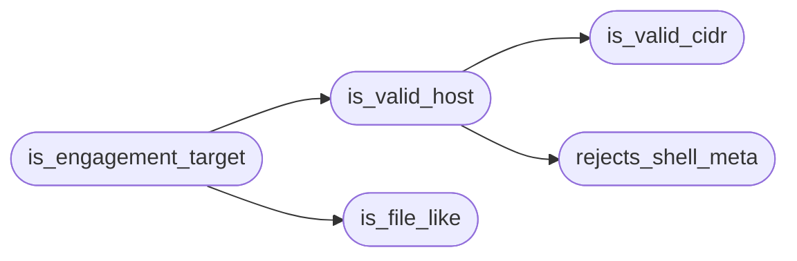

# `core.host_policy`

> Source: [core/host_policy.py:1](../../core/host_policy.py#L1) | language `py` | coverage 100.0% | [API index](../index.md)

Single source of truth for host and network shape validation.

Both the CLI UX gates (``core.validators.check_*``) and the security
predicates (``core.hardening.validate_*``) used to embed their own
host-matching logic, which drifted apart. Every predicate here is
pure (no I/O, no console output) so presentation and security layers
share one fail-closed policy: plain IPs, CIDR blocks and hostnames
pass, anything with shell metacharacters fails.

## Contents

- **Functions:** [`rejects_shell_meta`](#rejects_shell_meta), [`is_valid_cidr`](#is_valid_cidr), [`is_valid_host`](#is_valid_host), [`is_file_like`](#is_file_like), [`is_engagement_target`](#is_engagement_target)

## Call Graph

Solid arrows stay in this module, dashed arrows leave it.



## Functions

<a id="rejects_shell_meta"></a>

### `rejects_shell_meta`

`function` | [core/host_policy.py:24](../../core/host_policy.py#L24)

```python
def rejects_shell_meta(value: str) -> bool
```

Return True when value contains characters usable for shell injection.

**Parameters**

| Name | Type | Default | Description |
|---|---|---|---|
| `value` | `str` |  | Raw host string to inspect. |

**Returns:** `bool` - True when any shell metacharacter is present.

*Called by:* [`is_valid_host`](#is_valid_host)

---

<a id="is_valid_cidr"></a>

### `is_valid_cidr`

`function` | [core/host_policy.py:36](../../core/host_policy.py#L36)

```python
def is_valid_cidr(value: str) -> bool
```

Check value is a valid CIDR block.

**Parameters**

| Name | Type | Default | Description |
|---|---|---|---|
| `value` | `str` |  | Candidate CIDR string. |

**Returns:** `bool` - True when ``ipaddress`` accepts it as a network.

*Called by:* [`is_valid_host`](#is_valid_host)

---

<a id="is_valid_host"></a>

### `is_valid_host`

`function` | [core/host_policy.py:52](../../core/host_policy.py#L52)

```python
def is_valid_host(value: object) -> bool
```

Check value is a plain IP, CIDR, or hostname without shell metacharacters.

**Parameters**

| Name | Type | Default | Description |
|---|---|---|---|
| `value` | `object` |  | Candidate host value of any type. |

**Returns:** `bool` - True for IPs, CIDR blocks and hostnames up to 253 chars.

*Calls:* [`is_valid_cidr`](#is_valid_cidr), [`rejects_shell_meta`](#rejects_shell_meta)

*Called by:* [`is_engagement_target`](#is_engagement_target)

---

<a id="is_file_like"></a>

### `is_file_like`

`function` | [core/host_policy.py:77](../../core/host_policy.py#L77)

```python
def is_file_like(value: object) -> bool
```

Return True when value names a local artefact by extension, not a host.

A tool name such as ``linpeas.sh`` superficially matches the hostname
grammar yet is never an engagement target. Scope and target selection use
this to keep local files out of host handling.

**Parameters**

| Name | Type | Default | Description |
|---|---|---|---|
| `value` | `object` |  | Candidate value of any type. |

**Returns:** `bool` - True when the value ends with a known non-host file extension.

*Called by:* [`is_engagement_target`](#is_engagement_target)

---

<a id="is_engagement_target"></a>

### `is_engagement_target`

`function` | [core/host_policy.py:95](../../core/host_policy.py#L95)

```python
def is_engagement_target(value: object, *, allow_cidr: bool = True) -> bool
```

Return True when value is a routable engagement target, not a local file.

A thin policy layer over [`is_valid_host`](#is_valid_host): file-like names are never
targets, and CIDR blocks are rejected when the caller only accepts a
single host (``allow_cidr=False``).

**Parameters**

| Name | Type | Default | Description |
|---|---|---|---|
| `value` | `object` |  | Candidate target value of any type. |
| `allow_cidr` | `bool` | `True` | When False, reject CIDR blocks (single-host call sites). |

**Returns:** `bool` - True when the value is a usable host or (optionally) CIDR target.

*Calls:* [`is_file_like`](#is_file_like), [`is_valid_host`](#is_valid_host)

---
