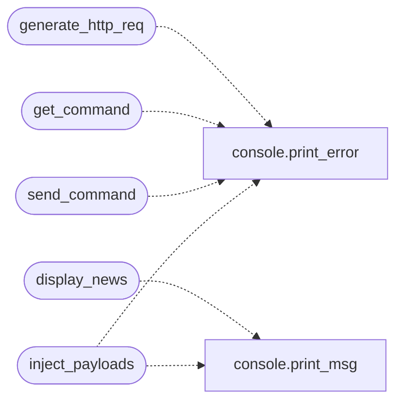

# `core.http`

> Source: [core/http.py:1](../../core/http.py#L1) | language `py` | coverage 100.0% | [API index](../index.md)

HTTP and API utilities for the LazyOwn framework.

Extracted from ``utils.py`` — HTTP request builders, exploit/PoC
scrapers, news feeds, and web interaction helpers.

## Contents

- **Functions:** [`generate_http_req`](#generate_http_req), [`get_banner`](#get_banner), [`get_command`](#get_command), [`send_command`](#send_command), [`exploitalert`](#exploitalert), [`packetstormsecurity`](#packetstormsecurity), [`nvddb`](#nvddb), [`scrape_news`](#scrape_news), [`display_news`](#display_news), [`inject_payloads`](#inject_payloads)

## Call Graph

Solid arrows stay in this module, dashed arrows leave it.



## Functions

<a id="generate_http_req"></a>

### `generate_http_req`

`function` | [core/http.py:18](../../core/http.py#L18)

```python
def generate_http_req(host: str, port: int, uri: str, custom_header: dict[str, str] | None = None, cmd: str | None = None) -> str
```

Build and send an HTTP GET request.

**Parameters**

| Name | Type | Default | Description |
|---|---|---|---|
| `host` | `str` |  | Target hostname or IP. |
| `port` | `int` |  | Target port. |
| `uri` | `str` |  | URI path. |
| `custom_header` | `dict[str, str] \| None` | `None` | Optional extra headers. |
| `cmd` | `str \| None` | `None` | Optional command to embed in the request. |

**Returns:** `str` - Response text or empty string.

*Calls:* [`print_error`](core.console.py.md#print_error)

---

<a id="get_banner"></a>

### `get_banner`

`function` | [core/http.py:50](../../core/http.py#L50)

```python
def get_banner(host: str, port: int) -> str
```

Fetch a banner by connecting via HTTP to the given host and port.

**Parameters**

| Name | Type | Default | Description |
|---|---|---|---|
| `host` | `str` |  | Target host. |
| `port` | `int` |  | Target port. |

**Returns:** `str` - Response text or empty string.

---

<a id="get_command"></a>

### `get_command`

`function` | [core/http.py:69](../../core/http.py#L69)

```python
def get_command(url: str, lhost: str) -> str | None
```

Fetch a command payload from a remote URL.

**Parameters**

| Name | Type | Default | Description |
|---|---|---|---|
| `url` | `str` |  | Full URL to fetch. |
| `lhost` | `str` |  | Local host address (unused, kept for signature compat). |

**Returns:** `str | None` - Response text or None on failure.

*Calls:* [`print_error`](core.console.py.md#print_error)

---

<a id="send_command"></a>

### `send_command`

`function` | [core/http.py:87](../../core/http.py#L87)

```python
def send_command(cmd: str, url: str, lhost: str) -> str | None
```

Send a command via HTTP POST.

**Parameters**

| Name | Type | Default | Description |
|---|---|---|---|
| `cmd` | `str` |  | Command string. |
| `url` | `str` |  | Target URL. |
| `lhost` | `str` |  | Local host. |

**Returns:** `str | None` - Response text or None.

*Calls:* [`print_error`](core.console.py.md#print_error)

---

<a id="exploitalert"></a>

### `exploitalert`

`function` | [core/http.py:106](../../core/http.py#L106)

```python
def exploitalert(content: str) -> list[dict[str, str]]
```

Parse ExploitAlert search results HTML.

**Parameters**

| Name | Type | Default | Description |
|---|---|---|---|
| `content` | `str` |  | Raw HTML from ExploitAlert. |

**Returns:** `list[dict[str, str]]` - List of ``{"title": …, "link": …}`` dicts.

---

<a id="packetstormsecurity"></a>

### `packetstormsecurity`

`function` | [core/http.py:125](../../core/http.py#L125)

```python
def packetstormsecurity(content: str) -> list[dict[str, str]]
```

Parse Packet Storm Security search results HTML.

**Parameters**

| Name | Type | Default | Description |
|---|---|---|---|
| `content` | `str` |  | Raw HTML from packetstormsecurity.com. |

**Returns:** `list[dict[str, str]]` - List of ``{"title": …, "link": …}`` dicts.

---

<a id="nvddb"></a>

### `nvddb`

`function` | [core/http.py:143](../../core/http.py#L143)

```python
def nvddb(content: str) -> list[dict[str, Any]]
```

Parse NVD JSON vulnerability feed.

**Parameters**

| Name | Type | Default | Description |
|---|---|---|---|
| `content` | `str` |  | Raw JSON string from the NVD API. |

**Returns:** `list[dict[str, Any]]` - List of CVE dicts.

---

<a id="scrape_news"></a>

### `scrape_news`

`function` | [core/http.py:174](../../core/http.py#L174)

```python
def scrape_news() -> tuple[list[str], list[str], list[str]]
```

Scrape Hacker News top stories.

**Returns:** `tuple[list[str], list[str], list[str]]` - ``(titles, links, scores)`` tuple.

---

<a id="display_news"></a>

### `display_news`

`function` | [core/http.py:198](../../core/http.py#L198)

```python
def display_news(titles: list[str], links: list[str], scores: list[str]) -> None
```

Display scraped news in the console.

**Parameters**

| Name | Type | Default | Description |
|---|---|---|---|
| `titles` | `list[str]` |  | News titles. |
| `links` | `list[str]` |  | News URLs. |
| `scores` | `list[str]` |  | News scores. |

*Calls:* [`print_msg`](core.console.py.md#print_msg)

---

<a id="inject_payloads"></a>

### `inject_payloads`

`function` | [core/http.py:211](../../core/http.py#L211)

```python
def inject_payloads(urls: list[str], payload_url: str, request_timeout: int = 15) -> None
```

Attempt to inject a payload URL into a list of target URLs.

**Parameters**

| Name | Type | Default | Description |
|---|---|---|---|
| `urls` | `list[str]` |  | List of target URLs. |
| `payload_url` | `str` |  | URL to inject. |
| `request_timeout` | `int` | `15` | Timeout per request in seconds. |

*Calls:* [`print_error`](core.console.py.md#print_error), [`print_msg`](core.console.py.md#print_msg)

---
