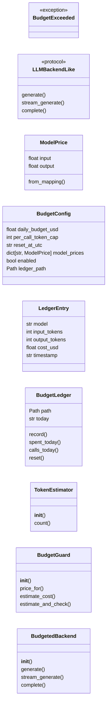
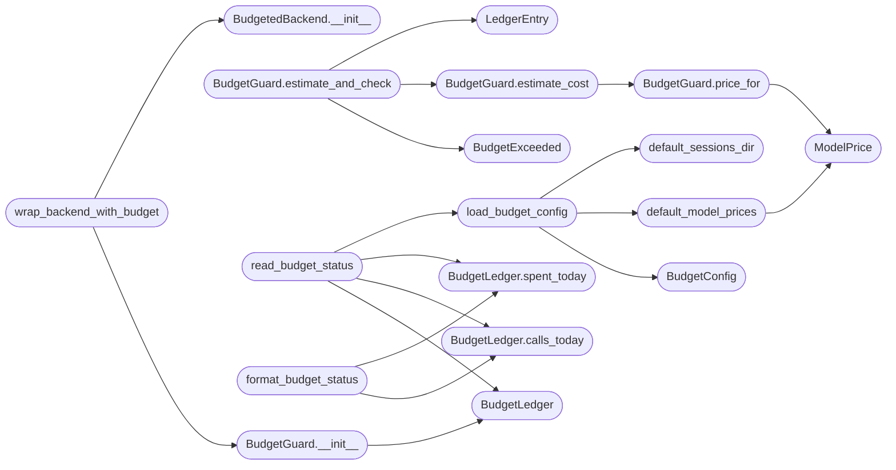

# `core.llm_budget`

> Source: [core/llm_budget.py:1](../../core/llm_budget.py#L1) | language `py` | coverage 82.4% | [API index](../index.md)

LLM budget cap and per call token counter.

The framework exposes several LLM backed entry points. The framework
never enforced a daily cost cap. The module below is the
single source of truth for the LLM budget contract. The module is
imported by [`modules.llm_factory`](modules.llm_factory.py.md) so every backend the factory
returns is wrapped with the guard.

The contract is the wrapper refuses the call when the daily budget is
exhausted or the per call token cap is exceeded. The contract never
raises a non budget related exception. The contract persists the
ledger to ``sessions/llm_budget.json`` so a process restart does not
reset the counter inside the same calendar day.

Pricing follows the OpenAI style model where the operator declares a
price per million input tokens and a price per million output
tokens. The default price table covers Groq and Ollama. The Ollama
prices are zero because the operator runs the model on the local
host. The operator may override every price through ``payload.json``.

The module imports nothing from the LazyOwn project beyond
[`core.config`](core.config.py.md) and [`core.dependencies`](core.dependencies.py.md) so a fresh checkout
can use the module without activating the framework.

## Contents

- **Classes:** [`ModelPrice`](#modelprice), [`BudgetConfig`](#budgetconfig), [`LedgerEntry`](#ledgerentry), [`BudgetLedger`](#budgetledger), [`TokenEstimator`](#tokenestimator), [`BudgetGuard`](#budgetguard), [`BudgetedBackend`](#budgetedbackend)
- **Protocols:** [`LLMBackendLike`](#llmbackendlike)
- **Exceptions:** [`BudgetExceeded`](#budgetexceeded)
- **Functions:** [`default_model_prices`](#default_model_prices), [`default_sessions_dir`](#default_sessions_dir), [`load_budget_config`](#load_budget_config), [`read_budget_status`](#read_budget_status), [`format_budget_status`](#format_budget_status), [`wrap_backend_with_budget`](#wrap_backend_with_budget)
- **Constants:** [`DEFAULT_DAILY_BUDGET_USD`](#default_daily_budget_usd), [`DEFAULT_PER_CALL_TOKEN_CAP`](#default_per_call_token_cap), [`DEFAULT_RESET_AT_UTC`](#default_reset_at_utc), [`DEFAULT_LEDGER_FILENAME`](#default_ledger_filename), [`TOKEN_BUDGET_FIELDS`](#token_budget_fields), [`SESSIONS_DIR_ENV`](#sessions_dir_env), [`GROQ_PRICE_INPUT_USD_PER_M`](#groq_price_input_usd_per_m), [`GROQ_PRICE_OUTPUT_USD_PER_M`](#groq_price_output_usd_per_m), [`OLLAMA_PRICE_INPUT_USD_PER_M`](#ollama_price_input_usd_per_m), [`OLLAMA_PRICE_OUTPUT_USD_PER_M`](#ollama_price_output_usd_per_m)

## Type Diagram



## Call Graph

Solid arrows stay in this module, dashed arrows leave it.



## Classes

<a id="modelprice"></a>

### `ModelPrice`

`class` `dataclass` | [core/llm_budget.py:69](../../core/llm_budget.py#L69)

Decorators: `@dataclass(frozen=True)`

```python
class ModelPrice
```

Price for a single model expressed in United States dollars per million tokens.

**Attributes**

| Name | Type | Default | Description |
|---|---|---|---|
| [`input`](#modelprice-input) | `float` |  | Cost per million input tokens. |
| [`output`](#modelprice-output) | `float` |  | Cost per million output tokens. |

**Members**

| Member | Kind | Summary |
|---|---|---|
| [`from_mapping`](#modelprice-from_mapping) | classmethod | Build a ModelPrice from a JSON friendly mapping. |

<a id="modelprice-from_mapping"></a>

#### `ModelPrice.from_mapping`

`classmethod` | [core/llm_budget.py:81](../../core/llm_budget.py#L81)

Decorators: `@classmethod`

```python
def from_mapping(cls, data: Mapping[str, Any]) -> ModelPrice
```

Build a ModelPrice from a JSON friendly mapping.

**Parameters**

| Name | Type | Default | Description |
|---|---|---|---|
| `data` | `Mapping[str, Any]` |  | Mapping that carries the `[`input`](#modelprice-input)` and `[`output`](#modelprice-output)` keys. |

**Returns:** `ModelPrice` - The ModelPrice the guard consumes.

**Raises**

- `ValueError`: when the mapping is missing the required keys.

---

<a id="budgetconfig"></a>

### `BudgetConfig`

`class` `dataclass` | [core/llm_budget.py:103](../../core/llm_budget.py#L103)

Decorators: `@dataclass(frozen=True)`

```python
class BudgetConfig
```

Runtime configuration for the LLM budget guard.

**Attributes**

| Name | Type | Default | Description |
|---|---|---|---|
| [`daily_budget_usd`](#budgetconfig-daily_budget_usd) | `float` |  | Maximum amount the operator allows the framework to spend on a single calendar day. |
| [`per_call_token_cap`](#budgetconfig-per_call_token_cap) | `int` |  | Maximum number of input tokens a single call may consume. The cap is a safety net that prevents a runaway prompt from consuming the whole budget in one shot. |
| [`reset_at_utc`](#budgetconfig-reset_at_utc) | `str` |  | Time of day, in HH:MM format and UTC, when the ledger rolls over and the day counter restarts. |
| [`model_prices`](#budgetconfig-model_prices) | `dict[str, ModelPrice]` | `field(default_factory=dict)` | Per model price table. The keys are model identifiers. The values are [`ModelPrice`](#modelprice) instances expressed in United States dollars per million tokens. |
| [`enabled`](#budgetconfig-enabled) | `bool` | `True` | When False the guard passes the call through without recording a charge. The default is True so the operator who configures a budget is protected by default. |
| [`ledger_path`](#budgetconfig-ledger_path) | `Path` | `field(default_factory=lambda: Path('/dev/null'))` | Absolute path of the JSON file the ledger writes. |

---

<a id="ledgerentry"></a>

### `LedgerEntry`

`class` `dataclass` | [core/llm_budget.py:132](../../core/llm_budget.py#L132)

Decorators: `@dataclass(frozen=True)`

```python
class LedgerEntry
```

Single charge the ledger records.

**Attributes**

| Name | Type | Default | Description |
|---|---|---|---|
| [`model`](#ledgerentry-model) | `str` |  | Model identifier the wrapper recorded. |
| [`input_tokens`](#ledgerentry-input_tokens) | `int` |  | Number of input tokens the wrapper counted. |
| [`output_tokens`](#ledgerentry-output_tokens) | `int` |  | Number of output tokens the wrapper recorded. |
| [`cost_usd`](#ledgerentry-cost_usd) | `float` |  | Dollar cost the wrapper charged for the call. |
| [`timestamp`](#ledgerentry-timestamp) | `str` |  | ISO 8601 timestamp the wrapper wrote the entry. |

---

<a id="budgetledger"></a>

### `BudgetLedger`

`class` `dataclass` | [core/llm_budget.py:176](../../core/llm_budget.py#L176)

Decorators: `@dataclass`

```python
class BudgetLedger
```

In memory ledger that persists the daily spend to disk.

**Attributes**

| Name | Type | Default | Description |
|---|---|---|---|
| [`path`](#budgetledger-path) | `Path` |  | Absolute path of the JSON file the ledger reads on construction and writes after every charge. |
| [`today`](#budgetledger-today) | `str` | `field(default_factory=_today_utc)` | Calendar day the ledger considers the current day. Tests override the value to drive the day roll over. |

**Members**

| Member | Kind | Summary |
|---|---|---|
| [`record`](#budgetledger-record) | method | Append a charge to the ledger and persist the new state. |
| [`spent_today`](#budgetledger-spent_today) | method | Return the dollar amount the ledger charged for the current day. |
| [`calls_today`](#budgetledger-calls_today) | method | Return the number of calls the ledger recorded for the current day. |
| [`reset`](#budgetledger-reset) | method | Clear the ledger for the current day and persist the empty state. |

<a id="budgetledger-record"></a>

#### `BudgetLedger.record`

`method` | [core/llm_budget.py:232](../../core/llm_budget.py#L232)

```python
def record(self, entry: LedgerEntry) -> None
```

Append a charge to the ledger and persist the new state.

**Parameters**

| Name | Type | Default | Description |
|---|---|---|---|
| `entry` | `LedgerEntry` |  | Charge the guard computed. |

<a id="budgetledger-spent_today"></a>

#### `BudgetLedger.spent_today`

`method` | [core/llm_budget.py:251](../../core/llm_budget.py#L251)

```python
def spent_today(self) -> float
```

Return the dollar amount the ledger charged for the current day.

**Returns:** `float`

*Called by:* [`format_budget_status`](#format_budget_status), [`read_budget_status`](#read_budget_status)

<a id="budgetledger-calls_today"></a>

#### `BudgetLedger.calls_today`

`method` | [core/llm_budget.py:256](../../core/llm_budget.py#L256)

```python
def calls_today(self) -> int
```

Return the number of calls the ledger recorded for the current day.

**Returns:** `int`

*Called by:* [`format_budget_status`](#format_budget_status), [`read_budget_status`](#read_budget_status)

<a id="budgetledger-reset"></a>

#### `BudgetLedger.reset`

`method` | [core/llm_budget.py:261](../../core/llm_budget.py#L261)

```python
def reset(self) -> None
```

Clear the ledger for the current day and persist the empty state.

*Called by:* [`AiCommandSet.do_llm_budget`](cli.commands.ai.py.md#aicommandset-do_llm_budget)

---

<a id="tokenestimator"></a>

### `TokenEstimator`

`class` | [core/llm_budget.py:268](../../core/llm_budget.py#L268)

```python
class TokenEstimator
```

Token counter the guard consumes.

The estimator wraps ``tiktoken`` when the dependency is available.
When ``tiktoken`` is missing the estimator falls back to a
whitespace tokeniser that still produces a deterministic count.
The fallback exists so the guard never crashes the operator who
runs the framework on a host without ``tiktoken`` installed.

**Members**

| Member | Kind | Summary |
|---|---|---|
| [`__init__`](#tokenestimator-__init__) | constructor |  |
| [`count`](#tokenestimator-count) | method | Return the number of tokens the input text contains. |

<a id="tokenestimator-__init__"></a>

#### `TokenEstimator.__init__`

`constructor` | [core/llm_budget.py:278](../../core/llm_budget.py#L278)

```python
def __init__(self, encoding_name: str = 'cl100k_base') -> None
```

**Parameters**

| Name | Type | Default | Description |
|---|---|---|---|
| `encoding_name` | `str` | `'cl100k_base'` |  |

<a id="tokenestimator-count"></a>

#### `TokenEstimator.count`

`method` | [core/llm_budget.py:292](../../core/llm_budget.py#L292)

```python
def count(self, text: str) -> int
```

Return the number of tokens the input text contains.

**Parameters**

| Name | Type | Default | Description |
|---|---|---|---|
| `text` | `str` |  | Prompt or completion the guard measures. |

**Returns:** `int` - Non negative integer count. Zero for the empty string.

---

<a id="budgetguard"></a>

### `BudgetGuard`

`class` | [core/llm_budget.py:310](../../core/llm_budget.py#L310)

```python
class BudgetGuard
```

Proxy that enforces the budget around a wrapped backend.

**Members**

| Member | Kind | Summary |
|---|---|---|
| [`__init__`](#budgetguard-__init__) | constructor |  |
| [`price_for`](#budgetguard-price_for) | method | Return the price the guard applies to a model identifier. |
| [`estimate_cost`](#budgetguard-estimate_cost) | method | Return the dollar cost the guard would charge for a call. |
| [`estimate_and_check`](#budgetguard-estimate_and_check) | method | Check the budget and record a charge when the call fits. |

<a id="budgetguard-__init__"></a>

#### `BudgetGuard.__init__`

`constructor` | [core/llm_budget.py:319](../../core/llm_budget.py#L319)

```python
def __init__(self, config: BudgetConfig, estimator: TokenEstimator, ledger: BudgetLedger | None = None) -> None
```

**Parameters**

| Name | Type | Default | Description |
|---|---|---|---|
| `config` | `BudgetConfig` |  |  |
| `estimator` | `TokenEstimator` |  |  |
| `ledger` | `BudgetLedger \| None` | `None` |  |

*Calls:* [`BudgetLedger`](#budgetledger)

*Called by:* [`wrap_backend_with_budget`](#wrap_backend_with_budget)

<a id="budgetguard-price_for"></a>

#### `BudgetGuard.price_for`

`method` | [core/llm_budget.py:329](../../core/llm_budget.py#L329)

```python
def price_for(self, model: str) -> ModelPrice
```

Return the price the guard applies to a model identifier.

**Parameters**

| Name | Type | Default | Description |
|---|---|---|---|
| `model` | `str` |  | Model identifier the caller asked for. |

**Returns:** `ModelPrice` - The configured price when the operator declared one. The
zero price for Ollama when the model is unknown so the
local model never charges the budget.

*Calls:* [`ModelPrice`](#modelprice)

*Called by:* [`BudgetGuard.estimate_cost`](#budgetguard-estimate_cost)

<a id="budgetguard-estimate_cost"></a>

#### `BudgetGuard.estimate_cost`

`method` | [core/llm_budget.py:343](../../core/llm_budget.py#L343)

```python
def estimate_cost(self, model: str, input_tokens: int, output_tokens: int) -> float
```

Return the dollar cost the guard would charge for a call.

**Parameters**

| Name | Type | Default | Description |
|---|---|---|---|
| `model` | `str` |  | Model identifier the caller asked for. |
| `input_tokens` | `int` |  | Input token count the estimator reported. |
| `output_tokens` | `int` |  | Output token count the caller declared. |

**Returns:** `float` - Dollar cost expressed in United States dollars.

*Calls:* [`BudgetGuard.price_for`](#budgetguard-price_for)

*Called by:* [`BudgetGuard.estimate_and_check`](#budgetguard-estimate_and_check)

<a id="budgetguard-estimate_and_check"></a>

#### `BudgetGuard.estimate_and_check`

`method` | [core/llm_budget.py:356](../../core/llm_budget.py#L356)

```python
def estimate_and_check(self, prompt: str, model: str, output_tokens: int = 0) -> LedgerEntry
```

Check the budget and record a charge when the call fits.

**Parameters**

| Name | Type | Default | Description |
|---|---|---|---|
| `prompt` | `str` |  | Prompt the caller will forward to the backend. |
| `model` | `str` |  | Model identifier the caller will use. |
| `output_tokens` | `int` | `0` | Output token count the caller declares in advance. The guard uses the value to estimate the cost when the caller knows the answer length. The guard falls back to zero when the caller cannot predict it. |

**Returns:** `LedgerEntry` - The LedgerEntry the guard recorded. The caller never has
to inspect the entry. The entry exists so tests can pin
the cost the guard charged.

**Raises**

- [`BudgetExceeded`](#budgetexceeded): when the per call token cap is exceeded,
the daily budget is exhausted, or the budget is
disabled and the cap is zero.

*Calls:* [`BudgetExceeded`](#budgetexceeded), [`BudgetGuard.estimate_cost`](#budgetguard-estimate_cost), [`LedgerEntry`](#ledgerentry)

---

<a id="budgetedbackend"></a>

### `BudgetedBackend`

`class` | [core/llm_budget.py:408](../../core/llm_budget.py#L408)

```python
class BudgetedBackend
```

Transparent proxy the factory returns in place of the raw backend.

**Members**

| Member | Kind | Summary |
|---|---|---|
| [`__init__`](#budgetedbackend-__init__) | constructor |  |
| [`generate`](#budgetedbackend-generate) | method | Forward a non streaming call and record a charge. |
| [`stream_generate`](#budgetedbackend-stream_generate) | method | Forward a streaming call. |
| [`complete`](#budgetedbackend-complete) | method | Forward a role aware call. |

<a id="budgetedbackend-__init__"></a>

#### `BudgetedBackend.__init__`

`constructor` | [core/llm_budget.py:417](../../core/llm_budget.py#L417)

```python
def __init__(self, inner: Any, guard: BudgetGuard, model: str) -> None
```

**Parameters**

| Name | Type | Default | Description |
|---|---|---|---|
| `inner` | `Any` |  |  |
| `guard` | `BudgetGuard` |  |  |
| `model` | `str` |  |  |

*Called by:* [`wrap_backend_with_budget`](#wrap_backend_with_budget)

<a id="budgetedbackend-generate"></a>

#### `BudgetedBackend.generate`

`method` | [core/llm_budget.py:422](../../core/llm_budget.py#L422)

```python
def generate(self, prompt: str) -> str
```

Forward a non streaming call and record a charge.

**Parameters**

| Name | Type | Default | Description |
|---|---|---|---|
| `prompt` | `str` |  |  |

**Returns:** `str`

<a id="budgetedbackend-stream_generate"></a>

#### `BudgetedBackend.stream_generate`

`method` | [core/llm_budget.py:430](../../core/llm_budget.py#L430)

```python
def stream_generate(self, prompt: str) -> Any
```

Forward a streaming call.

The charge is recorded up front.

**Parameters**

| Name | Type | Default | Description |
|---|---|---|---|
| `prompt` | `str` |  |  |

**Returns:** `Any`

<a id="budgetedbackend-complete"></a>

#### `BudgetedBackend.complete`

`method` | [core/llm_budget.py:435](../../core/llm_budget.py#L435)

```python
def complete(self, system: str, user: str, max_tokens: int, temperature: float) -> str
```

Forward a role aware call.

The prompt includes the system block.

**Parameters**

| Name | Type | Default | Description |
|---|---|---|---|
| `system` | `str` |  |  |
| `user` | `str` |  |  |
| `max_tokens` | `int` |  |  |
| `temperature` | `float` |  |  |

**Returns:** `str`

---

## Protocols

<a id="llmbackendlike"></a>

### `LLMBackendLike`

`protocol` | [core/llm_budget.py:58](../../core/llm_budget.py#L58)

```python
class LLMBackendLike(Protocol)
```

Bases: `Protocol`

Structural type the wrapper requires from the wrapped backend.

**Members**

| Member | Kind | Summary |
|---|---|---|
| [`generate`](#llmbackendlike-generate) | method |  |
| [`stream_generate`](#llmbackendlike-stream_generate) | method |  |
| [`complete`](#llmbackendlike-complete) | method |  |

<a id="llmbackendlike-generate"></a>

#### `LLMBackendLike.generate`

`method` | [core/llm_budget.py:61](../../core/llm_budget.py#L61)

```python
def generate(self, prompt: str) -> Any
```

**Parameters**

| Name | Type | Default | Description |
|---|---|---|---|
| `prompt` | `str` |  |  |

**Returns:** `Any`

<a id="llmbackendlike-stream_generate"></a>

#### `LLMBackendLike.stream_generate`

`method` | [core/llm_budget.py:63](../../core/llm_budget.py#L63)

```python
def stream_generate(self, prompt: str) -> Any
```

**Parameters**

| Name | Type | Default | Description |
|---|---|---|---|
| `prompt` | `str` |  |  |

**Returns:** `Any`

<a id="llmbackendlike-complete"></a>

#### `LLMBackendLike.complete`

`method` | [core/llm_budget.py:65](../../core/llm_budget.py#L65)

```python
def complete(self, system: str, user: str, max_tokens: int, temperature: float) -> str
```

**Parameters**

| Name | Type | Default | Description |
|---|---|---|---|
| `system` | `str` |  |  |
| `user` | `str` |  |  |
| `max_tokens` | `int` |  |  |
| `temperature` | `float` |  |  |

**Returns:** `str`

---

## Exceptions

<a id="budgetexceeded"></a>

### `BudgetExceeded`

`exception` | [core/llm_budget.py:54](../../core/llm_budget.py#L54)

```python
class BudgetExceeded(RuntimeError)
```

Bases: `RuntimeError`

Raised when a call would breach the daily budget or the token cap.

---

## Functions

<a id="default_model_prices"></a>

### `default_model_prices`

`function` | [core/llm_budget.py:442](../../core/llm_budget.py#L442)

```python
def default_model_prices() -> dict[str, ModelPrice]
```

Return the default price table the guard ships with.

**Returns:** `dict[str, ModelPrice]` - A dictionary keyed by model identifier. The values are
[`ModelPrice`](#modelprice) instances.

*Calls:* [`ModelPrice`](#modelprice)

*Called by:* [`load_budget_config`](#load_budget_config)

---

<a id="default_sessions_dir"></a>

### `default_sessions_dir`

`function` | [core/llm_budget.py:461](../../core/llm_budget.py#L461)

```python
def default_sessions_dir() -> Path
```

Return the directory the ledger writes to by default.

**Returns:** `Path` - Absolute path. The directory is the LazyOwn ``sessions``
directory under the current working directory. The operator
may override the value through the ``LAZYOWN_SESSIONS_DIR``
environment variable.

*Called by:* [`load_budget_config`](#load_budget_config)

---

<a id="load_budget_config"></a>

### `load_budget_config`

`function` | [core/llm_budget.py:552](../../core/llm_budget.py#L552)

```python
def load_budget_config(payload: Mapping[str, Any], sessions_dir: Path | None = None) -> BudgetConfig
```

Build a BudgetConfig from a payload mapping.

**Parameters**

| Name | Type | Default | Description |
|---|---|---|---|
| `payload` | `Mapping[str, Any]` |  | Mapping derived from ``payload.json``. |
| `sessions_dir` | `Path \| None` | `None` | Directory the ledger writes to. Defaults to the LazyOwn ``sessions`` directory. |

**Returns:** `BudgetConfig` - The BudgetConfig the guard consumes.

*Calls:* [`BudgetConfig`](#budgetconfig), [`default_model_prices`](#default_model_prices), [`default_sessions_dir`](#default_sessions_dir)

*Called by:* [`AiCommandSet.do_llm_budget`](cli.commands.ai.py.md#aicommandset-do_llm_budget), [`read_budget_status`](#read_budget_status)

---

<a id="read_budget_status"></a>

### `read_budget_status`

`function` | [core/llm_budget.py:585](../../core/llm_budget.py#L585)

```python
def read_budget_status(payload: Mapping[str, Any], sessions_dir: Path | None = None) -> dict[str, Any]
```

Return a structured snapshot of the current budget.

**Parameters**

| Name | Type | Default | Description |
|---|---|---|---|
| `payload` | `Mapping[str, Any]` |  | Mapping derived from ``payload.json``. |
| `sessions_dir` | `Path \| None` | `None` | Directory the ledger writes to. |

**Returns:** `dict[str, Any]` - Dictionary the CLI command and the MCP tool surface to the
operator. Keys are stable across releases.

*Calls:* [`BudgetLedger`](#budgetledger), [`BudgetLedger.calls_today`](#budgetledger-calls_today), [`BudgetLedger.spent_today`](#budgetledger-spent_today), [`load_budget_config`](#load_budget_config)

*Called by:* [`AiCommandSet.do_llm_budget`](cli.commands.ai.py.md#aicommandset-do_llm_budget)

---

<a id="format_budget_status"></a>

### `format_budget_status`

`function` | [core/llm_budget.py:616](../../core/llm_budget.py#L616)

```python
def format_budget_status(config: BudgetConfig, ledger: BudgetLedger) -> str
```

Render the budget status as a human readable block.

**Parameters**

| Name | Type | Default | Description |
|---|---|---|---|
| `config` | `BudgetConfig` |  | Active runtime configuration. |
| `ledger` | `BudgetLedger` |  | Ledger the operator wants to inspect. |

**Returns:** `str` - Multi line text the CLI command prints. The block is plain
text so the operator can pipe it to `[`grep`](cli.cli_enhancements.py.md#transcriptstore-grep)` or ``awk``.

*Calls:* [`BudgetLedger.calls_today`](#budgetledger-calls_today), [`BudgetLedger.spent_today`](#budgetledger-spent_today)

*Called by:* [`AiCommandSet.do_llm_budget`](cli.commands.ai.py.md#aicommandset-do_llm_budget)

---

<a id="wrap_backend_with_budget"></a>

### `wrap_backend_with_budget`

`function` | [core/llm_budget.py:657](../../core/llm_budget.py#L657)

```python
def wrap_backend_with_budget(backend: Any, config: BudgetConfig, estimator: TokenEstimator, model: str, ledger: BudgetLedger | None = None) -> BudgetedBackend
```

Wrap a concrete backend with a budgeted proxy.

**Parameters**

| Name | Type | Default | Description |
|---|---|---|---|
| `backend` | `Any` |  | Concrete backend the factory returns. |
| `config` | `BudgetConfig` |  | Active runtime configuration. |
| `estimator` | `TokenEstimator` |  | Token estimator the proxy uses. |
| `model` | `str` |  | Model identifier the proxy records on every call. |
| `ledger` | `BudgetLedger \| None` | `None` | Optional ledger. The factory passes ``None`` and lets the guard build the default ledger. |

**Returns:** `BudgetedBackend` - The proxy the caller forwards every request through.

**Raises**

- `TypeError`: when the backend does not expose the three call surface methods the proxy delegates to.

*Calls:* [`BudgetGuard.__init__`](#budgetguard-__init__), [`BudgetedBackend.__init__`](#budgetedbackend-__init__)

---

## Constants

<a id="default_daily_budget_usd"></a>

### `DEFAULT_DAILY_BUDGET_USD`

`constant` | [core/llm_budget.py:36](../../core/llm_budget.py#L36)

```python
DEFAULT_DAILY_BUDGET_USD = 1.0
```

---

<a id="default_per_call_token_cap"></a>

### `DEFAULT_PER_CALL_TOKEN_CAP`

`constant` | [core/llm_budget.py:37](../../core/llm_budget.py#L37)

```python
DEFAULT_PER_CALL_TOKEN_CAP = 8000
```

---

<a id="default_reset_at_utc"></a>

### `DEFAULT_RESET_AT_UTC`

`constant` | [core/llm_budget.py:38](../../core/llm_budget.py#L38)

```python
DEFAULT_RESET_AT_UTC = '00:00'
```

---

<a id="default_ledger_filename"></a>

### `DEFAULT_LEDGER_FILENAME`

`constant` | [core/llm_budget.py:39](../../core/llm_budget.py#L39)

```python
DEFAULT_LEDGER_FILENAME = 'llm_budget.json'
```

---

<a id="token_budget_fields"></a>

### `TOKEN_BUDGET_FIELDS`

`constant` | [core/llm_budget.py:40](../../core/llm_budget.py#L40)

```python
TOKEN_BUDGET_FIELDS
```

---

<a id="sessions_dir_env"></a>

### `SESSIONS_DIR_ENV`

`constant` | [core/llm_budget.py:47](../../core/llm_budget.py#L47)

```python
SESSIONS_DIR_ENV = 'LAZYOWN_SESSIONS_DIR'
```

---

<a id="groq_price_input_usd_per_m"></a>

### `GROQ_PRICE_INPUT_USD_PER_M`

`constant` | [core/llm_budget.py:48](../../core/llm_budget.py#L48)

```python
GROQ_PRICE_INPUT_USD_PER_M = 0.59
```

---

<a id="groq_price_output_usd_per_m"></a>

### `GROQ_PRICE_OUTPUT_USD_PER_M`

`constant` | [core/llm_budget.py:49](../../core/llm_budget.py#L49)

```python
GROQ_PRICE_OUTPUT_USD_PER_M = 0.79
```

---

<a id="ollama_price_input_usd_per_m"></a>

### `OLLAMA_PRICE_INPUT_USD_PER_M`

`constant` | [core/llm_budget.py:50](../../core/llm_budget.py#L50)

```python
OLLAMA_PRICE_INPUT_USD_PER_M = 0.0
```

---

<a id="ollama_price_output_usd_per_m"></a>

### `OLLAMA_PRICE_OUTPUT_USD_PER_M`

`constant` | [core/llm_budget.py:51](../../core/llm_budget.py#L51)

```python
OLLAMA_PRICE_OUTPUT_USD_PER_M = 0.0
```

---
