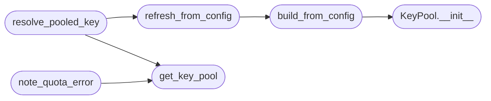

# `core.llm_key_pool`

> Source: [core/llm_key_pool.py:1](../../core/llm_key_pool.py#L1) | language `py` | coverage 100.0% | [API index](../index.md)

Per-backend LLM API key pool with round-robin rotation and quota cooldown.

sapper-v2 keeps a pool of API keys (``SAPPER_KEY_POOL``) and rotates to the
next one when a provider returns an explicit quota/credit error, so a long
autonomous run survives the exhaustion of any single key. LazyOwn already
rotates *models/members* on quota (``modules.lazy_loop.task_llm_chain``); this
module adds the orthogonal *key* axis.

The pool is pure and process-wide. It reads nothing itself: a builder parses
``payload.json`` once via [`build_from_config`](#build_from_config), seeding each backend's
pool with its primary key first so a single-key deployment behaves exactly as
before. Keys that hit an explicit quota error are parked for a cooldown window
and skipped until it elapses; when every key is cooling down the least-recently
parked one is returned so the caller still makes progress.

Config shape (``payload.json``):
    ``llm_key_pool``: either a flat list of extra keys for the default cloud
    backend (groq), or a mapping ``{backend: [keys, ...]}``. The backend's
    primary key (``api_key``/``openai_api_key``/...) is always tried first.

## Contents

- **Classes:** [`KeyPool`](#keypool)
- **Functions:** [`build_from_config`](#build_from_config), [`get_key_pool`](#get_key_pool), [`refresh_from_config`](#refresh_from_config), [`resolve_pooled_key`](#resolve_pooled_key), [`note_quota_error`](#note_quota_error)

## Call Graph

Solid arrows stay in this module, dashed arrows leave it.



## Classes

<a id="keypool"></a>

### `KeyPool`

`class` | [core/llm_key_pool.py:67](../../core/llm_key_pool.py#L67)

```python
class KeyPool
```

Thread-safe round-robin key selector with per-key quota cooldown.

One pool instance serves every backend. Each backend has an ordered key
list (primary first) plus a cursor and a cooldown map. The pool never
performs I/O; callers mark a key exhausted when the provider reports an
explicit quota error.

**Members**

| Member | Kind | Summary |
|---|---|---|
| [`__init__`](#keypool-__init__) | constructor | Initialize an empty pool. |
| [`set_keys`](#keypool-set_keys) | method | Replace the key list for one backend. |
| [`has_pool`](#keypool-has_pool) | method | Return True when more than one key is configured for the backend. |
| [`size`](#keypool-size) | method | Return the number of keys configured for the backend. |
| [`next_key`](#keypool-next_key) | method | Return the next usable key for a backend, advancing the cursor. |
| [`mark_exhausted`](#keypool-mark_exhausted) | method | Park a key for the cooldown window after an explicit quota error. |
| [`available`](#keypool-available) | method | Return how many keys are not currently cooling down. |
| [`reset`](#keypool-reset) | method | Clear every backend's keys, cursors and cooldowns. |

<a id="keypool-__init__"></a>

#### `KeyPool.__init__`

`constructor` | [core/llm_key_pool.py:76](../../core/llm_key_pool.py#L76)

```python
def __init__(self, cooldown_sec: float = _DEFAULT_COOLDOWN_SEC) -> None
```

Initialize an empty pool.

**Parameters**

| Name | Type | Default | Description |
|---|---|---|---|
| `cooldown_sec` | `float` | `_DEFAULT_COOLDOWN_SEC` | Seconds a quota-exhausted key is skipped. |

*Called by:* [`build_from_config`](#build_from_config)

<a id="keypool-set_keys"></a>

#### `KeyPool.set_keys`

`method` | [core/llm_key_pool.py:88](../../core/llm_key_pool.py#L88)

```python
def set_keys(self, backend: str, keys: Iterable[str]) -> None
```

Replace the key list for one backend.

**Parameters**

| Name | Type | Default | Description |
|---|---|---|---|
| `backend` | `str` |  | Backend identifier. |
| `keys` | `Iterable[str]` |  | Ordered candidate keys (primary first); placeholders and duplicates are dropped. |

<a id="keypool-has_pool"></a>

#### `KeyPool.has_pool`

`method` | [core/llm_key_pool.py:107](../../core/llm_key_pool.py#L107)

```python
def has_pool(self, backend: str) -> bool
```

Return True when more than one key is configured for the backend.

**Parameters**

| Name | Type | Default | Description |
|---|---|---|---|
| `backend` | `str` |  |  |

**Returns:** `bool`

<a id="keypool-size"></a>

#### `KeyPool.size`

`method` | [core/llm_key_pool.py:112](../../core/llm_key_pool.py#L112)

```python
def size(self, backend: str) -> int
```

Return the number of keys configured for the backend.

**Parameters**

| Name | Type | Default | Description |
|---|---|---|---|
| `backend` | `str` |  |  |

**Returns:** `int`

<a id="keypool-next_key"></a>

#### `KeyPool.next_key`

`method` | [core/llm_key_pool.py:117](../../core/llm_key_pool.py#L117)

```python
def next_key(self, backend: str, now: float | None = None) -> str | None
```

Return the next usable key for a backend, advancing the cursor.

Keys in cooldown are skipped. When every key is cooling down the one
whose cooldown expires soonest is returned so progress continues.

**Parameters**

| Name | Type | Default | Description |
|---|---|---|---|
| `backend` | `str` |  | Backend identifier. |
| `now` | `float \| None` | `None` | Optional monotonic-equivalent timestamp (for tests). |

**Returns:** `str | None` - A key string, or None when no keys are configured.

<a id="keypool-mark_exhausted"></a>

#### `KeyPool.mark_exhausted`

`method` | [core/llm_key_pool.py:149](../../core/llm_key_pool.py#L149)

```python
def mark_exhausted(self, backend: str, key: str, now: float | None = None) -> None
```

Park a key for the cooldown window after an explicit quota error.

**Parameters**

| Name | Type | Default | Description |
|---|---|---|---|
| `backend` | `str` |  | Backend identifier. |
| `key` | `str` |  | The key that reported quota exhaustion. |
| `now` | `float \| None` | `None` | Optional timestamp (for tests). |

<a id="keypool-available"></a>

#### `KeyPool.available`

`method` | [core/llm_key_pool.py:163](../../core/llm_key_pool.py#L163)

```python
def available(self, backend: str, now: float | None = None) -> int
```

Return how many keys are not currently cooling down.

**Parameters**

| Name | Type | Default | Description |
|---|---|---|---|
| `backend` | `str` |  |  |
| `now` | `float \| None` | `None` |  |

**Returns:** `int`

<a id="keypool-reset"></a>

#### `KeyPool.reset`

`method` | [core/llm_key_pool.py:171](../../core/llm_key_pool.py#L171)

```python
def reset(self) -> None
```

Clear every backend's keys, cursors and cooldowns.

---

## Functions

<a id="build_from_config"></a>

### `build_from_config`

`function` | [core/llm_key_pool.py:208](../../core/llm_key_pool.py#L208)

```python
def build_from_config(config: Mapping[str, Any], pool: KeyPool | None = None) -> KeyPool
```

Build or refresh a [`KeyPool`](#keypool) from a payload-derived mapping.

Each backend's pool is seeded with its primary configured key first, then
the extra keys from ``llm_key_pool``, so a deployment without a pool keeps
its single primary key and unchanged behaviour.

**Parameters**

| Name | Type | Default | Description |
|---|---|---|---|
| `config` | `Mapping[str, Any]` |  | A mapping derived from ``payload.json``. |
| `pool` | `KeyPool \| None` | `None` | An existing pool to refresh, or None to build a fresh one. |

**Returns:** `KeyPool` - The populated pool.

*Calls:* [`KeyPool.__init__`](#keypool-__init__)

*Called by:* [`refresh_from_config`](#refresh_from_config)

---

<a id="get_key_pool"></a>

### `get_key_pool`

`function` | [core/llm_key_pool.py:238](../../core/llm_key_pool.py#L238)

```python
def get_key_pool() -> KeyPool
```

Return the process-wide key pool singleton.

**Returns:** `KeyPool`

*Called by:* [`note_quota_error`](#note_quota_error), [`resolve_pooled_key`](#resolve_pooled_key)

---

<a id="refresh_from_config"></a>

### `refresh_from_config`

`function` | [core/llm_key_pool.py:243](../../core/llm_key_pool.py#L243)

```python
def refresh_from_config(config: Mapping[str, Any]) -> KeyPool
```

Refresh and return the global pool from a payload-derived mapping.

**Parameters**

| Name | Type | Default | Description |
|---|---|---|---|
| `config` | `Mapping[str, Any]` |  |  |

**Returns:** `KeyPool`

*Calls:* [`build_from_config`](#build_from_config)

*Called by:* [`resolve_pooled_key`](#resolve_pooled_key)

---

<a id="resolve_pooled_key"></a>

### `resolve_pooled_key`

`function` | [core/llm_key_pool.py:249](../../core/llm_key_pool.py#L249)

```python
def resolve_pooled_key(backend: str, config: Mapping[str, Any], fallback: str | None) -> str | None
```

Return the next pooled key for a backend, or `[`fallback`](modules.chain_registry.py.md#chain-fallback)` when no pool.

A single-key backend returns `[`fallback`](modules.chain_registry.py.md#chain-fallback)` unchanged so nothing about the
default deployment changes. Only when two or more real keys exist does the
round-robin take over.

**Parameters**

| Name | Type | Default | Description |
|---|---|---|---|
| `backend` | `str` |  | Backend identifier. |
| `config` | `Mapping[str, Any]` |  | Payload-derived mapping (used to refresh the pool lazily). |
| `fallback` | `str \| None` |  | The key the caller resolved by its normal path. |

**Returns:** `str | None` - A usable key, or `[`fallback`](modules.chain_registry.py.md#chain-fallback)` when no multi-key pool is configured.

*Calls:* [`get_key_pool`](#get_key_pool), [`refresh_from_config`](#refresh_from_config)

---

<a id="note_quota_error"></a>

### `note_quota_error`

`function` | [core/llm_key_pool.py:274](../../core/llm_key_pool.py#L274)

```python
def note_quota_error(backend: str, key: str | None) -> None
```

Park a key on the global pool after an explicit provider quota error.

A no-op when the key is unknown or empty, so quota-detection call sites can
invoke it unconditionally.

**Parameters**

| Name | Type | Default | Description |
|---|---|---|---|
| `backend` | `str` |  | Backend identifier. |
| `key` | `str \| None` |  | The key that reported quota exhaustion. |

*Calls:* [`get_key_pool`](#get_key_pool)

---
