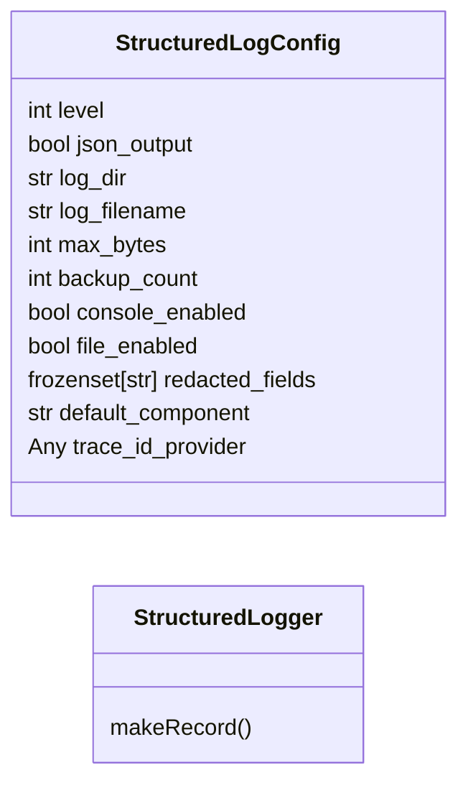
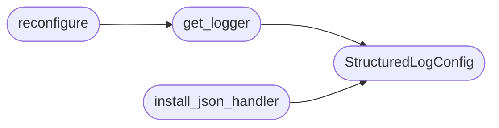

# `core.logging`

> Source: [core/logging.py:1](../../core/logging.py#L1) | language `py` | coverage 85.7% | [API index](../index.md)

Structured JSON-lines logging for the LazyOwn framework.

Replaces the historical `[`print_msg`](core.console.py.md#print_msg)` / `[`print_warn`](core.console.py.md#print_warn)` / `[`print_error`](core.console.py.md#print_error)`
pattern with a unified JSON-lines logger that preserves ANSI-coloured
console output AND writes machine-parseable entries to disk.

Contracts
---------
* `[`StructuredLogConfig`](#structuredlogconfig)`: every tunable — log level, output path, JSON
  vs plaintext, field redaction — lives here; no magic strings elsewhere.
* `[`StructuredLogger`](#structuredlogger)`: drop-in replacement for `[`core.console`](core.console.py.md)` helpers.
  Accepts ``extra`` kwargs that become top-level JSON fields.
* ``get_logger(name)``: factory with lazy initialisation matching Python's
  ``logging.getLogger`` semantics.
* `[`install_json_handler`](#install_json_handler)`: one-time wiring that adds a rotating JSON-lines
  file handler without disturbing existing console handlers.

Usage::

    from core.logging import StructuredLogConfig, get_logger

    _log = get_logger("lazyc2.api")

    # Human-readable console + JSON-lines audit entry
    _log.info("Beacon checked in", extra={"client_id": "abc", "rhost": "10.0.0.5"})

## Contents

- **Classes:** [`StructuredLogConfig`](#structuredlogconfig), [`StructuredLogger`](#structuredlogger)
- **Functions:** [`get_logger`](#get_logger), [`install_json_handler`](#install_json_handler), [`reconfigure`](#reconfigure)

## Type Diagram



## Call Graph

Solid arrows stay in this module, dashed arrows leave it.



## Classes

<a id="structuredlogconfig"></a>

### `StructuredLogConfig`

`class` `dataclass` | [core/logging.py:42](../../core/logging.py#L42)

Decorators: `@dataclass`

```python
class StructuredLogConfig
```

Configuration contract for structured logging.

All log-related settings are centralized here. The framework reads
these from ``payload.json`` keys prefixed with ``log_``.

**Attributes**

| Name | Type | Default | Description |
|---|---|---|---|
| [`level`](#structuredlogconfig-level) | `int` | `logging.INFO` |  |
| [`json_output`](#structuredlogconfig-json_output) | `bool` | `True` |  |
| [`log_dir`](#structuredlogconfig-log_dir) | `str` | `'sessions'` |  |
| [`log_filename`](#structuredlogconfig-log_filename) | `str` | `'lazyown.log'` |  |
| [`max_bytes`](#structuredlogconfig-max_bytes) | `int` | `10 * 1024 * 1024` |  |
| [`backup_count`](#structuredlogconfig-backup_count) | `int` | `5` |  |
| [`console_enabled`](#structuredlogconfig-console_enabled) | `bool` | `True` |  |
| [`file_enabled`](#structuredlogconfig-file_enabled) | `bool` | `True` |  |
| [`redacted_fields`](#structuredlogconfig-redacted_fields) | `frozenset[str]` | `frozenset({'password', 'pass', 'secret', 'token', 'api_key', 'aes_key'})` |  |
| [`default_component`](#structuredlogconfig-default_component) | `str` | `'lazyown'` |  |
| [`trace_id_provider`](#structuredlogconfig-trace_id_provider) | `Any` | `None` |  |

---

<a id="structuredlogger"></a>

### `StructuredLogger`

`class` | [core/logging.py:139](../../core/logging.py#L139)

```python
class StructuredLogger(logging.Logger)
```

Bases: `logging.Logger`

Logger subclass that accepts ``extra`` kwargs as structured fields.

Every keyword in ``extra`` is stored on the record and appears as a
top-level key in the JSON-lines output. Sensitive fields matching
`[`StructuredLogConfig.redacted_fields`](#structuredlogconfig-redacted_fields)` are replaced with ``[REDACTED]``
before serialization.

**Members**

| Member | Kind | Summary |
|---|---|---|
| [`makeRecord`](#structuredlogger-makerecord) | method |  |

<a id="structuredlogger-makerecord"></a>

#### `StructuredLogger.makeRecord`

`method` | [core/logging.py:148](../../core/logging.py#L148)

```python
def makeRecord(self, name: str, level: int, fn: str, lno: int, msg: object, args: Any, exc_info: Any, func: str | None = None, extra: Mapping[str, object] | None = None, sinfo: str | None = None) -> logging.LogRecord
```

**Parameters**

| Name | Type | Default | Description |
|---|---|---|---|
| `name` | `str` |  |  |
| `level` | `int` |  |  |
| `fn` | `str` |  |  |
| `lno` | `int` |  |  |
| `msg` | `object` |  |  |
| `args` | `Any` |  |  |
| `exc_info` | `Any` |  |  |
| `func` | `str \| None` | `None` |  |
| `extra` | `Mapping[str, object] \| None` | `None` |  |
| `sinfo` | `str \| None` | `None` |  |

**Returns:** `logging.LogRecord`

---

## Functions

<a id="get_logger"></a>

### `get_logger`

`function` | [core/logging.py:231](../../core/logging.py#L231)

```python
def get_logger(name: str = 'lazyown') -> StructuredLogger
```

Return a cached [`StructuredLogger`](#structuredlogger) for *name*.

On first call the default configuration is applied. Subsequent calls
with the same *name* return the same logger instance.

**Parameters**

| Name | Type | Default | Description |
|---|---|---|---|
| `name` | `str` | `'lazyown'` | The logger name. Defaults to ``"lazyown"``. |

**Returns:** `StructuredLogger` - A configured [`StructuredLogger`](#structuredlogger).

*Calls:* [`StructuredLogConfig`](#structuredlogconfig)

*Called by:* [`reconfigure`](#reconfigure), [`FactStore.__init__`](skills.lazyown_facts.py.md#factstore-__init__)

---

<a id="install_json_handler"></a>

### `install_json_handler`

`function` | [core/logging.py:251](../../core/logging.py#L251)

```python
def install_json_handler(name: str = 'lazyown', config: StructuredLogConfig | None = None) -> None
```

Install a JSON-lines file handler on *name*, preserving existing handlers.

When the logger already owns handlers (a custom console sink, a
library-configured appender) they are left untouched and only the
JSON file handler is appended. When the logger is cold it receives
the standard console plus file wiring from `_log_factory`.
The operation is idempotent: a second call with the same name and
configuration adds nothing.

**Parameters**

| Name | Type | Default | Description |
|---|---|---|---|
| `name` | `str` | `'lazyown'` | The logger name to wire. |
| `config` | `StructuredLogConfig \| None` | `None` | Optional configuration override, cached for future [`get_logger`](#get_logger) calls. |

*Calls:* [`StructuredLogConfig`](#structuredlogconfig)

---

<a id="reconfigure"></a>

### `reconfigure`

`function` | [core/logging.py:300](../../core/logging.py#L300)

```python
def reconfigure(config: StructuredLogConfig) -> None
```

Replace the cached configuration globally.

All future `[`get_logger`](#get_logger)` calls will use *config*. Existing
loggers in the cache are refreshed.

**Parameters**

| Name | Type | Default | Description |
|---|---|---|---|
| `config` | `StructuredLogConfig` |  | The new configuration to apply. |

*Calls:* [`get_logger`](#get_logger)

---
