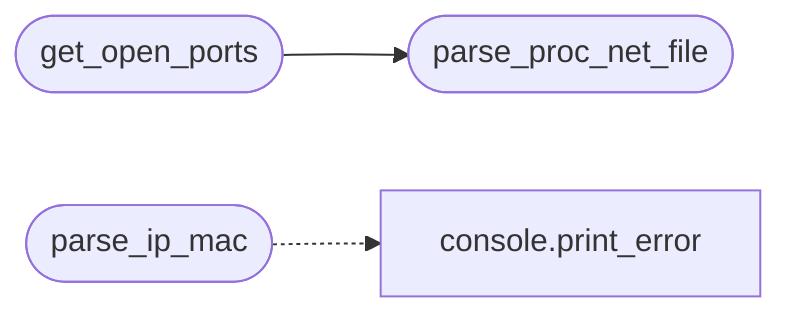

# `core.network`

> Source: [core/network.py:1](../../core/network.py#L1) | language `py` | coverage 100.0% | [API index](../index.md)

Network primitives for the LazyOwn framework.

Extracted from ``utils.py`` — ARP spoofing, socket operations, port
detection, and network parsing utilities.

## Contents

- **Functions:** [`parse_ip_mac`](#parse_ip_mac), [`create_arp_packet`](#create_arp_packet), [`send_packet`](#send_packet), [`parse_proc_net_file`](#parse_proc_net_file), [`get_open_ports`](#get_open_ports), [`is_port_in_use`](#is_port_in_use), [`get_banner`](#get_banner), [`get_network_info`](#get_network_info)

## Call Graph

Solid arrows stay in this module, dashed arrows leave it.



## Functions

<a id="parse_ip_mac"></a>

### `parse_ip_mac`

`function` | [core/network.py:18](../../core/network.py#L18)

```python
def parse_ip_mac(input_string: str) -> tuple[str | None, str | None]
```

Extract IP and MAC from a formatted string.

Expected format: ``IP: (192.168.1.222) MAC: ec:c3:02:b0:4c:96``

**Parameters**

| Name | Type | Default | Description |
|---|---|---|---|
| `input_string` | `str` |  |  |

**Returns:** `tuple[str | None, str | None]` - ``(ip, mac)`` tuple or ``(None, None)`` on failure.

*Calls:* [`print_error`](core.console.py.md#print_error)

---

<a id="create_arp_packet"></a>

### `create_arp_packet`

`function` | [core/network.py:33](../../core/network.py#L33)

```python
def create_arp_packet(src_mac: str, src_ip: str, dst_ip: str, dst_mac: str) -> bytes
```

Build a raw ARP request/reply packet.

**Parameters**

| Name | Type | Default | Description |
|---|---|---|---|
| `src_mac` | `str` |  | Source MAC (``xx:xx:xx:xx:xx:xx``). |
| `src_ip` | `str` |  | Source IP (dotted decimal). |
| `dst_ip` | `str` |  | Destination IP. |
| `dst_mac` | `str` |  | Destination MAC. |

**Returns:** `bytes` - Raw Ethernet + ARP frame bytes.

---

<a id="send_packet"></a>

### `send_packet`

`function` | [core/network.py:66](../../core/network.py#L66)

```python
def send_packet(packet: bytes, iface: str) -> None
```

Send a raw packet on a given network interface.

**Parameters**

| Name | Type | Default | Description |
|---|---|---|---|
| `packet` | `bytes` |  | Raw frame bytes. |
| `iface` | `str` |  | Interface name (e.g. ``eth0``). |

---

<a id="parse_proc_net_file"></a>

### `parse_proc_net_file`

`function` | [core/network.py:78](../../core/network.py#L78)

```python
def parse_proc_net_file(file_path: str) -> list[tuple[str, int]]
```

Parse a ``/proc/net/*`` file and extract (ip, port) pairs.

**Parameters**

| Name | Type | Default | Description |
|---|---|---|---|
| `file_path` | `str` |  | Path to a ``/proc/net/tcp``-style file. |

**Returns:** `list[tuple[str, int]]` - List of ``(ip_address, port)`` tuples.

*Called by:* [`get_open_ports`](#get_open_ports)

---

<a id="get_open_ports"></a>

### `get_open_ports`

`function` | [core/network.py:105](../../core/network.py#L105)

```python
def get_open_ports() -> list[tuple[str, int]]
```

Discover listening TCP ports from ``/proc/net/tcp`` and ``tcp6``.

**Returns:** `list[tuple[str, int]]` - List of ``(ip, port)`` tuples for listening endpoints.

*Calls:* [`parse_proc_net_file`](#parse_proc_net_file)

---

<a id="is_port_in_use"></a>

### `is_port_in_use`

`function` | [core/network.py:120](../../core/network.py#L120)

```python
def is_port_in_use(port: int, host: str = '127.0.0.1') -> bool
```

Check whether a TCP port is already bound.

**Parameters**

| Name | Type | Default | Description |
|---|---|---|---|
| `port` | `int` |  | Port number. |
| `host` | `str` | `'127.0.0.1'` | Host to check (default ``127.0.0.1``). |

**Returns:** `bool` - True if the port is in use.

---

<a id="get_banner"></a>

### `get_banner`

`function` | [core/network.py:134](../../core/network.py#L134)

```python
def get_banner(ip: str, port: int) -> str
```

Grab a TCP banner from the given host and port.

**Parameters**

| Name | Type | Default | Description |
|---|---|---|---|
| `ip` | `str` |  | Target IP. |
| `port` | `int` |  | Target port. |

**Returns:** `str` - Banner string, or an empty string on failure.

---

<a id="get_network_info"></a>

### `get_network_info`

`function` | [core/network.py:154](../../core/network.py#L154)

```python
def get_network_info() -> dict[str, Any]
```

Collect local network information.

**Returns:** `dict[str, Any]` - Dict with keys ``hostname``, ``ips``, ``interfaces``.

---
