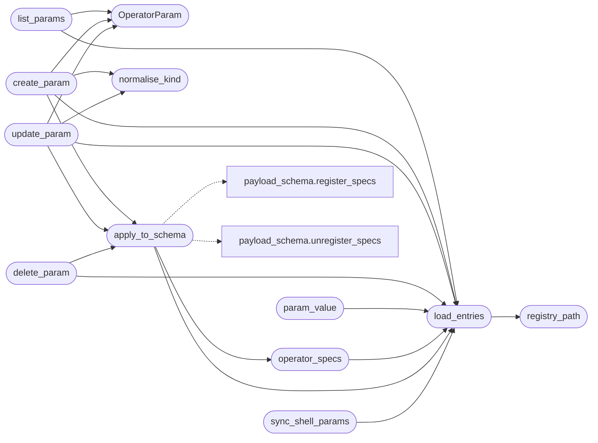

# `core.param_registry`

> Source: [core/param_registry.py:1](../../core/param_registry.py#L1) | language `py` | coverage 100.0% | [API index](../index.md)

Operator-managed parameter registry.

One place to declare a parameter that every LazyOwn surface can use:
lazyaddons (``{param}`` substitution), aliases, pipelines and the shell
``assign`` command.

Why this exists
---------------
Every addon that needed its own knob used to brand a payload key
(``php2shell_url``, ``foo_target``, ``bar_profile``). The repository ended
up with thousands of single-consumer keys, each of them registered by hand
in four places: ``params/extended.yaml``, ``core/payload_schema.py``,
``lazyc2/addon_creator.py`` and the lazyaddon-creator skill. The registry
replaces that ritual with a data file.

Storage
-------
``params/operator.yaml`` holds the operator-created parameters::

    c2_profile:
      kind: string
      default: default
      description: "C2 profile name"
      category: general

Every ``params/*.yaml`` file is read by the shell at startup and merged
into ``self.params``. A mapping entry contributes its `[`default`](#operatorparam-default)` value; a
flat entry contributes its value as-is (legacy behaviour).

Because the declaration is data, the payload schema and the addon-creator
validator pick the new keys up automatically: no source edit, no
addon-branded key, one declaration reused by every addon.

Design rules:

- The registry owns the file format, the CRUD and the projection of the
  entries into the payload schema. It never touches the shell directly:
  callers pass the shell in when they want the live params refreshed.
- Names are generic on purpose. A key that only makes sense for one addon
  is a design smell; use an existing generic key or add one here.
- Writes are atomic (temp file plus rename) so an interrupted edit never
  leaves a truncated YAML behind.

Usage:
    from core.param_registry import create_param, list_params, sync_shell_params

    create_param("c2_profile", kind="string", default="default", description="C2 profile")
    sync_shell_params(shell)

## Contents

- **Classes:** [`OperatorParam`](#operatorparam)
- **Functions:** [`registry_path`](#registry_path), [`normalise_kind`](#normalise_kind), [`effective_value`](#effective_value), [`load_entries`](#load_entries), [`list_params`](#list_params), [`create_param`](#create_param), [`update_param`](#update_param), [`delete_param`](#delete_param), [`param_value`](#param_value), [`operator_specs`](#operator_specs), [`apply_to_schema`](#apply_to_schema), [`sync_shell_params`](#sync_shell_params)
- **Constants:** [`PARAM_NAME_PATTERN`](#param_name_pattern), [`KIND_ALIASES`](#kind_aliases), [`REGISTRY_HEADER`](#registry_header)

## Call Graph

Solid arrows stay in this module, dashed arrows leave it.



## Classes

<a id="operatorparam"></a>

### `OperatorParam`

`class` `dataclass` | [core/param_registry.py:114](../../core/param_registry.py#L114)

Decorators: `@dataclass(frozen=True)`

```python
class OperatorParam
```

One operator-declared parameter.

**Attributes**

| Name | Type | Default | Description |
|---|---|---|---|
| [`name`](#operatorparam-name) | `str` |  | Placeholder token used in addon templates. |
| [`kind`](#operatorparam-kind) | `str` | `'string'` | Payload field kind (``string``, ``integer``, `[`url`](modules.lazy_oob.py.md#url)`, ...). |
| [`default`](#operatorparam-default) | `Any` | `''` | Value the shell uses when the parameter is not set. |
| [`description`](#operatorparam-description) | `str` | `''` | Short help text shown to the operator. |
| [`category`](#operatorparam-category) | `str` | `'general'` | Payload schema category used by the wizard and reports. |
| [`source`](#operatorparam-source) | `str` | `'operator'` | ``operator`` for registry entries, `[`builtin`](modules.intercept.py.md#interceptrule-builtin)` for schema keys. |

**Members**

| Member | Kind | Summary |
|---|---|---|
| [`as_entry`](#operatorparam-as_entry) | method | Return the YAML mapping stored in ``params/operator.yaml``. |
| [`to_spec`](#operatorparam-to_spec) | method | Return the payload schema spec for this parameter. |

<a id="operatorparam-as_entry"></a>

#### `OperatorParam.as_entry`

`method` | [core/param_registry.py:133](../../core/param_registry.py#L133)

```python
def as_entry(self) -> dict[str, Any]
```

Return the YAML mapping stored in ``params/operator.yaml``.

**Returns:** `dict[str, Any]`

<a id="operatorparam-to_spec"></a>

#### `OperatorParam.to_spec`

`method` | [core/param_registry.py:142](../../core/param_registry.py#L142)

```python
def to_spec(self) -> FieldSpec
```

Return the payload schema spec for this parameter.

**Returns:** `FieldSpec`

---

## Functions

<a id="registry_path"></a>

### `registry_path`

`function` | [core/param_registry.py:158](../../core/param_registry.py#L158)

```python
def registry_path(root: str | Path | None = None) -> Path
```

Return the operator registry file path.

**Parameters**

| Name | Type | Default | Description |
|---|---|---|---|
| `root` | `str \| Path \| None` | `None` | Optional repository root override (used by tests). |

**Returns:** `Path` - Path of the ``params/operator.yaml`` file.

*Called by:* [`load_entries`](#load_entries)

---

<a id="normalise_kind"></a>

### `normalise_kind`

`function` | [core/param_registry.py:172](../../core/param_registry.py#L172)

```python
def normalise_kind(kind: str) -> str
```

Return the canonical kind name for a user-supplied kind.

**Parameters**

| Name | Type | Default | Description |
|---|---|---|---|
| `kind` | `str` |  | Raw kind name typed by the operator. |

**Returns:** `str` - The canonical kind, defaulting to ``string`` for unknown values.

*Called by:* [`create_param`](#create_param), [`update_param`](#update_param)

---

<a id="effective_value"></a>

### `effective_value`

`function` | [core/param_registry.py:187](../../core/param_registry.py#L187)

```python
def effective_value(entry: Any) -> Any
```

Return the value a parameter contributes to the shell params.

A mapping entry contributes its `[`default`](#operatorparam-default)`; a flat entry contributes
its value as-is (legacy ``params/*.yaml`` behaviour).

**Parameters**

| Name | Type | Default | Description |
|---|---|---|---|
| `entry` | `Any` |  | Raw YAML value of one parameter. |

**Returns:** `Any` - The value the shell must receive.

---

<a id="load_entries"></a>

### `load_entries`

`function` | [core/param_registry.py:226](../../core/param_registry.py#L226)

```python
def load_entries(root: str | Path | None = None) -> dict[str, OperatorParam]
```

Return every operator-declared parameter.

**Parameters**

| Name | Type | Default | Description |
|---|---|---|---|
| `root` | `str \| Path \| None` | `None` | Optional repository root override (used by tests). |

**Returns:** `dict[str, OperatorParam]` - Mapping of parameter name to its declaration. A missing or broken
file yields an empty mapping instead of raising.

*Calls:* [`registry_path`](#registry_path)

*Called by:* [`ParamCommandSet.do_param`](cli.commands.params_ops.py.md#paramcommandset-do_param), [`LazyOrchestratorApp.action_edit_item`](cli.lazy_orchestrator.py.md#lazyorchestratorapp-action_edit_item), [`apply_to_schema`](#apply_to_schema), [`create_param`](#create_param), [`delete_param`](#delete_param), [`list_params`](#list_params), [`operator_specs`](#operator_specs), [`param_value`](#param_value), [`sync_shell_params`](#sync_shell_params), [`update_param`](#update_param), [`AddonCreatorConfig.live_placeholders`](lazyc2.addon_creator.py.md#addoncreatorconfig-live_placeholders)

---

<a id="list_params"></a>

### `list_params`

`function` | [core/param_registry.py:256](../../core/param_registry.py#L256)

```python
def list_params(root: str | Path | None = None, include_builtin: bool = True, keyword: str = '') -> list[OperatorParam]
```

Return the parameters visible to the operator.

**Parameters**

| Name | Type | Default | Description |
|---|---|---|---|
| `root` | `str \| Path \| None` | `None` | Optional repository root override (used by tests). |
| `include_builtin` | `bool` | `True` | Include the schema-backed builtin parameters. |
| `keyword` | `str` | `''` | Case-insensitive filter over name and description. |

**Returns:** `list[OperatorParam]` - Parameters sorted by name.

*Calls:* [`OperatorParam`](#operatorparam), [`load_entries`](#load_entries)

*Called by:* [`ParamCommandSet.do_param`](cli.commands.params_ops.py.md#paramcommandset-do_param), [`call_tool`](skills.lazyown_mcp.py.md#call_tool)

---

<a id="create_param"></a>

### `create_param`

`function` | [core/param_registry.py:291](../../core/param_registry.py#L291)

```python
def create_param(name: str, kind: str = 'string', default: Any = '', description: str = '', category: str = 'general', root: str | Path | None = None) -> OperatorParam
```

Create an operator parameter and persist it in the registry.

**Parameters**

| Name | Type | Default | Description |
|---|---|---|---|
| `name` | `str` |  | Parameter name; must match ``^[a-z][a-z0-9_]{0,47}$``. |
| `kind` | `str` | `'string'` | Payload field kind (``string``, ``integer``, `[`url`](modules.lazy_oob.py.md#url)`, ...). |
| `default` | `Any` | `''` | Default value of the parameter. |
| `description` | `str` | `''` | Short help text shown to the operator. |
| `category` | `str` | `'general'` | Payload schema category. |
| `root` | `str \| Path \| None` | `None` | Optional repository root override (used by tests). |

**Returns:** `OperatorParam` - The created parameter.

**Raises**

- `ValueError`: The name is illegal, the name is taken by another registry entry, or the description is too long.

*Calls:* [`OperatorParam`](#operatorparam), [`apply_to_schema`](#apply_to_schema), [`load_entries`](#load_entries), [`normalise_kind`](#normalise_kind)

*Called by:* [`ParamCommandSet.do_param`](cli.commands.params_ops.py.md#paramcommandset-do_param), [`call_tool`](skills.lazyown_mcp.py.md#call_tool)

---

<a id="update_param"></a>

### `update_param`

`function` | [core/param_registry.py:341](../../core/param_registry.py#L341)

```python
def update_param(name: str, default: Any = None, description: str | None = None, kind: str | None = None, category: str | None = None, root: str | Path | None = None) -> OperatorParam
```

Update an operator parameter in place.

**Parameters**

| Name | Type | Default | Description |
|---|---|---|---|
| `name` | `str` |  | Existing parameter name. |
| `default` | `Any` | `None` | New default value; ``None`` keeps the current one. |
| `description` | `str \| None` | `None` | New description; ``None`` keeps the current one. |
| `kind` | `str \| None` | `None` | New kind; ``None`` keeps the current one. |
| `category` | `str \| None` | `None` | New category; ``None`` keeps the current one. |
| `root` | `str \| Path \| None` | `None` | Optional repository root override (used by tests). |

**Returns:** `OperatorParam` - The updated parameter.

**Raises**

- `KeyError`: The parameter does not exist in the registry.
- `ValueError`: The description is too long.

*Calls:* [`OperatorParam`](#operatorparam), [`apply_to_schema`](#apply_to_schema), [`load_entries`](#load_entries), [`normalise_kind`](#normalise_kind)

---

<a id="delete_param"></a>

### `delete_param`

`function` | [core/param_registry.py:387](../../core/param_registry.py#L387)

```python
def delete_param(name: str, root: str | Path | None = None) -> bool
```

Delete an operator parameter from the registry.

**Parameters**

| Name | Type | Default | Description |
|---|---|---|---|
| `name` | `str` |  | Parameter name. |
| `root` | `str \| Path \| None` | `None` | Optional repository root override (used by tests). |

**Returns:** `bool` - ``True`` when the parameter existed and was removed.

**Raises**

- `KeyError`: The parameter does not exist in the registry.

*Calls:* [`apply_to_schema`](#apply_to_schema), [`load_entries`](#load_entries)

*Called by:* [`ParamCommandSet.do_param`](cli.commands.params_ops.py.md#paramcommandset-do_param), [`call_tool`](skills.lazyown_mcp.py.md#call_tool)

---

<a id="param_value"></a>

### `param_value`

`function` | [core/param_registry.py:411](../../core/param_registry.py#L411)

```python
def param_value(name: str, root: str | Path | None = None) -> Any
```

Return the effective value of an operator parameter.

**Parameters**

| Name | Type | Default | Description |
|---|---|---|---|
| `name` | `str` |  | Parameter name. |
| `root` | `str \| Path \| None` | `None` | Optional repository root override (used by tests). |

**Returns:** `Any` - The declared default, or ``None`` when the parameter is unknown.

*Calls:* [`load_entries`](#load_entries)

---

<a id="operator_specs"></a>

### `operator_specs`

`function` | [core/param_registry.py:425](../../core/param_registry.py#L425)

```python
def operator_specs(root: str | Path | None = None) -> dict[str, FieldSpec]
```

Return the payload schema specs of the operator parameters.

**Parameters**

| Name | Type | Default | Description |
|---|---|---|---|
| `root` | `str \| Path \| None` | `None` | Optional repository root override (used by tests). |

**Returns:** `dict[str, FieldSpec]` - Mapping of parameter name to its schema spec.

*Calls:* [`load_entries`](#load_entries)

*Called by:* [`apply_to_schema`](#apply_to_schema)

---

<a id="apply_to_schema"></a>

### `apply_to_schema`

`function` | [core/param_registry.py:437](../../core/param_registry.py#L437)

```python
def apply_to_schema(root: str | Path | None = None) -> int
```

Register the operator parameters in the payload schema.

A sandboxed `[`root`](modules.workspace.py.md#root)` (tests) never touches the process-wide schema:
the caller owns that schema in that case.

**Parameters**

| Name | Type | Default | Description |
|---|---|---|---|
| `root` | `str \| Path \| None` | `None` | Optional repository root override (used by tests). |

**Returns:** `int` - Number of parameters declared in the registry.

*Calls:* [`load_entries`](#load_entries), [`operator_specs`](#operator_specs), [`register_specs`](core.payload_schema.py.md#register_specs), [`unregister_specs`](core.payload_schema.py.md#unregister_specs)

*Called by:* [`ParamCommandSet.do_param`](cli.commands.params_ops.py.md#paramcommandset-do_param), [`create_param`](#create_param), [`delete_param`](#delete_param), [`update_param`](#update_param)

---

<a id="sync_shell_params"></a>

### `sync_shell_params`

`function` | [core/param_registry.py:459](../../core/param_registry.py#L459)

```python
def sync_shell_params(shell: Any, root: str | Path | None = None) -> int
```

Push the operator parameters into a live shell parameter dict.

The shell substitutes addon placeholders from ``shell.params`` only, so
a parameter created at runtime must land there to be usable in the same
session.

**Parameters**

| Name | Type | Default | Description |
|---|---|---|---|
| `shell` | `Any` |  | Object exposing a mutable ``params`` mapping. |
| `root` | `str \| Path \| None` | `None` | Optional repository root override (used by tests). |

**Returns:** `int` - Number of parameters pushed into the shell.

*Calls:* [`load_entries`](#load_entries)

*Called by:* [`ParamCommandSet.do_param`](cli.commands.params_ops.py.md#paramcommandset-do_param), [`LazyOrchestratorApp.create_param`](cli.lazy_orchestrator.py.md#lazyorchestratorapp-create_param)

---

## Constants

<a id="param_name_pattern"></a>

### `PARAM_NAME_PATTERN`

`constant` | [core/param_registry.py:69](../../core/param_registry.py#L69)

```python
PARAM_NAME_PATTERN = re.compile('^[a-z][a-z0-9_]{0,47}$')
```

---

<a id="kind_aliases"></a>

### `KIND_ALIASES`

`constant` | [core/param_registry.py:73](../../core/param_registry.py#L73)

```python
KIND_ALIASES: dict[str, FieldKind]
```

---

<a id="registry_header"></a>

### `REGISTRY_HEADER`

`constant` | [core/param_registry.py:94](../../core/param_registry.py#L94)

```python
REGISTRY_HEADER
```

---
