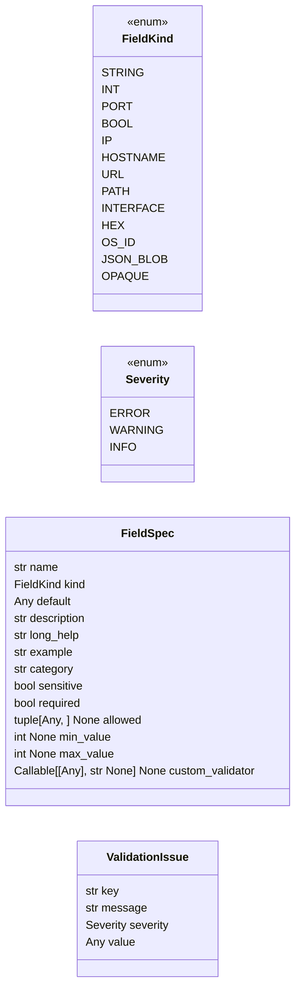
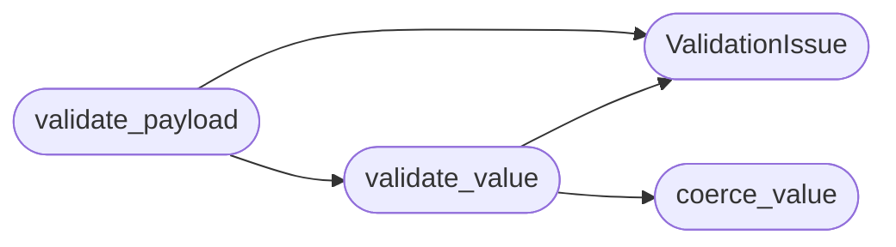

# `core.payload_schema`

> Source: [core/payload_schema.py:1](../../core/payload_schema.py#L1) | language `py` | coverage 100.0% | [API index](../index.md)

Declarative schema and validation for ``payload.json``.

``payload.json`` is the single source of runtime configuration for every
component of LazyOwn (CLI, C2, MCP, autonomous daemon). Historically it has
been a free-form dictionary: any key/value was accepted at load time, and
each consumer rediscovered the right type with ad-hoc casts. Typos in keys
silently degraded features instead of surfacing as errors, and string
values that needed to be integers (``"5555"`` vs ``5555``) caused failures
deep inside subprocess calls.

This module introduces a thin, additive validation layer:

* [`FieldSpec`](#fieldspec) declares the expected type, default, and human-readable
  documentation for every well-known payload key.
* [`validate_value`](#validate_value) checks a single value against its spec.
* [`validate_payload`](#validate_payload) returns the full list of issues without raising,
  so backwards compatibility is preserved — callers decide whether to warn
  or block.
* [`coerce_value`](#coerce_value) performs safe, well-defined coercions (e.g. parsing
  ``"5555"`` into ``5555`` when the field is declared as an integer port).

The schema is the source of truth for the setup wizard as well — every
prompt label, default, validator and example value comes from here so a
new field is defined in exactly one place.

Design rules:

- Adding a new well-known key means adding a [`FieldSpec`](#fieldspec) here; no
  other module needs to change to surface the documentation.
- Validation is intentionally non-fatal: unknown keys are warnings (so
  operator-private extensions keep working), and bad values are warnings
  by default. Callers that need hard failures (e.g. the wizard) inspect
  [`ValidationIssue.severity`](#validationissue-severity).
- No external dependencies. Pydantic et al. would impose an install
  burden that would break ``./run`` on fresh boxes.

## Contents

- **Classes:** [`FieldSpec`](#fieldspec), [`ValidationIssue`](#validationissue)
- **Enums:** [`FieldKind`](#fieldkind), [`Severity`](#severity)
- **Functions:** [`field_for`](#field_for), [`coerce_value`](#coerce_value), [`validate_value`](#validate_value), [`validate_payload`](#validate_payload), [`format_issue`](#format_issue), [`default_payload`](#default_payload), [`categories`](#categories)
- **Constants:** [`SCHEMA`](#schema)

## Type Diagram



## Call Graph

Solid arrows stay in this module, dashed arrows leave it.



## Classes

<a id="fieldspec"></a>

### `FieldSpec`

`class` `dataclass` | [core/payload_schema.py:100](../../core/payload_schema.py#L100)

Decorators: `@dataclass(frozen=True)`

```python
class FieldSpec
```

Declarative description of a payload field.

**Attributes**

| Name | Type | Default | Description |
|---|---|---|---|
| [`name`](#fieldspec-name) | `str` |  | Key as it appears in ``payload.json``. |
| [`kind`](#fieldspec-kind) | `FieldKind` |  | Categorical [`FieldKind`](#fieldkind) controlling validation and coercion behaviour. |
| [`default`](#fieldspec-default) | `Any` |  | Value used when bootstrapping a brand new payload. |
| [`description`](#fieldspec-description) | `str` |  | One-line plain-language explanation suitable for help text and wizard tooltips. |
| [`long_help`](#fieldspec-long_help) | `str` | `''` | Multi-line explanation used by the wizard's tutorial mode. Newlines are preserved verbatim. |
| [`example`](#fieldspec-example) | `str` | `''` | Concrete example value shown to novices. |
| [`category`](#fieldspec-category) | `str` | `'misc'` | Logical grouping (`[`network`](lazygui.config.constants.py.md#appconstants-network)`, `[`c2`](discord_c2.py.md#c2)`, ``recon``, ``ai``, ``credentials``, ``wordlists``, `[`email`](modules.phishing_orchestrator.py.md#campaigntarget-email)`, ``misc``). |
| [`sensitive`](#fieldspec-sensitive) | `bool` | `False` | When ``True`` the wizard masks the value in summaries. |
| [`required`](#fieldspec-required) | `bool` | `False` | When ``True`` an empty/missing value is reported as an error rather than a warning. |
| [`allowed`](#fieldspec-allowed) | `tuple[Any, ...] \| None` | `None` | Optional whitelist of acceptable values for enum-like fields. |
| [`min_value`](#fieldspec-min_value) | `int \| None` | `None` | Optional inclusive lower bound for numeric fields. |
| [`max_value`](#fieldspec-max_value) | `int \| None` | `None` | Optional inclusive upper bound for numeric fields. |
| [`custom_validator`](#fieldspec-custom_validator) | `Callable[[Any], str \| None] \| None` | `None` | Optional callable returning ``None`` when the value is valid or a string message when it is not. Runs after the kind-based validator. |

---

<a id="validationissue"></a>

### `ValidationIssue`

`class` `dataclass` | [core/payload_schema.py:142](../../core/payload_schema.py#L142)

Decorators: `@dataclass(frozen=True)`

```python
class ValidationIssue
```

Structured outcome of a single validation check.

Issues are returned as a list so consumers can render them as a table,
emit a single warning, or short-circuit on the first error. The
[`severity`](#validationissue-severity) field makes it explicit which issues are advisory and
which must be addressed before the value can be used.

**Attributes**

| Name | Type | Default | Description |
|---|---|---|---|
| [`key`](#validationissue-key) | `str` |  | Name of the offending field. |
| [`message`](#validationissue-message) | `str` |  | Human-readable explanation of the problem. |
| [`severity`](#validationissue-severity) | `Severity` | `Severity.WARNING` | One of [`Severity`](#severity). Callers should treat warnings as advisory and errors as blocking. |
| [`value`](#validationissue-value) | `Any` | `None` | The raw value that produced the issue. Sensitive fields are masked by [`format_issue`](#format_issue) so logs do not leak credentials. |

---

## Enums

<a id="fieldkind"></a>

### `FieldKind`

`enum` | [core/payload_schema.py:73](../../core/payload_schema.py#L73)

```python
class FieldKind(StrEnum)
```

Bases: `StrEnum`

Categorical type of a payload field used by validators and the wizard.

**Attributes**

| Name | Type | Default | Description |
|---|---|---|---|
| [`STRING`](#fieldkind-string) |  | `'string'` |  |
| [`INT`](#fieldkind-int) |  | `'int'` |  |
| [`PORT`](#fieldkind-port) |  | `'port'` |  |
| [`BOOL`](#fieldkind-bool) |  | `'bool'` |  |
| [`IP`](#fieldkind-ip) |  | `'ip'` |  |
| [`HOSTNAME`](#fieldkind-hostname) |  | `'hostname'` |  |
| [`URL`](#fieldkind-url) |  | `'url'` |  |
| [`PATH`](#fieldkind-path) |  | `'path'` |  |
| [`INTERFACE`](#fieldkind-interface) |  | `'interface'` |  |
| [`HEX`](#fieldkind-hex) |  | `'hex'` |  |
| [`OS_ID`](#fieldkind-os_id) |  | `'os_id'` |  |
| [`JSON_BLOB`](#fieldkind-json_blob) |  | `'json_blob'` |  |
| [`OPAQUE`](#fieldkind-opaque) |  | `'opaque'` |  |

---

<a id="severity"></a>

### `Severity`

`enum` | [core/payload_schema.py:91](../../core/payload_schema.py#L91)

```python
class Severity(StrEnum)
```

Bases: `StrEnum`

Severity of a [`ValidationIssue`](#validationissue).

**Attributes**

| Name | Type | Default | Description |
|---|---|---|---|
| [`ERROR`](#severity-error) |  | `'error'` |  |
| [`WARNING`](#severity-warning) |  | `'warning'` |  |
| [`INFO`](#severity-info) |  | `'info'` |  |

---

## Functions

<a id="field_for"></a>

### `field_for`

`function` | [core/payload_schema.py:1582](../../core/payload_schema.py#L1582)

```python
def field_for(key: str) -> FieldSpec | None
```

Return the [`FieldSpec`](#fieldspec) for `[`key`](key.py.md)` or ``None`` if it is unknown.

**Parameters**

| Name | Type | Default | Description |
|---|---|---|---|
| `key` | `str` |  |  |

**Returns:** `FieldSpec | None`

---

<a id="coerce_value"></a>

### `coerce_value`

`function` | [core/payload_schema.py:1587](../../core/payload_schema.py#L1587)

```python
def coerce_value(key: str, raw: Any) -> Any
```

Return ``raw`` coerced to the canonical type declared for `[`key`](key.py.md)`.

Unknown keys and values that already satisfy the schema are returned
unchanged. Coercion is intentionally narrow: only ``int``/``port`` and
boolean-like strings are converted. This keeps the function safe for
use inside the ``assign`` command without surprising operators.

**Parameters**

| Name | Type | Default | Description |
|---|---|---|---|
| `key` | `str` |  | Payload key as written in ``payload.json``. |
| `raw` | `Any` |  | Value about to be assigned. |

**Returns:** `Any` - The coerced value, or ``raw`` unchanged when no coercion is
defined for the field's kind.

*Called by:* [`apply_assign`](cli.assign.py.md#apply_assign), [`run`](cli.wizard.py.md#run), [`run_non_interactive`](cli.wizard.py.md#run_non_interactive), [`validate_value`](#validate_value), [`check_calls`](scripts.devtools.core_smoke.py.md#check_calls)

---

<a id="validate_value"></a>

### `validate_value`

`function` | [core/payload_schema.py:1610](../../core/payload_schema.py#L1610)

```python
def validate_value(key: str, value: Any) -> ValidationIssue | None
```

Validate `[`value`](#validationissue-value)` against the schema entry for `[`key`](key.py.md)`.

**Parameters**

| Name | Type | Default | Description |
|---|---|---|---|
| `key` | `str` |  |  |
| `value` | `Any` |  |  |

**Returns:** `ValidationIssue | None` - ``None`` when the value is acceptable; otherwise a
[`ValidationIssue`](#validationissue) whose severity is `[`ERROR`](#severity-error)` when the
field is declared as required and either missing or invalid, and
`[`WARNING`](#severity-warning)` for soft constraints (out-of-range integers, bad
format on optional fields). Unknown keys produce a warning so the
caller knows the value will not be type-checked.

*Calls:* [`ValidationIssue`](#validationissue), [`coerce_value`](#coerce_value)

*Called by:* [`apply_assign`](cli.assign.py.md#apply_assign), [`validate_payload`](#validate_payload)

---

<a id="validate_payload"></a>

### `validate_payload`

`function` | [core/payload_schema.py:1684](../../core/payload_schema.py#L1684)

```python
def validate_payload(payload: Mapping[str, Any]) -> list[ValidationIssue]
```

Validate an entire payload dictionary and return all issues found.

The check is intentionally exhaustive — it returns issues for every
key, including unknown ones, so callers can decide which severity
levels to surface. No exception is ever raised, which preserves the
historical contract that loading ``payload.json`` must never crash
the framework just because a field is malformed.

**Parameters**

| Name | Type | Default | Description |
|---|---|---|---|
| `payload` | `Mapping[str, Any]` |  | Dictionary loaded from ``payload.json``. |

**Returns:** `list[ValidationIssue]` - Possibly empty list of [`ValidationIssue`](#validationissue). Required fields
that are missing from the payload entirely are reported with
[`Severity.ERROR`](#severity-error).

*Calls:* [`ValidationIssue`](#validationissue), [`validate_value`](#validate_value)

*Called by:* [`load_and_validate`](core.config.py.md#load_and_validate)

---

<a id="format_issue"></a>

### `format_issue`

`function` | [core/payload_schema.py:1719](../../core/payload_schema.py#L1719)

```python
def format_issue(issue: ValidationIssue) -> str
```

Render a [`ValidationIssue`](#validationissue) as a single human-readable line.

Sensitive fields have their value redacted so log scrapers do not
expose credentials. The format intentionally mirrors GCC-style
diagnostics (``key: severity: message``) so it grep-friendly.

**Parameters**

| Name | Type | Default | Description |
|---|---|---|---|
| `issue` | `ValidationIssue` |  |  |

**Returns:** `str`

---

<a id="default_payload"></a>

### `default_payload`

`function` | [core/payload_schema.py:1737](../../core/payload_schema.py#L1737)

```python
def default_payload() -> dict[str, Any]
```

Return a freshly built payload dict populated from the schema defaults.

Useful for tests and for the wizard when no ``payload.json`` exists.

**Returns:** `dict[str, Any]`

---

<a id="categories"></a>

### `categories`

`function` | [core/payload_schema.py:1745](../../core/payload_schema.py#L1745)

```python
def categories() -> dict[str, list[FieldSpec]]
```

Return schema entries grouped by [`FieldSpec.category`](#fieldspec-category).

Used by the wizard to render category-aware tables and by future
documentation generators.

**Returns:** `dict[str, list[FieldSpec]]`

---

## Constants

<a id="schema"></a>

### `SCHEMA`

`constant` | [core/payload_schema.py:368](../../core/payload_schema.py#L368)

```python
SCHEMA: dict[str, FieldSpec]
```

---
