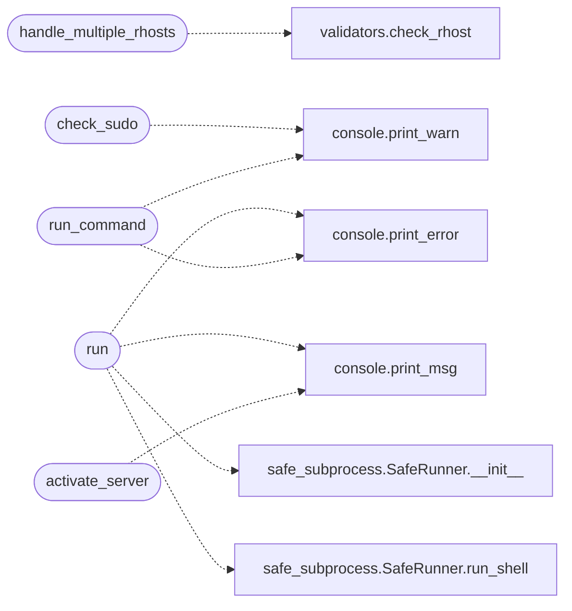

# `core.process`

> Source: [core/process.py:1](../../core/process.py#L1) | language `py` | coverage 100.0% | [API index](../index.md)

Process and subprocess utilities for the LazyOwn framework.

Extracted from ``utils.py`` — command execution, binary/package detection,
sudo escalation, virtualenv activation.

## Contents

- **Functions:** [`check_go_tool_installed`](#check_go_tool_installed), [`is_binary_present`](#is_binary_present), [`handle_multiple_rhosts`](#handle_multiple_rhosts), [`check_sudo`](#check_sudo), [`run`](#run), [`is_package_installed`](#is_package_installed), [`run_command`](#run_command), [`ensure_tmux_session`](#ensure_tmux_session), [`activate_server`](#activate_server)

## Call Graph

Solid arrows stay in this module, dashed arrows leave it.



## Functions

<a id="check_go_tool_installed"></a>

### `check_go_tool_installed`

`function` | [core/process.py:34](../../core/process.py#L34)

```python
def check_go_tool_installed(tool_name: str) -> bool
```

Check if a Go tool binary is installed and runnable.

**Parameters**

| Name | Type | Default | Description |
|---|---|---|---|
| `tool_name` | `str` |  | Name of the binary to check. |

**Returns:** `bool` - True if the tool responds with a zero exit code to ``help``.

*Called by:* [`C2Builder.run`](modules.c2_builder.py.md#c2builder-run)

---

<a id="is_binary_present"></a>

### `is_binary_present`

`function` | [core/process.py:54](../../core/process.py#L54)

```python
def is_binary_present(binary_name: str) -> bool
```

Check whether binary is on ``PATH``.

Uses ``shutil.which`` — no shell spawning, no injection surface.

**Parameters**

| Name | Type | Default | Description |
|---|---|---|---|
| `binary_name` | `str` |  | Name of the binary. |

**Returns:** `bool` - True if found on PATH.

*Called by:* [`CommandAndControlMigratedCommandSet.do_duckyspark`](cli.commands.command_and_control_migrated.py.md#commandandcontrolmigratedcommandset-do_duckyspark), [`CommandAndControlMigratedCommandSet.do_empire`](cli.commands.command_and_control_migrated.py.md#commandandcontrolmigratedcommandset-do_empire), [`CommandAndControlMigratedCommandSet.do_sliver_server`](cli.commands.command_and_control_migrated.py.md#commandandcontrolmigratedcommandset-do_sliver_server), [`CredMigratedCommandSet.do_john2zip`](cli.commands.cred_migrated.py.md#credmigratedcommandset-do_john2zip), [`CredMigratedCommandSet.do_passwordspray`](cli.commands.cred_migrated.py.md#credmigratedcommandset-do_passwordspray), [`ExfiltrationCommandSet.do_getuserspns`](cli.commands.exfiltration.py.md#exfiltrationcommandset-do_getuserspns), [`ExfiltrationCommandSet.do_reg_py`](cli.commands.exfiltration.py.md#exfiltrationcommandset-do_reg_py), [`ExfiltrationCommandSet.do_samdump2`](cli.commands.exfiltration.py.md#exfiltrationcommandset-do_samdump2), [`ExfiltrationCommandSet.do_secretsdump`](cli.commands.exfiltration.py.md#exfiltrationcommandset-do_secretsdump), [`ExploitMigratedCommandSet.do_adcs_check`](cli.commands.exploit_migrated.py.md#exploitmigratedcommandset-do_adcs_check), [`ExploitMigratedCommandSet.do_autoblody`](cli.commands.exploit_migrated.py.md#exploitmigratedcommandset-do_autoblody), [`ExploitMigratedCommandSet.do_createdll`](cli.commands.exploit_migrated.py.md#exploitmigratedcommandset-do_createdll) and 53 more

---

<a id="handle_multiple_rhosts"></a>

### `handle_multiple_rhosts`

`function` | [core/process.py:68](../../core/process.py#L68)

```python
def handle_multiple_rhosts(func: Callable) -> Callable
```

Decorator that iterates over a list of remote hosts.

Wraps a shell method so it runs against each host in
``self.params["rhost"]``.  The original host is restored after
each iteration.

**Parameters**

| Name | Type | Default | Description |
|---|---|---|---|
| `func` | `Callable` |  | The method to wrap. |

**Returns:** `Callable` - The decorated wrapper.

*Calls:* [`check_rhost`](core.validators.py.md#check_rhost)

---

<a id="check_sudo"></a>

### `check_sudo`

`function` | [core/process.py:97](../../core/process.py#L97)

```python
def check_sudo() -> None
```

Re-launch the script with ``sudo`` if not already root.

Exits the current process and replaces it with a sudo invocation.

*Calls:* [`print_warn`](core.console.py.md#print_warn)

---

<a id="run"></a>

### `run`

`function` | [core/process.py:108](../../core/process.py#L108)

```python
def run(command: str) -> str
```

Execute a shell command via `[`SafeRunner`](core.safe_subprocess.py.md#saferunner)`.

**Parameters**

| Name | Type | Default | Description |
|---|---|---|---|
| `command` | `str` |  | Shell command string. |

**Returns:** `str` - Stripped stdout on success, error message on failure.

*Calls:* [`print_error`](core.console.py.md#print_error), [`print_msg`](core.console.py.md#print_msg), [`SafeRunner.__init__`](core.safe_subprocess.py.md#saferunner-__init__), [`SafeRunner.run_shell`](core.safe_subprocess.py.md#saferunner-run_shell)

---

<a id="is_package_installed"></a>

### `is_package_installed`

`function` | [core/process.py:143](../../core/process.py#L143)

```python
def is_package_installed(package_name: str) -> bool
```

Check whether a Python package is importable.

**Parameters**

| Name | Type | Default | Description |
|---|---|---|---|
| `package_name` | `str` |  | Name of the package (e.g. ``requests``). |

**Returns:** `bool` - True if ``importlib.util.find_spec`` succeeds.

---

<a id="run_command"></a>

### `run_command`

`function` | [core/process.py:183](../../core/process.py#L183)

```python
def run_command(command: str, timeout: float | None = None) -> str
```

Run a command, streaming output in real time.

Uses ``subprocess.Popen`` to execute ``command``, printing stdout and
stderr as they arrive and returning the complete output string.

stderr is drained on a worker thread so a chatty process writing to
stderr while stdout is quiet can never deadlock the read loop.

**Parameters**

| Name | Type | Default | Description |
|---|---|---|---|
| `command` | `str` |  | The command string to execute. |
| `timeout` | `float \| None` | `None` | Optional per-command timeout in seconds. When exceeded the process is killed and the partial output is returned. |

**Returns:** `str` - Combined stdout + stderr output.

*Calls:* [`print_error`](core.console.py.md#print_error), [`print_warn`](core.console.py.md#print_warn)

---

<a id="ensure_tmux_session"></a>

### `ensure_tmux_session`

`function` | [core/process.py:253](../../core/process.py#L253)

```python
def ensure_tmux_session(session_name: str) -> None
```

Create a tmux session if it does not already exist.

**Parameters**

| Name | Type | Default | Description |
|---|---|---|---|
| `session_name` | `str` |  | Name for the tmux session. |

---

<a id="activate_server"></a>

### `activate_server`

`function` | [core/process.py:271](../../core/process.py#L271)

```python
def activate_server(httpd: Any, url: str, lhost: str) -> None
```

Start an HTTP server and print the serving URL.

**Parameters**

| Name | Type | Default | Description |
|---|---|---|---|
| `httpd` | `Any` |  | An HTTPServer instance with a ``serve_forever`` method. |
| `url` | `str` |  | URL path for the server. |
| `lhost` | `str` |  | Listening host address. |

*Calls:* [`print_msg`](core.console.py.md#print_msg)

---
