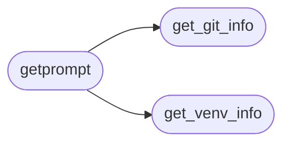

# `core.prompt`

> Source: [core/prompt.py:1](../../core/prompt.py#L1) | language `py` | coverage 100.0% | [API index](../index.md)

Prompt builder for LazyOwn CLI and C2 dashboard banner.

Exposes [`getprompt`](#getprompt) which returns the coloured status line shown
in both the CLI header and the C2 web dashboard. Extracted from
``utils.py`` to break the 3358-line monolith.

## Contents

- **Functions:** [`get_git_info`](#get_git_info), [`get_venv_info`](#get_venv_info), [`get_kernel`](#get_kernel), [`get_terminal_size`](#get_terminal_size), [`get_local_ips`](#get_local_ips), [`copy2clip`](#copy2clip), [`getprompt`](#getprompt)

## Call Graph

Solid arrows stay in this module, dashed arrows leave it.



## Functions

<a id="get_git_info"></a>

### `get_git_info`

`function` | [core/prompt.py:35](../../core/prompt.py#L35)

```python
def get_git_info() -> str
```

Return current git branch and dirty-status for the prompt.

Returns an empty string if git is not available or the working
tree is not a git repo.

**Returns:** `str`

*Called by:* [`getprompt`](#getprompt)

---

<a id="get_venv_info"></a>

### `get_venv_info`

`function` | [core/prompt.py:60](../../core/prompt.py#L60)

```python
def get_venv_info() -> str
```

Return the active virtualenv name, or empty string if none.

**Returns:** `str`

*Called by:* [`getprompt`](#getprompt)

---

<a id="get_kernel"></a>

### `get_kernel`

`function` | [core/prompt.py:68](../../core/prompt.py#L68)

```python
def get_kernel() -> str
```

Return the running kernel version (short form).

**Returns:** `str`

---

<a id="get_terminal_size"></a>

### `get_terminal_size`

`function` | [core/prompt.py:78](../../core/prompt.py#L78)

```python
def get_terminal_size() -> tuple[int, int]
```

Return ``(width, height)`` of the terminal, defaulting to 80x24.

**Returns:** `tuple[int, int]`

---

<a id="get_local_ips"></a>

### `get_local_ips`

`function` | [core/prompt.py:87](../../core/prompt.py#L87)

```python
def get_local_ips() -> str
```

Return a comma-separated string of non-loopback IPv4 addresses.

**Returns:** `str`

---

<a id="copy2clip"></a>

### `copy2clip`

`function` | [core/prompt.py:109](../../core/prompt.py#L109)

```python
def copy2clip(text: str) -> bool
```

Copy ``text`` to the system clipboard via xclip.

Returns True on success, False if xclip is unavailable.

**Parameters**

| Name | Type | Default | Description |
|---|---|---|---|
| `text` | `str` |  |  |

**Returns:** `bool`

---

<a id="getprompt"></a>

### `getprompt`

`function` | [core/prompt.py:127](../../core/prompt.py#L127)

```python
def getprompt() -> str
```

Build the coloured status line for the CLI header and C2 dashboard.

Returns a Rich-formatted string containing the current session
context: operator@host, network interfaces, target, domain, git
branch, virtualenv, and timestamp.

**Returns:** `str` - A Rich-console compatible string.

*Calls:* [`get_git_info`](#get_git_info), [`get_venv_info`](#get_venv_info)

---
