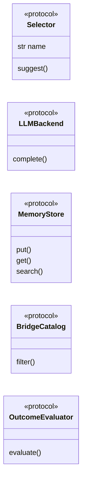

# `core.protocols`

> Source: [core/protocols.py:1](../../core/protocols.py#L1) | language `py` | coverage 76.9% | [API index](../index.md)

Stable structural interfaces (PEP 544 ``Protocol``) for high-level orchestration.

These protocols are the contract used by ``skills/autonomous_daemon.py``,
``skills/swan_agent.py`` and the MCP layer. New backends, selectors and memory
stores must implement these signatures so the orchestration layer never
depends on a concrete implementation (Dependency Inversion).

Type-only — no runtime side effects.

## Contents

- **Protocols:** [`Selector`](#selector), [`LLMBackend`](#llmbackend), [`MemoryStore`](#memorystore), [`BridgeCatalog`](#bridgecatalog), [`OutcomeEvaluator`](#outcomeevaluator)

## Type Diagram



## Protocols

<a id="selector"></a>

### `Selector`

`protocol` | [core/protocols.py:17](../../core/protocols.py#L17)

Decorators: `@runtime_checkable`

```python
class Selector(Protocol)
```

Bases: `Protocol`

Suggests the next command for a given target/phase.

Implementations include `[`ReactiveSelector`](skills.autonomous_daemon.py.md#reactiveselector)`, `[`ParquetSelector`](skills.autonomous_daemon.py.md#parquetselector)`,
`[`BridgeSelector`](skills.autonomous_daemon.py.md#bridgeselector)`, `[`SWANSelector`](skills.autonomous_daemon.py.md#swanselector)`, `[`LLMSelector`](skills.autonomous_daemon.py.md#llmselector)` and
`[`FallbackSelector`](skills.autonomous_daemon.py.md#fallbackselector)`.

**Attributes**

| Name | Type | Default | Description |
|---|---|---|---|
| [`name`](#selector-name) | `str` |  |  |

**Members**

| Member | Kind | Summary |
|---|---|---|
| [`suggest`](#selector-suggest) | method | Return ``{"command": str, "reasoning": str, "mitre": str}`` or ``None``. |

<a id="selector-suggest"></a>

#### `Selector.suggest`

`method` | [core/protocols.py:27](../../core/protocols.py#L27)

```python
def suggest(self, target: str, phase: str, context: dict[str, Any] | None = None) -> dict[str, Any] | None
```

Return ``{"command": str, "reasoning": str, "mitre": str}`` or ``None``.

**Parameters**

| Name | Type | Default | Description |
|---|---|---|---|
| `target` | `str` |  |  |
| `phase` | `str` |  |  |
| `context` | `dict[str, Any] \| None` | `None` |  |

**Returns:** `dict[str, Any] | None`

---

<a id="llmbackend"></a>

### `LLMBackend`

`protocol` | [core/protocols.py:37](../../core/protocols.py#L37)

Decorators: `@runtime_checkable`

```python
class LLMBackend(Protocol)
```

Bases: `Protocol`

Pluggable language model backend (Groq, Ollama, Claude, ...).

**Members**

| Member | Kind | Summary |
|---|---|---|
| [`complete`](#llmbackend-complete) | method | Return the model completion as a string. |

<a id="llmbackend-complete"></a>

#### `LLMBackend.complete`

`method` | [core/protocols.py:40](../../core/protocols.py#L40)

```python
def complete(self, system: str, user: str, max_tokens: int = 1024, temperature: float = 0.2) -> str
```

Return the model completion as a string.

**Parameters**

| Name | Type | Default | Description |
|---|---|---|---|
| `system` | `str` |  |  |
| `user` | `str` |  |  |
| `max_tokens` | `int` | `1024` |  |
| `temperature` | `float` | `0.2` |  |

**Returns:** `str`

---

<a id="memorystore"></a>

### `MemoryStore`

`protocol` | [core/protocols.py:51](../../core/protocols.py#L51)

Decorators: `@runtime_checkable`

```python
class MemoryStore(Protocol)
```

Bases: `Protocol`

Persistent key/value store used by hive_mind, parquet_db and rag layers.

**Members**

| Member | Kind | Summary |
|---|---|---|
| [`put`](#memorystore-put) | method |  |
| [`get`](#memorystore-get) | method |  |
| [`search`](#memorystore-search) | method |  |

<a id="memorystore-put"></a>

#### `MemoryStore.put`

`method` | [core/protocols.py:54](../../core/protocols.py#L54)

```python
def put(self, key: str, value: Any) -> None
```

**Parameters**

| Name | Type | Default | Description |
|---|---|---|---|
| `key` | `str` |  |  |
| `value` | `Any` |  |  |

<a id="memorystore-get"></a>

#### `MemoryStore.get`

`method` | [core/protocols.py:56](../../core/protocols.py#L56)

```python
def get(self, key: str, default: Any = None) -> Any
```

**Parameters**

| Name | Type | Default | Description |
|---|---|---|---|
| `key` | `str` |  |  |
| `default` | `Any` | `None` |  |

**Returns:** `Any`

<a id="memorystore-search"></a>

#### `MemoryStore.search`

`method` | [core/protocols.py:58](../../core/protocols.py#L58)

```python
def search(self, query: str, k: int = 5) -> list[dict[str, Any]]
```

**Parameters**

| Name | Type | Default | Description |
|---|---|---|---|
| `query` | `str` |  |  |
| `k` | `int` | `5` |  |

**Returns:** `list[dict[str, Any]]`

---

<a id="bridgecatalog"></a>

### `BridgeCatalog`

`protocol` | [core/protocols.py:62](../../core/protocols.py#L62)

Decorators: `@runtime_checkable`

```python
class BridgeCatalog(Protocol)
```

Bases: `Protocol`

Catalog of executable commands keyed by phase + OS.

**Members**

| Member | Kind | Summary |
|---|---|---|
| [`filter`](#bridgecatalog-filter) | method | Return command entries matching ``phase`` and ``os_id``. |

<a id="bridgecatalog-filter"></a>

#### `BridgeCatalog.filter`

`method` | [core/protocols.py:65](../../core/protocols.py#L65)

```python
def filter(self, phase: str, os_id: int) -> list[dict[str, Any]]
```

Return command entries matching ``phase`` and ``os_id``.

**Parameters**

| Name | Type | Default | Description |
|---|---|---|---|
| `phase` | `str` |  |  |
| `os_id` | `int` |  |  |

**Returns:** `list[dict[str, Any]]`

---

<a id="outcomeevaluator"></a>

### `OutcomeEvaluator`

`protocol` | [core/protocols.py:70](../../core/protocols.py#L70)

Decorators: `@runtime_checkable`

```python
class OutcomeEvaluator(Protocol)
```

Bases: `Protocol`

Scores the outcome of an executed command for RL/MoE feedback.

**Members**

| Member | Kind | Summary |
|---|---|---|
| [`evaluate`](#outcomeevaluator-evaluate) | method | Return a reward in ``[0.0, 1.0]``. |

<a id="outcomeevaluator-evaluate"></a>

#### `OutcomeEvaluator.evaluate`

`method` | [core/protocols.py:73](../../core/protocols.py#L73)

```python
def evaluate(self, command: str, output: str, target: str, phase: str) -> float
```

Return a reward in ``[0.0, 1.0]``.

**Parameters**

| Name | Type | Default | Description |
|---|---|---|---|
| `command` | `str` |  |  |
| `output` | `str` |  |  |
| `target` | `str` |  |  |
| `phase` | `str` |  |  |

**Returns:** `float`

---
