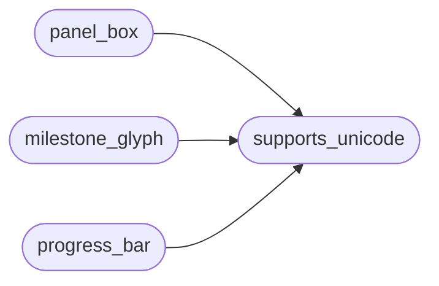

# `core.safe_console`

> Source: [core/safe_console.py:1](../../core/safe_console.py#L1) | language `py` | coverage 100.0% | [API index](../index.md)

Terminal-safe Rich console factory.

Colors and unicode glyphs are only safe when the sink interprets them.
This module centralises that decision so no surface ever leaks raw ANSI
codes (``?[32m``) or placeholder boxes (``?`` for ``╭─✔█``) again:

- Rich auto-detection already drops ANSI on non-tty / NO_COLOR /
  TERM=dumb sinks — every console here keeps those defaults.
- When stdout cannot encode UTF-8, panels switch to the ASCII box and
  glyph helpers degrade to ``[x]``/``[>]``/``[ ]``/``#``/``-``.

## Contents

- **Functions:** [`supports_unicode`](#supports_unicode), [`get_console`](#get_console), [`panel_box`](#panel_box), [`milestone_glyph`](#milestone_glyph), [`progress_bar`](#progress_bar)

## Call Graph

Solid arrows stay in this module, dashed arrows leave it.



## Functions

<a id="supports_unicode"></a>

### `supports_unicode`

`function` | [core/safe_console.py:33](../../core/safe_console.py#L33)

```python
def supports_unicode() -> bool
```

Return True when stdout can encode box-drawing glyphs and emoji.

**Returns:** `bool`

*Called by:* [`milestone_glyph`](#milestone_glyph), [`panel_box`](#panel_box), [`progress_bar`](#progress_bar)

---

<a id="get_console"></a>

### `get_console`

`function` | [core/safe_console.py:42](../../core/safe_console.py#L42)

```python
def get_console(**overrides) -> Console
```

Build a Rich console with safe color/box defaults.

Callers may pass Rich ``Console`` options (`[`width`](cli.timeline_browser.py.md#timelinecolumn-width)`, `[`file`](modules.playbook_admin.py.md#playbookentry-file)`);
``color_system``/``force_terminal`` are left on auto so piped or
crippled sinks never receive raw escape codes.

**Parameters**

| Name | Type | Default | Description |
|---|---|---|---|
| `**overrides` |  |  |  |

**Returns:** `Console`

*Called by:* [`TipsEngine.__init__`](cli.tips_engine.py.md#tipsengine-__init__), [`LoopProgress.__post_init__`](modules.loop_progress.py.md#loopprogress-__post_init__)

---

<a id="panel_box"></a>

### `panel_box`

`function` | [core/safe_console.py:52](../../core/safe_console.py#L52)

```python
def panel_box()
```

Return the ROUNDED box on UTF-8 sinks, ASCII otherwise.

*Calls:* [`supports_unicode`](#supports_unicode)

---

<a id="milestone_glyph"></a>

### `milestone_glyph`

`function` | [core/safe_console.py:57](../../core/safe_console.py#L57)

```python
def milestone_glyph(state: str) -> str
```

Glyph for a milestone state: done / active / pending (or other).

**Parameters**

| Name | Type | Default | Description |
|---|---|---|---|
| `state` | `str` |  |  |

**Returns:** `str`

*Calls:* [`supports_unicode`](#supports_unicode)

*Called by:* [`print_phase`](cli.ops_commands.py.md#print_phase)

---

<a id="progress_bar"></a>

### `progress_bar`

`function` | [core/safe_console.py:67](../../core/safe_console.py#L67)

```python
def progress_bar(ratio: float, width: int = 10) -> str
```

Fixed-width fill bar, unicode blocks or ASCII hashes.

**Parameters**

| Name | Type | Default | Description |
|---|---|---|---|
| `ratio` | `float` |  |  |
| `width` | `int` | `10` |  |

**Returns:** `str`

*Calls:* [`supports_unicode`](#supports_unicode)

---
