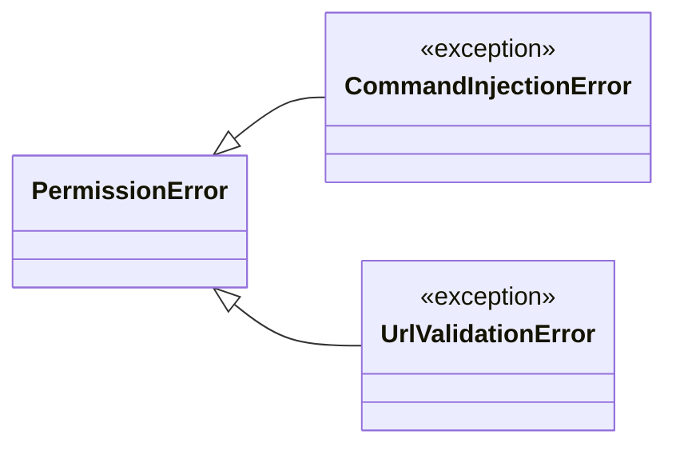
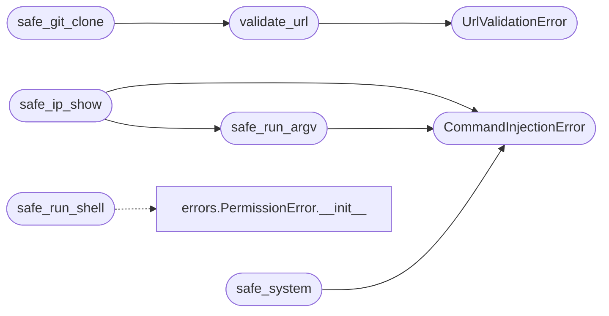

# `core.safe_exec`

> Source: [core/safe_exec.py:1](../../core/safe_exec.py#L1) | language `py` | coverage 100.0% | [API index](../index.md)

Centralized safe command execution for the LazyOwn framework.

Contract: replaces all ``os.system()`` and ``subprocess.run(shell=True)``
call sites with a single, audited, default-deny execution path.

Invariants:

1. `[`safe_system`](#safe_system)` never passes user-controlled strings to a shell.
2. `[`safe_run_argv`](#safe_run_argv)` always uses ``shell=False``.
3. `[`safe_run_shell`](#safe_run_shell)` requires explicit ``allow=True`` plus a reason.
4. `[`safe_clear_screen`](#safe_clear_screen)` uses the terminal capability query, never os.system.
5. `[`validate_url`](#validate_url)` rejects shell metacharacters in URLs before git clone.
6. `[`safe_git_clone`](#safe_git_clone)` uses subprocess list-form, never os.system.
7. ``safe_ip_display`` parses ``ip`` output in Python, never via shell pipes.

## Contents

- **Exceptions:** [`CommandInjectionError`](#commandinjectionerror), [`UrlValidationError`](#urlvalidationerror)
- **Functions:** [`safe_system`](#safe_system), [`safe_run_argv`](#safe_run_argv), [`safe_run_shell`](#safe_run_shell), [`safe_clear_screen`](#safe_clear_screen), [`validate_url`](#validate_url), [`safe_git_clone`](#safe_git_clone), [`safe_ip_show`](#safe_ip_show), [`safe_find_tool`](#safe_find_tool), [`safe_file_read`](#safe_file_read)

## Type Diagram



## Call Graph

Solid arrows stay in this module, dashed arrows leave it.



## Exceptions

<a id="commandinjectionerror"></a>

### `CommandInjectionError`

`exception` | [core/safe_exec.py:49](../../core/safe_exec.py#L49)

```python
class CommandInjectionError(PermissionError)
```

Bases: [`PermissionError`](core.errors.py.md#permissionerror)

Raised when a command contains shell metacharacters.

---

<a id="urlvalidationerror"></a>

### `UrlValidationError`

`exception` | [core/safe_exec.py:53](../../core/safe_exec.py#L53)

```python
class UrlValidationError(PermissionError)
```

Bases: [`PermissionError`](core.errors.py.md#permissionerror)

Raised when a URL contains shell metacharacters.

---

## Functions

<a id="safe_system"></a>

### `safe_system`

`function` | [core/safe_exec.py:74](../../core/safe_exec.py#L74)

```python
def safe_system(command: str, *, reason: str = '') -> int
```

Execute a fixed command string through the shell safely.

Only allows pre-defined, non-user-controlled command strings.
Rejects any command containing shell metacharacters that could
indicate injection.

Prefer [`safe_run_argv`](#safe_run_argv) for any new call site: this helper keeps
``shell=True`` for legacy fixed strings and must never receive
interpolated user input.

**Parameters**

| Name | Type | Default | Description |
|---|---|---|---|
| `command` | `str` |  | A fixed command string (no user interpolation). |
| `reason` | `str` | `''` | Audit justification. |

**Returns:** `int` - The exit code of the command.

**Raises**

- [`CommandInjectionError`](#commandinjectionerror): If the command contains metacharacters.
- `ValueError`: If command is empty.

*Calls:* [`CommandInjectionError`](#commandinjectionerror)

---

<a id="safe_run_argv"></a>

### `safe_run_argv`

`function` | [core/safe_exec.py:174](../../core/safe_exec.py#L174)

```python
def safe_run_argv(argv: Sequence[str], *, timeout: float | None = None, capture_output: bool = True, check: bool = False, input_data: str | None = None) -> subprocess.CompletedProcess[str]
```

Execute a command via subprocess without shell interpretation.

Children always run in a dedicated session; a timeout terminates the
whole process group so detached grandchildren never outlive their
parent on the operator host.

**Parameters**

| Name | Type | Default | Description |
|---|---|---|---|
| `argv` | `Sequence[str]` |  | Program and arguments as a sequence. Must not be empty. |
| `timeout` | `float \| None` | `None` | Optional wall-clock timeout in seconds. |
| `capture_output` | `bool` | `True` | Whether to capture stdout and stderr. |
| `check` | `bool` | `False` | Whether to raise on non-zero exit. |
| `input_data` | `str \| None` | `None` | Optional stdin content. |

**Returns:** `subprocess.CompletedProcess[str]` - CompletedProcess result.

**Raises**

- `ValueError`: If argv is empty.
- `CalledProcessError`: (raised in the body, not documented)
- [`CommandInjectionError`](#commandinjectionerror): (raised in the body, not documented)

*Calls:* [`CommandInjectionError`](#commandinjectionerror)

*Called by:* [`safe_ip_show`](#safe_ip_show), [`AtomicResolver.ensure_repo`](modules.atomic_resolver.py.md#atomicresolver-ensure_repo)

---

<a id="safe_run_shell"></a>

### `safe_run_shell`

`function` | [core/safe_exec.py:228](../../core/safe_exec.py#L228)

```python
def safe_run_shell(command: str, *, allow: bool = False, reason: str = '', timeout: float | None = None, cwd: str | None = None) -> subprocess.CompletedProcess[str]
```

Execute a command through the shell, gated by policy.

The child runs in a dedicated session; a timeout terminates the whole
process group, so a misbehaving third-party child that ignores
termination signals leaves no orphans behind.

**Parameters**

| Name | Type | Default | Description |
|---|---|---|---|
| `command` | `str` |  | The shell command to run. |
| `allow` | `bool` | `False` | Must be True to execute. |
| `reason` | `str` | `''` | Free-text justification. |
| `timeout` | `float \| None` | `None` | Optional wall-clock timeout. |
| `cwd` | `str \| None` | `None` | Optional working directory, preserves caller behaviour. |

**Returns:** `subprocess.CompletedProcess[str]` - CompletedProcess result.

**Raises**

- [`PermissionError`](core.errors.py.md#permissionerror): When allow is not True.
- `ValueError`: When allow is True but reason is empty.

*Calls:* [`PermissionError.__init__`](core.errors.py.md#permissionerror-__init__)

*Called by:* [`PwnCommandSet.do_lolbas_use`](cli.commands.pwn.py.md#pwncommandset-do_lolbas_use), [`ensure_session`](modules.atomic_exploit_bridge.py.md#ensure_session), [`run_spec`](modules.atomic_exploit_bridge.py.md#run_spec), [`DNSBeacon.run`](modules.dns_beacon.py.md#dnsbeacon-run)

---

<a id="safe_clear_screen"></a>

### `safe_clear_screen`

`function` | [core/safe_exec.py:285](../../core/safe_exec.py#L285)

```python
def safe_clear_screen() -> None
```

Clear the terminal screen without using os.system.

Uses tput reset via subprocess list-form, falling back to
ANSI escape sequences when tput is unavailable.

---

<a id="validate_url"></a>

### `validate_url`

`function` | [core/safe_exec.py:300](../../core/safe_exec.py#L300)

```python
def validate_url(url: str) -> str
```

Validate a URL string, rejecting shell metacharacters.

**Parameters**

| Name | Type | Default | Description |
|---|---|---|---|
| `url` | `str` |  | The URL to validate. |

**Returns:** `str` - The validated URL string.

**Raises**

- [`UrlValidationError`](#urlvalidationerror): If the URL contains shell metacharacters or does not match the expected URL pattern.
- `ValueError`: If the URL is empty.

*Calls:* [`UrlValidationError`](#urlvalidationerror)

*Called by:* [`safe_git_clone`](#safe_git_clone), [`webhooks_register`](lazyc2.blueprints.api_v1.py.md#webhooks_register), [`shorten`](modules.lazyshortener.py.md#shorten)

---

<a id="safe_git_clone"></a>

### `safe_git_clone`

`function` | [core/safe_exec.py:327](../../core/safe_exec.py#L327)

```python
def safe_git_clone(repo_url: str, target_dir: str | Path, *, timeout: float = 120) -> subprocess.CompletedProcess[str]
```

Clone a git repository safely using subprocess list-form.

Never uses os.system. Validates the URL before execution.

**Parameters**

| Name | Type | Default | Description |
|---|---|---|---|
| `repo_url` | `str` |  | The git repository URL (http/https only). |
| `target_dir` | `str \| Path` |  | The target directory path. |
| `timeout` | `float` | `120` | Clone timeout in seconds. |

**Returns:** `subprocess.CompletedProcess[str]` - CompletedProcess result.

**Raises**

- [`UrlValidationError`](#urlvalidationerror): If the URL is invalid.

*Calls:* [`validate_url`](#validate_url)

*Called by:* [`AtomicResolver.ensure_repo`](modules.atomic_resolver.py.md#atomicresolver-ensure_repo), [`ensure_installed`](modules.winbox_gym.py.md#ensure_installed)

---

<a id="safe_ip_show"></a>

### `safe_ip_show`

`function` | [core/safe_exec.py:361](../../core/safe_exec.py#L361)

```python
def safe_ip_show(interface: str = 'scope global') -> list[dict[str, str]]
```

Parse IP addresses from ``ip show`` output in Python.

Replaces shell pipes like ``ip a show ... | awk | grep | cut``.

**Parameters**

| Name | Type | Default | Description |
|---|---|---|---|
| `interface` | `str` | `'scope global'` | The ip show filter argument. |

**Returns:** `list[dict[str, str]]` - List of dicts with 'interface' and 'address' keys.

**Raises**

- [`CommandInjectionError`](#commandinjectionerror): (raised in the body, not documented)

*Calls:* [`CommandInjectionError`](#commandinjectionerror), [`safe_run_argv`](#safe_run_argv)

---

<a id="safe_find_tool"></a>

### `safe_find_tool`

`function` | [core/safe_exec.py:398](../../core/safe_exec.py#L398)

```python
def safe_find_tool(name: str) -> str | None
```

Find a tool on PATH using shutil.which.

Replaces hardcoded paths like ``/usr/local/bin/go``.

**Parameters**

| Name | Type | Default | Description |
|---|---|---|---|
| `name` | `str` |  | The executable name to find. |

**Returns:** `str | None` - Absolute path to the tool, or None if not found.

---

<a id="safe_file_read"></a>

### `safe_file_read`

`function` | [core/safe_exec.py:414](../../core/safe_exec.py#L414)

```python
def safe_file_read(path: str | Path, *, max_bytes: int = 10 * 1024 * 1024) -> str
```

Read a file safely with a size limit.

**Parameters**

| Name | Type | Default | Description |
|---|---|---|---|
| `path` | `str \| Path` |  | File path to read. |
| `max_bytes` | `int` | `10 * 1024 * 1024` | Maximum bytes to read. |

**Returns:** `str` - File contents as string.

**Raises**

- `ValueError`: If the file exceeds max_bytes.
- `FileNotFoundError`: If the file does not exist.

---
