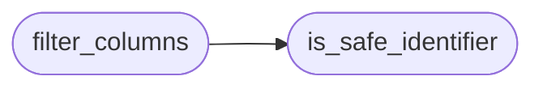

# `core.safe_import`

> Source: [core/safe_import.py:1](../../core/safe_import.py#L1) | language `py` | coverage 100.0% | [API index](../index.md)

Fail-closed import of attacker-supplied campaign packages.

Campaign ``.zip`` files arrive from other operators and may be
malicious. This module owns the two trust boundaries of the import
path: archive extraction (ZipSlip) and schema merge (second-order
SQL from hostile column names). Callers in ``cli/commands/campaign``
must route through these helpers instead of ``extractall`` and raw
``", ".join(columns)``.

## Contents

- **Functions:** [`is_safe_identifier`](#is_safe_identifier), [`filter_columns`](#filter_columns), [`safe_extract_zip`](#safe_extract_zip), [`safe_copy_tree`](#safe_copy_tree)

## Call Graph

Solid arrows stay in this module, dashed arrows leave it.



## Functions

<a id="is_safe_identifier"></a>

### `is_safe_identifier`

`function` | [core/safe_import.py:20](../../core/safe_import.py#L20)

```python
def is_safe_identifier(name: str) -> bool
```

Return True when ``name`` is a bare SQL identifier.

**Parameters**

| Name | Type | Default | Description |
|---|---|---|---|
| `name` | `str` |  | Candidate column or table fragment. |

**Returns:** `bool` - True for ``[A-Za-z_][A-Za-z0-9_]*``, False otherwise.

*Called by:* [`filter_columns`](#filter_columns)

---

<a id="filter_columns"></a>

### `filter_columns`

`function` | [core/safe_import.py:32](../../core/safe_import.py#L32)

```python
def filter_columns(src_columns: list[str], dest_columns: list[str]) -> list[str]
```

Intersect source columns with destination columns, safely.

Only names present in the destination schema and matching the
bare-identifier pattern survive, in source order. Hostile or
unknown columns are dropped so one poisoned column cannot break
or inject into the whole import.

**Parameters**

| Name | Type | Default | Description |
|---|---|---|---|
| `src_columns` | `list[str]` |  | Column names read from the imported database. |
| `dest_columns` | `list[str]` |  | Column names of the destination table. |

**Returns:** `list[str]` - Safe ordered subset of ``src_columns``.

*Calls:* [`is_safe_identifier`](#is_safe_identifier)

---

<a id="safe_extract_zip"></a>

### `safe_extract_zip`

`function` | [core/safe_import.py:51](../../core/safe_import.py#L51)

```python
def safe_extract_zip(archive: str | Path, dest: str | Path) -> list[str]
```

Extract a zip archive with ZipSlip protection.

Every member is validated before writing: absolute paths, parent
references and symlink entries are skipped, and the resolved
target must stay inside ``dest`` after symlink resolution.

**Parameters**

| Name | Type | Default | Description |
|---|---|---|---|
| `archive` | `str \| Path` |  | Path to the ``.zip`` file. |
| `dest` | `str \| Path` |  | Directory receiving the extracted tree. |

**Returns:** `list[str]` - Relative paths of the extracted members.

---

<a id="safe_copy_tree"></a>

### `safe_copy_tree`

`function` | [core/safe_import.py:93](../../core/safe_import.py#L93)

```python
def safe_copy_tree(src: str | Path, dest: str | Path) -> int
```

Copy a directory tree without symlink escape.

Mirrors the campaign session-restore loop: symlinks are never
followed, and every destination stays inside ``dest``.

**Parameters**

| Name | Type | Default | Description |
|---|---|---|---|
| `src` | `str \| Path` |  | Source directory. |
| `dest` | `str \| Path` |  | Destination directory. |

**Returns:** `int` - Number of files copied.

---
