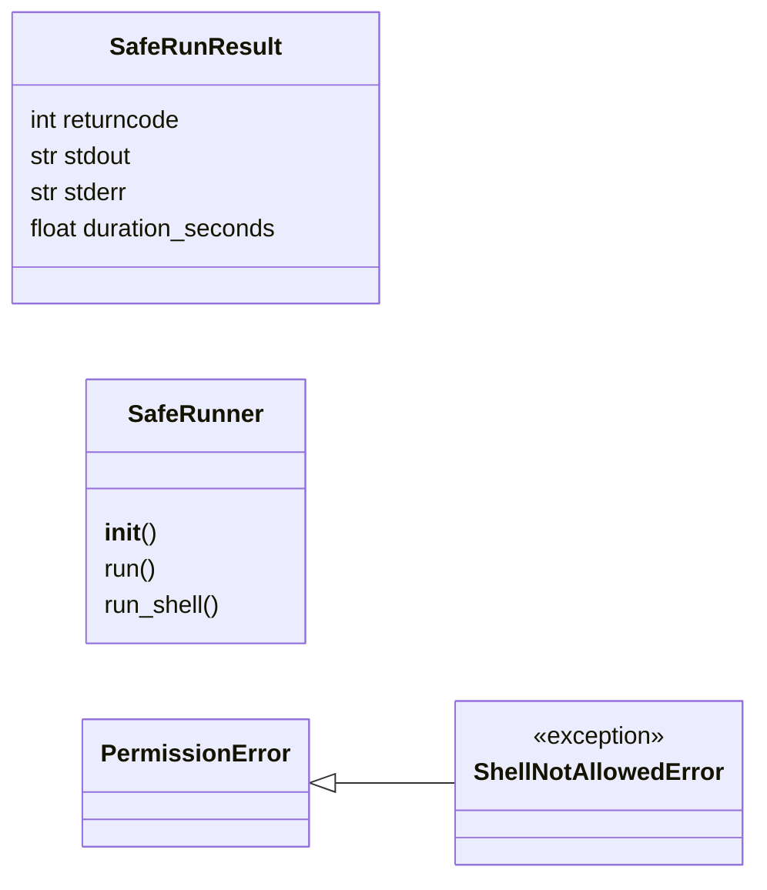
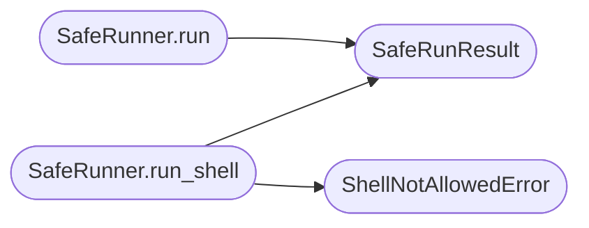

# `core.safe_subprocess`

> Source: [core/safe_subprocess.py:1](../../core/safe_subprocess.py#L1) | language `py` | coverage 100.0% | [API index](../index.md)

Safe subprocess runner for the LazyOwn framework.

Contract: this module replaces the legacy ``subprocess.run(..., shell=True, ...)``
call sites that pepper [`utils`](utils.py.md) and [`lazyc2`](lazyc2.__init__.py.md). The default
behaviour is to refuse shell execution; callers that genuinely need the
shell must pass ``allow=True`` and a free-text ``reason`` that is
recorded in the audit log together with the returncode.

Invariants:

1. [`SafeRunner.run_shell`](#saferunner-run_shell) raises [`ShellNotAllowedError`](#shellnotallowederror) when
   `[`allow`](modules.goals.py.md#taskconstraints-allow)` is missing or ``False``.
2. [`SafeRunner.run_shell`](#saferunner-run_shell) requires a non-empty ``reason``; an
   empty string raises `ValueError`.
3. [`SafeRunner.run`](#saferunner-run) (argv list) is always allowed and never audits.
4. The audit log, when configured, receives a single JSON line per
   ``run_shell`` call (allowed and denied attempts alike).
5. The returned [`SafeRunResult`](#saferunresult) exposes `[`returncode`](#saferunresult-returncode)`,
   `[`stdout`](#saferunresult-stdout)`, `[`stderr`](#saferunresult-stderr)` and `[`duration_seconds`](#saferunresult-duration_seconds)`.

Config keys owned: none (the audit log path is supplied at construction).

## Contents

- **Classes:** [`SafeRunResult`](#saferunresult), [`SafeRunner`](#saferunner)
- **Exceptions:** [`ShellNotAllowedError`](#shellnotallowederror)

## Type Diagram



## Call Graph

Solid arrows stay in this module, dashed arrows leave it.



## Classes

<a id="saferunresult"></a>

### `SafeRunResult`

`class` `dataclass` | [core/safe_subprocess.py:44](../../core/safe_subprocess.py#L44)

Decorators: `@dataclass(frozen=True)`

```python
class SafeRunResult
```

Outcome of a [`SafeRunner`](#saferunner) invocation.

**Attributes**

| Name | Type | Default | Description |
|---|---|---|---|
| [`returncode`](#saferunresult-returncode) | `int` |  | The exit code of the process. |
| [`stdout`](#saferunresult-stdout) | `str` |  | Captured standard output. |
| [`stderr`](#saferunresult-stderr) | `str` |  | Captured standard error. |
| [`duration_seconds`](#saferunresult-duration_seconds) | `float` |  | Wall-clock execution time. |

---

<a id="saferunner"></a>

### `SafeRunner`

`class` | [core/safe_subprocess.py:60](../../core/safe_subprocess.py#L60)

```python
class SafeRunner
```

Default-deny shell runner used by the LazyOwn framework.

**Parameters**

| Name | Type | Default | Description |
|---|---|---|---|
| `audit_log_path` |  |  | Optional filesystem path. When provided, every ``run_shell`` call is appended as a single JSON line. |

**Members**

| Member | Kind | Summary |
|---|---|---|
| [`__init__`](#saferunner-__init__) | constructor |  |
| [`run`](#saferunner-run) | method | Execute ``argv`` without invoking a shell. |
| [`run_shell`](#saferunner-run_shell) | method | Execute ``command`` through the system shell, gated by policy. |

<a id="saferunner-__init__"></a>

#### `SafeRunner.__init__`

`constructor` | [core/safe_subprocess.py:70](../../core/safe_subprocess.py#L70)

```python
def __init__(self, audit_log_path: str | Path | None = None) -> None
```

**Parameters**

| Name | Type | Default | Description |
|---|---|---|---|
| `audit_log_path` | `str \| Path \| None` | `None` | Optional filesystem path. When provided, every ``run_shell`` call is appended as a single JSON line. |

*Called by:* [`run`](core.process.py.md#run), [`run`](utils.py.md#run)

<a id="saferunner-run"></a>

#### `SafeRunner.run`

`method` | [core/safe_subprocess.py:73](../../core/safe_subprocess.py#L73)

```python
def run(self, argv: Sequence[str], *, timeout: float | None = None) -> SafeRunResult
```

Execute ``argv`` without invoking a shell.

**Parameters**

| Name | Type | Default | Description |
|---|---|---|---|
| `argv` | `Sequence[str]` |  | The program and its arguments as a sequence of strings. |
| `timeout` | `float \| None` | `None` | Optional wall-clock timeout in seconds. |

**Returns:** `SafeRunResult` - A [`SafeRunResult`](#saferunresult) describing the outcome.

**Raises**

- `FileNotFoundError`: if the program does not exist.
- `subprocess.TimeoutExpired`: if the timeout elapses.
- `ValueError`: (raised in the body, not documented)

*Calls:* [`SafeRunResult`](#saferunresult)

<a id="saferunner-run_shell"></a>

#### `SafeRunner.run_shell`

`method` | [core/safe_subprocess.py:105](../../core/safe_subprocess.py#L105)

```python
def run_shell(self, command: str, *, allow: bool = False, reason: str = '', timeout: float | None = None) -> SafeRunResult
```

Execute ``command`` through the system shell, gated by policy.

**Parameters**

| Name | Type | Default | Description |
|---|---|---|---|
| `command` | `str` |  | The shell command to run. |
| `allow` | `bool` | `False` | Must be ``True`` to execute; otherwise a [`ShellNotAllowedError`](#shellnotallowederror) is raised (and audited). |
| `reason` | `str` | `''` | Free-text justification, recorded in the audit log. Required when `[`allow`](modules.goals.py.md#taskconstraints-allow)` is ``True``. |
| `timeout` | `float \| None` | `None` | Optional wall-clock timeout in seconds. |

**Returns:** `SafeRunResult` - A [`SafeRunResult`](#saferunresult) describing the outcome.

**Raises**

- [`ShellNotAllowedError`](#shellnotallowederror): when `[`allow`](modules.goals.py.md#taskconstraints-allow)` is not ``True``.
- `ValueError`: when `[`allow`](modules.goals.py.md#taskconstraints-allow)` is ``True`` but ``reason`` is empty.

*Calls:* [`SafeRunResult`](#saferunresult), [`ShellNotAllowedError`](#shellnotallowederror)

*Called by:* [`run`](core.process.py.md#run), [`run`](utils.py.md#run)

---

## Exceptions

<a id="shellnotallowederror"></a>

### `ShellNotAllowedError`

`exception` | [core/safe_subprocess.py:39](../../core/safe_subprocess.py#L39)

```python
class ShellNotAllowedError(PermissionError)
```

Bases: [`PermissionError`](core.errors.py.md#permissionerror)

Raised when a shell invocation is attempted without ``allow=True``.

---
