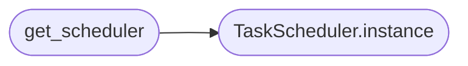

# `core.scheduler`

> Source: [core/scheduler.py:1](../../core/scheduler.py#L1) | language `py` | coverage 90.9% | [API index](../index.md)

Centralized task scheduler for the LazyOwn framework.

Uses ``apscheduler`` when available, falling back to a stdlib implementation
built on ``sched.scheduler`` and ``threading.Timer`` for environments where
the library is not installed. Thread-safe for concurrent task registration
and cancellation from any thread.

Usage::

    from core.scheduler import get_scheduler

    sched = get_scheduler()
    sched.start()
    sched.schedule_task("heartbeat", 30, send_heartbeat)
    sched.schedule_once("cleanup", 60, remove_temp_files)
    sched.stop()

## Contents

- **Classes:** [`TaskScheduler`](#taskscheduler)
- **Functions:** [`get_scheduler`](#get_scheduler)

## Call Graph

Solid arrows stay in this module, dashed arrows leave it.



## Classes

<a id="taskscheduler"></a>

### `TaskScheduler`

`class` | [core/scheduler.py:50](../../core/scheduler.py#L50)

```python
class TaskScheduler
```

Thread-safe scheduler for recurring and one-shot tasks.

Automatically selects ``apscheduler`` (BackgroundScheduler) when
available, falling back to a stdlib implementation using
``sched.scheduler`` and ``threading.Timer`` otherwise.

**Members**

| Member | Kind | Summary |
|---|---|---|
| [`__init__`](#taskscheduler-__init__) | constructor |  |
| [`instance`](#taskscheduler-instance) | classmethod | Return the singleton `[`TaskScheduler`](#taskscheduler)` instance. |
| [`start`](#taskscheduler-start) | method | Start the scheduler background thread. |
| [`stop`](#taskscheduler-stop) | method | Stop the scheduler and cancel all pending tasks. |
| [`schedule_task`](#taskscheduler-schedule_task) | method | Register a recurring task to run every ``interval_seconds``. |
| [`schedule_once`](#taskscheduler-schedule_once) | method | Register a one-shot task to run after ``delay_seconds``. |
| [`cancel_task`](#taskscheduler-cancel_task) | method | Cancel a scheduled task by name. |
| [`list_tasks`](#taskscheduler-list_tasks) | method | Return metadata for all registered tasks. |

<a id="taskscheduler-__init__"></a>

#### `TaskScheduler.__init__`

`constructor` | [core/scheduler.py:61](../../core/scheduler.py#L61)

```python
def __init__(self) -> None
```

<a id="taskscheduler-instance"></a>

#### `TaskScheduler.instance`

`classmethod` | [core/scheduler.py:73](../../core/scheduler.py#L73)

Decorators: `@classmethod`

```python
def instance(cls) -> TaskScheduler
```

Return the singleton `[`TaskScheduler`](#taskscheduler)` instance.

**Returns:** `TaskScheduler`

*Called by:* [`get_scheduler`](#get_scheduler)

<a id="taskscheduler-start"></a>

#### `TaskScheduler.start`

`method` | [core/scheduler.py:81](../../core/scheduler.py#L81)

```python
def start(self) -> None
```

Start the scheduler background thread.

Idempotent: calling ``start()`` on an already-running scheduler is a
no-op.

<a id="taskscheduler-stop"></a>

#### `TaskScheduler.stop`

`method` | [core/scheduler.py:100](../../core/scheduler.py#L100)

```python
def stop(self) -> None
```

Stop the scheduler and cancel all pending tasks.

Idempotent: calling ``stop()`` on an already-stopped scheduler is a
no-op.

<a id="taskscheduler-schedule_task"></a>

#### `TaskScheduler.schedule_task`

`method` | [core/scheduler.py:123](../../core/scheduler.py#L123)

```python
def schedule_task(self, name: str, interval_seconds: int, func: Callable[[], None]) -> None
```

Register a recurring task to run every ``interval_seconds``.

If a task with the same ``name`` already exists it is cancelled and
replaced.

**Parameters**

| Name | Type | Default | Description |
|---|---|---|---|
| `name` | `str` |  | Unique identifier for the task. |
| `interval_seconds` | `int` |  | Seconds between invocations. |
| `func` | `Callable[[], None]` |  | Zero-argument callable to invoke each cycle. |

<a id="taskscheduler-schedule_once"></a>

#### `TaskScheduler.schedule_once`

`method` | [core/scheduler.py:157](../../core/scheduler.py#L157)

```python
def schedule_once(self, name: str, delay_seconds: int, func: Callable[[], None]) -> None
```

Register a one-shot task to run after ``delay_seconds``.

If a task with the same ``name`` already exists it is cancelled and
replaced.

**Parameters**

| Name | Type | Default | Description |
|---|---|---|---|
| `name` | `str` |  | Unique identifier for the task. |
| `delay_seconds` | `int` |  | Seconds to delay before invocation. |
| `func` | `Callable[[], None]` |  | Zero-argument callable to invoke. |

<a id="taskscheduler-cancel_task"></a>

#### `TaskScheduler.cancel_task`

`method` | [core/scheduler.py:192](../../core/scheduler.py#L192)

```python
def cancel_task(self, name: str) -> None
```

Cancel a scheduled task by name.

No error is raised if the task does not exist.

**Parameters**

| Name | Type | Default | Description |
|---|---|---|---|
| `name` | `str` |  | Identifier of the task to cancel. |

<a id="taskscheduler-list_tasks"></a>

#### `TaskScheduler.list_tasks`

`method` | [core/scheduler.py:205](../../core/scheduler.py#L205)

```python
def list_tasks(self) -> list[dict]
```

Return metadata for all registered tasks.

**Returns:** `list[dict]` - A list of dictionaries with keys ``name``, ``interval_seconds``,
``recurring``, ``active``, and ``next_run_iso``.

---

## Functions

<a id="get_scheduler"></a>

### `get_scheduler`

`function` | [core/scheduler.py:285](../../core/scheduler.py#L285)

```python
def get_scheduler() -> TaskScheduler
```

Return the singleton `[`TaskScheduler`](#taskscheduler)` instance.

**Returns:** `TaskScheduler`

*Calls:* [`TaskScheduler.instance`](#taskscheduler-instance)

---
