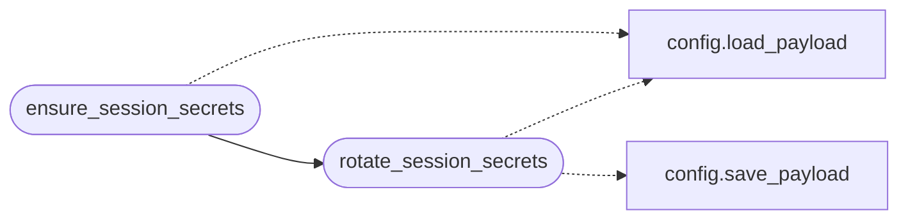

# `core.session_secrets`

> Source: [core/session_secrets.py:1](../../core/session_secrets.py#L1) | language `py` | coverage 100.0% | [API index](../index.md)

Session-scoped secret rotation.

Engagement secrets live only for the lifetime of a session:

- ``aes_key`` — beacon channel AES-256 key (``sessions/key.aes``).
- ``rat_key`` — beacon HMAC signing key (``payload.json``).
- ``session_magic`` — activation string baked into lab implants.

`[`rotate_session_secrets`](#rotate_session_secrets)` generates all three with ``secrets``/``os.urandom``,
persists them and mirrors the values onto the live config object so the C2,
the shell and the implant builders read the same secrets in one deployment.
``clean`` rotates them again after artifact removal, and the C2 rotates on
boot when ``rotate_keys_on_boot`` is enabled, so nothing durable ships with
a secret that is public knowledge.

## Contents

- **Functions:** [`rotate_session_secrets`](#rotate_session_secrets), [`ensure_session_secrets`](#ensure_session_secrets)

## Call Graph

Solid arrows stay in this module, dashed arrows leave it.



## Functions

<a id="rotate_session_secrets"></a>

### `rotate_session_secrets`

`function` | [core/session_secrets.py:38](../../core/session_secrets.py#L38)

```python
def rotate_session_secrets(config_obj: Any = None, sessions_dir: str | os.PathLike[str] = _SESSIONS_DIRNAME) -> dict[str, str]
```

Generate and persist a fresh set of session secrets.

**Parameters**

| Name | Type | Default | Description |
|---|---|---|---|
| `config_obj` | `Any` | `None` | Optional live config wrapper (`[`core.config.Config`](core.config.py.md#config)`) whose attributes are refreshed in memory. |
| `sessions_dir` | `str \| os.PathLike[str]` | `_SESSIONS_DIRNAME` | Directory that holds the on-disk AES key file. |

**Returns:** `dict[str, str]` - Mapping with the generated ``aes_hex``, ``rat_key`` and
``session_magic`` values as strings.

**Raises**

- `OSError`: if the AES key file or ``payload.json`` cannot be written.

*Calls:* [`load_payload`](core.config.py.md#load_payload), [`save_payload`](core.config.py.md#save_payload)

*Called by:* [`ShellSysCommandSet.do_clean`](cli.commands.shellsys.py.md#shellsyscommandset-do_clean), [`ensure_session_secrets`](#ensure_session_secrets)

---

<a id="ensure_session_secrets"></a>

### `ensure_session_secrets`

`function` | [core/session_secrets.py:70](../../core/session_secrets.py#L70)

```python
def ensure_session_secrets(config_obj: Any = None, rotate: bool = False, sessions_dir: str | os.PathLike[str] = _SESSIONS_DIRNAME) -> dict[str, str]
```

Return valid session secrets, rotating them when required.

**Parameters**

| Name | Type | Default | Description |
|---|---|---|---|
| `config_obj` | `Any` | `None` | Optional live config wrapper refreshed in memory. |
| `rotate` | `bool` | `False` | Force a full rotation regardless of current validity. |
| `sessions_dir` | `str \| os.PathLike[str]` | `_SESSIONS_DIRNAME` | Directory that holds the on-disk AES key file. |

**Returns:** `dict[str, str]` - Mapping with ``aes_hex``, ``rat_key`` and ``session_magic``.

*Calls:* [`load_payload`](core.config.py.md#load_payload), [`rotate_session_secrets`](#rotate_session_secrets)

*Called by:* [`build_agent`](modules.c2_agent.py.md#build_agent), [`deploy`](modules.c2_agent.py.md#deploy), [`C2Builder.run`](modules.c2_builder.py.md#c2builder-run)

---
