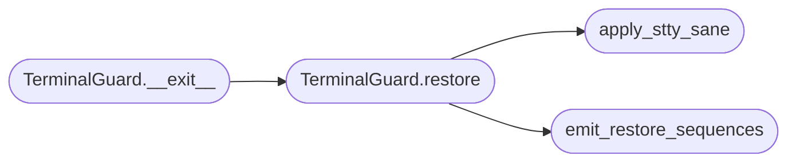

# `core.terminal_guard`

> Source: [core/terminal_guard.py:1](../../core/terminal_guard.py#L1) | language `py` | coverage 100.0% | [API index](../index.md)

Terminal state guard for interactive automation.

Child processes, curses apps, Rich ``Live`` regions and interrupted
prompts can leave a terminal in raw mode, with echo off, mouse
reporting on or the alternate screen active. This module snapshots the
termios attributes before the loop starts and restores them on exit,
atexit and explicit calls, then emits the standard sequences that undo
the modes a crashed child may have enabled.

## Contents

- **Classes:** [`TerminalGuard`](#terminalguard)
- **Functions:** [`emit_restore_sequences`](#emit_restore_sequences), [`apply_stty_sane`](#apply_stty_sane)
- **Constants:** [`RESTORE_SEQUENCE`](#restore_sequence)

## Call Graph

Solid arrows stay in this module, dashed arrows leave it.



## Classes

<a id="terminalguard"></a>

### `TerminalGuard`

`class` | [core/terminal_guard.py:73](../../core/terminal_guard.py#L73)

```python
class TerminalGuard
```

Snapshot termios on enter and restore it on every exit path.

Usage::

    with TerminalGuard():
        run_interactive_thing()

The guard is reentrant-safe enough for nested use: each instance
keeps its own snapshot and restores only its own.

**Members**

| Member | Kind | Summary |
|---|---|---|
| [`__init__`](#terminalguard-__init__) | constructor | Prepare an empty guard; the snapshot happens on `[`__enter__`](#terminalguard-__enter__)`. |
| [`__enter__`](#terminalguard-__enter__) | method | Capture current termios attributes when a tty is present. |
| [`__exit__`](#terminalguard-__exit__) | method | Restore the terminal on context exit. |
| [`restore`](#terminalguard-restore) | method | Restore saved termios, then reset extra terminal modes once. |

<a id="terminalguard-__init__"></a>

#### `TerminalGuard.__init__`

`constructor` | [core/terminal_guard.py:85](../../core/terminal_guard.py#L85)

```python
def __init__(self) -> None
```

Prepare an empty guard; the snapshot happens on `[`__enter__`](#terminalguard-__enter__)`.

*Called by:* [`run_loop`](modules.lazy_runner.py.md#run_loop)

<a id="terminalguard-__enter__"></a>

#### `TerminalGuard.__enter__`

`method` | [core/terminal_guard.py:91](../../core/terminal_guard.py#L91)

```python
def __enter__(self) -> TerminalGuard
```

Capture current termios attributes when a tty is present.

**Returns:** `TerminalGuard`

<a id="terminalguard-__exit__"></a>

#### `TerminalGuard.__exit__`

`method` | [core/terminal_guard.py:104](../../core/terminal_guard.py#L104)

```python
def __exit__(self, *_exc: object) -> None
```

Restore the terminal on context exit.

**Parameters**

| Name | Type | Default | Description |
|---|---|---|---|
| `*_exc` | `object` |  |  |

*Calls:* [`TerminalGuard.restore`](#terminalguard-restore)

<a id="terminalguard-restore"></a>

#### `TerminalGuard.restore`

`method` | [core/terminal_guard.py:108](../../core/terminal_guard.py#L108)

```python
def restore(self) -> None
```

Restore saved termios, then reset extra terminal modes once.

*Calls:* [`apply_stty_sane`](#apply_stty_sane), [`emit_restore_sequences`](#emit_restore_sequences)

*Called by:* [`TerminalGuard.__exit__`](#terminalguard-__exit__)

---

## Functions

<a id="emit_restore_sequences"></a>

### `emit_restore_sequences`

`function` | [core/terminal_guard.py:41](../../core/terminal_guard.py#L41)

```python
def emit_restore_sequences() -> None
```

Write the mode-reset sequences to the controlling terminal.

A crashed child can leave mouse tracking or the alternate screen on;
those modes are not part of termios, so the bytes go straight to
``/dev/tty`` (or stdout when that is the tty).

*Called by:* [`TerminalGuard.restore`](#terminalguard-restore)

---

<a id="apply_stty_sane"></a>

### `apply_stty_sane`

`function` | [core/terminal_guard.py:62](../../core/terminal_guard.py#L62)

```python
def apply_stty_sane() -> None
```

Best-effort ``stty sane`` fallback when termios restore fails.

*Called by:* [`TerminalGuard.restore`](#terminalguard-restore)

---

## Constants

<a id="restore_sequence"></a>

### `RESTORE_SEQUENCE`

`constant` | [core/terminal_guard.py:18](../../core/terminal_guard.py#L18)

```python
RESTORE_SEQUENCE
```

---
