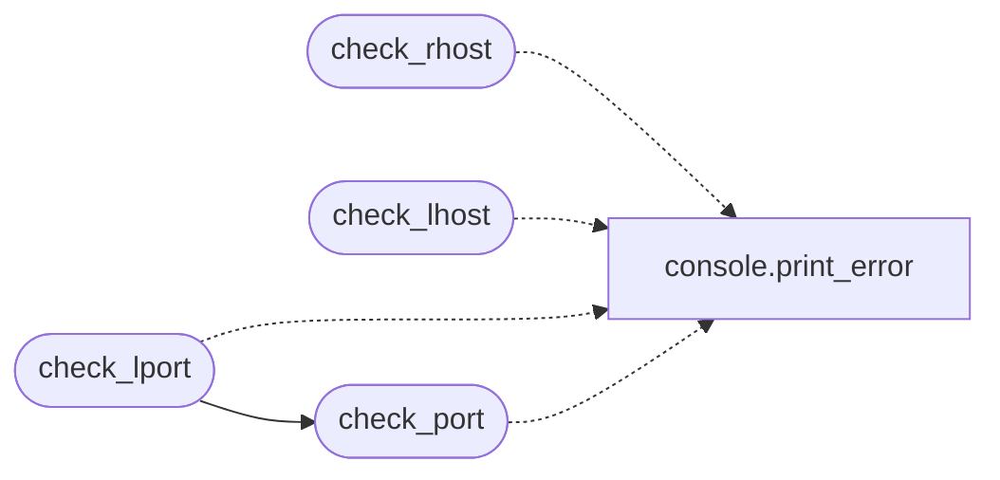

# `core.validators`

> Source: [core/validators.py:1](../../core/validators.py#L1) | language `py` | coverage 100.0% | [API index](../index.md)

Input validators for runtime configuration values.

These helpers were historically in ``utils.py`` and are imported by ~280 CLI
commands and ~80 C2 routes. They emit a coloured error message to stdout and
return ``False`` when the value is missing, so callers can short-circuit
without raising.

## Contents

- **Functions:** [`check_rhost`](#check_rhost), [`check_lhost`](#check_lhost), [`check_lport`](#check_lport), [`check_port`](#check_port)

## Call Graph

Solid arrows stay in this module, dashed arrows leave it.



## Functions

<a id="check_rhost"></a>

### `check_rhost`

`function` | [core/validators.py:26](../../core/validators.py#L26)

```python
def check_rhost(rhost: Any) -> bool
```

Return ``True`` if ``rhost`` is set, otherwise print an error and return ``False``.

**Parameters**

| Name | Type | Default | Description |
|---|---|---|---|
| `rhost` | `Any` |  |  |

**Returns:** `bool`

*Calls:* [`print_error`](core.console.py.md#print_error)

*Called by:* [`CommandAndControlMigratedCommandSet.do_msf`](cli.commands.command_and_control_migrated.py.md#commandandcontrolmigratedcommandset-do_msf), [`CommandAndControlMigratedCommandSet.do_sliver_server`](cli.commands.command_and_control_migrated.py.md#commandandcontrolmigratedcommandset-do_sliver_server), [`CredentialAccessCommandSet.do_hydra`](cli.commands.cred.py.md#credentialaccesscommandset-do_hydra), [`CredMigratedCommandSet.do_dacledit`](cli.commands.cred_migrated.py.md#credmigratedcommandset-do_dacledit), [`EnumCommandSet.do_psexec`](cli.commands.enum.py.md#enumcommandset-do_psexec), [`EnumCommandSet.do_psexec_py`](cli.commands.enum.py.md#enumcommandset-do_psexec_py), [`EnumCommandSet.do_rpcdump`](cli.commands.enum.py.md#enumcommandset-do_rpcdump), [`EnumCommandSet.do_smbclient`](cli.commands.enum.py.md#enumcommandset-do_smbclient), [`EnumCommandSet.do_smbclient_impacket`](cli.commands.enum.py.md#enumcommandset-do_smbclient_impacket), [`EnumCommandSet.do_smbclient_py`](cli.commands.enum.py.md#enumcommandset-do_smbclient_py), [`EnumCommandSet.do_smbmap`](cli.commands.enum.py.md#enumcommandset-do_smbmap), [`ExfiltrationCommandSet.do_evilwinrm`](cli.commands.exfiltration.py.md#exfiltrationcommandset-do_evilwinrm) and 49 more

---

<a id="check_lhost"></a>

### `check_lhost`

`function` | [core/validators.py:40](../../core/validators.py#L40)

```python
def check_lhost(lhost: Any) -> bool
```

Return ``True`` if ``lhost`` is set, otherwise print an error and return ``False``.

**Parameters**

| Name | Type | Default | Description |
|---|---|---|---|
| `lhost` | `Any` |  |  |

**Returns:** `bool`

*Calls:* [`print_error`](core.console.py.md#print_error)

*Called by:* [`CommandAndControlMigratedCommandSet.do_duckyspark`](cli.commands.command_and_control_migrated.py.md#commandandcontrolmigratedcommandset-do_duckyspark), [`CommandAndControlMigratedCommandSet.do_msf`](cli.commands.command_and_control_migrated.py.md#commandandcontrolmigratedcommandset-do_msf), [`CommandAndControlMigratedCommandSet.do_sliver_server`](cli.commands.command_and_control_migrated.py.md#commandandcontrolmigratedcommandset-do_sliver_server), [`EnumCommandSet.do_smbclient`](cli.commands.enum.py.md#enumcommandset-do_smbclient), [`EnumCommandSet.do_smbclient_impacket`](cli.commands.enum.py.md#enumcommandset-do_smbclient_impacket), [`EnumCommandSet.do_smbclient_py`](cli.commands.enum.py.md#enumcommandset-do_smbclient_py), [`EnumCommandSet.do_smbmap`](cli.commands.enum.py.md#enumcommandset-do_smbmap), [`ExploitCommandSet.do_download_exploit`](cli.commands.exploit.py.md#exploitcommandset-do_download_exploit), [`ExploitCommandSet.do_rev`](cli.commands.exploit.py.md#exploitcommandset-do_rev), [`ExploitCommandSet.do_wrapper`](cli.commands.exploit.py.md#exploitcommandset-do_wrapper), [`ExploitCommandSet.do_www`](cli.commands.exploit.py.md#exploitcommandset-do_www), [`ExploitMigratedCommandSet.do_cacti_exploit`](cli.commands.exploit_migrated.py.md#exploitmigratedcommandset-do_cacti_exploit) and 22 more

---

<a id="check_lport"></a>

### `check_lport`

`function` | [core/validators.py:54](../../core/validators.py#L54)

```python
def check_lport(lport: Any) -> bool
```

Return ``True`` if ``lport`` is set, otherwise print an error and return ``False``.

**Parameters**

| Name | Type | Default | Description |
|---|---|---|---|
| `lport` | `Any` |  |  |

**Returns:** `bool`

*Calls:* [`print_error`](core.console.py.md#print_error), [`check_port`](#check_port)

*Called by:* [`CommandAndControlMigratedCommandSet.do_sliver_server`](cli.commands.command_and_control_migrated.py.md#commandandcontrolmigratedcommandset-do_sliver_server), [`ExploitMigratedCommandSet.do_cacti_exploit`](cli.commands.exploit_migrated.py.md#exploitmigratedcommandset-do_cacti_exploit), [`ExploitMigratedCommandSet.do_shellshock`](cli.commands.exploit_migrated.py.md#exploitmigratedcommandset-do_shellshock), [`MobileMacOSCommandSet.do_android_apk`](cli.commands.mobile_macos.py.md#mobilemacoscommandset-do_android_apk), [`MobileMacOSCommandSet.do_macos_persist`](cli.commands.mobile_macos.py.md#mobilemacoscommandset-do_macos_persist), [`PersistMigratedCommandSet.do_backdoor_factory`](cli.commands.persist_migrated.py.md#persistmigratedcommandset-do_backdoor_factory), [`PersistMigratedCommandSet.do_veil`](cli.commands.persist_migrated.py.md#persistmigratedcommandset-do_veil), [`PwnCommandSet.do_lolbas_use`](cli.commands.pwn.py.md#pwncommandset-do_lolbas_use), [`ScanMigratedCommandSet.do_smbattack`](cli.commands.scan_migrated.py.md#scanmigratedcommandset-do_smbattack), [`C2Builder.run`](modules.c2_builder.py.md#c2builder-run)

---

<a id="check_port"></a>

### `check_port`

`function` | [core/validators.py:64](../../core/validators.py#L64)

```python
def check_port(port: Any, name: str = 'port') -> bool
```

Return ``True`` if ``port`` is a valid TCP/UDP port (1-65535).

**Parameters**

| Name | Type | Default | Description |
|---|---|---|---|
| `port` | `Any` |  |  |
| `name` | `str` | `'port'` |  |

**Returns:** `bool`

*Calls:* [`print_error`](core.console.py.md#print_error)

*Called by:* [`check_lport`](#check_lport)

---
