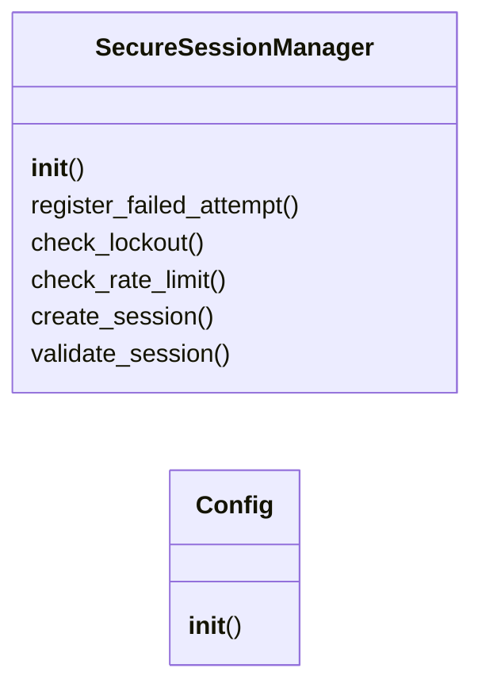
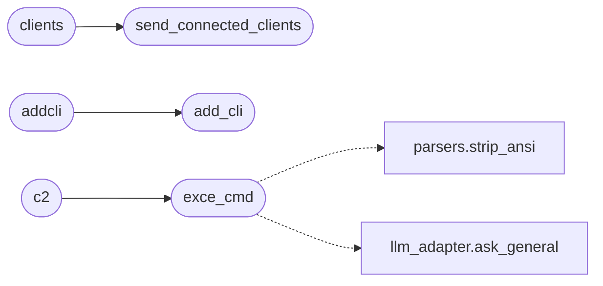

# `discord_c2`

> Source: [discord_c2.py:1](../../discord_c2.py#L1) | language `py` | coverage 0.0% | [API index](../index.md)

## Contents

- **Classes:** [`SecureSessionManager`](#securesessionmanager), [`Config`](#config)
- **Functions:** [`load_payload`](#load_payload), [`on_ready`](#on_ready), [`start`](#start), [`exce_cmd`](#exce_cmd), [`add_cli`](#add_cli), [`handle_file`](#handle_file), [`download_c2`](#download_c2), [`send_connected_clients`](#send_connected_clients), [`clients`](#clients), [`addcli`](#addcli), [`c2`](#c2)
- **Constants:** [`ENTABLEIA`](#entableia), [`SESSION_TIMEOUT`](#session_timeout), [`MAX_FAILED_ATTEMPTS`](#max_failed_attempts), [`RATE_LIMIT`](#rate_limit), [`FLASK_API_URL`](#flask_api_url)

## Type Diagram



## Call Graph

Solid arrows stay in this module, dashed arrows leave it.



## Classes

<a id="securesessionmanager"></a>

### `SecureSessionManager`

`class` | [discord_c2.py:27](../../discord_c2.py#L27)

```python
class SecureSessionManager
```

**Members**

| Member | Kind | Summary |
|---|---|---|
| [`__init__`](#securesessionmanager-__init__) | constructor |  |
| [`register_failed_attempt`](#securesessionmanager-register_failed_attempt) | method |  |
| [`check_lockout`](#securesessionmanager-check_lockout) | method |  |
| [`check_rate_limit`](#securesessionmanager-check_rate_limit) | method |  |
| [`create_session`](#securesessionmanager-create_session) | method |  |
| [`validate_session`](#securesessionmanager-validate_session) | method |  |

<a id="securesessionmanager-__init__"></a>

#### `SecureSessionManager.__init__`

`constructor` | [discord_c2.py:28](../../discord_c2.py#L28)

```python
def __init__(self)
```

<a id="securesessionmanager-register_failed_attempt"></a>

#### `SecureSessionManager.register_failed_attempt`

`method` | [discord_c2.py:33](../../discord_c2.py#L33)

```python
def register_failed_attempt(self, user_id: int)
```

**Parameters**

| Name | Type | Default | Description |
|---|---|---|---|
| `user_id` | `int` |  |  |

<a id="securesessionmanager-check_lockout"></a>

#### `SecureSessionManager.check_lockout`

`method` | [discord_c2.py:40](../../discord_c2.py#L40)

```python
def check_lockout(self, user_id: int) -> bool
```

**Parameters**

| Name | Type | Default | Description |
|---|---|---|---|
| `user_id` | `int` |  |  |

**Returns:** `bool`

<a id="securesessionmanager-check_rate_limit"></a>

#### `SecureSessionManager.check_rate_limit`

`method` | [discord_c2.py:49](../../discord_c2.py#L49)

```python
def check_rate_limit(self, user_id: int) -> bool
```

**Parameters**

| Name | Type | Default | Description |
|---|---|---|---|
| `user_id` | `int` |  |  |

**Returns:** `bool`

<a id="securesessionmanager-create_session"></a>

#### `SecureSessionManager.create_session`

`method` | [discord_c2.py:62](../../discord_c2.py#L62)

```python
def create_session(self, user_id: int, client_id: str)
```

**Parameters**

| Name | Type | Default | Description |
|---|---|---|---|
| `user_id` | `int` |  |  |
| `client_id` | `str` |  |  |

<a id="securesessionmanager-validate_session"></a>

#### `SecureSessionManager.validate_session`

`method` | [discord_c2.py:70](../../discord_c2.py#L70)

```python
def validate_session(self, user_id: int) -> bool
```

**Parameters**

| Name | Type | Default | Description |
|---|---|---|---|
| `user_id` | `int` |  |  |

**Returns:** `bool`

---

<a id="config"></a>

### `Config`

`class` | [discord_c2.py:86](../../discord_c2.py#L86)

```python
class Config
```

**Members**

| Member | Kind | Summary |
|---|---|---|
| [`__init__`](#config-__init__) | constructor |  |

<a id="config-__init__"></a>

#### `Config.__init__`

`constructor` | [discord_c2.py:87](../../discord_c2.py#L87)

```python
def __init__(self, config_dict)
```

**Parameters**

| Name | Type | Default | Description |
|---|---|---|---|
| `config_dict` |  |  |  |

---

## Functions

<a id="load_payload"></a>

### `load_payload`

`function` | [discord_c2.py:96](../../discord_c2.py#L96)

```python
def load_payload()
```

---

<a id="on_ready"></a>

### `on_ready`

`function` `async` | [discord_c2.py:103](../../discord_c2.py#L103)

Decorators: `@bot.event`

```python
async def on_ready()
```

---

<a id="start"></a>

### `start`

`function` `async` | [discord_c2.py:108](../../discord_c2.py#L108)

Decorators: `@bot.command()`

```python
async def start(ctx, *, secret: str = None)
```

**Parameters**

| Name | Type | Default | Description |
|---|---|---|---|
| `ctx` |  |  |  |
| `secret` | `str` | `None` |  |

---

<a id="exce_cmd"></a>

### `exce_cmd`

`function` `async` | [discord_c2.py:130](../../discord_c2.py#L130)

Decorators: `@bot.command()`

```python
async def exce_cmd(ctx, *, command: str)
```

**Parameters**

| Name | Type | Default | Description |
|---|---|---|---|
| `ctx` |  |  |  |
| `command` | `str` |  |  |

*Calls:* [`strip_ansi`](core.parsers.py.md#strip_ansi), [`ask_general`](modules.llm_adapter.py.md#ask_general)

*Called by:* [`c2`](#c2)

---

<a id="add_cli"></a>

### `add_cli`

`function` `async` | [discord_c2.py:206](../../discord_c2.py#L206)

Decorators: `@bot.command()`

```python
async def add_cli(ctx, new_client_id: str)
```

**Parameters**

| Name | Type | Default | Description |
|---|---|---|---|
| `ctx` |  |  |  |
| `new_client_id` | `str` |  |  |

*Called by:* [`addcli`](#addcli)

---

<a id="handle_file"></a>

### `handle_file`

`function` `async` | [discord_c2.py:216](../../discord_c2.py#L216)

Decorators: `@bot.command()`

```python
async def handle_file(ctx)
```

**Parameters**

| Name | Type | Default | Description |
|---|---|---|---|
| `ctx` |  |  |  |

---

<a id="download_c2"></a>

### `download_c2`

`function` `async` | [discord_c2.py:245](../../discord_c2.py#L245)

Decorators: `@bot.command()`

```python
async def download_c2(ctx, client_id: str, file_name: str)
```

**Parameters**

| Name | Type | Default | Description |
|---|---|---|---|
| `ctx` |  |  |  |
| `client_id` | `str` |  |  |
| `file_name` | `str` |  |  |

---

<a id="send_connected_clients"></a>

### `send_connected_clients`

`function` `async` | [discord_c2.py:256](../../discord_c2.py#L256)

Decorators: `@bot.command()`

```python
async def send_connected_clients(ctx)
```

**Parameters**

| Name | Type | Default | Description |
|---|---|---|---|
| `ctx` |  |  |  |

*Called by:* [`clients`](#clients)

---

<a id="clients"></a>

### `clients`

`function` `async` | [discord_c2.py:273](../../discord_c2.py#L273)

Decorators: `@bot.command()`

```python
async def clients(ctx)
```

**Parameters**

| Name | Type | Default | Description |
|---|---|---|---|
| `ctx` |  |  |  |

*Calls:* [`send_connected_clients`](#send_connected_clients)

---

<a id="addcli"></a>

### `addcli`

`function` `async` | [discord_c2.py:278](../../discord_c2.py#L278)

Decorators: `@bot.command()`

```python
async def addcli(ctx, new_client_id: str)
```

**Parameters**

| Name | Type | Default | Description |
|---|---|---|---|
| `ctx` |  |  |  |
| `new_client_id` | `str` |  |  |

*Calls:* [`add_cli`](#add_cli)

---

<a id="c2"></a>

### `c2`

`function` `async` | [discord_c2.py:283](../../discord_c2.py#L283)

Decorators: `@bot.command()`

```python
async def c2(ctx, *, command: str)
```

**Parameters**

| Name | Type | Default | Description |
|---|---|---|---|
| `ctx` |  |  |  |
| `command` | `str` |  |  |

*Calls:* [`exce_cmd`](#exce_cmd)

---

## Constants

<a id="entableia"></a>

### `ENTABLEIA`

`constant` | [discord_c2.py:292](../../discord_c2.py#L292)

```python
ENTABLEIA = config.enable_ia
```

---

<a id="session_timeout"></a>

### `SESSION_TIMEOUT`

`constant` | [discord_c2.py:299](../../discord_c2.py#L299)

```python
SESSION_TIMEOUT = 1800
```

---

<a id="max_failed_attempts"></a>

### `MAX_FAILED_ATTEMPTS`

`constant` | [discord_c2.py:300](../../discord_c2.py#L300)

```python
MAX_FAILED_ATTEMPTS = 3
```

---

<a id="rate_limit"></a>

### `RATE_LIMIT`

`constant` | [discord_c2.py:301](../../discord_c2.py#L301)

```python
RATE_LIMIT = 5
```

---

<a id="flask_api_url"></a>

### `FLASK_API_URL`

`constant` | [discord_c2.py:304](../../discord_c2.py#L304)

```python
FLASK_API_URL = f'https://{lhost}:{c2_port}/get_connected_clients'
```

---
