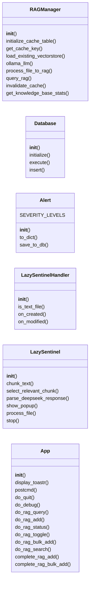
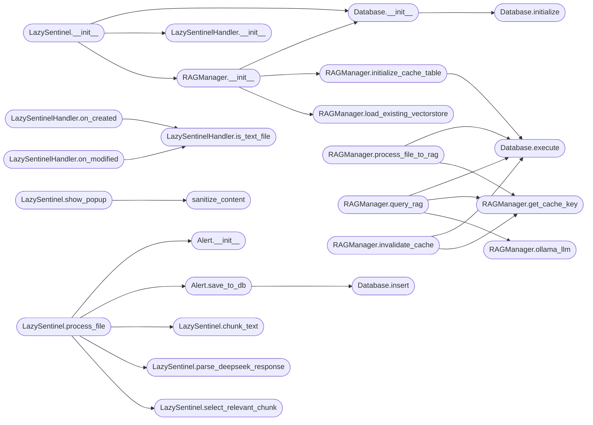

# `lazy_sentinel4`

> Source: [lazy_sentinel4.py:1](../../lazy_sentinel4.py#L1) | language `py` | coverage 8.3% | [API index](../index.md)

## Contents

- **Classes:** [`RAGManager`](#ragmanager), [`Database`](#database), [`Alert`](#alert), [`LazySentinelHandler`](#lazysentinelhandler), [`LazySentinel`](#lazysentinel), [`App`](#app)
- **Functions:** [`sanitize_content`](#sanitize_content)
- **Constants:** [`DEEPSEEK_API_URL`](#deepseek_api_url), [`DEEPSEEK_MODEL`](#deepseek_model), [`KNOWLEDGE_BASE_DIR`](#knowledge_base_dir)

## Type Diagram



## Call Graph

Solid arrows stay in this module, dashed arrows leave it.



## Classes

<a id="ragmanager"></a>

### `RAGManager`

`class` | [lazy_sentinel4.py:56](../../lazy_sentinel4.py#L56)

```python
class RAGManager
```

Manages RAG functionality with CAG caching for document processing and querying.

**Members**

| Member | Kind | Summary |
|---|---|---|
| [`__init__`](#ragmanager-__init__) | constructor |  |
| [`initialize_cache_table`](#ragmanager-initialize_cache_table) | method |  |
| [`get_cache_key`](#ragmanager-get_cache_key) | method |  |
| [`load_existing_vectorstore`](#ragmanager-load_existing_vectorstore) | method |  |
| [`ollama_llm`](#ragmanager-ollama_llm) | method |  |
| [`process_file_to_rag`](#ragmanager-process_file_to_rag) | method |  |
| [`query_rag`](#ragmanager-query_rag) | method |  |
| [`invalidate_cache`](#ragmanager-invalidate_cache) | method |  |
| [`get_knowledge_base_stats`](#ragmanager-get_knowledge_base_stats) | method |  |

<a id="ragmanager-__init__"></a>

#### `RAGManager.__init__`

`constructor` | [lazy_sentinel4.py:59](../../lazy_sentinel4.py#L59)

```python
def __init__(self, model_name: str = DEEPSEEK_MODEL, cache_size: int = 1000)
```

**Parameters**

| Name | Type | Default | Description |
|---|---|---|---|
| `model_name` | `str` | `DEEPSEEK_MODEL` |  |
| `cache_size` | `int` | `1000` |  |

*Calls:* [`Database.__init__`](#database-__init__), [`RAGManager.initialize_cache_table`](#ragmanager-initialize_cache_table), [`RAGManager.load_existing_vectorstore`](#ragmanager-load_existing_vectorstore)

*Called by:* [`LazySentinel.__init__`](#lazysentinel-__init__)

<a id="ragmanager-initialize_cache_table"></a>

#### `RAGManager.initialize_cache_table`

`method` | [lazy_sentinel4.py:71](../../lazy_sentinel4.py#L71)

```python
def initialize_cache_table(self)
```

*Calls:* [`Database.execute`](#database-execute)

*Called by:* [`RAGManager.__init__`](#ragmanager-__init__)

<a id="ragmanager-get_cache_key"></a>

#### `RAGManager.get_cache_key`

`method` | [lazy_sentinel4.py:83](../../lazy_sentinel4.py#L83)

```python
def get_cache_key(self, content: str) -> str
```

**Parameters**

| Name | Type | Default | Description |
|---|---|---|---|
| `content` | `str` |  |  |

**Returns:** `str`

*Called by:* [`RAGManager.invalidate_cache`](#ragmanager-invalidate_cache), [`RAGManager.process_file_to_rag`](#ragmanager-process_file_to_rag), [`RAGManager.query_rag`](#ragmanager-query_rag)

<a id="ragmanager-load_existing_vectorstore"></a>

#### `RAGManager.load_existing_vectorstore`

`method` | [lazy_sentinel4.py:86](../../lazy_sentinel4.py#L86)

```python
def load_existing_vectorstore(self)
```

*Called by:* [`RAGManager.__init__`](#ragmanager-__init__)

<a id="ragmanager-ollama_llm"></a>

#### `RAGManager.ollama_llm`

`method` | [lazy_sentinel4.py:99](../../lazy_sentinel4.py#L99)

```python
def ollama_llm(self, question: str, context: str) -> str
```

**Parameters**

| Name | Type | Default | Description |
|---|---|---|---|
| `question` | `str` |  |  |
| `context` | `str` |  |  |

**Returns:** `str`

*Called by:* [`RAGManager.query_rag`](#ragmanager-query_rag)

<a id="ragmanager-process_file_to_rag"></a>

#### `RAGManager.process_file_to_rag`

`method` | [lazy_sentinel4.py:113](../../lazy_sentinel4.py#L113)

```python
def process_file_to_rag(self, file_path: Path) -> bool
```

**Parameters**

| Name | Type | Default | Description |
|---|---|---|---|
| `file_path` | `Path` |  |  |

**Returns:** `bool`

*Calls:* [`Database.execute`](#database-execute), [`RAGManager.get_cache_key`](#ragmanager-get_cache_key)

*Called by:* [`App.do_rag_add`](#app-do_rag_add), [`App.do_rag_bulk_add`](#app-do_rag_bulk_add), [`LazySentinel.process_file`](#lazysentinel-process_file)

<a id="ragmanager-query_rag"></a>

#### `RAGManager.query_rag`

`method` | [lazy_sentinel4.py:153](../../lazy_sentinel4.py#L153)

```python
def query_rag(self, question: str) -> str
```

**Parameters**

| Name | Type | Default | Description |
|---|---|---|---|
| `question` | `str` |  |  |

**Returns:** `str`

*Calls:* [`Database.execute`](#database-execute), [`RAGManager.get_cache_key`](#ragmanager-get_cache_key), [`RAGManager.ollama_llm`](#ragmanager-ollama_llm)

*Called by:* [`App.do_rag_query`](#app-do_rag_query)

<a id="ragmanager-invalidate_cache"></a>

#### `RAGManager.invalidate_cache`

`method` | [lazy_sentinel4.py:175](../../lazy_sentinel4.py#L175)

```python
def invalidate_cache(self, file_path: Path)
```

**Parameters**

| Name | Type | Default | Description |
|---|---|---|---|
| `file_path` | `Path` |  |  |

*Calls:* [`Database.execute`](#database-execute), [`RAGManager.get_cache_key`](#ragmanager-get_cache_key)

*Called by:* [`LazySentinel.process_file`](#lazysentinel-process_file)

<a id="ragmanager-get_knowledge_base_stats"></a>

#### `RAGManager.get_knowledge_base_stats`

`method` | [lazy_sentinel4.py:189](../../lazy_sentinel4.py#L189)

```python
def get_knowledge_base_stats(self) -> dict
```

**Returns:** `dict`

*Called by:* [`App.do_rag_status`](#app-do_rag_status)

---

<a id="database"></a>

### `Database`

`class` | [lazy_sentinel4.py:212](../../lazy_sentinel4.py#L212)

```python
class Database
```

**Members**

| Member | Kind | Summary |
|---|---|---|
| [`__init__`](#database-__init__) | constructor |  |
| [`initialize`](#database-initialize) | method |  |
| [`execute`](#database-execute) | method |  |
| [`insert`](#database-insert) | method |  |

<a id="database-__init__"></a>

#### `Database.__init__`

`constructor` | [lazy_sentinel4.py:213](../../lazy_sentinel4.py#L213)

```python
def __init__(self, db_path: str)
```

**Parameters**

| Name | Type | Default | Description |
|---|---|---|---|
| `db_path` | `str` |  |  |

*Calls:* [`Database.initialize`](#database-initialize)

*Called by:* [`LazySentinel.__init__`](#lazysentinel-__init__), [`RAGManager.__init__`](#ragmanager-__init__)

<a id="database-initialize"></a>

#### `Database.initialize`

`method` | [lazy_sentinel4.py:217](../../lazy_sentinel4.py#L217)

```python
def initialize(self) -> None
```

*Called by:* [`Database.__init__`](#database-__init__)

<a id="database-execute"></a>

#### `Database.execute`

`method` | [lazy_sentinel4.py:241](../../lazy_sentinel4.py#L241)

```python
def execute(self, query: str, params: tuple = ()) -> list[sqlite3.Row]
```

**Parameters**

| Name | Type | Default | Description |
|---|---|---|---|
| `query` | `str` |  |  |
| `params` | `tuple` | `()` |  |

**Returns:** `list[sqlite3.Row]`

*Called by:* [`App.do_debug`](#app-do_debug), [`RAGManager.initialize_cache_table`](#ragmanager-initialize_cache_table), [`RAGManager.invalidate_cache`](#ragmanager-invalidate_cache), [`RAGManager.process_file_to_rag`](#ragmanager-process_file_to_rag), [`RAGManager.query_rag`](#ragmanager-query_rag)

<a id="database-insert"></a>

#### `Database.insert`

`method` | [lazy_sentinel4.py:253](../../lazy_sentinel4.py#L253)

```python
def insert(self, query: str, params: tuple = ()) -> int | None
```

**Parameters**

| Name | Type | Default | Description |
|---|---|---|---|
| `query` | `str` |  |  |
| `params` | `tuple` | `()` |  |

**Returns:** `int | None`

*Called by:* [`Alert.save_to_db`](#alert-save_to_db)

---

<a id="alert"></a>

### `Alert`

`class` | [lazy_sentinel4.py:269](../../lazy_sentinel4.py#L269)

```python
class Alert
```

**Attributes**

| Name | Type | Default | Description |
|---|---|---|---|
| [`SEVERITY_LEVELS`](#alert-severity_levels) |  | `['info', 'low', 'medium', 'high', 'critical']` |  |

**Members**

| Member | Kind | Summary |
|---|---|---|
| [`__init__`](#alert-__init__) | constructor |  |
| [`to_dict`](#alert-to_dict) | method |  |
| [`save_to_db`](#alert-save_to_db) | method |  |

<a id="alert-__init__"></a>

#### `Alert.__init__`

`constructor` | [lazy_sentinel4.py:272](../../lazy_sentinel4.py#L272)

```python
def __init__(self, alert_type: str, details: dict, severity: str = 'medium')
```

**Parameters**

| Name | Type | Default | Description |
|---|---|---|---|
| `alert_type` | `str` |  |  |
| `details` | `dict` |  |  |
| `severity` | `str` | `'medium'` |  |

*Called by:* [`LazySentinel.process_file`](#lazysentinel-process_file)

<a id="alert-to_dict"></a>

#### `Alert.to_dict`

`method` | [lazy_sentinel4.py:278](../../lazy_sentinel4.py#L278)

```python
def to_dict(self) -> dict
```

**Returns:** `dict`

<a id="alert-save_to_db"></a>

#### `Alert.save_to_db`

`method` | [lazy_sentinel4.py:286](../../lazy_sentinel4.py#L286)

```python
def save_to_db(self, db: Database) -> int | None
```

**Parameters**

| Name | Type | Default | Description |
|---|---|---|---|
| `db` | `Database` |  |  |

**Returns:** `int | None`

*Calls:* [`Database.insert`](#database-insert)

*Called by:* [`LazySentinel.process_file`](#lazysentinel-process_file)

---

<a id="lazysentinelhandler"></a>

### `LazySentinelHandler`

`class` | [lazy_sentinel4.py:300](../../lazy_sentinel4.py#L300)

```python
class LazySentinelHandler(FileSystemEventHandler)
```

Bases: `FileSystemEventHandler`

**Members**

| Member | Kind | Summary |
|---|---|---|
| [`__init__`](#lazysentinelhandler-__init__) | constructor |  |
| [`is_text_file`](#lazysentinelhandler-is_text_file) | method |  |
| [`on_created`](#lazysentinelhandler-on_created) | method |  |
| [`on_modified`](#lazysentinelhandler-on_modified) | method |  |

<a id="lazysentinelhandler-__init__"></a>

#### `LazySentinelHandler.__init__`

`constructor` | [lazy_sentinel4.py:301](../../lazy_sentinel4.py#L301)

```python
def __init__(self, lazysentinel)
```

**Parameters**

| Name | Type | Default | Description |
|---|---|---|---|
| `lazysentinel` |  |  |  |

*Called by:* [`LazySentinel.__init__`](#lazysentinel-__init__)

<a id="lazysentinelhandler-is_text_file"></a>

#### `LazySentinelHandler.is_text_file`

`method` | [lazy_sentinel4.py:304](../../lazy_sentinel4.py#L304)

```python
def is_text_file(self, file_path: Path) -> bool
```

**Parameters**

| Name | Type | Default | Description |
|---|---|---|---|
| `file_path` | `Path` |  |  |

**Returns:** `bool`

*Called by:* [`LazySentinelHandler.on_created`](#lazysentinelhandler-on_created), [`LazySentinelHandler.on_modified`](#lazysentinelhandler-on_modified)

<a id="lazysentinelhandler-on_created"></a>

#### `LazySentinelHandler.on_created`

`method` | [lazy_sentinel4.py:314](../../lazy_sentinel4.py#L314)

```python
def on_created(self, event)
```

**Parameters**

| Name | Type | Default | Description |
|---|---|---|---|
| `event` |  |  |  |

*Calls:* [`LazySentinelHandler.is_text_file`](#lazysentinelhandler-is_text_file)

<a id="lazysentinelhandler-on_modified"></a>

#### `LazySentinelHandler.on_modified`

`method` | [lazy_sentinel4.py:326](../../lazy_sentinel4.py#L326)

```python
def on_modified(self, event)
```

**Parameters**

| Name | Type | Default | Description |
|---|---|---|---|
| `event` |  |  |  |

*Calls:* [`LazySentinelHandler.is_text_file`](#lazysentinelhandler-is_text_file)

---

<a id="lazysentinel"></a>

### `LazySentinel`

`class` | [lazy_sentinel4.py:338](../../lazy_sentinel4.py#L338)

```python
class LazySentinel
```

**Members**

| Member | Kind | Summary |
|---|---|---|
| [`__init__`](#lazysentinel-__init__) | constructor |  |
| [`chunk_text`](#lazysentinel-chunk_text) | method |  |
| [`select_relevant_chunk`](#lazysentinel-select_relevant_chunk) | method |  |
| [`parse_deepseek_response`](#lazysentinel-parse_deepseek_response) | method |  |
| [`show_popup`](#lazysentinel-show_popup) | method |  |
| [`process_file`](#lazysentinel-process_file) | method |  |
| [`stop`](#lazysentinel-stop) | method |  |

<a id="lazysentinel-__init__"></a>

#### `LazySentinel.__init__`

`constructor` | [lazy_sentinel4.py:339](../../lazy_sentinel4.py#L339)

```python
def __init__(self, app, popup_queue, watch_dir='sessions', excluded_files=None, min_file_size=10)
```

**Parameters**

| Name | Type | Default | Description |
|---|---|---|---|
| `app` |  |  |  |
| `popup_queue` |  |  |  |
| `watch_dir` |  | `'sessions'` |  |
| `excluded_files` |  | `None` |  |
| `min_file_size` |  | `10` |  |

*Calls:* [`Database.__init__`](#database-__init__), [`LazySentinelHandler.__init__`](#lazysentinelhandler-__init__), [`RAGManager.__init__`](#ragmanager-__init__)

*Called by:* [`App.__init__`](#app-__init__)

<a id="lazysentinel-chunk_text"></a>

#### `LazySentinel.chunk_text`

`method` | [lazy_sentinel4.py:359](../../lazy_sentinel4.py#L359)

```python
def chunk_text(self, text, chunk_size)
```

**Parameters**

| Name | Type | Default | Description |
|---|---|---|---|
| `text` |  |  |  |
| `chunk_size` |  |  |  |

*Called by:* [`LazySentinel.process_file`](#lazysentinel-process_file)

<a id="lazysentinel-select_relevant_chunk"></a>

#### `LazySentinel.select_relevant_chunk`

`method` | [lazy_sentinel4.py:362](../../lazy_sentinel4.py#L362)

```python
def select_relevant_chunk(self, file_content, chunks)
```

**Parameters**

| Name | Type | Default | Description |
|---|---|---|---|
| `file_content` |  |  |  |
| `chunks` |  |  |  |

*Called by:* [`LazySentinel.process_file`](#lazysentinel-process_file)

<a id="lazysentinel-parse_deepseek_response"></a>

#### `LazySentinel.parse_deepseek_response`

`method` | [lazy_sentinel4.py:376](../../lazy_sentinel4.py#L376)

```python
def parse_deepseek_response(self, response_text: str) -> dict
```

**Parameters**

| Name | Type | Default | Description |
|---|---|---|---|
| `response_text` | `str` |  |  |

**Returns:** `dict`

*Called by:* [`LazySentinel.process_file`](#lazysentinel-process_file)

<a id="lazysentinel-show_popup"></a>

#### `LazySentinel.show_popup`

`method` | [lazy_sentinel4.py:402](../../lazy_sentinel4.py#L402)

```python
def show_popup(self, file_name: str, relevant_info: str, commands: list[str], details: str)
```

**Parameters**

| Name | Type | Default | Description |
|---|---|---|---|
| `file_name` | `str` |  |  |
| `relevant_info` | `str` |  |  |
| `commands` | `list[str]` |  |  |
| `details` | `str` |  |  |

*Calls:* [`sanitize_content`](#sanitize_content)

*Called by:* [`LazySentinel.process_file`](#lazysentinel-process_file)

<a id="lazysentinel-process_file"></a>

#### `LazySentinel.process_file`

`method` | [lazy_sentinel4.py:420](../../lazy_sentinel4.py#L420)

```python
def process_file(self, file_path)
```

**Parameters**

| Name | Type | Default | Description |
|---|---|---|---|
| `file_path` |  |  |  |

*Calls:* [`Alert.__init__`](#alert-__init__), [`Alert.save_to_db`](#alert-save_to_db), [`LazySentinel.chunk_text`](#lazysentinel-chunk_text), [`LazySentinel.parse_deepseek_response`](#lazysentinel-parse_deepseek_response), [`LazySentinel.select_relevant_chunk`](#lazysentinel-select_relevant_chunk), [`LazySentinel.show_popup`](#lazysentinel-show_popup), [`RAGManager.invalidate_cache`](#ragmanager-invalidate_cache), [`RAGManager.process_file_to_rag`](#ragmanager-process_file_to_rag)

<a id="lazysentinel-stop"></a>

#### `LazySentinel.stop`

`method` | [lazy_sentinel4.py:536](../../lazy_sentinel4.py#L536)

```python
def stop(self)
```

*Called by:* [`App.do_quit`](#app-do_quit)

---

<a id="app"></a>

### `App`

`class` | [lazy_sentinel4.py:542](../../lazy_sentinel4.py#L542)

```python
class App(cmd2.Cmd)
```

Bases: `cmd2.Cmd`

Subclasses: [`LazyOwnDashboard`](cli.dashboard_tui.py.md#lazyowndashboard), [`LazyMonitorApp`](cli.lazy_monitor.py.md#lazymonitorapp), [`LazyOrchestratorApp`](cli.lazy_orchestrator.py.md#lazyorchestratorapp), [`MarketplaceConfigApp`](cli.marketplace_config.py.md#marketplaceconfigapp), [`PurpleDashboard`](cli.purple_tui.py.md#purpledashboard), [`ReverseShellApp`](modules.kivi.py.md#reverseshellapp), [`LazyOwnTUI`](poc_tui.app.py.md#lazyowntui)

**Members**

| Member | Kind | Summary |
|---|---|---|
| [`__init__`](#app-__init__) | constructor |  |
| [`display_toastr`](#app-display_toastr) | method | Display the sentinel popup through the shared toast bus panel. |
| [`postcmd`](#app-postcmd) | method | Check the popup queue after each command and display toastr notifications. |
| [`do_quit`](#app-do_quit) | method |  |
| [`do_debug`](#app-do_debug) | method |  |
| [`do_rag_query`](#app-do_rag_query) | method |  |
| [`do_rag_add`](#app-do_rag_add) | method |  |
| [`do_rag_status`](#app-do_rag_status) | method |  |
| [`do_rag_toggle`](#app-do_rag_toggle) | method |  |
| [`do_rag_bulk_add`](#app-do_rag_bulk_add) | method |  |
| [`do_rag_search`](#app-do_rag_search) | method |  |
| [`complete_rag_add`](#app-complete_rag_add) | method |  |
| [`complete_rag_bulk_add`](#app-complete_rag_bulk_add) | method |  |

<a id="app-__init__"></a>

#### `App.__init__`

`constructor` | [lazy_sentinel4.py:543](../../lazy_sentinel4.py#L543)

```python
def __init__(self)
```

*Calls:* [`LazySentinel.__init__`](#lazysentinel-__init__)

<a id="app-display_toastr"></a>

#### `App.display_toastr`

`method` | [lazy_sentinel4.py:557](../../lazy_sentinel4.py#L557)

```python
def display_toastr(self, file_name: str, relevant_info: str, commands: str, details: str, severity: str = 'info', duration: int = 3)
```

Display the sentinel popup through the shared toast bus panel.

**Parameters**

| Name | Type | Default | Description |
|---|---|---|---|
| `file_name` | `str` |  |  |
| `relevant_info` | `str` |  |  |
| `commands` | `str` |  |  |
| `details` | `str` |  |  |
| `severity` | `str` | `'info'` |  |
| `duration` | `int` | `3` |  |

*Calls:* [`sentinel_toast_panel`](cli.toast_bus.py.md#sentinel_toast_panel)

*Called by:* [`App.postcmd`](#app-postcmd)

<a id="app-postcmd"></a>

#### `App.postcmd`

`method` | [lazy_sentinel4.py:567](../../lazy_sentinel4.py#L567)

```python
def postcmd(self, stop, line)
```

Check the popup queue after each command and display toastr notifications.

**Parameters**

| Name | Type | Default | Description |
|---|---|---|---|
| `stop` |  |  |  |
| `line` |  |  |  |

*Calls:* [`App.display_toastr`](#app-display_toastr)

<a id="app-do_quit"></a>

#### `App.do_quit`

`method` | [lazy_sentinel4.py:591](../../lazy_sentinel4.py#L591)

```python
def do_quit(self, arg)
```

**Parameters**

| Name | Type | Default | Description |
|---|---|---|---|
| `arg` |  |  |  |

*Calls:* [`LazySentinel.stop`](#lazysentinel-stop)

<a id="app-do_debug"></a>

#### `App.do_debug`

`method` | [lazy_sentinel4.py:595](../../lazy_sentinel4.py#L595)

```python
def do_debug(self, arg)
```

**Parameters**

| Name | Type | Default | Description |
|---|---|---|---|
| `arg` |  |  |  |

*Calls:* [`Database.execute`](#database-execute)

<a id="app-do_rag_query"></a>

#### `App.do_rag_query`

`method` | [lazy_sentinel4.py:604](../../lazy_sentinel4.py#L604)

```python
def do_rag_query(self, arg)
```

**Parameters**

| Name | Type | Default | Description |
|---|---|---|---|
| `arg` |  |  |  |

*Calls:* [`RAGManager.query_rag`](#ragmanager-query_rag)

<a id="app-do_rag_add"></a>

#### `App.do_rag_add`

`method` | [lazy_sentinel4.py:612](../../lazy_sentinel4.py#L612)

```python
def do_rag_add(self, arg)
```

**Parameters**

| Name | Type | Default | Description |
|---|---|---|---|
| `arg` |  |  |  |

*Calls:* [`RAGManager.process_file_to_rag`](#ragmanager-process_file_to_rag)

<a id="app-do_rag_status"></a>

#### `App.do_rag_status`

`method` | [lazy_sentinel4.py:627](../../lazy_sentinel4.py#L627)

```python
def do_rag_status(self, arg)
```

**Parameters**

| Name | Type | Default | Description |
|---|---|---|---|
| `arg` |  |  |  |

*Calls:* [`RAGManager.get_knowledge_base_stats`](#ragmanager-get_knowledge_base_stats)

<a id="app-do_rag_toggle"></a>

#### `App.do_rag_toggle`

`method` | [lazy_sentinel4.py:634](../../lazy_sentinel4.py#L634)

```python
def do_rag_toggle(self, arg)
```

**Parameters**

| Name | Type | Default | Description |
|---|---|---|---|
| `arg` |  |  |  |

<a id="app-do_rag_bulk_add"></a>

#### `App.do_rag_bulk_add`

`method` | [lazy_sentinel4.py:639](../../lazy_sentinel4.py#L639)

```python
def do_rag_bulk_add(self, arg)
```

**Parameters**

| Name | Type | Default | Description |
|---|---|---|---|
| `arg` |  |  |  |

*Calls:* [`RAGManager.process_file_to_rag`](#ragmanager-process_file_to_rag)

<a id="app-do_rag_search"></a>

#### `App.do_rag_search`

`method` | [lazy_sentinel4.py:658](../../lazy_sentinel4.py#L658)

```python
def do_rag_search(self, arg)
```

**Parameters**

| Name | Type | Default | Description |
|---|---|---|---|
| `arg` |  |  |  |

<a id="app-complete_rag_add"></a>

#### `App.complete_rag_add`

`method` | [lazy_sentinel4.py:679](../../lazy_sentinel4.py#L679)

```python
def complete_rag_add(self, text, line, begidx, endidx)
```

**Parameters**

| Name | Type | Default | Description |
|---|---|---|---|
| `text` |  |  |  |
| `line` |  |  |  |
| `begidx` |  |  |  |
| `endidx` |  |  |  |

<a id="app-complete_rag_bulk_add"></a>

#### `App.complete_rag_bulk_add`

`method` | [lazy_sentinel4.py:686](../../lazy_sentinel4.py#L686)

```python
def complete_rag_bulk_add(self, text, line, begidx, endidx)
```

**Parameters**

| Name | Type | Default | Description |
|---|---|---|---|
| `text` |  |  |  |
| `line` |  |  |  |
| `begidx` |  |  |  |
| `endidx` |  |  |  |

---

## Functions

<a id="sanitize_content"></a>

### `sanitize_content`

`function` | [lazy_sentinel4.py:45](../../lazy_sentinel4.py#L45)

```python
def sanitize_content(text: str) -> str
```

Sanitize text to ensure it's safe for rendering.

**Parameters**

| Name | Type | Default | Description |
|---|---|---|---|
| `text` | `str` |  |  |

**Returns:** `str`

*Called by:* [`LazySentinel.show_popup`](#lazysentinel-show_popup)

---

## Constants

<a id="deepseek_api_url"></a>

### `DEEPSEEK_API_URL`

`constant` | [lazy_sentinel4.py:40](../../lazy_sentinel4.py#L40)

```python
DEEPSEEK_API_URL = 'http://localhost:11434/api/generate'
```

---

<a id="deepseek_model"></a>

### `DEEPSEEK_MODEL`

`constant` | [lazy_sentinel4.py:41](../../lazy_sentinel4.py#L41)

```python
DEEPSEEK_MODEL = 'deepseek-r1:1.5b'
```

---

<a id="knowledge_base_dir"></a>

### `KNOWLEDGE_BASE_DIR`

`constant` | [lazy_sentinel4.py:42](../../lazy_sentinel4.py#L42)

```python
KNOWLEDGE_BASE_DIR = './persistent_chroma_db'
```

---
