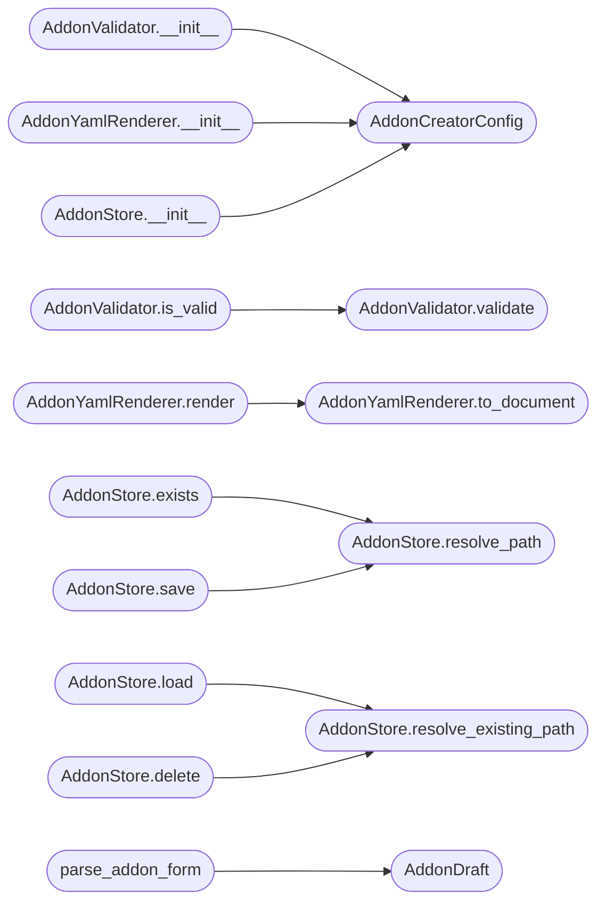

# `lazyc2.addon_creator`

> Source: [lazyc2/addon_creator.py:1](../../lazyc2/addon_creator.py#L1) | language `py` | coverage 96.2% | [API index](../index.md)

LazyAddon creator contract for the LazyOwn C2 web interface.

Single source of truth for authoring ``lazyaddons/*.yaml`` files from the
``/addons/create`` form shipped with ``lazyc2.py``. The contract covers
the full lifecycle: form parsing, validation, YAML rendering, and safe
persistence, so the CLI loader in ``lazyown.py`` can register the
resulting file as a first-class shell command.

Contracts:
    - AddonCreatorConfig: centralised constants and schema options
    - ParamSpec: immutable value object for one addon parameter
    - AddonDraft: mutable form state collected by the web layer
    - ValidationIssue: one field-specific validation finding
    - AddonValidationError: raised when a draft is not persistable
    - AddonValidator: pure validation returning field-specific issues
    - AddonYamlRenderer: renders an AddonDraft as canonical addon YAML
    - AddonStore: path-safe, atomic persistence inside the addons directory
    - parse_addon_form: adapts Flask form data into an AddonDraft

Design (SOLID):
    - Single Responsibility: validation, rendering, and persistence are
      separate collaborators, each with one reason to change
    - Open/Closed: new categories, OS values, or triggers extend the
      config constants without touching behaviour
    - Liskov: parse_addon_form accepts any Mapping, Flask MultiDict
      included, and every collaborator is independently replaceable
    - Interface Segregation: the Flask blueprint consumes only the small
      public surface below, never internal state
    - Dependency Inversion: the web layer depends on this contract,
      never the other way around

Security invariants:
    - Addon names pass a strict whitelist regex, so path traversal
      through the generated filename is impossible by construction
    - AddonStore re-checks realpath containment against the addons
      directory as defence in depth before any read, write, or delete
    - Every write is atomic (temp file plus os.replace) so an aborted
      request can never leave a half-written addon behind
    - Command placeholder tokens are validated against declared params
      and known payload.json keys so a typo cannot ship silently

Usage:
    from lazyc2.addon_creator import (
        AddonStore,
        AddonValidator,
        AddonYamlRenderer,
        parse_addon_form,
    )

    draft = parse_addon_form(request.form)
    issues = AddonValidator(draft).validate()
    yaml_text = AddonYamlRenderer().render(draft)
    path = AddonStore().save(draft.name, yaml_text)

## Contents

- **Classes:** [`AddonCreatorConfig`](#addoncreatorconfig), [`ParamSpec`](#paramspec), [`AddonDraft`](#addondraft), [`ValidationIssue`](#validationissue), [`AddonValidator`](#addonvalidator), [`AddonYamlRenderer`](#addonyamlrenderer), [`AddonStore`](#addonstore)
- **Exceptions:** [`AddonValidationError`](#addonvalidationerror)
- **Functions:** [`parse_addon_form`](#parse_addon_form)

## Type Diagram

```mermaid
classDiagram
    direction LR
    class AddonCreatorConfig
    AddonCreatorConfig : str addons_dir
    AddonCreatorConfig : str file_suffix
    AddonCreatorConfig : str tmp_suffix
    AddonCreatorConfig : int file_mode
    AddonCreatorConfig : int yaml_width
    AddonCreatorConfig : rePattern[str] name_pattern
    AddonCreatorConfig : rePattern[str] filename_pattern
    AddonCreatorConfig : rePattern[str] version_pattern
    AddonCreatorConfig : rePattern[str] param_name_pattern
    AddonCreatorConfig : rePattern[str] trigger_pattern
    AddonCreatorConfig : rePattern[str] category_pattern
    AddonCreatorConfig : rePattern[str] env_pattern
    AddonCreatorConfig : rePattern[str] rel_path_pattern
    AddonCreatorConfig : rePattern[str] placeholder_pattern
    AddonCreatorConfig : rePattern[str] double_brace_pattern
    AddonCreatorConfig : int description_max_length
    AddonCreatorConfig : int author_max_length
    AddonCreatorConfig : int param_description_max_length
    AddonCreatorConfig : int default_value_max_length
    AddonCreatorConfig : int max_params
    AddonCreatorConfig : int max_triggers
    AddonCreatorConfig : tuple[str, ] param_types
    AddonCreatorConfig : tuple[str, ] os_options
    AddonCreatorConfig : tuple[str, ] category_options
    class ParamSpec
    ParamSpec : str name
    ParamSpec : str type
    ParamSpec : bool required
    ParamSpec : str description
    ParamSpec : str  None default
    ParamSpec : to_dict()
    class AddonDraft
    AddonDraft : str name
    AddonDraft : str description
    AddonDraft : str author
    AddonDraft : str version
    AddonDraft : bool enabled
    AddonDraft : str os
    AddonDraft : list[str] triggers
    AddonDraft : str category
    AddonDraft : str module_type
    AddonDraft : str install_type
    AddonDraft : list[ParamSpec] params
    AddonDraft : str tool_name
    AddonDraft : str repo_url
    AddonDraft : str install_path
    AddonDraft : str install_command
    AddonDraft : str execute_command
    AddonDraft : str upload_file
    AddonDraft : str remote_command
    AddonDraft : str download_file
    AddonDraft : str lazycommand
    AddonDraft : list[str] env
    class ValidationIssue
    ValidationIssue : str field
    ValidationIssue : str message
    class AddonValidationError
    <<exception>> AddonValidationError
    AddonValidationError : __init__()
    class AddonValidator
    AddonValidator : __init__()
    AddonValidator : validate()
    AddonValidator : is_valid()
    class AddonYamlRenderer
    AddonYamlRenderer : __init__()
    AddonYamlRenderer : render()
    AddonYamlRenderer : to_document()
    class AddonStore
    AddonStore : __init__()
    AddonStore : resolve_path()
    AddonStore : resolve_existing_path()
    AddonStore : exists()
    AddonStore : save()
    AddonStore : load()
    AddonStore : delete()
    AddonStore : list_all()
```



## Call Graph

Solid arrows stay in this module, dashed arrows leave it.



## Classes

<a id="addoncreatorconfig"></a>

### `AddonCreatorConfig`

`class` | [lazyc2/addon_creator.py:71](../../lazyc2/addon_creator.py#L71)

```python
class AddonCreatorConfig
```

Centralised constants and schema options for the addon creator.

Every whitelist, pattern, length limit, and default value lives here
so the contract stays data-driven and nothing is hardcoded in the
collaborators below.

**Attributes**

| Name | Type | Default | Description |
|---|---|---|---|
| [`addons_dir`](#addoncreatorconfig-addons_dir) | `str` | `'lazyaddons'` |  |
| [`file_suffix`](#addoncreatorconfig-file_suffix) | `str` | `'.yaml'` |  |
| [`tmp_suffix`](#addoncreatorconfig-tmp_suffix) | `str` | `'.tmp'` |  |
| [`file_mode`](#addoncreatorconfig-file_mode) | `int` | `stat.S_IRUSR \| stat.S_IWUSR \| stat.S_IRGRP \| stat.S_IROTH` |  |
| [`yaml_width`](#addoncreatorconfig-yaml_width) | `int` | `88` |  |
| [`name_pattern`](#addoncreatorconfig-name_pattern) | `re.Pattern[str]` | `re.compile('^[a-z][a-z0-9_]{0,63}$')` |  |
| [`filename_pattern`](#addoncreatorconfig-filename_pattern) | `re.Pattern[str]` | `re.compile('^[A-Za-z0-9][A-Za-z0-9_.\\-]{0,127}$')` |  |
| [`version_pattern`](#addoncreatorconfig-version_pattern) | `re.Pattern[str]` | `re.compile('^\\d+(\\.\\d+){0,3}$')` |  |
| [`param_name_pattern`](#addoncreatorconfig-param_name_pattern) | `re.Pattern[str]` | `re.compile('^[a-z][a-z0-9_]{0,47}$')` |  |
| [`trigger_pattern`](#addoncreatorconfig-trigger_pattern) | `re.Pattern[str]` | `re.compile('^[a-z0-9][a-z0-9\\-]{0,63}$')` |  |
| [`category_pattern`](#addoncreatorconfig-category_pattern) | `re.Pattern[str]` | `re.compile('^\\d{2}\\. [A-Za-z0-9 /&()+\\-]{3,60}$')` |  |
| [`env_pattern`](#addoncreatorconfig-env_pattern) | `re.Pattern[str]` | `re.compile('^[A-Za-z_][A-Za-z0-9_]*:\\s?.*$')` |  |
| [`rel_path_pattern`](#addoncreatorconfig-rel_path_pattern) | `re.Pattern[str]` | `re.compile('^[A-Za-z0-9._\\-]+(/[A-Za-z0-9._\\-]+)*$')` |  |
| [`placeholder_pattern`](#addoncreatorconfig-placeholder_pattern) | `re.Pattern[str]` | `re.compile('\\{([^{}]+)\\}')` |  |
| [`double_brace_pattern`](#addoncreatorconfig-double_brace_pattern) | `re.Pattern[str]` | `re.compile('\\{\\{[^{}]*\\}\\}')` |  |
| [`description_max_length`](#addoncreatorconfig-description_max_length) | `int` | `500` |  |
| [`author_max_length`](#addoncreatorconfig-author_max_length) | `int` | `80` |  |
| [`param_description_max_length`](#addoncreatorconfig-param_description_max_length) | `int` | `200` |  |
| [`default_value_max_length`](#addoncreatorconfig-default_value_max_length) | `int` | `200` |  |
| [`max_params`](#addoncreatorconfig-max_params) | `int` | `20` |  |
| [`max_triggers`](#addoncreatorconfig-max_triggers) | `int` | `40` |  |
| [`param_types`](#addoncreatorconfig-param_types) | `tuple[str, ...]` | `('string', 'integer', 'boolean')` |  |
| [`os_options`](#addoncreatorconfig-os_options) | `tuple[str, ...]` | `('any', 'linux', 'windows', 'macos', 'network', 'containers', 'saas', 'iaas')` |  |
| [`category_options`](#addoncreatorconfig-category_options) | `tuple[str, ...]` | `('01. Reconnaissance', '02. Scanning & Enumeration', '03. Exploitation', '04. Evasion & Bypass', '04. Post-Exploitation', '06. Privilege Escalation', '07. Credential Access', '08. Lateral Movement', '09. Data Exfiltration', '10. Command & Control', '11. Reporting', '12. Credential Access & Bypass', '12. Miscellaneous', '16. Artificial Intelligence', '17. Cloud Attacks', '18. Container & Kubernetes', '20. CI/CD Pipeline Attacks')` |  |
| [`module_type_options`](#addoncreatorconfig-module_type_options) | `tuple[str, ...]` | `('scanner', 'exploit', 'payload', 'auxiliary')` |  |
| [`install_type_options`](#addoncreatorconfig-install_type_options) | `tuple[str, ...]` | `('git',)` |  |
| [`trigger_options`](#addoncreatorconfig-trigger_options) | `tuple[str, ...]` | `('ftp', 'ftps', 'ssh', 'telnet', 'http', 'https', 'http-proxy', 'smtp', 'pop3', 'imap', 'dns', 'dhcp', 'ntp', 'snmp', 'ldap', 'rpc', 'nfs', 'smb', 'microsoft-ds', 'netbios-ssn', 'msrpc', 'rdp', 'mysql', 'mssql', 'postgresql', 'oracle', 'mongodb', 'redis', 'memcached', 'elasticsearch', 'rabbitmq', 'mqtt', 'kubernetes', 'sip', 'sccp', 'irc', 'xmpp', 'rtsp', 'kafka', 'zookeeper', 'cassandra', 'activemq', 'amqp', 'stomp', 'coap', 'modbus', 'bacnet', 'afp')` |  |
| [`payload_placeholders`](#addoncreatorconfig-payload_placeholders) | `frozenset[str]` | `frozenset({'action', 'aes_key', 'api_key', 'backdoor_linux_home', 'backdoor_password', 'backdoor_username', 'backdoor_win_home', 'backdoor_win_service_path', 'baseoutputdir', 'binary_name', 'c2_malleable_route', 'c2_decoy_mode', 'c2_fallback_urls', 'c2_open_registration', 'c2_pass', 'c2_port', 'c2_require_beacon_hmac', 'c2_user', 'ca_name', 'cert_pass', 'cloud_prefix', 'cloud_provider', 'cloud_region', 'data', 'data_file', 'dc_ip', 'device', 'dirwordlist', 'dnswordlist', 'domain', 'email_from', 'email_password', 'email_to', 'email_username', 'enable_c2_implant_debug', 'enable_chainmode', 'enable_cloudflare', 'enable_operator_presence', 'enable_toasts', 'endip', 'entropia_artifact', 'entropia_harness_args', 'entropia_kind', 'entropia_name', 'entropia_opsec', 'entropia_out', 'entropia_seed', 'entropia_seed_a', 'entropia_seed_b', 'entropia_src', 'entropia_type', 'exploitdb', 'exploitgym_admin_key', 'exploitgym_anthropic_key', 'exploitgym_flag_seed', 'exploitgym_model', 'exploitgym_openai_key', 'exploitgym_path', 'exploitgym_server_api_key', 'exploitgym_server_salt', 'ext', 'field', 'file', 'headers', 'headers_file', 'ghidra_server', 'ghidra_plugin_url', 'grype_target', 'hide_code', 'ip', 'json_data', 'json_data_file', 'lhost', 'listener', 'lport', 'method', 'mcp_host', 'mcp_port', 'mode', 'nameserver', 'note_text', 'os_id', 'outputdir', 'params', 'params_file', 'pass', 'password', 'path', 'platform', 'port', 'prompt', 'proxy_port', 'query', 'rat_key', 'region', 'report_output_path', 'reverse_shell_port', 'rhost', 'rport', 's', 'sandboxed', 'scan_type', 'scope', 'scope_enforcement', 'sleep', 'sleep_start', 'smtp_port', 'smtp_server', 'spoof_ip', 'start_pass', 'start_user', 'startip', 'subdomain', 'target', 'target_path', 'technique_id', 'template_name', 'toast_max_per_tick', 'toolname', 'topoexploit_path', 'topoexploit_port', 'trivy_scan_type', 'trivy_target', 'tui_theme', 'ui_hints', 'url', 'url_traffic_1', 'url_traffic_2', 'url_traffic_3', 'user', 'user_agent_1', 'user_agent_2', 'user_agent_3', 'user_agent_lin', 'user_agent_win', 'username', 'usrwordlist', 'wordlist', 'orchestrator', 'local_llm', 'llamacpp_host', 'llm_model_llamacpp', 'agent_model_timeout', 'android_serial', 'dirtyinit_device_path', 'wifi_ssid'})` |  |
| [`default_author`](#addoncreatorconfig-default_author) | `str` | `'LazyOwn'` |  |
| [`default_version`](#addoncreatorconfig-default_version) | `str` | `'1.0'` |  |
| [`default_os`](#addoncreatorconfig-default_os) | `str` | `'any'` |  |
| [`default_install_type`](#addoncreatorconfig-default_install_type) | `str` | `'git'` |  |

---

<a id="paramspec"></a>

### `ParamSpec`

`class` `dataclass` | [lazyc2/addon_creator.py:348](../../lazyc2/addon_creator.py#L348)

Decorators: `@dataclass(frozen=True)`

```python
class ParamSpec
```

One addon parameter declared under the `[`params`](#addondraft-params)` key.

**Attributes**

| Name | Type | Default | Description |
|---|---|---|---|
| [`name`](#paramspec-name) | `str` |  | Placeholder token, must match `[`param_name_pattern`](#addoncreatorconfig-param_name_pattern)`. |
| [`type`](#paramspec-type) | `str` | `'string'` | One of `[`param_types`](#addoncreatorconfig-param_types)`. |
| [`required`](#paramspec-required) | `bool` | `False` | Whether the CLI refuses to run without a value. |
| [`description`](#paramspec-description) | `str` | `''` | Short help text shown to the operator. |
| [`default`](#paramspec-default) | `str \| None` | `None` | Optional fallback value applied when payload.json does not define the parameter. |

**Members**

| Member | Kind | Summary |
|---|---|---|
| [`to_dict`](#paramspec-to_dict) | method | Return the param as a schema-ordered mapping. |

<a id="paramspec-to_dict"></a>

#### `ParamSpec.to_dict`

`method` | [lazyc2/addon_creator.py:366](../../lazyc2/addon_creator.py#L366)

```python
def to_dict(self) -> dict[str, object]
```

Return the param as a schema-ordered mapping.

**Returns:** `dict[str, object]`

---

<a id="addondraft"></a>

### `AddonDraft`

`class` `dataclass` | [lazyc2/addon_creator.py:381](../../lazyc2/addon_creator.py#L381)

Decorators: `@dataclass`

```python
class AddonDraft
```

Complete addon form state collected from the web layer.

**Attributes**

| Name | Type | Default | Description |
|---|---|---|---|
| [`name`](#addondraft-name) | `str` | `''` |  |
| [`description`](#addondraft-description) | `str` | `''` |  |
| [`author`](#addondraft-author) | `str` | `''` |  |
| [`version`](#addondraft-version) | `str` | `''` |  |
| [`enabled`](#addondraft-enabled) | `bool` | `True` |  |
| [`os`](#addondraft-os) | `str` | `'any'` |  |
| [`triggers`](#addondraft-triggers) | `list[str]` | `field(default_factory=list)` |  |
| [`category`](#addondraft-category) | `str` | `''` |  |
| [`module_type`](#addondraft-module_type) | `str` | `''` |  |
| [`install_type`](#addondraft-install_type) | `str` | `''` |  |
| [`params`](#addondraft-params) | `list[ParamSpec]` | `field(default_factory=list)` |  |
| [`tool_name`](#addondraft-tool_name) | `str` | `''` |  |
| [`repo_url`](#addondraft-repo_url) | `str` | `''` |  |
| [`install_path`](#addondraft-install_path) | `str` | `''` |  |
| [`install_command`](#addondraft-install_command) | `str` | `''` |  |
| [`execute_command`](#addondraft-execute_command) | `str` | `''` |  |
| [`upload_file`](#addondraft-upload_file) | `str` | `''` |  |
| [`remote_command`](#addondraft-remote_command) | `str` | `''` |  |
| [`download_file`](#addondraft-download_file) | `str` | `''` |  |
| [`lazycommand`](#addondraft-lazycommand) | `str` | `''` |  |
| [`env`](#addondraft-env) | `list[str]` | `field(default_factory=list)` |  |

---

<a id="validationissue"></a>

### `ValidationIssue`

`class` `dataclass` | [lazyc2/addon_creator.py:408](../../lazyc2/addon_creator.py#L408)

Decorators: `@dataclass(frozen=True)`

```python
class ValidationIssue
```

One field-specific validation finding for the form.

**Attributes**

| Name | Type | Default | Description |
|---|---|---|---|
| [`field`](#validationissue-field) | `str` |  |  |
| [`message`](#validationissue-message) | `str` |  |  |

---

<a id="addonvalidator"></a>

### `AddonValidator`

`class` | [lazyc2/addon_creator.py:428](../../lazyc2/addon_creator.py#L428)

```python
class AddonValidator
```

Pure validation of an AddonDraft against the schema contract.

The validator performs no I/O; name collision checks belong to the
web layer because they require store state.

**Members**

| Member | Kind | Summary |
|---|---|---|
| [`__init__`](#addonvalidator-__init__) | constructor | Store the draft and configuration used by every check. |
| [`validate`](#addonvalidator-validate) | method | Run every rule and return the collected issues. |
| [`is_valid`](#addonvalidator-is_valid) | method | Return True when the draft passes every rule. |

<a id="addonvalidator-__init__"></a>

#### `AddonValidator.__init__`

`constructor` | [lazyc2/addon_creator.py:435](../../lazyc2/addon_creator.py#L435)

```python
def __init__(self, draft: AddonDraft, config: AddonCreatorConfig | None = None) -> None
```

Store the draft and configuration used by every check.

**Parameters**

| Name | Type | Default | Description |
|---|---|---|---|
| `draft` | `AddonDraft` |  | The form state to validate. |
| `config` | `AddonCreatorConfig \| None` | `None` | Optional configuration override for tests. |

*Calls:* [`AddonCreatorConfig`](#addoncreatorconfig)

*Called by:* [`create_addon`](lazyc2.blueprints.addons.py.md#create_addon)

<a id="addonvalidator-validate"></a>

#### `AddonValidator.validate`

`method` | [lazyc2/addon_creator.py:449](../../lazyc2/addon_creator.py#L449)

```python
def validate(self) -> list[ValidationIssue]
```

Run every rule and return the collected issues.

**Returns:** `list[ValidationIssue]` - A list of ValidationIssue instances, empty when the draft
is valid.

*Called by:* [`AddonValidator.is_valid`](#addonvalidator-is_valid), [`create_addon`](lazyc2.blueprints.addons.py.md#create_addon)

<a id="addonvalidator-is_valid"></a>

#### `AddonValidator.is_valid`

`method` | [lazyc2/addon_creator.py:463](../../lazyc2/addon_creator.py#L463)

```python
def is_valid(self) -> bool
```

Return True when the draft passes every rule.

**Returns:** `bool`

*Calls:* [`AddonValidator.validate`](#addonvalidator-validate)

---

<a id="addonyamlrenderer"></a>

### `AddonYamlRenderer`

`class` | [lazyc2/addon_creator.py:731](../../lazyc2/addon_creator.py#L731)

```python
class AddonYamlRenderer
```

Render an AddonDraft as canonical LazyAddon YAML.

**Members**

| Member | Kind | Summary |
|---|---|---|
| [`__init__`](#addonyamlrenderer-__init__) | constructor | Store the configuration used for defaults. |
| [`render`](#addonyamlrenderer-render) | method | Return the YAML document for the draft. |
| [`to_document`](#addonyamlrenderer-to_document) | method | Build the schema-ordered document mapping for the draft. |

<a id="addonyamlrenderer-__init__"></a>

#### `AddonYamlRenderer.__init__`

`constructor` | [lazyc2/addon_creator.py:734](../../lazyc2/addon_creator.py#L734)

```python
def __init__(self, config: AddonCreatorConfig | None = None) -> None
```

Store the configuration used for defaults.

**Parameters**

| Name | Type | Default | Description |
|---|---|---|---|
| `config` | `AddonCreatorConfig \| None` | `None` | Optional configuration override for tests. |

*Calls:* [`AddonCreatorConfig`](#addoncreatorconfig)

*Called by:* [`create_addon`](lazyc2.blueprints.addons.py.md#create_addon), [`view_addon`](lazyc2.blueprints.addons.py.md#view_addon)

<a id="addonyamlrenderer-render"></a>

#### `AddonYamlRenderer.render`

`method` | [lazyc2/addon_creator.py:742](../../lazyc2/addon_creator.py#L742)

```python
def render(self, draft: AddonDraft) -> str
```

Return the YAML document for the draft.

**Parameters**

| Name | Type | Default | Description |
|---|---|---|---|
| `draft` | `AddonDraft` |  | The validated form state. |

**Returns:** `str` - A YAML string ready to be written to ``lazyaddons/<name>.yaml``.

*Calls:* [`AddonYamlRenderer.to_document`](#addonyamlrenderer-to_document)

*Called by:* [`create_addon`](lazyc2.blueprints.addons.py.md#create_addon), [`view_addon`](lazyc2.blueprints.addons.py.md#view_addon)

<a id="addonyamlrenderer-to_document"></a>

#### `AddonYamlRenderer.to_document`

`method` | [lazyc2/addon_creator.py:760](../../lazyc2/addon_creator.py#L760)

```python
def to_document(self, draft: AddonDraft) -> dict[str, object]
```

Build the schema-ordered document mapping for the draft.

**Parameters**

| Name | Type | Default | Description |
|---|---|---|---|
| `draft` | `AddonDraft` |  | The validated form state. |

**Returns:** `dict[str, object]` - A plain mapping accepted by ``yaml.safe_dump`` and by the
CLI loader in ``lazyown.register_yaml_plugin``.

*Called by:* [`AddonYamlRenderer.render`](#addonyamlrenderer-render)

---

<a id="addonstore"></a>

### `AddonStore`

`class` | [lazyc2/addon_creator.py:816](../../lazyc2/addon_creator.py#L816)

```python
class AddonStore
```

Path-safe, atomic persistence for addon files.

Every operation resolves the target path against the addons
directory and re-checks realpath containment before touching the
filesystem. Writes go through a temp file plus ``os.replace`` so a
crashed request can never leave a partial document behind.

**Members**

| Member | Kind | Summary |
|---|---|---|
| [`__init__`](#addonstore-__init__) | constructor | Configure the store. |
| [`resolve_path`](#addonstore-resolve_path) | method | Return the safe absolute path for a newly created addon name. |
| [`resolve_existing_path`](#addonstore-resolve_existing_path) | method | Return the safe absolute path for an existing addon file. |
| [`exists`](#addonstore-exists) | method | Return True when an addon file already exists for the name. |
| [`save`](#addonstore-save) | method | Persist the YAML document atomically. |
| [`load`](#addonstore-load) | method | Return the parsed addon document for a name. |
| [`delete`](#addonstore-delete) | method | Delete the addon file for a name. |
| [`list_all`](#addonstore-list_all) | method | Return summary dicts for every parseable addon. |

<a id="addonstore-__init__"></a>

#### `AddonStore.__init__`

`constructor` | [lazyc2/addon_creator.py:825](../../lazyc2/addon_creator.py#L825)

```python
def __init__(self, config: AddonCreatorConfig | None = None, base_dir: str | None = None) -> None
```

Configure the store.

**Parameters**

| Name | Type | Default | Description |
|---|---|---|---|
| `config` | `AddonCreatorConfig \| None` | `None` | Optional configuration override for tests. |
| `base_dir` | `str \| None` | `None` | Optional absolute or relative addons directory. Defaults to ``lazyaddons`` below the current directory. |

*Calls:* [`AddonCreatorConfig`](#addoncreatorconfig)

<a id="addonstore-resolve_path"></a>

#### `AddonStore.resolve_path`

`method` | [lazyc2/addon_creator.py:840](../../lazyc2/addon_creator.py#L840)

```python
def resolve_path(self, name: str) -> Path
```

Return the safe absolute path for a newly created addon name.

**Parameters**

| Name | Type | Default | Description |
|---|---|---|---|
| `name` | `str` |  | The addon name (without extension). |

**Returns:** `Path` - The resolved file path inside the addons directory.

**Raises**

- [`AddonValidationError`](#addonvalidationerror): When the name is not whitelisted or the resolved path escapes the addons directory.

*Called by:* [`AddonStore.exists`](#addonstore-exists), [`AddonStore.save`](#addonstore-save)

<a id="addonstore-resolve_existing_path"></a>

#### `AddonStore.resolve_existing_path`

`method` | [lazyc2/addon_creator.py:855](../../lazyc2/addon_creator.py#L855)

```python
def resolve_existing_path(self, name: str) -> Path
```

Return the safe absolute path for an existing addon file.

Pre-existing addons predate the creation whitelist and may use
uppercase letters, dots, or hyphens (for example
``AdaptixC2.yaml`` or ``copy-fail-CVE-2026-31431.yaml``).
Lookups therefore validate against the looser filename pattern
while keeping the same traversal and containment guarantees.

**Parameters**

| Name | Type | Default | Description |
|---|---|---|---|
| `name` | `str` |  | The addon file stem (without extension). |

**Returns:** `Path` - The resolved file path inside the addons directory.

**Raises**

- [`AddonValidationError`](#addonvalidationerror): When the name contains path
separators, traversal sequences, or escapes the addons
directory.

*Called by:* [`AddonStore.delete`](#addonstore-delete), [`AddonStore.load`](#addonstore-load)

<a id="addonstore-exists"></a>

#### `AddonStore.exists`

`method` | [lazyc2/addon_creator.py:899](../../lazyc2/addon_creator.py#L899)

```python
def exists(self, name: str) -> bool
```

Return True when an addon file already exists for the name.

**Parameters**

| Name | Type | Default | Description |
|---|---|---|---|
| `name` | `str` |  | The addon name to probe. |

**Returns:** `bool`

*Calls:* [`AddonStore.resolve_path`](#addonstore-resolve_path)

<a id="addonstore-save"></a>

#### `AddonStore.save`

`method` | [lazyc2/addon_creator.py:910](../../lazyc2/addon_creator.py#L910)

```python
def save(self, name: str, yaml_text: str) -> Path
```

Persist the YAML document atomically.

The temp file is created with the store file mode from the first
byte, so no reader can ever observe a permissive partial document.
The write is flushed and fsynced before ``os.replace`` promotes it
into place, and any failure removes the temp file.

**Parameters**

| Name | Type | Default | Description |
|---|---|---|---|
| `name` | `str` |  | The addon name (without extension). |
| `yaml_text` | `str` |  | The rendered YAML document. |

**Returns:** `Path` - The written file path.

**Raises**

- [`AddonValidationError`](#addonvalidationerror): When the name is unsafe.
- `OSError`: When the write fails.

*Calls:* [`AddonStore.resolve_path`](#addonstore-resolve_path)

<a id="addonstore-load"></a>

#### `AddonStore.load`

`method` | [lazyc2/addon_creator.py:964](../../lazyc2/addon_creator.py#L964)

```python
def load(self, name: str) -> dict[str, Any]
```

Return the parsed addon document for a name.

**Parameters**

| Name | Type | Default | Description |
|---|---|---|---|
| `name` | `str` |  | The addon name (without extension). |

**Returns:** `dict[str, Any]` - The parsed YAML mapping.

**Raises**

- [`AddonValidationError`](#addonvalidationerror): When the name is unsafe.
- `FileNotFoundError`: When the addon does not exist.
- `yaml.YAMLError`: When the file is not valid YAML.
- `ValueError`: When the document is not a mapping.

*Calls:* [`AddonStore.resolve_existing_path`](#addonstore-resolve_existing_path)

<a id="addonstore-delete"></a>

#### `AddonStore.delete`

`method` | [lazyc2/addon_creator.py:987](../../lazyc2/addon_creator.py#L987)

```python
def delete(self, name: str) -> bool
```

Delete the addon file for a name.

**Parameters**

| Name | Type | Default | Description |
|---|---|---|---|
| `name` | `str` |  | The addon name (without extension). |

**Returns:** `bool` - True when the file was removed, False when it did not exist.

*Calls:* [`AddonStore.resolve_existing_path`](#addonstore-resolve_existing_path)

<a id="addonstore-list_all"></a>

#### `AddonStore.list_all`

`method` | [lazyc2/addon_creator.py:1003](../../lazyc2/addon_creator.py#L1003)

```python
def list_all(self) -> list[dict[str, Any]]
```

Return summary dicts for every parseable addon.

**Returns:** `list[dict[str, Any]]` - A list sorted by display name with keys `[`name`](#paramspec-name)`
(declared YAML name), `[`filename`](modules.compliance.py.md#evidenceentry-filename)` (file stem used by the
view and delete routes), `[`description`](#paramspec-description)`, `[`category`](#addondraft-category)`,
`[`author`](#addondraft-author)`, `[`os`](#addondraft-os)`, and `[`enabled`](#addondraft-enabled)`. Broken files are
skipped so the dashboard keeps working.

---

## Exceptions

<a id="addonvalidationerror"></a>

### `AddonValidationError`

`exception` | [lazyc2/addon_creator.py:415](../../lazyc2/addon_creator.py#L415)

```python
class AddonValidationError(ValueError)
```

Bases: `ValueError`

Raised when an AddonDraft cannot be persisted.

**Members**

| Member | Kind | Summary |
|---|---|---|
| [`__init__`](#addonvalidationerror-__init__) | constructor |  |

<a id="addonvalidationerror-__init__"></a>

#### `AddonValidationError.__init__`

`constructor` | [lazyc2/addon_creator.py:422](../../lazyc2/addon_creator.py#L422)

```python
def __init__(self, issues: list[ValidationIssue]) -> None
```

**Parameters**

| Name | Type | Default | Description |
|---|---|---|---|
| `issues` | `list[ValidationIssue]` |  |  |

---

## Functions

<a id="parse_addon_form"></a>

### `parse_addon_form`

`function` | [lazyc2/addon_creator.py:1083](../../lazyc2/addon_creator.py#L1083)

```python
def parse_addon_form(form: Mapping[str, Any]) -> AddonDraft
```

Adapt raw form data into an AddonDraft.

**Parameters**

| Name | Type | Default | Description |
|---|---|---|---|
| `form` | `Mapping[str, Any]` |  | A mapping shaped like ``request.form``. Param rows use indexed keys ``params-<i>-name``, ``params-<i>-type``, ``params-<i>-required``, ``params-<i>-default``, and ``params-<i>-description``. |

**Returns:** `AddonDraft` - The populated draft, ready for validation.

*Calls:* [`AddonDraft`](#addondraft)

*Called by:* [`create_addon`](lazyc2.blueprints.addons.py.md#create_addon)

---
