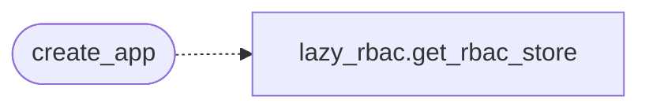

# `lazyc2.app_factory`

> Source: [lazyc2/app_factory.py:1](../../lazyc2/app_factory.py#L1) | language `py` | coverage 100.0% | [API index](../index.md)

Flask application factory for the LazyOwn C2 server.

Consolidates app creation, security policy initialisation, extension wiring,
and blueprint registration. Call [`create_app`](#create_app) to get a fully-wired
`Flask` instance instead of relying on the monolithic ``lazyc2.py``
module-level globals.

Usage::

    from lazyc2.app_factory import create_app
    app = create_app()
    app.run()

## Contents

- **Functions:** [`create_app`](#create_app)

## Call Graph

Solid arrows stay in this module, dashed arrows leave it.



## Functions

<a id="create_app"></a>

### `create_app`

`function` | [lazyc2/app_factory.py:90](../../lazyc2/app_factory.py#L90)

```python
def create_app() -> Flask
```

Create and return a fully configured C2 Flask application.

**Returns:** `Flask` - A `Flask` instance ready to run or serve via WSGI.

*Calls:* [`get_rbac_store`](modules.lazy_rbac.py.md#get_rbac_store)

---
