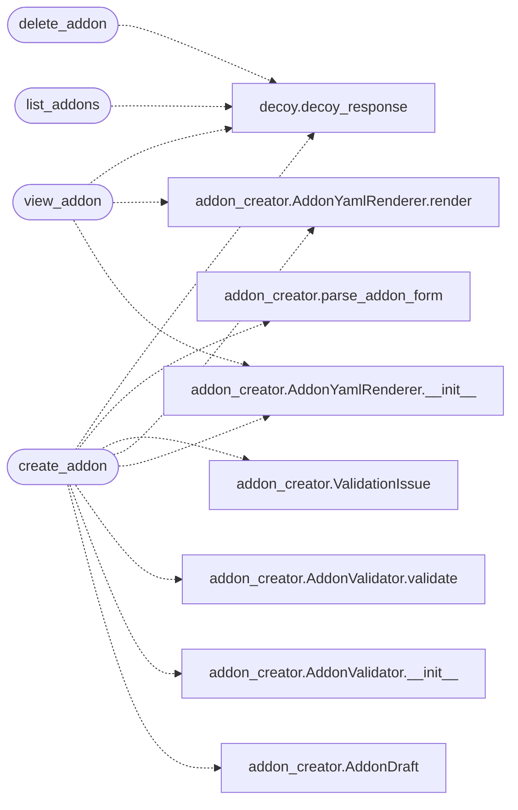

# `lazyc2.blueprints.addons`

> Source: [lazyc2/blueprints/addons.py:1](../../lazyc2/blueprints/addons.py#L1) | language `py` | coverage 100.0% | [API index](../index.md)

LazyAddon creator blueprint for the C2 dashboard.

Exposes the addon lifecycle under ``/addons``: a list page, the guided
creation form (GET and POST), a rendered YAML preview page, and a
delete endpoint. All mutating routes enforce the per-session CSRF token
issued on the form page.

Design (SOLID):
    - Single Responsibility: this module only adapts HTTP requests to
      the `[`lazyc2.addon_creator`](lazyc2.addon_creator.py.md)` contract and templates
    - Open/Closed: new pages reuse the same store and policy helpers
    - Liskov: every route returns plain Flask responses like the rest
      of the dashboard
    - Interface Segregation: small helpers, no shared mutable globals
    - Dependency Inversion: depends on the addon creator contract,
      never on the ``lazyc2.py`` monolith internals

## Contents

- **Functions:** [`init_addons_bp`](#init_addons_bp), [`csrf_protect`](#csrf_protect), [`list_addons`](#list_addons), [`create_addon`](#create_addon), [`view_addon`](#view_addon), [`delete_addon`](#delete_addon)

## Call Graph

Solid arrows stay in this module, dashed arrows leave it.



## Functions

<a id="init_addons_bp"></a>

### `init_addons_bp`

`function` | [lazyc2/blueprints/addons.py:69](../../lazyc2/blueprints/addons.py#L69)

```python
def init_addons_bp(base_dir: str | None = None) -> None
```

Configure the blueprint state before registration.

**Parameters**

| Name | Type | Default | Description |
|---|---|---|---|
| `base_dir` | `str \| None` | `None` | Optional addons directory override. When omitted the value stored on the app config under ``LAZYOWN_ADDONS_DIR`` or the contract default is used. |

---

<a id="csrf_protect"></a>

### `csrf_protect`

`function` | [lazyc2/blueprints/addons.py:96](../../lazyc2/blueprints/addons.py#L96)

```python
def csrf_protect(view: Callable[..., Response]) -> Callable[..., Response]
```

Decorate a view so mutating requests must echo the CSRF token.

Safe methods pass through untouched; unsafe methods must present a
token bound to the stable client cookie issued on the form page.

**Parameters**

| Name | Type | Default | Description |
|---|---|---|---|
| `view` | `Callable[..., Response]` |  | The Flask view function to wrap. |

**Returns:** `Callable[..., Response]` - The wrapped view returning 403 JSON when the token is invalid.

---

<a id="list_addons"></a>

### `list_addons`

`function` | [lazyc2/blueprints/addons.py:263](../../lazyc2/blueprints/addons.py#L263)

Decorators: `@addons_bp.route('/addons')`

```python
def list_addons()
```

Render the addon dashboard list page with a fresh CSRF token.

*Calls:* [`decoy_response`](lazyc2.extensions.decoy.py.md#decoy_response)

---

<a id="create_addon"></a>

### `create_addon`

`function` | [lazyc2/blueprints/addons.py:277](../../lazyc2/blueprints/addons.py#L277)

Decorators: `@addons_bp.route('/addons/create', methods=['GET', 'POST'])`, `@csrf_protect`

```python
def create_addon()
```

Render the creation form and persist valid addon submissions.

**Returns:** On GET the guided form. On POST either the re-rendered form
with per-field errors or a redirect to the YAML preview.

*Calls:* [`AddonDraft`](lazyc2.addon_creator.py.md#addondraft), [`AddonValidator.__init__`](lazyc2.addon_creator.py.md#addonvalidator-__init__), [`AddonValidator.validate`](lazyc2.addon_creator.py.md#addonvalidator-validate), [`AddonYamlRenderer.__init__`](lazyc2.addon_creator.py.md#addonyamlrenderer-__init__), [`AddonYamlRenderer.render`](lazyc2.addon_creator.py.md#addonyamlrenderer-render), [`ValidationIssue`](lazyc2.addon_creator.py.md#validationissue), [`parse_addon_form`](lazyc2.addon_creator.py.md#parse_addon_form), [`decoy_response`](lazyc2.extensions.decoy.py.md#decoy_response)

---

<a id="view_addon"></a>

### `view_addon`

`function` | [lazyc2/blueprints/addons.py:321](../../lazyc2/blueprints/addons.py#L321)

Decorators: `@addons_bp.route('/addons/<name>/view')`

```python
def view_addon(name: str)
```

Render the persisted YAML document for an addon.

**Parameters**

| Name | Type | Default | Description |
|---|---|---|---|
| `name` | `str` |  | The addon name to preview. |

**Returns:** The preview page or a redirect to the list when missing.

*Calls:* [`AddonYamlRenderer.__init__`](lazyc2.addon_creator.py.md#addonyamlrenderer-__init__), [`AddonYamlRenderer.render`](lazyc2.addon_creator.py.md#addonyamlrenderer-render), [`decoy_response`](lazyc2.extensions.decoy.py.md#decoy_response)

---

<a id="delete_addon"></a>

### `delete_addon`

`function` | [lazyc2/blueprints/addons.py:345](../../lazyc2/blueprints/addons.py#L345)

Decorators: `@addons_bp.route('/addons/<name>/delete', methods=['POST'])`, `@csrf_protect`

```python
def delete_addon(name: str)
```

Delete an addon file.

**Parameters**

| Name | Type | Default | Description |
|---|---|---|---|
| `name` | `str` |  | The addon name to remove. |

**Returns:** A redirect to the list page with a status flash.

*Calls:* [`decoy_response`](lazyc2.extensions.decoy.py.md#decoy_response)

---
