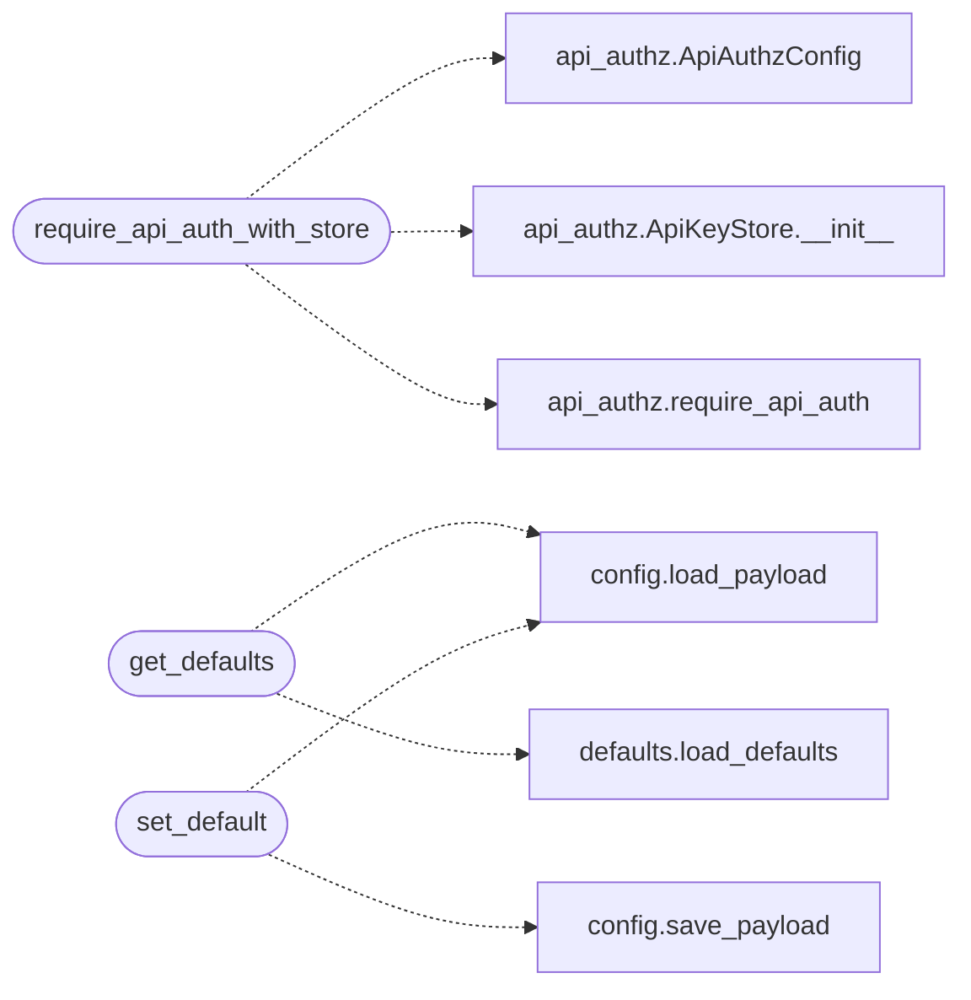

# `lazyc2.blueprints.api`

> Source: [lazyc2/blueprints/api.py:1](../../lazyc2/blueprints/api.py#L1) | language `py` | coverage 100.0% | [API index](../index.md)

API blueprint for the LazyOwn C2 server.

Provides REST endpoints for health checks, command execution, output
retrieval, and dashboard data. Registered under the ``/api`` prefix.

Every endpoint that mutates state or reads sensitive data requires
tenant-bound API authorization via `[`core.api_authz.require_api_auth`](core.api_authz.py.md#require_api_auth)`.

## Contents

- **Classes:** [`HealthConfig`](#healthconfig)
- **Functions:** [`health`](#health), [`ping`](#ping), [`require_api_auth_with_store`](#require_api_auth_with_store), [`health_tenant`](#health_tenant), [`get_defaults`](#get_defaults), [`set_default`](#set_default)

## Call Graph

Solid arrows stay in this module, dashed arrows leave it.



## Classes

<a id="healthconfig"></a>

### `HealthConfig`

`class` `dataclass` | [lazyc2/blueprints/api.py:25](../../lazyc2/blueprints/api.py#L25)

Decorators: `@dataclass`

```python
class HealthConfig
```

Configuration for the health-check subsystem.

**Attributes**

| Name | Type | Default | Description |
|---|---|---|---|
| [`required_components`](#healthconfig-required_components) | `tuple[str, ...]` | `('database', 'listeners', 'beacons')` |  |
| [`degraded_threshold_beacons`](#healthconfig-degraded_threshold_beacons) | `int` | `0` |  |

---

## Functions

<a id="health"></a>

### `health`

`function` | [lazyc2/blueprints/api.py:108](../../lazyc2/blueprints/api.py#L108)

Decorators: `@api_bp.route('/health', methods=['GET'])`

```python
def health()
```

Health-check endpoint returning subsystem status.

**Returns:** 200 with JSON containing status of database, listeners,
beacons, uptime, and an overall ``status`` field
(``healthy``, ``degraded``, or ``unhealthy``).

---

<a id="ping"></a>

### `ping`

`function` | [lazyc2/blueprints/api.py:120](../../lazyc2/blueprints/api.py#L120)

Decorators: `@api_bp.route('/ping', methods=['GET'])`

```python
def ping()
```

Lightweight liveness probe.

**Returns:** 200 with ``{"status": "ok"}``.

---

<a id="require_api_auth_with_store"></a>

### `require_api_auth_with_store`

`function` | [lazyc2/blueprints/api.py:129](../../lazyc2/blueprints/api.py#L129)

```python
def require_api_auth_with_store(view)
```

Protect a view with the app-scoped API key store.

Resolves the store from the Flask app config at request time so the
route stays decoupled from application construction order.

**Parameters**

| Name | Type | Default | Description |
|---|---|---|---|
| `view` |  |  | The Flask view function to protect. |

**Returns:** The view wrapped by [`core.api_authz.require_api_auth`](core.api_authz.py.md#require_api_auth).

*Calls:* [`ApiAuthzConfig`](core.api_authz.py.md#apiauthzconfig), [`ApiKeyStore.__init__`](core.api_authz.py.md#apikeystore-__init__), [`require_api_auth`](core.api_authz.py.md#require_api_auth)

---

<a id="health_tenant"></a>

### `health_tenant`

`function` | [lazyc2/blueprints/api.py:157](../../lazyc2/blueprints/api.py#L157)

Decorators: `@api_bp.route('/health/tenant', methods=['GET'])`, `@require_api_auth_with_store`

```python
def health_tenant()
```

Health-check scoped to the current authenticated tenant.

Requires a valid API key bound to a tenant. Returns tenant-scoped
metrics in addition to the standard health data.

**Returns:** 200 with health data plus ``tenant_id`` and tenant-scoped
beacon/listener counts. 401 when the API key is missing or
invalid, 403 when the key is not tenant-scoped.

---

<a id="get_defaults"></a>

### `get_defaults`

`function` | [lazyc2/blueprints/api.py:182](../../lazyc2/blueprints/api.py#L182)

Decorators: `@api_bp.route('/defaults', methods=['GET'])`

```python
def get_defaults()
```

Return build-time defaults alongside live payload values.

Mirrors the ``defaults show`` CLI command for the web GUI.

**Returns:** 200 with ``{"defaults": {...}, "live": {...}}``.

*Calls:* [`load_payload`](core.config.py.md#load_payload), [`load_defaults`](core.defaults.py.md#load_defaults)

---

<a id="set_default"></a>

### `set_default`

`function` | [lazyc2/blueprints/api.py:210](../../lazyc2/blueprints/api.py#L210)

Decorators: `@api_bp.route('/defaults', methods=['POST'])`, `@require_api_auth_with_store`

```python
def set_default()
```

Persist a per-engagement override for a build default.

Mirrors ``defaults set <name> <value>`` for the web GUI. Only
``wordlist``, ``lport`` and ``rport`` are overridable, and values
land in ``payload.json`` through the canonical writer; the TOML
file is never rewritten.

**Returns:** 200 with the stored ``{name, value}``. 400 on bad input,
401/403 on auth failures.

*Calls:* [`load_payload`](core.config.py.md#load_payload), [`save_payload`](core.config.py.md#save_payload)

---
