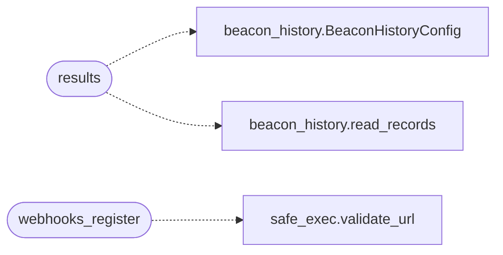

# `lazyc2.blueprints.api_v1`

> Source: [lazyc2/blueprints/api_v1.py:1](../../lazyc2/blueprints/api_v1.py#L1) | language `py` | coverage 100.0% | [API index](../index.md)

Versioned REST API (``/api/v1``) for the LazyOwn C2 server.

Programmatic interface for SIEM/SOAR integration, custom dashboards, and
CI/CD pipelines. Every endpoint except ``/health`` requires a tenant-bound
API key (``X-API-Key`` header, see `[`core.api_authz`](core.api_authz.py.md)`).

Endpoints:

- ``GET /api/v1/health`` — public service status.
- ``GET /api/v1/targets`` — hosts in scope from the campaign database.
- ``GET /api/v1/results`` — beacon task results, optionally per client.
- ``GET /api/v1/campaigns`` — autonomous campaign/objective status.
- ``GET /api/v1/webhooks`` — registered result webhooks.
- ``POST /api/v1/webhooks`` — register a result webhook URL.
- ``DELETE /api/v1/webhooks/<index>`` — remove a registered webhook.

## Contents

- **Functions:** [`health`](#health), [`targets`](#targets), [`results`](#results), [`campaigns`](#campaigns), [`webhooks_list`](#webhooks_list), [`webhooks_register`](#webhooks_register), [`webhooks_delete`](#webhooks_delete)
- **Constants:** [`WEBHOOKS_FILE`](#webhooks_file), [`OBJECTIVES_FILE`](#objectives_file), [`WORLD_MODEL_FILE`](#world_model_file)

## Call Graph

Solid arrows stay in this module, dashed arrows leave it.



## Functions

<a id="health"></a>

### `health`

`function` | [lazyc2/blueprints/api_v1.py:65](../../lazyc2/blueprints/api_v1.py#L65)

Decorators: `@api_v1_bp.route('/health', methods=['GET'])`

```python
def health() -> Any
```

Public service status (same payload as ``/api/health``).

**Returns:** `Any` - 200 with subsystem status, uptime, and an overall status field.

---

<a id="targets"></a>

### `targets`

`function` | [lazyc2/blueprints/api_v1.py:76](../../lazyc2/blueprints/api_v1.py#L76)

Decorators: `@api_v1_bp.route('/targets', methods=['GET'])`, `@require_api_auth_with_store`

```python
def targets() -> Any
```

List in-scope hosts from the campaign database.

Query args:
    workspace: Workspace name (default ``"default"``).

**Returns:** `Any` - 200 with the workspace name and its hosts (each with services).
503 when the campaign database is unavailable.

---

<a id="results"></a>

### `results`

`function` | [lazyc2/blueprints/api_v1.py:108](../../lazyc2/blueprints/api_v1.py#L108)

Decorators: `@api_v1_bp.route('/results', methods=['GET'])`, `@require_api_auth_with_store`

```python
def results() -> Any
```

Return beacon task results.

Query args:
    client_id: When given, only that beacon's history. Otherwise the
        latest record per known beacon plus the client id list.

**Returns:** `Any` - 200 with records (oldest first per beacon).

*Calls:* [`BeaconHistoryConfig`](modules.beacon_history.py.md#beaconhistoryconfig), [`read_records`](modules.beacon_history.py.md#read_records)

---

<a id="campaigns"></a>

### `campaigns`

`function` | [lazyc2/blueprints/api_v1.py:141](../../lazyc2/blueprints/api_v1.py#L141)

Decorators: `@api_v1_bp.route('/campaigns', methods=['GET'])`, `@require_api_auth_with_store`

```python
def campaigns() -> Any
```

Report autonomous campaign status from operational state files.

**Returns:** `Any` - 200 with the current kill-chain phase (world model, when present)
and pending objective counts. State files are best-effort: missing
files yield empty sections, never errors.

---

<a id="webhooks_list"></a>

### `webhooks_list`

`function` | [lazyc2/blueprints/api_v1.py:180](../../lazyc2/blueprints/api_v1.py#L180)

Decorators: `@api_v1_bp.route('/webhooks', methods=['GET'])`, `@require_api_auth_with_store`

```python
def webhooks_list() -> Any
```

List registered result webhooks.

**Returns:** `Any` - 200 with the webhook list (URL + event filter each).

---

<a id="webhooks_register"></a>

### `webhooks_register`

`function` | [lazyc2/blueprints/api_v1.py:191](../../lazyc2/blueprints/api_v1.py#L191)

Decorators: `@api_v1_bp.route('/webhooks', methods=['POST'])`, `@require_api_auth_with_store`

```python
def webhooks_register() -> Any
```

Register a result webhook URL.

Body (JSON): ``{"url": "https://...", "events": ["results"]}``.
The URL must be http(s); anything else is rejected.

**Returns:** `Any` - 201 with the stored entry and its index. 400 on bad input.

*Calls:* [`validate_url`](core.safe_exec.py.md#validate_url)

---

<a id="webhooks_delete"></a>

### `webhooks_delete`

`function` | [lazyc2/blueprints/api_v1.py:228](../../lazyc2/blueprints/api_v1.py#L228)

Decorators: `@api_v1_bp.route('/webhooks/<int:index>', methods=['DELETE'])`, `@require_api_auth_with_store`

```python
def webhooks_delete(index: int) -> Any
```

Remove a registered webhook by index.

**Parameters**

| Name | Type | Default | Description |
|---|---|---|---|
| `index` | `int` |  |  |

**Returns:** `Any` - 200 with the removed entry. 404 when the index does not exist.

---

## Constants

<a id="webhooks_file"></a>

### `WEBHOOKS_FILE`

`constant` | [lazyc2/blueprints/api_v1.py:33](../../lazyc2/blueprints/api_v1.py#L33)

```python
WEBHOOKS_FILE = 'api_webhooks.json'
```

---

<a id="objectives_file"></a>

### `OBJECTIVES_FILE`

`constant` | [lazyc2/blueprints/api_v1.py:34](../../lazyc2/blueprints/api_v1.py#L34)

```python
OBJECTIVES_FILE = 'objectives.jsonl'
```

---

<a id="world_model_file"></a>

### `WORLD_MODEL_FILE`

`constant` | [lazyc2/blueprints/api_v1.py:35](../../lazyc2/blueprints/api_v1.py#L35)

```python
WORLD_MODEL_FILE = 'world_model.json'
```

---
