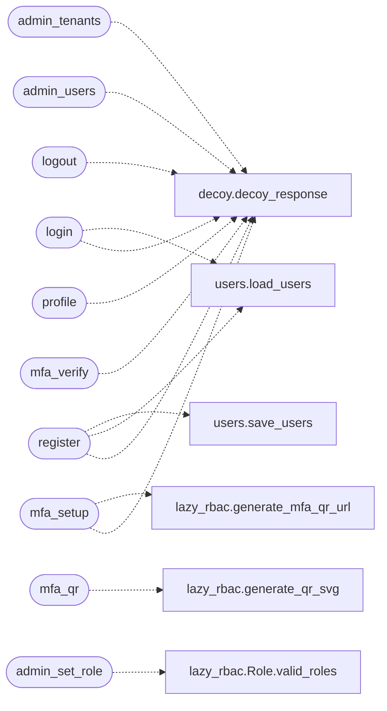

# `lazyc2.blueprints.auth`

> Source: [lazyc2/blueprints/auth.py:1](../../lazyc2/blueprints/auth.py#L1) | language `py` | coverage 6.7% | [API index](../index.md)

Authentication and authorisation blueprint for the LazyOwn C2 server.

Login, logout, registration, MFA setup/verification, profile, and
admin user/tenant management routes. Registered from within
``lazyc2.py`` so that ``url_for('index')`` and other lazyc2.py
routes are available.

## Contents

- **Functions:** [`register`](#register), [`login`](#login), [`mfa_setup`](#mfa_setup), [`mfa_qr`](#mfa_qr), [`mfa_verify`](#mfa_verify), [`profile`](#profile), [`logout`](#logout), [`admin_users`](#admin_users), [`admin_set_role`](#admin_set_role), [`admin_reset_mfa`](#admin_reset_mfa), [`admin_delete_user`](#admin_delete_user), [`admin_tenants`](#admin_tenants), [`admin_create_tenant`](#admin_create_tenant), [`admin_switch_tenant`](#admin_switch_tenant)

## Call Graph

Solid arrows stay in this module, dashed arrows leave it.



## Functions

<a id="register"></a>

### `register`

`function` | [lazyc2/blueprints/auth.py:96](../../lazyc2/blueprints/auth.py#L96)

Decorators: `@auth_bp.route('/register', methods=['GET', 'POST'])`

```python
def register()
```

*Calls:* [`decoy_response`](lazyc2.extensions.decoy.py.md#decoy_response), [`load_users`](lazyc2.extensions.users.py.md#load_users), [`save_users`](lazyc2.extensions.users.py.md#save_users)

---

<a id="login"></a>

### `login`

`function` | [lazyc2/blueprints/auth.py:155](../../lazyc2/blueprints/auth.py#L155)

Decorators: `@auth_bp.route('/login', methods=['GET', 'POST'])`

```python
def login()
```

*Calls:* [`decoy_response`](lazyc2.extensions.decoy.py.md#decoy_response), [`load_users`](lazyc2.extensions.users.py.md#load_users)

---

<a id="mfa_setup"></a>

### `mfa_setup`

`function` | [lazyc2/blueprints/auth.py:200](../../lazyc2/blueprints/auth.py#L200)

Decorators: `@auth_bp.route('/mfa/setup', methods=['GET', 'POST'])`, `@login_required`

```python
def mfa_setup()
```

*Calls:* [`decoy_response`](lazyc2.extensions.decoy.py.md#decoy_response), [`generate_mfa_qr_url`](modules.lazy_rbac.py.md#generate_mfa_qr_url)

---

<a id="mfa_qr"></a>

### `mfa_qr`

`function` | [lazyc2/blueprints/auth.py:273](../../lazyc2/blueprints/auth.py#L273)

Decorators: `@auth_bp.route('/mfa/qr/<username>')`, `@login_required`

```python
def mfa_qr(username)
```

**Parameters**

| Name | Type | Default | Description |
|---|---|---|---|
| `username` |  |  |  |

*Calls:* [`generate_qr_svg`](modules.lazy_rbac.py.md#generate_qr_svg)

---

<a id="mfa_verify"></a>

### `mfa_verify`

`function` | [lazyc2/blueprints/auth.py:295](../../lazyc2/blueprints/auth.py#L295)

Decorators: `@auth_bp.route('/mfa/verify', methods=['GET', 'POST'])`

```python
def mfa_verify()
```

*Calls:* [`decoy_response`](lazyc2.extensions.decoy.py.md#decoy_response)

---

<a id="profile"></a>

### `profile`

`function` | [lazyc2/blueprints/auth.py:339](../../lazyc2/blueprints/auth.py#L339)

Decorators: `@auth_bp.route('/profile')`, `@login_required`

```python
def profile()
```

*Calls:* [`decoy_response`](lazyc2.extensions.decoy.py.md#decoy_response)

---

<a id="logout"></a>

### `logout`

`function` | [lazyc2/blueprints/auth.py:364](../../lazyc2/blueprints/auth.py#L364)

Decorators: `@auth_bp.route('/logout')`, `@login_required`

```python
def logout()
```

*Calls:* [`decoy_response`](lazyc2.extensions.decoy.py.md#decoy_response)

---

<a id="admin_users"></a>

### `admin_users`

`function` | [lazyc2/blueprints/auth.py:383](../../lazyc2/blueprints/auth.py#L383)

Decorators: `@auth_bp.route('/admin/users')`, `@login_required`, `@require_role(Role.ADMIN.value)`

```python
def admin_users()
```

*Calls:* [`decoy_response`](lazyc2.extensions.decoy.py.md#decoy_response)

---

<a id="admin_set_role"></a>

### `admin_set_role`

`function` | [lazyc2/blueprints/auth.py:400](../../lazyc2/blueprints/auth.py#L400)

Decorators: `@auth_bp.route('/admin/users/<int:user_id>/role', methods=['POST'])`, `@login_required`, `@require_role(Role.ADMIN.value)`

```python
def admin_set_role(user_id)
```

**Parameters**

| Name | Type | Default | Description |
|---|---|---|---|
| `user_id` |  |  |  |

*Calls:* [`Role.valid_roles`](modules.lazy_rbac.py.md#role-valid_roles)

---

<a id="admin_reset_mfa"></a>

### `admin_reset_mfa`

`function` | [lazyc2/blueprints/auth.py:422](../../lazyc2/blueprints/auth.py#L422)

Decorators: `@auth_bp.route('/admin/users/<int:user_id>/mfa/reset', methods=['POST'])`, `@login_required`, `@require_role(Role.ADMIN.value)`

```python
def admin_reset_mfa(user_id)
```

**Parameters**

| Name | Type | Default | Description |
|---|---|---|---|
| `user_id` |  |  |  |

---

<a id="admin_delete_user"></a>

### `admin_delete_user`

`function` | [lazyc2/blueprints/auth.py:434](../../lazyc2/blueprints/auth.py#L434)

Decorators: `@auth_bp.route('/admin/users/<int:user_id>/delete', methods=['POST'])`, `@login_required`, `@require_role(Role.ADMIN.value)`

```python
def admin_delete_user(user_id)
```

**Parameters**

| Name | Type | Default | Description |
|---|---|---|---|
| `user_id` |  |  |  |

---

<a id="admin_tenants"></a>

### `admin_tenants`

`function` | [lazyc2/blueprints/auth.py:452](../../lazyc2/blueprints/auth.py#L452)

Decorators: `@auth_bp.route('/admin/tenants')`, `@login_required`

```python
def admin_tenants()
```

*Calls:* [`decoy_response`](lazyc2.extensions.decoy.py.md#decoy_response)

---

<a id="admin_create_tenant"></a>

### `admin_create_tenant`

`function` | [lazyc2/blueprints/auth.py:472](../../lazyc2/blueprints/auth.py#L472)

Decorators: `@auth_bp.route('/admin/tenants/create', methods=['POST'])`, `@login_required`

```python
def admin_create_tenant()
```

---

<a id="admin_switch_tenant"></a>

### `admin_switch_tenant`

`function` | [lazyc2/blueprints/auth.py:491](../../lazyc2/blueprints/auth.py#L491)

Decorators: `@auth_bp.route('/admin/tenants/<tenant_id>/switch', methods=['POST'])`, `@login_required`

```python
def admin_switch_tenant(tenant_id)
```

**Parameters**

| Name | Type | Default | Description |
|---|---|---|---|
| `tenant_id` |  |  |  |

---
